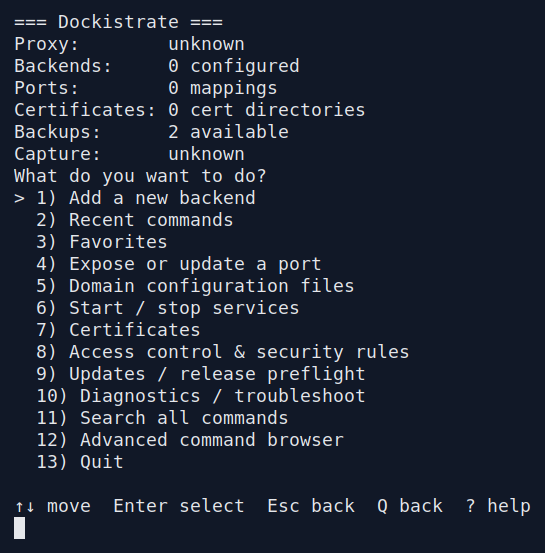
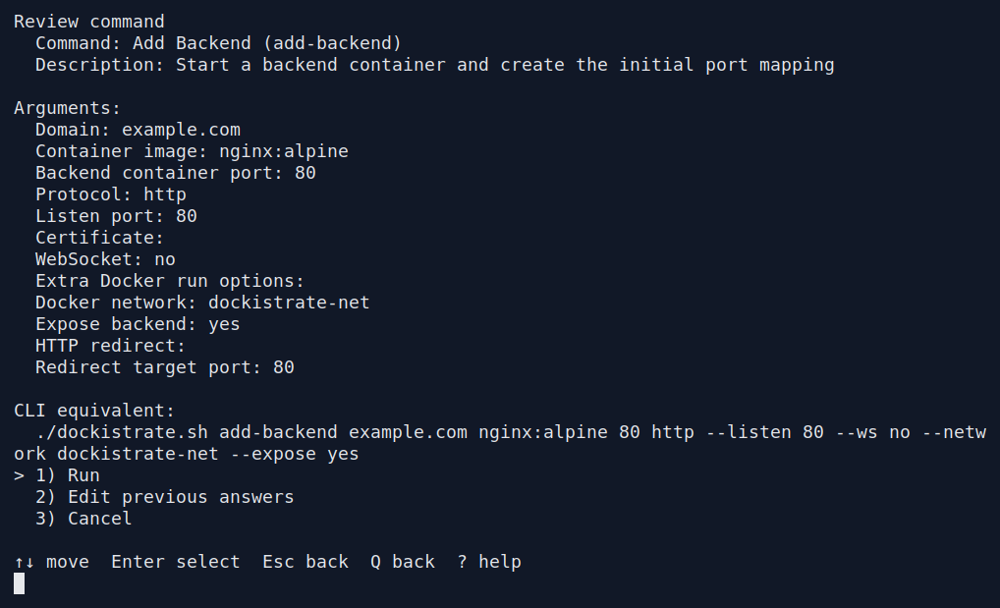
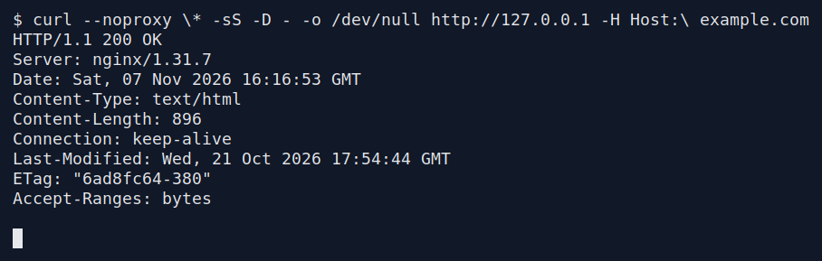

# Dockistrate

Dockistrate runs application containers behind a shared Nginx proxy. Its
interactive menus guide you through applications, ports, certificates, routing,
headers, and access rules. Review a change before running it, then check the
result. The same commands are available for automation.

It is built for trusted infrastructure operators with Docker access. Linux
and macOS are supported, including macOS Bash 3.2. Operators do not need Python.

**Upgrading from 1.x?** Version 2.0.0 requires state migration and
backend ownership setup. Back up configuration and application data, then follow
the [upgrade guide](docs/guides/updates.md#upgrading-from-101-to-200).

## Get started

Install Docker and OpenSSL. On macOS, keep Docker Desktop running. The examples
use `curl` to check application responses. See the
[requirements](CONTRIBUTING.md#setup) for development and test dependencies.

Clone the repository and choose a production release tag. Replace `vX.Y.Z`
with that tag; a detached HEAD is expected.

```bash
git clone https://github.com/nourae/dockistrate-oss.git
cd dockistrate-oss
git fetch --tags --prune origin
git checkout vX.Y.Z
./dockistrate.sh -i
```

<!-- walkthrough: readme-home -->



Choose a task from Home. [Read the captured text](docs/assets/interactive/core-all-http-backend/01-choose-a-task.txt).

<!-- /walkthrough: readme-home -->

Use the arrow keys and Enter, or the displayed numbers, to choose an item.
Press `?` for help. **Back**, Esc, or Q returns from a menu; at Home, Esc or Q
exits. In a text field, type `back` to revisit the previous step. Blank input
follows the displayed default. [Learn navigation, Search, Recent commands,
and Favorites](docs/guides/interactive-workflows.md).

## Your first application

<a id="1-serve-http"></a>

Start with a fresh demonstration installation and available ports 80 and 443.
Choose **Add a new backend**, enter `example.com`, select **HTTP**, and choose
`dockistrate-net`. Use `nginx:alpine`, container port `80`, and listen port `80`.
Keep WebSocket disabled, choose **Expose now**, and leave extra Docker options
empty. Review the values, then choose **Run**.

<!-- walkthrough: readme-review -->



Review the domain, image and ports before choosing Run. [Read the captured text](docs/assets/interactive/core-all-http-backend/13-review-the-http-backend.txt).

<!-- /walkthrough: readme-review -->

The proxy starts with the exposed backend. Fresh configurations deny requests
at both address layers. For this public demonstration, choose **Advanced
command browser → Backend Access Overrides → Set Backend ACL Policy**, select
`example.com`, choose `allow`, and run the change. Private applications should
keep the appropriate [client and connection-peer allowances](docs/guides/access-control-security-rules.md#address-layers-and-private-services).

Choose **Diagnostics / troubleshoot → Check Config**, then make a request:

```bash
curl --noproxy '*' -i http://127.0.0.1 -H 'Host: example.com'
```

<!-- walkthrough: readme-result -->



A request through the proxy returns HTTP 200 and the example application. [Read the captured text](docs/assets/interactive/core-all-verify-http/01-http-responds-successfully.txt).

<!-- /walkthrough: readme-result -->

A successful example returns `200 OK` and the Nginx welcome page. This local
request needs no DNS change. The [complete backend walkthrough](docs/guides/backends-and-ports.md)
shows the prompts, result, verification, and removal steps.

<a id="2-add-local-https"></a>
<a id="3-block-a-matching-request"></a>

Continue with [local HTTPS](docs/guides/tls-certificates-http3.md) or
[block and unblock a matching request](docs/guides/access-control-security-rules.md).
Each guide includes choices, screenshots, short explanations, verification,
and undo steps. Self-signed HTTPS is a local demonstration;
use a trusted certificate for public clients.

## Find your next task

| I want to… | Illustrated guide |
| --- | --- |
| Add applications, ports, or WebSockets | [Backends and ports](docs/guides/backends-and-ports.md) |
| Add a hostname or change inheritance | [Hosts and aliases](docs/guides/hosts-and-aliases.md) |
| Configure HTTPS, TLS, or HTTP/3 | [Certificates and TLS](docs/guides/tls-certificates-http3.md) |
| Require client certificates | [Mutual TLS](docs/guides/mutual-tls.md) |
| Control clients or requests | [Access controls](docs/guides/access-control-security-rules.md) |
| Route paths or change headers | [Routing](docs/guides/path-routing.md) · [Headers and client IPs](docs/guides/headers-real-ip-hsts-csp.md) |
| Investigate a problem | [Diagnostics, logs, and capture](docs/guides/diagnostics-capture.md) |
| Back up, recover, or upgrade | [Backup and recovery](docs/guides/backups-restore-cleanup.md) · [Updates](docs/guides/updates.md) |

The [documentation index](docs/README.md) maps every menu section to its guide.
Use **Search all commands** when you already know the operation's name.

## Edit configuration files

Each domain has editable CSV files under `state/domains/<domain>/config/`.
Manual edits remain pending until you choose **Domain configuration files →
Validate Domain Config → Apply Domain Config**. Preview the changes before
choosing **Apply changes**. Existing menu commands apply their changes
immediately, while protecting pending manual edits.

The [domain configuration guide](docs/guides/domain-configuration.md) explains
file editing, previews, application, and recovery. The last successful
configuration remains in `runtime/applied/` beneath the domain directory.

## Automation and reference

The review screen names each selected setting and includes the equivalent CLI
command. Commands needing no arguments show `(none)`. Start with:

```bash
./dockistrate.sh help
source completion/dockistrate-completion.bash
```

Use [advanced settings](docs/guides/advanced-nginx-docker-options.md) for Nginx
options, images, and runtime settings. Before an upgrade, back up and follow
the [update guide](docs/guides/updates.md). Application volumes and bind mounts
need their own backups; configuration backups alone do not protect that data.

See [contributing](CONTRIBUTING.md), the [security policy](SECURITY.md), and the
[function reference](docs/function-reference.md) for development and deeper
technical details. Dockistrate is independent of Docker, F5, NGINX, Certbot,
Let's Encrypt, and other integrated services. See [LICENSE](LICENSE).
