# Access Control and Security Rules

Use this guide to admit intended clients, block a matching request, and manage
the rules afterward. Start with `./dockistrate.sh -i`. The screenshots were
recorded on disposable servers. Recording details identify
the source revisions and checks for [access defaults](../assets/interactive/security-access-provenance.json),
[ACL lifecycle](../assets/interactive/security-acl-provenance.json), and
[request rules](../assets/interactive/security-rules-provenance.json).

**Before starting:** use an existing HTTP/HTTPS backend such as `example.com`,
know its listener port, and record its current policy with **Status**. Resolve
pending domain edits before an immediate command, or cancel and use the
[explicit apply workflow](domain-configuration.md). These changes can replace
the proxy and interrupt connections for every backend; see
[activation behavior](#when-policy-changes-take-effect).

List/show commands run directly without a mutation review. For **Remove…** or
**Revoke…**, choosing **Run** is followed by **Type YES to run this
destructive command:**; enter `YES` only when the displayed scope is intended.

## Walkthrough: allow a private client

1. Open **Access control & security rules → Add ACL** and choose `example.com`.
   Select **Apply to L7 and L3 (TCP uses client IP)**, then **Allow**.
2. Enter the actual client IPv4 address seen at both layers. `203.0.113.8` is a
   documentation example, not an address to copy for a local test. Review the
   domain, scope, action and address, then choose **Run**.

<!-- walkthrough: acl-rules -->

<details>
<summary>add-acl — inputs and result</summary>

1. Choose **example.com**.

   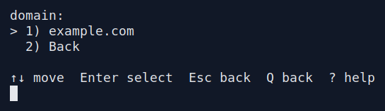

   [Read the captured terminal text](../assets/interactive/security-acl-acl-rules/03-example-com.txt)

2. Choose **Apply to L7 and L3 (TCP uses client IP)**.

   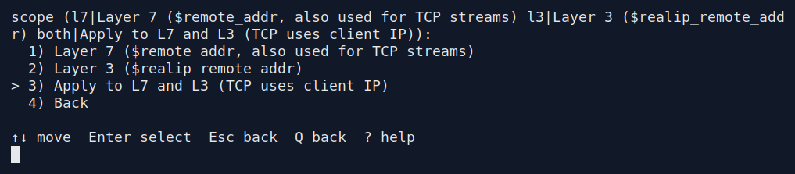

   [Read the captured terminal text](../assets/interactive/security-acl-acl-rules/04-apply-to-l7-and-l3-tcp-uses-client-ip.txt)

3. Choose **allow**.

   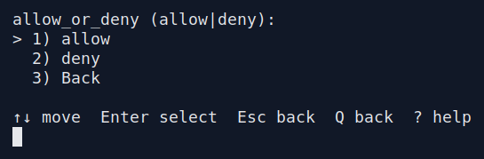

   [Read the captured terminal text](../assets/interactive/security-acl-acl-rules/05-allow.txt)

4. Enter `203.0.113.8`.

   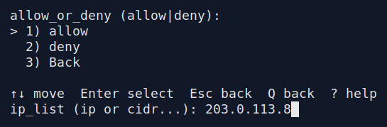

   [Read the captured terminal text](../assets/interactive/security-acl-acl-rules/06-enter-value.txt)

5. Review the collected inputs, then choose **Run**.

   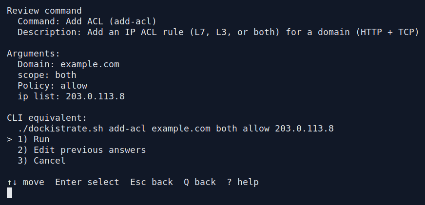

   [Read the captured terminal text](../assets/interactive/security-acl-acl-rules/07-run.txt)

6. Command result.

   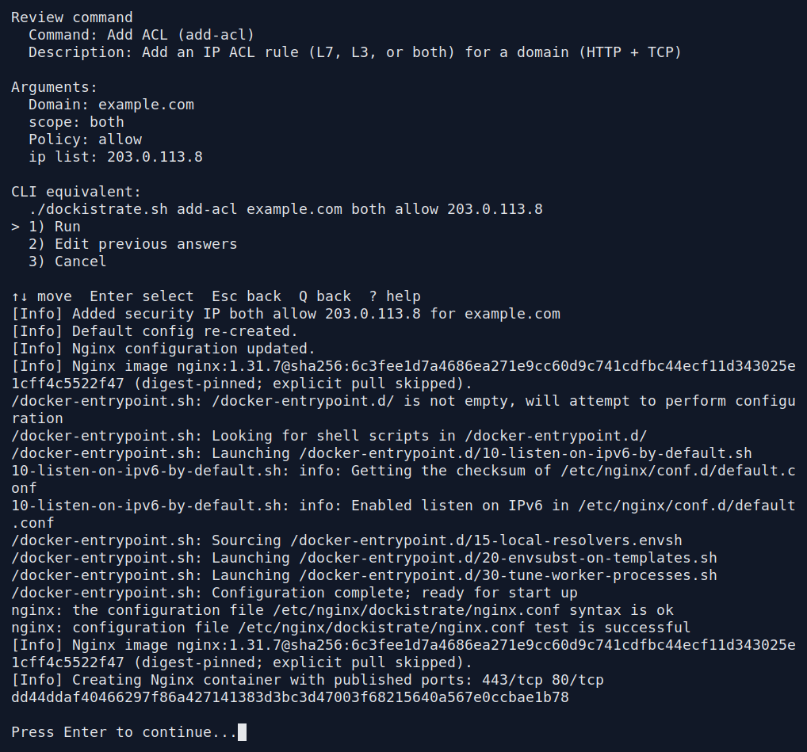

   [Read the captured terminal text](../assets/interactive/security-acl-acl-rules/08-command-result.txt)

</details>

<details>
<summary>list-acl — inputs and result</summary>

1. Command result.

   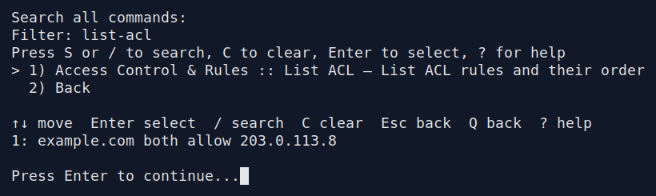

   [Read the captured terminal text](../assets/interactive/security-acl-list-acl/03-command-result.txt)

</details>

<details>
<summary>update-acl — inputs and result</summary>

1. Choose **example.com both allow 203.0.113.8**.

   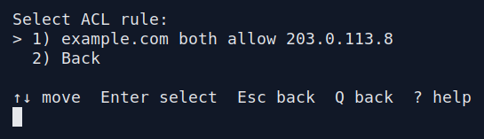

   [Read the captured terminal text](../assets/interactive/security-acl-update-acl/03-example-com-both-allow-203-0-113-8.txt)

2. Choose **Keep current: example.com**.

   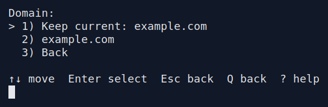

   [Read the captured terminal text](../assets/interactive/security-acl-update-acl/04-keep-current-example-com.txt)

3. Choose **Layer 7 (client IP; CIDR supported)**.

   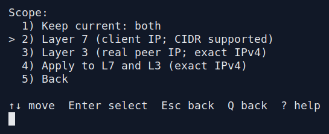

   [Read the captured terminal text](../assets/interactive/security-acl-update-acl/05-layer-7-client-ip-cidr-supported.txt)

4. Choose **Deny**.

   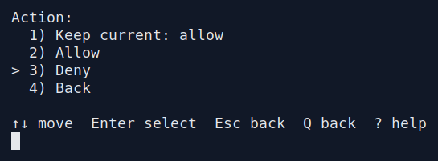

   [Read the captured terminal text](../assets/interactive/security-acl-update-acl/06-deny.txt)

5. Enter `203.0.113.0/24`.

   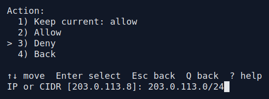

   [Read the captured terminal text](../assets/interactive/security-acl-update-acl/07-enter-value.txt)

6. Enter `403`.

   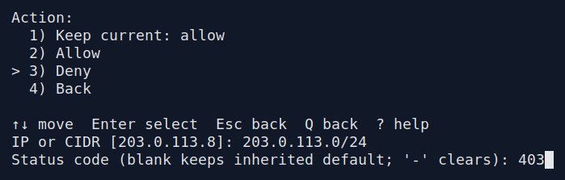

   [Read the captured terminal text](../assets/interactive/security-acl-update-acl/08-enter-value.txt)

7. Review the collected inputs, then choose **Run**.

   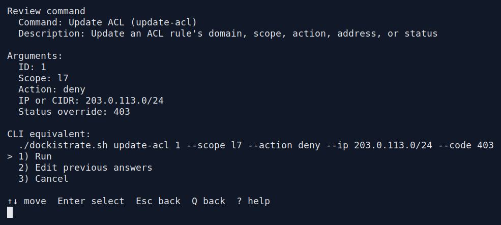

   [Read the captured terminal text](../assets/interactive/security-acl-update-acl/09-run.txt)

8. Command result.

   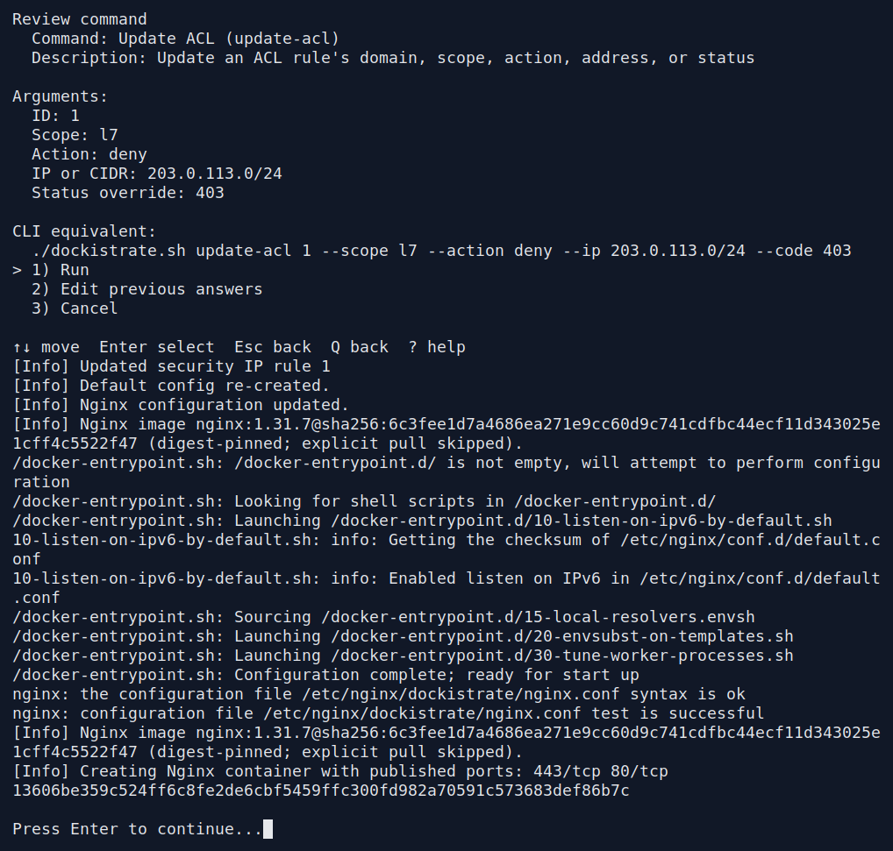

   [Read the captured terminal text](../assets/interactive/security-acl-update-acl/10-command-result.txt)

</details>

<details>
<summary>disable-acl — inputs and result</summary>

1. Choose **example.com l7 deny 203.0.113.0/24**.

   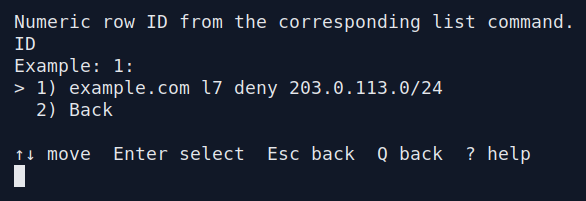

   [Read the captured terminal text](../assets/interactive/security-acl-disable-acl/03-example-com-l7-deny-203-0-113-0-24.txt)

2. Review the collected inputs, then choose **Run**.

   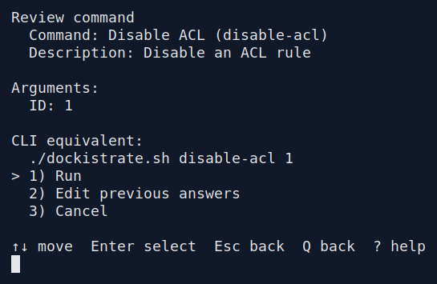

   [Read the captured terminal text](../assets/interactive/security-acl-disable-acl/04-run.txt)

3. Command result.

   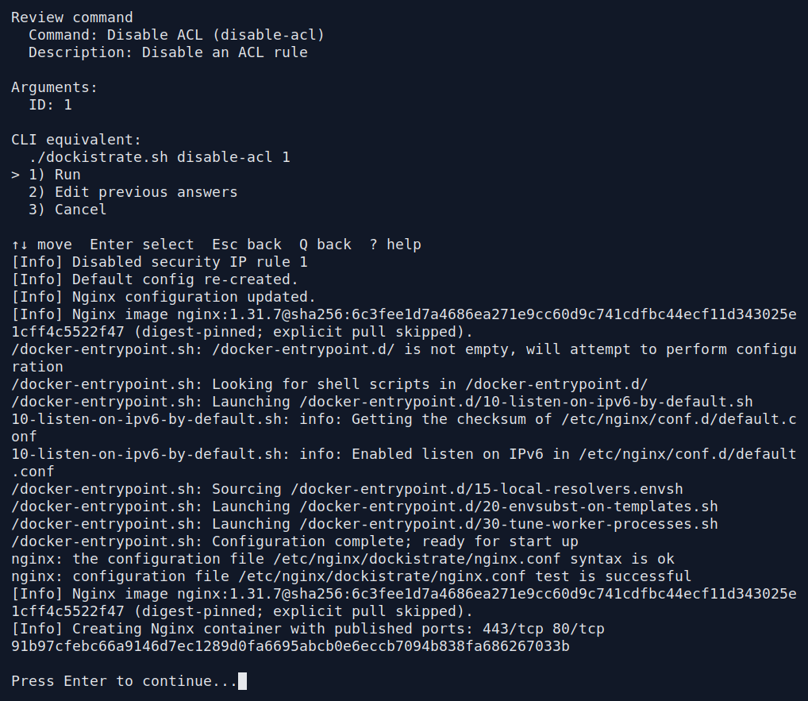

   [Read the captured terminal text](../assets/interactive/security-acl-disable-acl/05-command-result.txt)

</details>

<details>
<summary>enable-acl — inputs and result</summary>

1. Choose **example.com l7 deny 203.0.113.0/24 [disabled]**.

   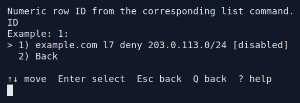

   [Read the captured terminal text](../assets/interactive/security-acl-enable-acl/03-example-com-l7-deny-203-0-113-0-24-disabled.txt)

2. Review the collected inputs, then choose **Run**.

   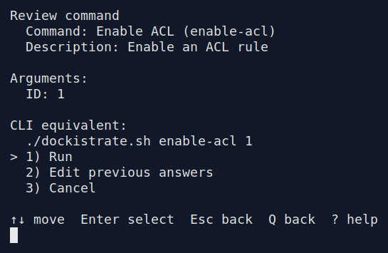

   [Read the captured terminal text](../assets/interactive/security-acl-enable-acl/04-run.txt)

3. Command result.

   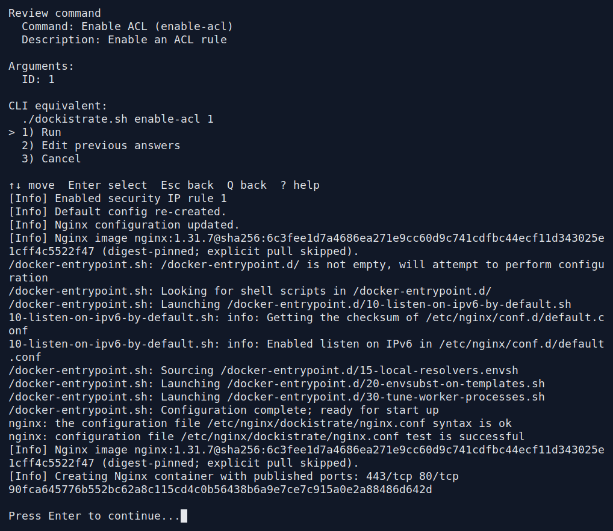

   [Read the captured terminal text](../assets/interactive/security-acl-enable-acl/05-command-result.txt)

</details>

<details>
<summary>add-acl — inputs and result</summary>

1. Choose **example.com**.

   

   [Read the captured terminal text](../assets/interactive/security-acl-acl-second-rule/03-example-com.txt)

2. Choose **Layer 7 ($remote_addr, also used for TCP streams)**.

   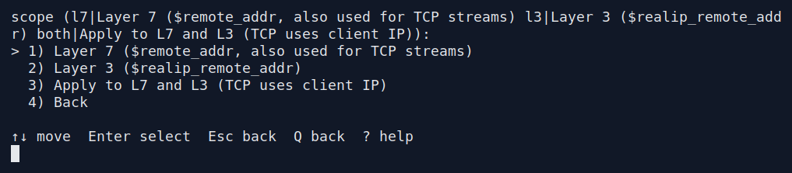

   [Read the captured terminal text](../assets/interactive/security-acl-acl-second-rule/04-layer-7-remote-addr-also-used-for-tcp-streams.txt)

3. Choose **allow**.

   

   [Read the captured terminal text](../assets/interactive/security-acl-acl-second-rule/05-allow.txt)

4. Enter `198.51.100.10`.

   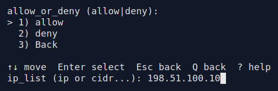

   [Read the captured terminal text](../assets/interactive/security-acl-acl-second-rule/06-enter-value.txt)

5. Review the collected inputs, then choose **Run**.

   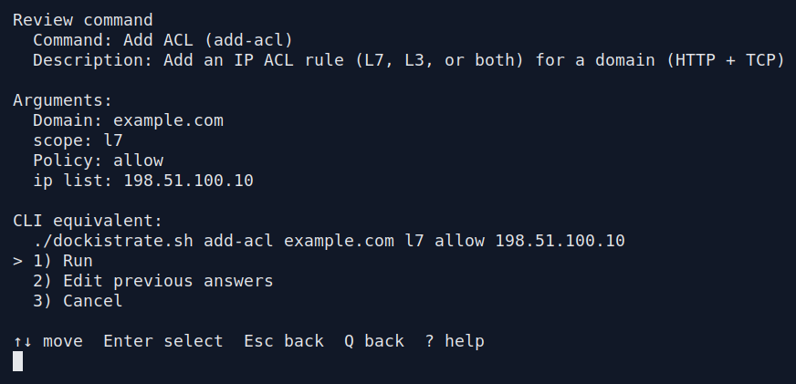

   [Read the captured terminal text](../assets/interactive/security-acl-acl-second-rule/07-run.txt)

6. Command result.

   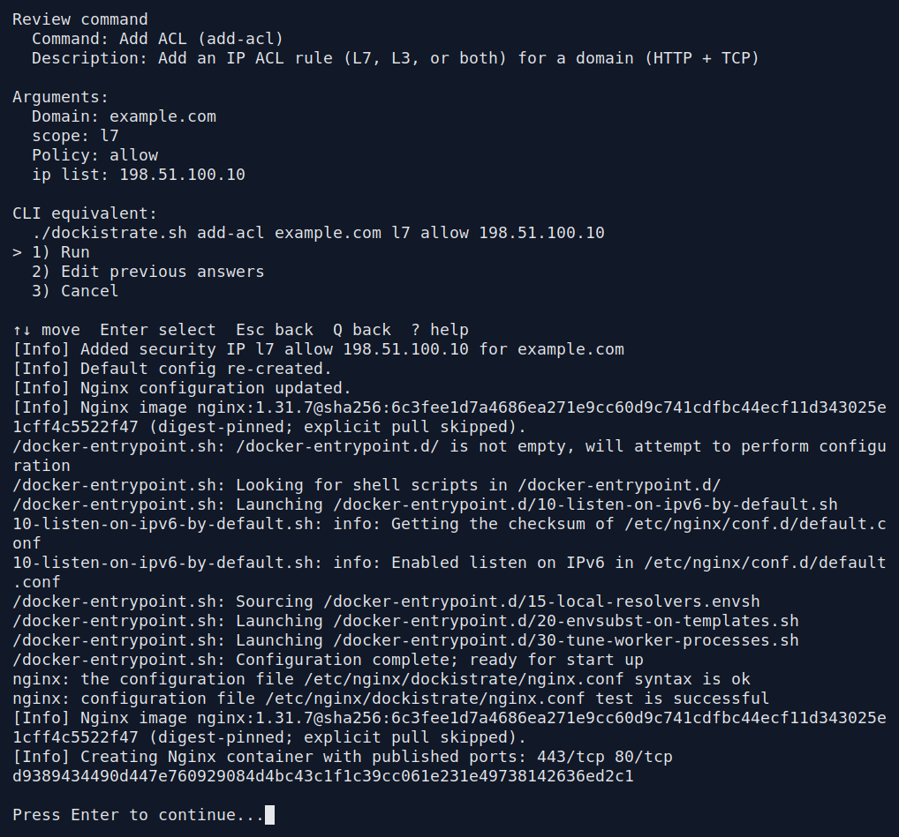

   [Read the captured terminal text](../assets/interactive/security-acl-acl-second-rule/08-command-result.txt)

</details>

<details>
<summary>move-acl-rule — inputs and result</summary>

1. Enter `2`.

   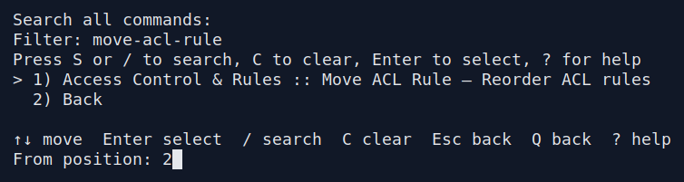

   [Read the captured terminal text](../assets/interactive/security-acl-move-acl-rule/03-enter-value.txt)

2. Enter `1`.

   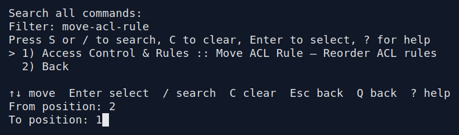

   [Read the captured terminal text](../assets/interactive/security-acl-move-acl-rule/04-enter-value.txt)

3. Review the collected inputs, then choose **Run**.

   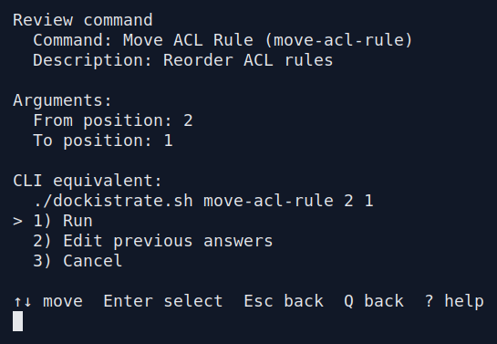

   [Read the captured terminal text](../assets/interactive/security-acl-move-acl-rule/05-run.txt)

4. Command result.

   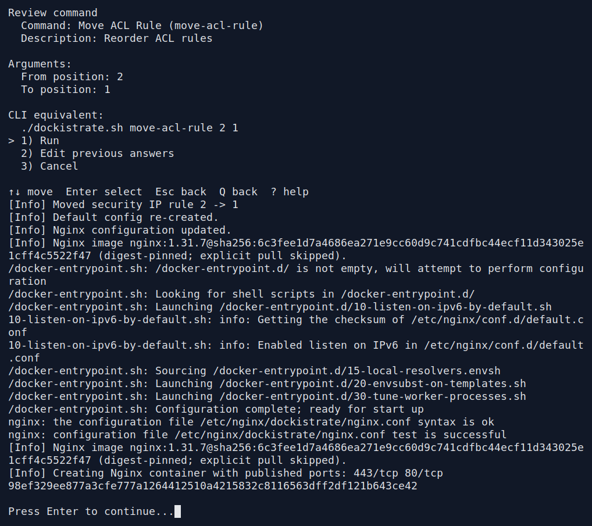

   [Read the captured terminal text](../assets/interactive/security-acl-move-acl-rule/06-command-result.txt)

</details>

<details>
<summary>disable-all-acl — inputs and result</summary>

1. Review the collected inputs, then choose **Run**.

   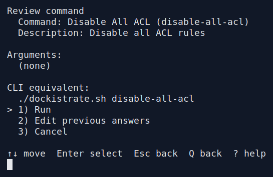

   [Read the captured terminal text](../assets/interactive/security-acl-disable-all-acl/03-run.txt)

2. Command result.

   

   [Read the captured terminal text](../assets/interactive/security-acl-disable-all-acl/04-command-result.txt)

</details>

<details>
<summary>enable-all-acl — inputs and result</summary>

1. Review the collected inputs, then choose **Run**.

   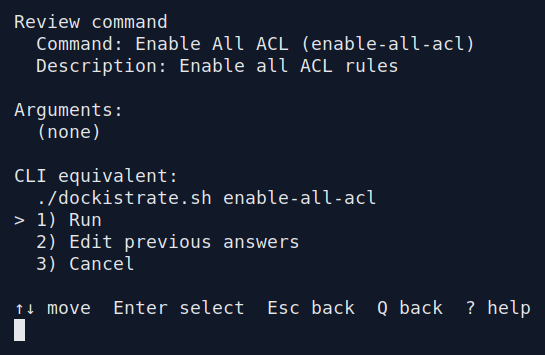

   [Read the captured terminal text](../assets/interactive/security-acl-enable-all-acl/03-run.txt)

2. Command result.

   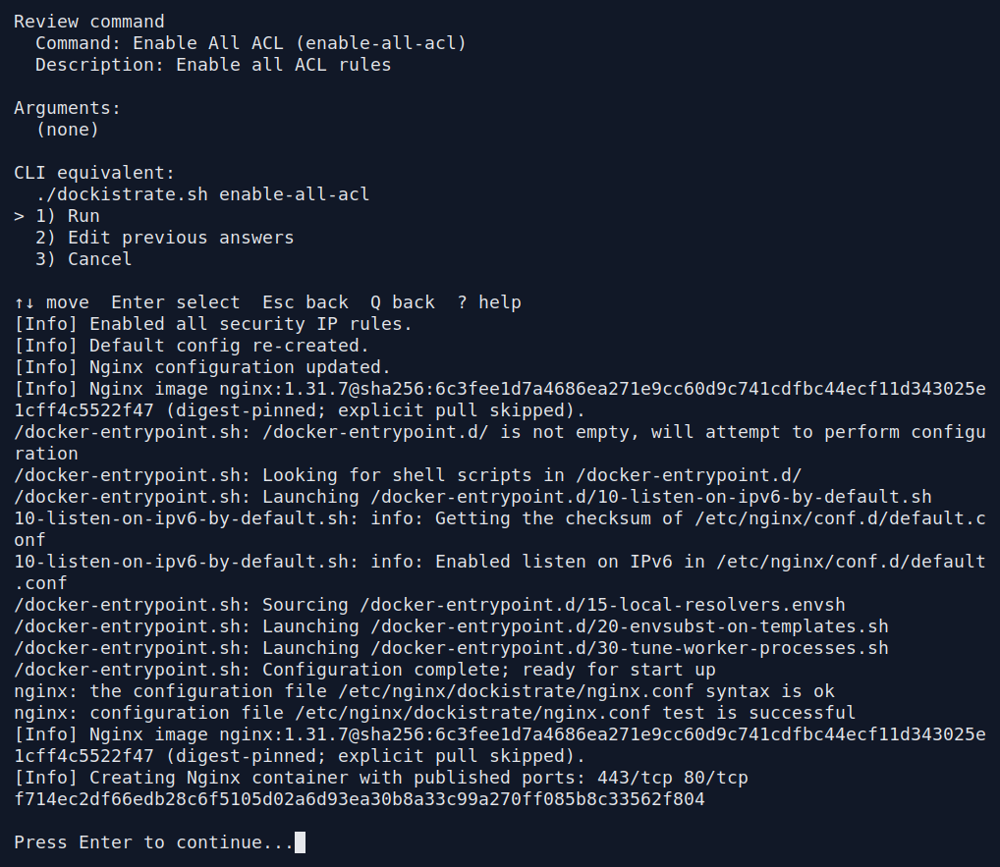

   [Read the captured terminal text](../assets/interactive/security-acl-enable-all-acl/04-command-result.txt)

</details>

<details>
<summary>remove-acl — inputs and result</summary>

1. Choose **example.com l7 allow 198.51.100.10**.

   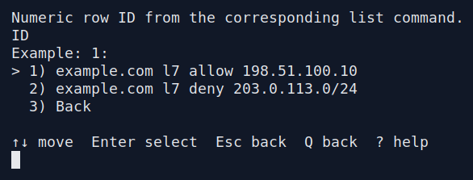

   [Read the captured terminal text](../assets/interactive/security-acl-remove-acl/03-example-com-l7-allow-198-51-100-10.txt)

2. Review the collected inputs, then choose **Run**.

   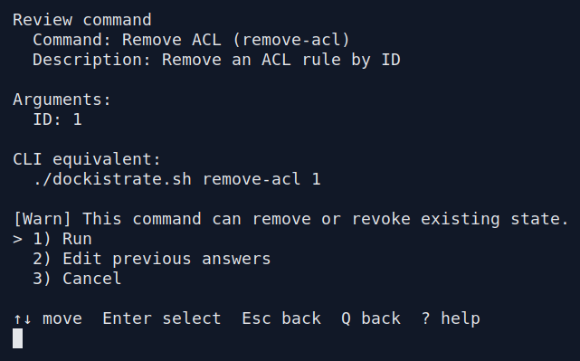

   [Read the captured terminal text](../assets/interactive/security-acl-remove-acl/04-run.txt)

3. Enter `YES`.

   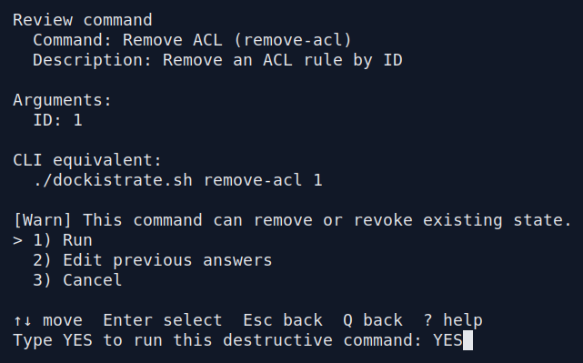

   [Read the captured terminal text](../assets/interactive/security-acl-remove-acl/05-enter-value.txt)

4. Command result.

   

   [Read the captured terminal text](../assets/interactive/security-acl-remove-acl/06-command-result.txt)

</details>

<details>
<summary>remove-all-acl — inputs and result</summary>

1. Choose **Cancel**.

   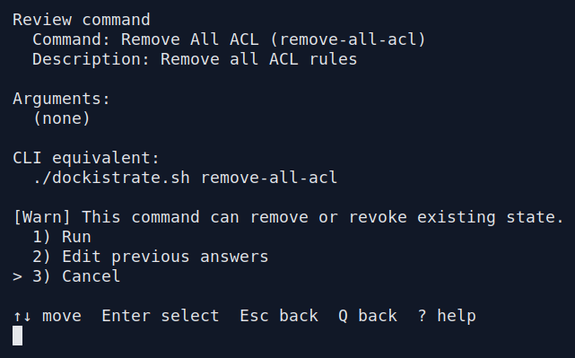

   [Read the captured terminal text](../assets/interactive/security-acl-acl-remove-all-cancel/03-cancel.txt)

2. Choose **Back**.

   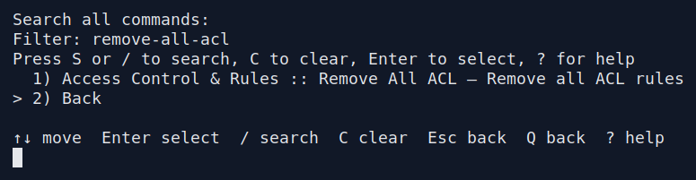

   [Read the captured terminal text](../assets/interactive/security-acl-acl-remove-all-cancel/04-return-without-running.txt)

</details>

<details>
<summary>remove-all-acl — inputs and result</summary>

1. Review the collected inputs, then choose **Run**.

   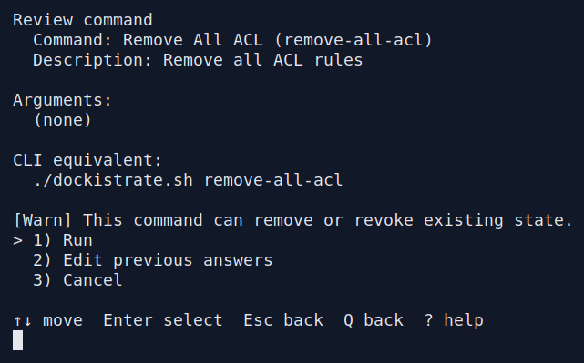

   [Read the captured terminal text](../assets/interactive/security-acl-remove-all-acl/03-run.txt)

2. Enter `YES`.

   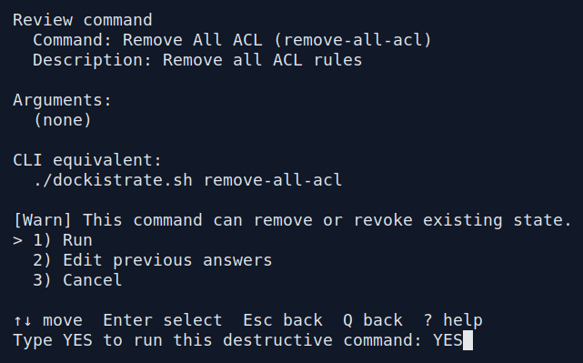

   [Read the captured terminal text](../assets/interactive/security-acl-remove-all-acl/04-enter-value.txt)

3. Command result.

   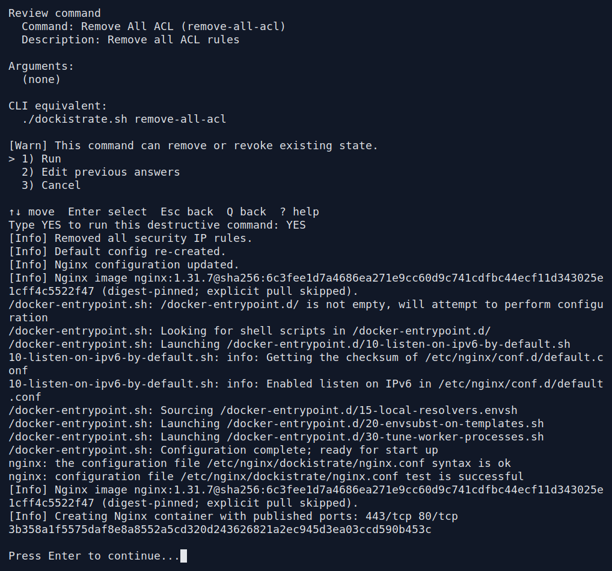

   [Read the captured terminal text](../assets/interactive/security-acl-remove-all-acl/05-command-result.txt)

</details>

<details>
<summary>list-acl — inputs and result</summary>

1. Command result.

   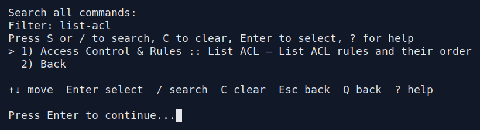

   [Read the captured terminal text](../assets/interactive/security-acl-acl-cleanup-result/03-command-result.txt)

</details>

<details>
<summary>check-config — inputs and result</summary>

1. Configuration test passed.

   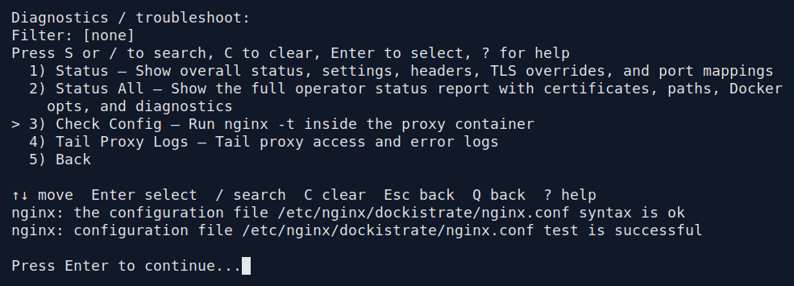

   [Read the captured terminal text](../assets/interactive/security-acl-acl-config/03-configuration-test-passed.txt)

</details>

<details>
<summary>add-acl — Deny an actual client and choose its rejection code</summary>

1. Choose **Layer 7 ($remote_addr, also used for TCP streams)**.

   

   [Read the captured terminal text](../assets/interactive/security-branches-acl-deny-client/04-layer-7-remote-addr-also-used-for-tcp-streams.txt)

2. Choose **deny**.

   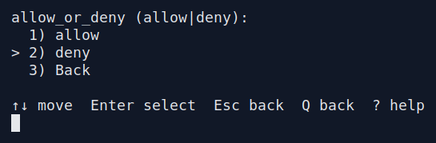

   [Read the captured terminal text](../assets/interactive/security-branches-acl-deny-client/05-deny.txt)

3. Enter `172.18.0.1`.

   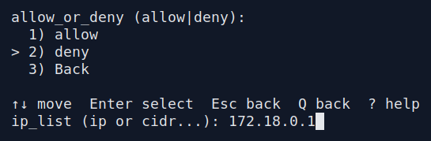

   [Read the captured terminal text](../assets/interactive/security-branches-acl-deny-client/06-enter-value.txt)

4. Enter `403`.

   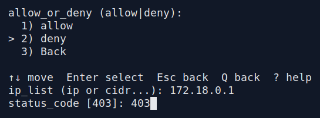

   [Read the captured terminal text](../assets/interactive/security-branches-acl-deny-client/07-enter-value.txt)

5. Review the collected inputs, then choose **Run**.

   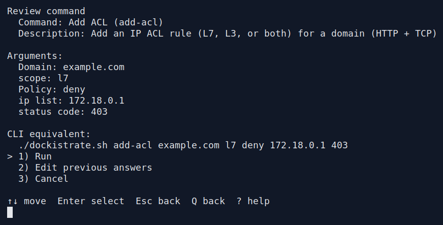

   [Read the captured terminal text](../assets/interactive/security-branches-acl-deny-client/08-run.txt)

6. Command result.

   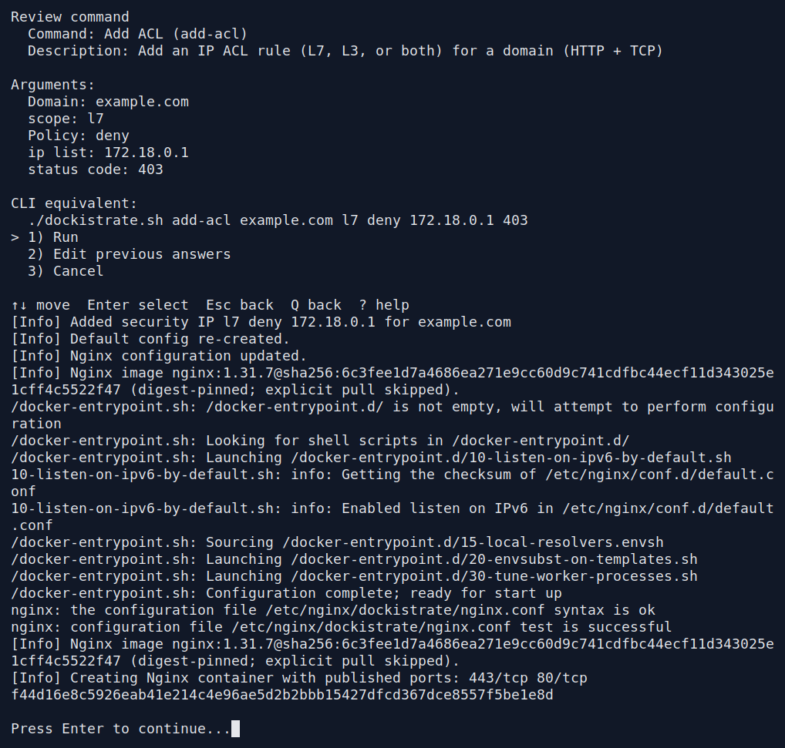

   [Read the captured terminal text](../assets/interactive/security-branches-acl-deny-client/09-command-result.txt)

</details>

<details>
<summary>The explicit address rule rejects this client</summary>

1. The explicit address rule rejects this client.

   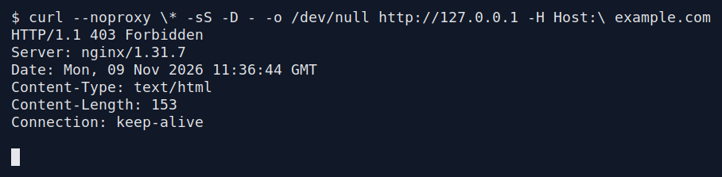

   [Read the captured terminal text](../assets/interactive/security-branches-acl-client-block-verified/01-the-explicit-address-rule-rejects-this-client.txt)

</details>

<details>
<summary>remove-acl — Remove the demonstration denial</summary>

1. Choose **example.com l7 deny 172.18.0.1**.

   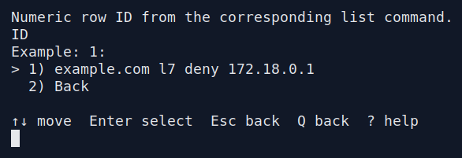

   [Read the captured terminal text](../assets/interactive/security-branches-acl-deny-client-remove/03-example-com-l7-deny-172-18-0-1.txt)

2. Review the collected inputs, then choose **Run**.

   

   [Read the captured terminal text](../assets/interactive/security-branches-acl-deny-client-remove/04-run.txt)

3. Enter `YES`.

   

   [Read the captured terminal text](../assets/interactive/security-branches-acl-deny-client-remove/05-enter-value.txt)

4. Command result.

   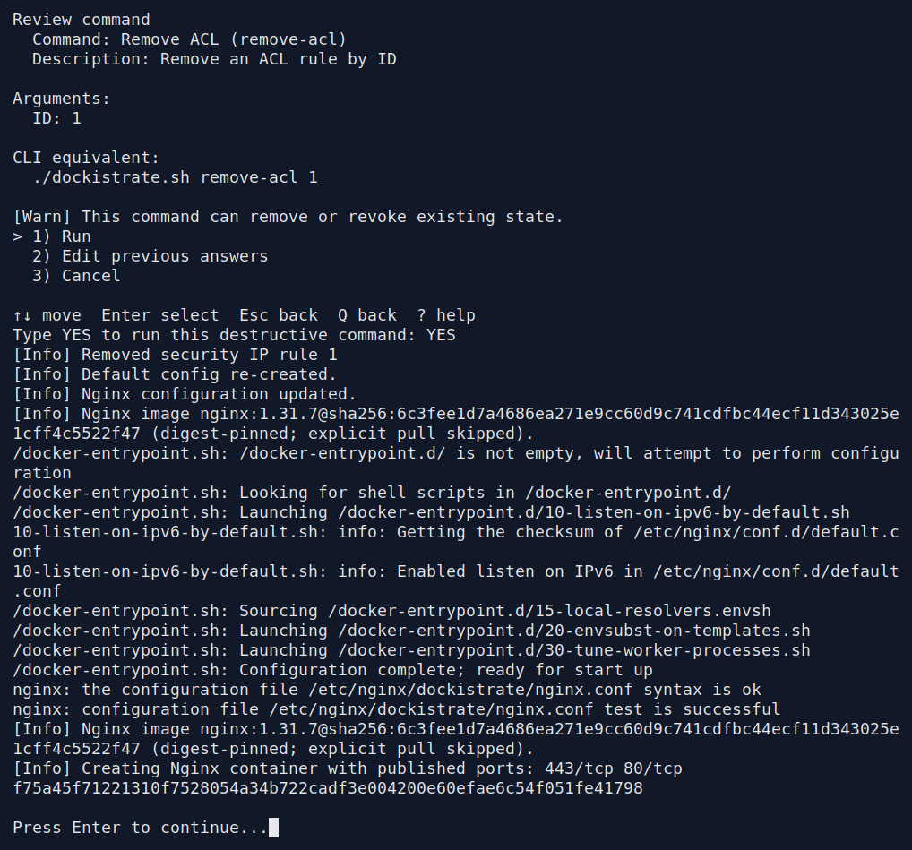

   [Read the captured terminal text](../assets/interactive/security-branches-acl-deny-client-remove/06-command-result.txt)

</details>

<!-- /walkthrough: acl-rules -->

3. Open **Advanced command browser → Backend Access Overrides → Set Backend
   ACL Policy**, choose `example.com`, then `deny`, review and **Run**. When
   client and original-peer addresses differ, add separate L7 and L3 allowances
   first, as described [below](#address-layers-and-private-services).
4. Choose **List ACL**, record the global rule ID, and run **Check Config**.
   Make a request from the allowed client and another from a disallowed client.
   The allowed request should reach the application; the other should be
   rejected. A successful configuration check alone does not prove this.
5. To undo the example, select **Remove ACL**, select its recorded ID, review
   and **Run**; restore the policy you recorded before starting. Removing the
   final allowance while policy is `deny` closes access.

CLI equivalents, after replacing the address with the one actually observed:

```bash
./dockistrate.sh add-acl example.com both allow 203.0.113.8
./dockistrate.sh set-backend-acl-policy example.com deny
./dockistrate.sh list-acl
./dockistrate.sh check-config
```

## Walkthrough: block a user agent, then undo

**Before starting:** establish an otherwise permitted baseline request. For an
intentionally public disposable demo, set the backend ACL policy to `allow`;
for a private service, retain its explicit allowances. Other access controls
still apply.

1. Open **Access control & security rules → Add Security Rule**. Choose
   `example.com`, **Block when conditions match**, condition count `1`, and
   status override `403`.
2. Select **Header**, enter `User-Agent`, select **Contains**, and enter
   `BadBot`. Check the domain, action and condition in **Security rule summary**,
   then select **Confirm**. This flow uses its own confirmation, without a
   second generic **Run** screen.

<!-- walkthrough: security-rules -->

<details>
<summary>add-security-rule — inputs and result</summary>

1. Choose **example.com**.

   

   [Read the captured terminal text](../assets/interactive/security-rules-security-rules/03-example-com.txt)

2. Choose **Block when conditions match (recommended for new rules)**.

   

   [Read the captured terminal text](../assets/interactive/security-rules-security-rules/04-block-when-conditions-match-recommended-for-new-rules.txt)

3. Enter `2`.

   

   [Read the captured terminal text](../assets/interactive/security-rules-security-rules/05-enter-value.txt)

4. Choose **and**.

   

   [Read the captured terminal text](../assets/interactive/security-rules-security-rules/06-and.txt)

5. Enter `403`.

   

   [Read the captured terminal text](../assets/interactive/security-rules-security-rules/07-enter-value.txt)

6. Choose **Header — request header (name required)**.

   

   [Read the captured terminal text](../assets/interactive/security-rules-security-rules/08-header-request-header-name-required.txt)

7. Enter `User-Agent`.

   

   [Read the captured terminal text](../assets/interactive/security-rules-security-rules/09-enter-value.txt)

8. Choose **Contains — substring present (case-insensitive). Example: header User-Agent contains debug**.

   

   [Read the captured terminal text](../assets/interactive/security-rules-security-rules/10-contains-substring-present-case-insensitive-example-header-user-agent-contains-d.txt)

9. Enter `BadBot`.

   

   [Read the captured terminal text](../assets/interactive/security-rules-security-rules/11-enter-value.txt)

10. Choose **Method — HTTP method (GET/POST/...)**.

    

    [Read the captured terminal text](../assets/interactive/security-rules-security-rules/12-method-http-method-get-post.txt)

11. Choose **Equals — string equals. Example: method - equals POST**.

    

    [Read the captured terminal text](../assets/interactive/security-rules-security-rules/13-equals-string-equals-example-method-equals-post.txt)

12. Enter `GET`.

    

    [Read the captured terminal text](../assets/interactive/security-rules-security-rules/14-enter-value.txt)

13. Choose **Confirm**.

    

    [Read the captured terminal text](../assets/interactive/security-rules-security-rules/15-confirm.txt)

14. Command result.

    

    [Read the captured terminal text](../assets/interactive/security-rules-security-rules/16-command-result.txt)

</details>

<details>
<summary>Verify the matching request is blocked</summary>

1. Verify the matching request is blocked.

   

   [Read the captured terminal text](../assets/interactive/security-rules-security-block-verified/01-verify-the-matching-request-is-blocked.txt)

</details>

<details>
<summary>set-security-rule-mode — inputs and result</summary>

1. Choose **AND example.com (n=2, mode=AND) action=block status=403 reason=- loc=auto**.

   

   [Read the captured terminal text](../assets/interactive/security-rules-set-security-rule-mode/03-and-example-com-n-2-mode-and-action-block-status-403-reason-loc-auto.txt)

2. Choose **or**.

   

   [Read the captured terminal text](../assets/interactive/security-rules-set-security-rule-mode/04-or.txt)

3. Review the collected inputs, then choose **Run**.

   

   [Read the captured terminal text](../assets/interactive/security-rules-set-security-rule-mode/05-run.txt)

4. Command result.

   

   [Read the captured terminal text](../assets/interactive/security-rules-set-security-rule-mode/06-command-result.txt)

</details>

<details>
<summary>set-security-rule-mode — inputs and result</summary>

1. Choose **OR example.com (n=2, mode=OR) action=block status=403 reason=- loc=auto**.

   

   [Read the captured terminal text](../assets/interactive/security-rules-security-mode-reset/03-or-example-com-n-2-mode-or-action-block-status-403-reason-loc-auto.txt)

2. Choose **and (current)**.

   

   [Read the captured terminal text](../assets/interactive/security-rules-security-mode-reset/04-and-current.txt)

3. Review the collected inputs, then choose **Run**.

   

   [Read the captured terminal text](../assets/interactive/security-rules-security-mode-reset/05-run.txt)

4. Command result.

   

   [Read the captured terminal text](../assets/interactive/security-rules-security-mode-reset/06-command-result.txt)

</details>

<details>
<summary>duplicate-security-rule — inputs and result</summary>

1. Enter `1`.

   

   [Read the captured terminal text](../assets/interactive/security-rules-duplicate-security-rule/03-enter-value.txt)

2. Review the collected inputs, then choose **Run**.

   

   [Read the captured terminal text](../assets/interactive/security-rules-duplicate-security-rule/04-run.txt)

3. Command result.

   

   [Read the captured terminal text](../assets/interactive/security-rules-duplicate-security-rule/05-command-result.txt)

</details>

<details>
<summary>move-security-rule — inputs and result</summary>

1. Enter `2`.

   

   [Read the captured terminal text](../assets/interactive/security-rules-move-security-rule/03-enter-value.txt)

2. Enter `1`.

   

   [Read the captured terminal text](../assets/interactive/security-rules-move-security-rule/04-enter-value.txt)

3. Review the collected inputs, then choose **Run**.

   

   [Read the captured terminal text](../assets/interactive/security-rules-move-security-rule/05-run.txt)

4. Command result.

   

   [Read the captured terminal text](../assets/interactive/security-rules-move-security-rule/06-command-result.txt)

</details>

<details>
<summary>update-security-rule — inputs and result</summary>

1. Choose **AND example.com (n=2, mode=AND) action=block status=403 reason=- loc=auto**.

   

   [Read the captured terminal text](../assets/interactive/security-rules-update-security-rule/03-and-example-com-n-2-mode-and-action-block-status-403-reason-loc-auto.txt)

2. Enter `example.com`.

   

   [Read the captured terminal text](../assets/interactive/security-rules-update-security-rule/04-enter-value.txt)

3. Choose **Block when conditions match (recommended for new rules) (current)**.

   

   [Read the captured terminal text](../assets/interactive/security-rules-update-security-rule/05-block-when-conditions-match-recommended-for-new-rules-current.txt)

4. Enter `404`.

   

   [Read the captured terminal text](../assets/interactive/security-rules-update-security-rule/06-enter-value.txt)

5. Choose **Keep current**.

   

   [Read the captured terminal text](../assets/interactive/security-rules-update-security-rule/07-keep-current.txt)

6. Review the collected inputs, then choose **Run**.

   

   [Read the captured terminal text](../assets/interactive/security-rules-update-security-rule/08-run.txt)

7. Command result.

   

   [Read the captured terminal text](../assets/interactive/security-rules-update-security-rule/09-command-result.txt)

</details>

<details>
<summary>disable-security-rule — inputs and result</summary>

1. Choose **AND example.com (n=2, mode=AND) action=block status=404 reason=- loc=auto**.

   

   [Read the captured terminal text](../assets/interactive/security-rules-disable-security-rule/03-and-example-com-n-2-mode-and-action-block-status-404-reason-loc-auto.txt)

2. Review the collected inputs, then choose **Run**.

   

   [Read the captured terminal text](../assets/interactive/security-rules-disable-security-rule/04-run.txt)

3. Command result.

   

   [Read the captured terminal text](../assets/interactive/security-rules-disable-security-rule/05-command-result.txt)

</details>

<details>
<summary>enable-security-rule — inputs and result</summary>

1. Choose **AND example.com (n=2, mode=AND) action=block status=404 reason=- loc=auto [disabled]**.

   

   [Read the captured terminal text](../assets/interactive/security-rules-enable-security-rule/03-and-example-com-n-2-mode-and-action-block-status-404-reason-loc-auto-disabled.txt)

2. Review the collected inputs, then choose **Run**.

   

   [Read the captured terminal text](../assets/interactive/security-rules-enable-security-rule/04-run.txt)

3. Command result.

   

   [Read the captured terminal text](../assets/interactive/security-rules-enable-security-rule/05-command-result.txt)

</details>

<details>
<summary>remove-security-rule — inputs and result</summary>

1. Choose **AND example.com (n=2, mode=AND) action=block status=404 reason=- loc=auto**.

   

   [Read the captured terminal text](../assets/interactive/security-rules-remove-security-rule/03-and-example-com-n-2-mode-and-action-block-status-404-reason-loc-auto.txt)

2. Review the collected inputs, then choose **Run**.

   

   [Read the captured terminal text](../assets/interactive/security-rules-remove-security-rule/04-run.txt)

3. Enter `YES`.

   

   [Read the captured terminal text](../assets/interactive/security-rules-remove-security-rule/05-enter-value.txt)

4. Command result.

   

   [Read the captured terminal text](../assets/interactive/security-rules-remove-security-rule/06-command-result.txt)

</details>

<details>
<summary>disable-all-security-rules — inputs and result</summary>

1. Review the collected inputs, then choose **Run**.

   

   [Read the captured terminal text](../assets/interactive/security-rules-disable-all-security-rules/03-run.txt)

2. Command result.

   

   [Read the captured terminal text](../assets/interactive/security-rules-disable-all-security-rules/04-command-result.txt)

</details>

<details>
<summary>enable-all-security-rules — inputs and result</summary>

1. Review the collected inputs, then choose **Run**.

   

   [Read the captured terminal text](../assets/interactive/security-rules-enable-all-security-rules/03-run.txt)

2. Command result.

   

   [Read the captured terminal text](../assets/interactive/security-rules-enable-all-security-rules/04-command-result.txt)

</details>

<details>
<summary>list-security-rules — inputs and result</summary>

1. Choose **example.com**.

   

   [Read the captured terminal text](../assets/interactive/security-rules-list-security-rules/03-example-com.txt)

2. Command result.

   

   [Read the captured terminal text](../assets/interactive/security-rules-list-security-rules/04-command-result.txt)

</details>

<details>
<summary>remove-all-security-rules — inputs and result</summary>

1. Choose **Cancel**.

   

   [Read the captured terminal text](../assets/interactive/security-rules-security-bulk-cancel/03-cancel.txt)

2. Choose **Back**.

   

   [Read the captured terminal text](../assets/interactive/security-rules-security-bulk-cancel/04-return-without-running.txt)

</details>

<details>
<summary>remove-all-security-rules — inputs and result</summary>

1. Review the collected inputs, then choose **Run**.

   

   [Read the captured terminal text](../assets/interactive/security-rules-remove-all-security-rules/03-run.txt)

2. Enter `YES`.

   

   [Read the captured terminal text](../assets/interactive/security-rules-remove-all-security-rules/04-enter-value.txt)

3. Command result.

   

   [Read the captured terminal text](../assets/interactive/security-rules-remove-all-security-rules/05-command-result.txt)

</details>

<details>
<summary>add-security-rule — inputs and result</summary>

1. Choose **example.com**.

   

   [Read the captured terminal text](../assets/interactive/security-rules-security-require/03-example-com.txt)

2. Choose **Require conditions to match**.

   

   [Read the captured terminal text](../assets/interactive/security-rules-security-require/04-require-conditions-to-match.txt)

3. Enter `1`.

   

   [Read the captured terminal text](../assets/interactive/security-rules-security-require/05-enter-value.txt)

4. Enter `403`.

   

   [Read the captured terminal text](../assets/interactive/security-rules-security-require/06-enter-value.txt)

5. Choose **Header — request header (name required)**.

   

   [Read the captured terminal text](../assets/interactive/security-rules-security-require/07-header-request-header-name-required.txt)

6. Enter `X-Guide`.

   

   [Read the captured terminal text](../assets/interactive/security-rules-security-require/08-enter-value.txt)

7. Choose **Equals — string equals. Example: header X-Guide equals prod**.

   

   [Read the captured terminal text](../assets/interactive/security-rules-security-require/09-equals-string-equals-example-header-x-guide-equals-prod.txt)

8. Enter `trusted`.

   

   [Read the captured terminal text](../assets/interactive/security-rules-security-require/10-enter-value.txt)

9. Choose **Confirm**.

   

   [Read the captured terminal text](../assets/interactive/security-rules-security-require/11-confirm.txt)

10. Command result.

    

    [Read the captured terminal text](../assets/interactive/security-rules-security-require/12-command-result.txt)

</details>

<details>
<summary>add-security-rule — inputs and result</summary>

1. Choose **example.com**.

   

   [Read the captured terminal text](../assets/interactive/security-rules-security-allow/03-example-com.txt)

2. Choose **Allow past later Block rules**.

   

   [Read the captured terminal text](../assets/interactive/security-rules-security-allow/04-allow-past-later-block-rules.txt)

3. Enter `1`.

   

   [Read the captured terminal text](../assets/interactive/security-rules-security-allow/05-enter-value.txt)

4. Choose **Header — request header (name required)**.

   

   [Read the captured terminal text](../assets/interactive/security-rules-security-allow/06-header-request-header-name-required.txt)

5. Enter `X-Guide`.

   

   [Read the captured terminal text](../assets/interactive/security-rules-security-allow/07-enter-value.txt)

6. Choose **Equals — string equals. Example: header X-Guide equals prod**.

   

   [Read the captured terminal text](../assets/interactive/security-rules-security-allow/08-equals-string-equals-example-header-x-guide-equals-prod.txt)

7. Enter `trusted`.

   

   [Read the captured terminal text](../assets/interactive/security-rules-security-allow/09-enter-value.txt)

8. Choose **Confirm**.

   

   [Read the captured terminal text](../assets/interactive/security-rules-security-allow/10-confirm.txt)

9. Command result.

   

   [Read the captured terminal text](../assets/interactive/security-rules-security-allow/11-command-result.txt)

</details>

<details>
<summary>add-security-rule — inputs and result</summary>

1. Choose **example.com**.

   

   [Read the captured terminal text](../assets/interactive/security-rules-security-block-after-allow/03-example-com.txt)

2. Choose **Block when conditions match (recommended for new rules)**.

   

   [Read the captured terminal text](../assets/interactive/security-rules-security-block-after-allow/04-block-when-conditions-match-recommended-for-new-rules.txt)

3. Enter `1`.

   

   [Read the captured terminal text](../assets/interactive/security-rules-security-block-after-allow/05-enter-value.txt)

4. Enter `403`.

   

   [Read the captured terminal text](../assets/interactive/security-rules-security-block-after-allow/06-enter-value.txt)

5. Choose **Header — request header (name required)**.

   

   [Read the captured terminal text](../assets/interactive/security-rules-security-block-after-allow/07-header-request-header-name-required.txt)

6. Enter `User-Agent`.

   

   [Read the captured terminal text](../assets/interactive/security-rules-security-block-after-allow/08-enter-value.txt)

7. Choose **Contains — substring present (case-insensitive). Example: header User-Agent contains debug**.

   

   [Read the captured terminal text](../assets/interactive/security-rules-security-block-after-allow/09-contains-substring-present-case-insensitive-example-header-user-agent-contains-d.txt)

8. Enter `BadBot`.

   

   [Read the captured terminal text](../assets/interactive/security-rules-security-block-after-allow/10-enter-value.txt)

9. Choose **Confirm**.

   

   [Read the captured terminal text](../assets/interactive/security-rules-security-block-after-allow/11-confirm.txt)

10. Command result.

    

    [Read the captured terminal text](../assets/interactive/security-rules-security-block-after-allow/12-command-result.txt)

</details>

<details>
<summary>check-config — inputs and result</summary>

1. Configuration test passed.

   

   [Read the captured terminal text](../assets/interactive/security-rules-security-rules-config/03-configuration-test-passed.txt)

</details>

<details>
<summary>add-security-rule — Cookie, query argument, variable, IP scope and path inputs</summary>

1. Enter `5`.

   

   [Read the captured terminal text](../assets/interactive/security-branches-security-condition-branches/05-enter-value.txt)

2. Choose **or**.

   

   [Read the captured terminal text](../assets/interactive/security-branches-security-condition-branches/06-or.txt)

3. Enter `403`.

   

   [Read the captured terminal text](../assets/interactive/security-branches-security-condition-branches/07-enter-value.txt)

4. Choose **Cookie — request cookie (name required)**.

   

   [Read the captured terminal text](../assets/interactive/security-branches-security-condition-branches/08-cookie-request-cookie-name-required.txt)

5. Enter `session`.

   

   [Read the captured terminal text](../assets/interactive/security-branches-security-condition-branches/09-enter-value.txt)

6. Choose **Exists — value present / header exists. Example: cookie session exists -**.

   

   [Read the captured terminal text](../assets/interactive/security-branches-security-condition-branches/10-exists-value-present-header-exists-example-cookie-session-exists.txt)

7. Choose **Argument — query parameter (name required)**.

   

   [Read the captured terminal text](../assets/interactive/security-branches-security-condition-branches/11-argument-query-parameter-name-required.txt)

8. Enter `token`.

   

   [Read the captured terminal text](../assets/interactive/security-branches-security-condition-branches/12-enter-value.txt)

9. Choose **Equals — string equals. Example: arg token equals prod**.

   

   [Read the captured terminal text](../assets/interactive/security-branches-security-condition-branches/13-equals-string-equals-example-arg-token-equals-prod.txt)

10. Enter `demo`.

    

    [Read the captured terminal text](../assets/interactive/security-branches-security-condition-branches/14-enter-value.txt)

11. Choose **Variable — Nginx variable (name required)**.

    

    [Read the captured terminal text](../assets/interactive/security-branches-security-condition-branches/15-variable-nginx-variable-name-required.txt)

12. Enter `$request_method`.

    

    [Read the captured terminal text](../assets/interactive/security-branches-security-condition-branches/16-enter-value.txt)

13. Choose **Equals — string equals. Example: var $request_method equals foo**.

    

    [Read the captured terminal text](../assets/interactive/security-branches-security-condition-branches/17-equals-string-equals-example-var-request-method-equals-foo.txt)

14. Enter `POST`.

    

    [Read the captured terminal text](../assets/interactive/security-branches-security-condition-branches/18-enter-value.txt)

15. Choose **IP — client IP address**.

    

    [Read the captured terminal text](../assets/interactive/security-branches-security-condition-branches/19-ip-client-ip-address.txt)

16. Choose **Real IP (realip_remote_addr)**.

    

    [Read the captured terminal text](../assets/interactive/security-branches-security-condition-branches/20-real-ip-realip-remote-addr.txt)

17. Choose **Equals — string equals. Example: ip l3 equals 192.168.1.10**.

    

    [Read the captured terminal text](../assets/interactive/security-branches-security-condition-branches/21-equals-string-equals-example-ip-l3-equals-192-168-1-10.txt)

18. Enter `203.0.113.8`.

    

    [Read the captured terminal text](../assets/interactive/security-branches-security-condition-branches/22-enter-value.txt)

19. Choose **Path — normalized path**.

    

    [Read the captured terminal text](../assets/interactive/security-branches-security-condition-branches/23-path-normalized-path.txt)

20. Choose **Matches — regex matches (case-insensitive). Example: path matches /health**.

    

    [Read the captured terminal text](../assets/interactive/security-branches-security-condition-branches/24-matches-regex-matches-case-insensitive-example-path-matches-health.txt)

21. Enter `^/private/`.

    

    [Read the captured terminal text](../assets/interactive/security-branches-security-condition-branches/25-enter-value.txt)

22. Choose **Confirm**.

    

    [Read the captured terminal text](../assets/interactive/security-branches-security-condition-branches/26-confirm.txt)

23. Command result.

    

    [Read the captured terminal text](../assets/interactive/security-branches-security-condition-branches/27-command-result.txt)

</details>

<details>
<summary>update-security-rule — Replace conditions and clear the status override</summary>

1. Enter `-`.

   

   [Read the captured terminal text](../assets/interactive/security-branches-security-replace-conditions/06-enter-value.txt)

2. Choose **Replace**.

   

   [Read the captured terminal text](../assets/interactive/security-branches-security-replace-conditions/07-replace.txt)

3. Enter `2`.

   

   [Read the captured terminal text](../assets/interactive/security-branches-security-replace-conditions/08-enter-value.txt)

4. Choose **or**.

   

   [Read the captured terminal text](../assets/interactive/security-branches-security-replace-conditions/09-or.txt)

5. Choose **Header — request header (name required)**.

   

   [Read the captured terminal text](../assets/interactive/security-branches-security-replace-conditions/10-header-request-header-name-required.txt)

6. Enter `User-Agent`.

   

   [Read the captured terminal text](../assets/interactive/security-branches-security-replace-conditions/11-enter-value.txt)

7. Choose **Contains — substring present (case-insensitive). Example: header User-Agent contains debug**.

   

   [Read the captured terminal text](../assets/interactive/security-branches-security-replace-conditions/12-contains-substring-present-case-insensitive-example-header-user-agent-contains-d.txt)

8. Enter `OtherBot`.

   

   [Read the captured terminal text](../assets/interactive/security-branches-security-replace-conditions/13-enter-value.txt)

9. Choose **Method — HTTP method (GET/POST/...)**.

   

   [Read the captured terminal text](../assets/interactive/security-branches-security-replace-conditions/14-method-http-method-get-post.txt)

10. Choose **Equals — string equals. Example: method - equals POST**.

    

    [Read the captured terminal text](../assets/interactive/security-branches-security-replace-conditions/15-equals-string-equals-example-method-equals-post.txt)

11. Enter `POST`.

    

    [Read the captured terminal text](../assets/interactive/security-branches-security-replace-conditions/16-enter-value.txt)

12. Review the collected inputs, then choose **Run**.

    

    [Read the captured terminal text](../assets/interactive/security-branches-security-replace-conditions/17-run.txt)

13. Command result.

    

    [Read the captured terminal text](../assets/interactive/security-branches-security-replace-conditions/18-command-result.txt)

</details>

<details>
<summary>list-security-rules — Inspect the replacement conditions</summary>

1. Choose **example.com**.

   

   [Read the captured terminal text](../assets/interactive/security-branches-security-replacement-list/03-example-com.txt)

2. Command result.

   

   [Read the captured terminal text](../assets/interactive/security-branches-security-replacement-list/04-command-result.txt)

</details>

<details>
<summary>check-config — Check the restored configuration</summary>

1. Configuration test passed.

   

   [Read the captured terminal text](../assets/interactive/security-branches-security-branches-config/03-configuration-test-passed.txt)

</details>

<!-- /walkthrough: security-rules -->

3. Choose **List Security Rules → example.com** and record the global ID.
   Send the two requests below to your listener. For the isolated example,
   the baseline should reach the application and the matching request should
   return `403`. Repeat on HTTPS if it is configured.
4. Open **Disable Security Rule**, select that ID, review and **Run**. Repeat
   the matching request: it should return to the baseline behavior. Re-enable
   the same ID to restore the block, or remove it when the example is finished.

```bash
./dockistrate.sh add-security-rule example.com 1 \
  header User-Agent contains BadBot --action block --code 403
./dockistrate.sh list-security-rules example.com
curl --noproxy '*' -i http://127.0.0.1:80/ -H 'Host: example.com'
curl --noproxy '*' -i http://127.0.0.1:80/ -H 'Host: example.com' -A BadBot
# Use the actual ID shown by the list; 1 is an example.
./dockistrate.sh disable-security-rule 1
```

**Require** means every applicable Require rule must pass. **Allow** skips later
Block/Allow rules when it matches; it does not bypass Require, ACL, or mTLS.
For two or more conditions, choose `and` or `or` before entering them. Fields
include headers, method, path, query/cookie values, IP, host and TLS information;
the picker offers operators appropriate to the chosen field.

## Conditional inputs: deny codes and other request fields

**Add ACL** asks for `status_code` only after **Deny**. Choose **Layer 7 → Deny**,
enter the client's address as observed by the proxy, then `403`, review and
**Run**. A matching request should receive `403`; remove the displayed rule ID
and repeat the request to verify recovery. Use the client's actual address for
this check; documentation addresses do not represent your test client.

For **Add Security Rule**, choose **Block**, `5` conditions, **or**, and `403`.
These inputs exercise the additional condition prompts:

| Source | Name or scope | Operator | Value |
| --- | --- | --- | --- |
| Cookie | `session` | Exists | No value prompt |
| Argument | `token` | Equals | `demo` |
| Variable | `$request_method` | Equals | `POST` |
| IP | **Real IP (realip_remote_addr)** | Equals | `203.0.113.8` |
| Path | No name prompt | Matches | `^/private/` |

Review the summary and **Confirm**. Test each condition separately: an ordinary
GET remains allowed, while `Cookie: session=demo`, `?token=demo`, a POST, or a
request to `/private/demo` should be rejected. The IP value is a documentation
address; substitute a real observed peer when testing an IP match. Remove the
demonstrated rule by its listed ID to undo.

To replace a rule's conditions, choose **Update Security Rule**, keep its domain
and **Block** action, enter `-` at the status override to restore the default,
then **Replace → 2 → or**. Enter **Header → User-Agent → Contains → OtherBot**
and **Method → Equals → POST**, review and **Run**. The old `BadBot` match should
stop blocking; `OtherBot` and POST should now use the default rejection code.
Inspect **List Security Rules** and remove the demonstration rule to recover.

The update review groups **Condition 1** and **Condition 2** by source, name,
test, and value, and shows **Condition combination: or**. Clearing the status
override appears as **Status code: Inherited default**; the CLI retains `--code -`.

```bash
./dockistrate.sh add-security-rule example.com 5 \
  cookie session exists - arg token equals demo var '$request_method' equals POST \
  ip l3 equals 203.0.113.8 path - matches '^/private/' --action block --mode or --code 403
# Use the actual ID from List Security Rules for a replacement:
./dockistrate.sh update-security-rule 1 --code - --count 2 \
  header User-Agent contains OtherBot method - equals POST --mode or
```

## Change, inspect, or remove rules

Open **Advanced command browser → Access Control & Rules**. In this table,
numbers are examples: first list the current rules and select their actual
global IDs. For each mutation, inspect the review and choose **Run**; **Cancel**
cancels. Bulk commands have no domain argument and affect every domain.
Their review shows `(none)` under arguments; the command name identifies the
operation across all domains.
Disabling retains a rule; removal deletes its definition. Save the old values
or a backup before deletion. Every CLI cell follows `./dockistrate.sh`.

| Menu action and inputs | CLI equivalent | Result / recovery |
| --- | --- | --- |
| <a id="cmd-add-acl"></a>**Add ACL** → domain, scope, Allow/Deny, addresses; Deny also asks for a status | `add-acl example.com l7 deny 203.0.113.8 403` | Add a row; remove its ID to undo. CIDRs are L7-only. |
| <a id="cmd-list-acl"></a>**List ACL** | `list-acl` | Inspect IDs, addresses, scopes and enabled state before edits. |
| <a id="cmd-update-acl"></a>**Update ACL** → ID → keep/edit domain, scope, action, address and deny code | `update-acl 1 --scope l7 --ip 203.0.113.0/24 --code 403` | Check the revised row. Restore prior fields to undo; blank keeps a code, `-` clears it interactively (`--code ''` in CLI). |
| <a id="cmd-disable-acl"></a>**Disable ACL** → ID | `disable-acl 1` | Retain the row but stop applying it; enable to undo. |
| <a id="cmd-enable-acl"></a>**Enable ACL** → ID | `enable-acl 1` | Apply a saved row again; disable to undo. |
| <a id="cmd-move-acl-rule"></a>**Move ACL Rule** → from ID, destination position | `move-acl-rule 2 1` | Reorder saved rows; list again before using IDs. Explicit deny still wins over overlapping allow. |
| <a id="cmd-remove-acl"></a>**Remove ACL** → ID | `remove-acl 1` | Delete one row; recreate its saved fields if needed. |
| <a id="cmd-disable-all-acl"></a>**Disable All ACL** → review all-domain scope | `disable-all-acl` | Disable all rows; policies still apply. |
| <a id="cmd-enable-all-acl"></a>**Enable All ACL** → review all-domain scope | `enable-all-acl` | Enable all rows, including previously disabled ones; this is not an exact undo of mixed enabled states. |
| <a id="cmd-remove-all-acl"></a>**Remove All ACL** → review all-domain scope | `remove-all-acl` | Delete every ACL row; restore a backup or recreate intended rules. |
| <a id="cmd-add-security-rule"></a>**Add Security Rule** → domain, action, count, optional mode/code, conditions → **Confirm** | `add-security-rule example.com 1 header User-Agent contains BadBot --action block --code 403` | Create a rule; list to learn its ID. |
| <a id="cmd-list-security-rules"></a>**List Security Rules** → **All domains** or hostname | `list-security-rules example.com` | Domain filtering shows directly saved rules and keeps global IDs. |
| <a id="cmd-update-security-rule"></a>**Update Security Rule** → ID → keep/change values → **Replace conditions?** | `update-security-rule 1 --action block --count 1 header User-Agent contains OtherBot` | Review changed fields; restore saved values to undo. |
| <a id="cmd-set-security-rule-mode"></a>**Set Security Rule Mode** → ID → `and` or `or` | `set-security-rule-mode 1 or` | Requires a rule with at least two conditions. Change how they combine; restore the prior mode to undo. |
| <a id="cmd-duplicate-security-rule"></a>**Duplicate Security Rule** → ID | `duplicate-security-rule 1` | Create a copy; list for its new ID, then update or remove that copy. |
| <a id="cmd-move-security-rule"></a>**Move Security Rule** → from ID, destination position | `move-security-rule 2 1` | Change global order; list again. Require rules still run first. |
| <a id="cmd-disable-security-rule"></a>**Disable Security Rule** → ID | `disable-security-rule 1` | Retain the definition without enforcement; enable to undo. |
| <a id="cmd-enable-security-rule"></a>**Enable Security Rule** → ID | `enable-security-rule 1` | Restore enforcement; disable to undo. |
| <a id="cmd-remove-security-rule"></a>**Remove Security Rule** → ID | `remove-security-rule 1` | Delete it and its conditions; recreate or restore to recover. |
| <a id="cmd-disable-all-security-rules"></a>**Disable All Security Rules** → review all-domain scope | `disable-all-security-rules` | Disable every rule, leaving other access controls active. |
| <a id="cmd-enable-all-security-rules"></a>**Enable All Security Rules** → review all-domain scope | `enable-all-security-rules` | Enable every rule, including previously disabled ones. |
| <a id="cmd-remove-all-security-rules"></a>**Remove All Security Rules** → review all-domain scope | `remove-all-security-rules` | Delete all definitions and conditions; recovery needs saved definitions or a backup. |

For bulk cleanup, first walk through to the review and choose **Cancel**. Only
choose **Run** when deletion or activation of every listed domain is intended.
After any actual change, list again, check configuration and repeat matching
and nonmatching requests. Rule IDs can change after removal/reordering.

Check a rule's effective condition mode in **List Security Rules**. The mode
picker can label its default `and (current)` even when the saved rule uses
`or`; explicitly choose the intended mode and verify the resulting listing.

## Walkthrough: choose defaults and backend overrides

1. Record effective settings with **Status**. Open **Advanced command browser
   → Global Access Defaults** to change fallback policy or rejection codes.
2. For a single public demo, instead open **Backend Access Overrides → Set
   Backend ACL Policy**, choose `example.com`, `allow`, review and **Run**.

<!-- walkthrough: access-defaults -->

<details>
<summary>set-acl-policy — inputs and result</summary>

1. Choose **deny (current) (current)**.

   

   [Read the captured terminal text](../assets/interactive/security-access-set-acl-policy/03-deny-current-current.txt)

2. Review the collected inputs, then choose **Run**.

   

   [Read the captured terminal text](../assets/interactive/security-access-set-acl-policy/04-run.txt)

3. Command result.

   

   [Read the captured terminal text](../assets/interactive/security-access-set-acl-policy/05-command-result.txt)

</details>

<details>
<summary>set-acl-status — inputs and result</summary>

1. Enter `403`.

   

   [Read the captured terminal text](../assets/interactive/security-access-set-acl-status/03-enter-value.txt)

2. Review the collected inputs, then choose **Run**.

   

   [Read the captured terminal text](../assets/interactive/security-access-set-acl-status/04-run.txt)

3. Command result.

   

   [Read the captured terminal text](../assets/interactive/security-access-set-acl-status/05-command-result.txt)

</details>

<details>
<summary>set-security-rule-status — inputs and result</summary>

1. Enter `403`.

   

   [Read the captured terminal text](../assets/interactive/security-access-set-security-rule-status/03-enter-value.txt)

2. Review the collected inputs, then choose **Run**.

   

   [Read the captured terminal text](../assets/interactive/security-access-set-security-rule-status/04-run.txt)

3. Command result.

   

   [Read the captured terminal text](../assets/interactive/security-access-set-security-rule-status/05-command-result.txt)

</details>

<details>
<summary>set-backend-acl-status — inputs and result</summary>

1. Choose **example.com**.

   

   [Read the captured terminal text](../assets/interactive/security-access-set-backend-acl-status/03-example-com.txt)

2. Enter `403`.

   

   [Read the captured terminal text](../assets/interactive/security-access-set-backend-acl-status/04-enter-value.txt)

3. Review the collected inputs, then choose **Run**.

   

   [Read the captured terminal text](../assets/interactive/security-access-set-backend-acl-status/05-run.txt)

4. Command result.

   

   [Read the captured terminal text](../assets/interactive/security-access-set-backend-acl-status/06-command-result.txt)

</details>

<details>
<summary>set-backend-security-rule-status — inputs and result</summary>

1. Choose **example.com**.

   

   [Read the captured terminal text](../assets/interactive/security-access-set-backend-security-rule-status/03-example-com.txt)

2. Enter `404`.

   

   [Read the captured terminal text](../assets/interactive/security-access-set-backend-security-rule-status/04-enter-value.txt)

3. Review the collected inputs, then choose **Run**.

   

   [Read the captured terminal text](../assets/interactive/security-access-set-backend-security-rule-status/05-run.txt)

4. Command result.

   

   [Read the captured terminal text](../assets/interactive/security-access-set-backend-security-rule-status/06-command-result.txt)

</details>

<details>
<summary>set-backend-acl-policy — inputs and result</summary>

1. Choose **example.com**.

   

   [Read the captured terminal text](../assets/interactive/security-access-access-defaults/03-example-com.txt)

2. Choose **allow (current) (current)**.

   

   [Read the captured terminal text](../assets/interactive/security-access-access-defaults/04-allow-current-current.txt)

3. Review the collected inputs, then choose **Run**.

   

   [Read the captured terminal text](../assets/interactive/security-access-access-defaults/05-run.txt)

4. Command result.

   

   [Read the captured terminal text](../assets/interactive/security-access-access-defaults/06-command-result.txt)

</details>

<details>
<summary>remove-backend-acl-status — inputs and result</summary>

1. Choose **example.com**.

   

   [Read the captured terminal text](../assets/interactive/security-access-remove-backend-acl-status/03-example-com.txt)

2. Review the collected inputs, then choose **Run**.

   

   [Read the captured terminal text](../assets/interactive/security-access-remove-backend-acl-status/04-run.txt)

3. Enter `YES`.

   

   [Read the captured terminal text](../assets/interactive/security-access-remove-backend-acl-status/05-enter-value.txt)

4. Command result.

   

   [Read the captured terminal text](../assets/interactive/security-access-remove-backend-acl-status/06-command-result.txt)

</details>

<details>
<summary>remove-backend-security-rule-status — inputs and result</summary>

1. Choose **example.com**.

   

   [Read the captured terminal text](../assets/interactive/security-access-remove-backend-security-rule-status/03-example-com.txt)

2. Review the collected inputs, then choose **Run**.

   

   [Read the captured terminal text](../assets/interactive/security-access-remove-backend-security-rule-status/04-run.txt)

3. Enter `YES`.

   

   [Read the captured terminal text](../assets/interactive/security-access-remove-backend-security-rule-status/05-enter-value.txt)

4. Command result.

   

   [Read the captured terminal text](../assets/interactive/security-access-remove-backend-security-rule-status/06-command-result.txt)

</details>

<details>
<summary>remove-backend-acl-policy — inputs and result</summary>

1. Choose **example.com**.

   

   [Read the captured terminal text](../assets/interactive/security-access-remove-backend-acl-policy/03-example-com.txt)

2. Review the collected inputs, then choose **Run**.

   

   [Read the captured terminal text](../assets/interactive/security-access-remove-backend-acl-policy/04-run.txt)

3. Enter `YES`.

   

   [Read the captured terminal text](../assets/interactive/security-access-remove-backend-acl-policy/05-enter-value.txt)

4. Command result.

   

   [Read the captured terminal text](../assets/interactive/security-access-remove-backend-acl-policy/06-command-result.txt)

</details>

<!-- /walkthrough: access-defaults -->

3. Verify the effective setting in **Status** and send both allowed and rejected
   requests. Explicit rule codes take priority over backend and global defaults.
4. To return to inheritance, use the corresponding **Remove Backend…** command.
   For a global setting, restore its recorded prior value; there is no global
   reset command.

| Menu action and inputs | CLI equivalent | Expected setting |
| --- | --- | --- |
| <a id="cmd-set-acl-policy"></a>**Set ACL Policy** → `deny` | `set-acl-policy deny` | Global fallback for both address layers. |
| <a id="cmd-set-acl-status"></a>**Set ACL Status** → `403` | `set-acl-status 403` | Global ACL rejection fallback; CIDR rules require 403 as detailed below. |
| <a id="cmd-set-security-rule-status"></a>**Set Security Rule Status** → `403` | `set-security-rule-status 403` | Global Require/Block rejection fallback. |
| <a id="cmd-set-backend-acl-policy"></a>**Set Backend ACL Policy** → domain → `allow` | `set-backend-acl-policy example.com allow` | Override both address layers for this host; explicit denies remain. |
| <a id="cmd-remove-backend-acl-policy"></a>**Remove Backend ACL Policy** → domain | `remove-backend-acl-policy example.com` | Resume inherited policy. |
| <a id="cmd-set-backend-acl-status"></a>**Set Backend ACL Status** → domain → `403` | `set-backend-acl-status example.com 403` | Host rejection fallback. |
| <a id="cmd-remove-backend-acl-status"></a>**Remove Backend ACL Status** → domain | `remove-backend-acl-status example.com` | Resume inherited ACL status. |
| <a id="cmd-set-backend-security-rule-status"></a>**Set Backend Security Rule Status** → domain → `403` | `set-backend-security-rule-status example.com 403` | Host Require/Block rejection fallback. |
| <a id="cmd-remove-backend-security-rule-status"></a>**Remove Backend Security Rule Status** → domain | `remove-backend-security-rule-status example.com` | Resume inherited request-rule status. |

## Configuration and detailed behavior

Domain ACLs are stored in `state/domains/<domain>/config/acl.csv`. Request
security rules use `security_rules.csv` with their conditions in
`security_conditions.csv`; status and policy overrides use `settings.csv`.
The tables identify rules and their order explicitly. Manual edits require
`apply-domain-config`; the CLI and interactive commands remain immediate.
See [Domain configuration files](domain-configuration.md).

Dockistrate supports IP-based ACLs and request security rules that render into
generated Nginx includes. Use ACLs for allow/deny policy and security rules for
request predicates such as headers, methods, cookies, query strings, and paths.
Follow the [interactive blocking walkthrough](../../README.md#3-block-a-matching-request)
and [rule inspection guide](interactive-workflows.md#inspect-and-change-request-rules)
for exact picker selections.

## Common Commands

```text
set-acl-policy <allow|deny>
set-acl-status <code>
set-security-rule-status <code>
set-trusted-proxies <cidr_list|none>
set-real-ip-recursive <on|off>

add-acl <domain> <l7|l3|both> <allow|deny> <ip|CIDR-for-l7...> [status_code]
remove-acl <id>
disable-acl <id>
enable-acl <id>
update-acl <id> [--domain d] [--scope l7|l3|both] [--action allow|deny] [--ip ip|CIDR-for-l7] [--code status]
list-acl

add-security-rule <domain> <count> (<field_type> <name|-> <condition> <value|->)x<count> [--action require|block|allow] [--mode and|or] [--code status] [--reason text] [--loc text]
update-security-rule <id> [--domain domain] [--action require|block|allow] [--mode and|or] [--code status] [--reason text] [--loc text] [--count n (<field_type> <name|-> <condition> <value|->)x<n>]
set-security-rule-mode <id> <and|or>
remove-security-rule <id>
list-security-rules [domain]

set-backend-acl-status <domain> <code>
set-backend-security-rule-status <domain> <code>
```

ACL and security-rule IP selectors are IPv4-only. CIDR ranges are accepted only
for `l7` ACL rows. Use exact IPv4 addresses for `l3` or `both`; `update-acl`
applies the same rule based on the resulting scope.

In interactive **Update ACL**, select the global rule ID and keep or edit its
domain, scope, action and address before reviewing the generated CLI flags.
For Deny, blank keeps the status override and `-` clears it; CLI clears it with
`--code ''`. Allow preserves the saved override without prompting for it.
EOF cancels collection; it does not accept a default or run a partial update.
Rule IDs and move positions are decimal in CLI and interactive mode: `010`
selects rule 10 and `08` selects rule 8.

An ACL request rejects exact duplicate IP/CIDR tokens before mutation. Backend
existence is checked again after the mutation lock is acquired, so concurrent
backend removal cannot leave orphan ACL rows.

## Request Rule Hostnames and Inheritance

Rules added to a backend apply to the primary hostname, all ordinary aliases,
and dedicated hosts whose `security_rules` inheritance setting is `yes` (the
default). This includes aliases with separate ACL serving blocks. Nginx binds
applicability to the configured serving identity; changing Host to an alias
does not disable the backend's rules. `host` and `tls_sni` conditions still
compare the actual request hostname and TLS SNI, respectively.

`set-dedicated-host-inherit <hostname> security_rules no` explicitly disables
inherited backend request rules for that dedicated host. Any enabled rules
already persisted specifically for the host continue to apply. With inheritance
enabled, host-specific and inherited rules share the same effective policy:
all Require rules must pass, then Block/Allow rules use their saved global order.
`add-security-rule` and `update-security-rule --domain` accept configured
backends, ordinary aliases, and dedicated hosts. A rule added directly to an
alias or dedicated host applies only there; it does not propagate to the primary
backend. Interactive selection and shell completion offer these same targets,
excluding unapplied drafts and certificate-only domains.

A rejecting rule's explicit `--code` takes precedence. Otherwise, the serving hostname's
`set-backend-security-rule-status` override wins, followed by the primary
backend override for ordinary aliases and inheriting dedicated hosts, and then
the global default. The status picker and completion include aliases and
dedicated hosts. CLI and interactive commands use the same enforcement path.

Upgrade behavior: previously bypassed rules become effective on configured
alternate names at the next configuration update. Review Host/SNI predicates
that intentionally permit only the primary name before updating. Enabled saved
rules referring to unknown identities now stop generation instead of becoming
unreachable includes; remove obsolete rows or restore their intended identity.
Invalid topology or inheritance also stops generation, with command transaction
rollback preserving the previous configuration and runtime.

## Address Layers and Private Services

HTTP ACLs check both the L7 client address (`$remote_addr`) and the L3 original
connection peer (`$realip_remote_addr`). The domain's policy applies to both.
With the default `deny`, each layer needs a matching allowance: an L7-only
allow, even `0.0.0.0/0`, does not satisfy the L3 check.

For an intentionally public domain, **Set Backend ACL Policy → allow**, or
`./dockistrate.sh set-backend-acl-policy example.com allow`, opens both layers
for that domain. Existing explicit denies and other controls still apply.
This changes neither the global policy nor unrelated domains' policies.

Private services should retain `deny`. CIDRs are supported only in `l7` rules;
`l3` and `both` require exact IPv4 addresses. Use the addresses Nginx actually
observes, which can include a Docker bridge gateway or a trusted reverse proxy.
See [client IP and proxy trust](headers-real-ip-hsts-csp.md#client-ip-and-proxy-ip).

## ACL Example

When both layers see the same trusted address, allow it in both. Replace this
documentation address with the actual observed address:

```bash
./dockistrate.sh set-backend-acl-policy example.com deny
./dockistrate.sh add-acl example.com both allow 203.0.113.8
./dockistrate.sh list-acl
```

Interactively, choose **Access control & security rules → Add ACL**, the domain,
**Apply to L7 and L3 (TCP uses client IP)**, `allow`, the exact address, and **Run**.

For clients in `203.0.113.0/24` arriving through an already configured trusted
proxy whose original peer address is `198.51.100.10`, use separate allowances:

```bash
./dockistrate.sh add-acl example.com l7 allow 203.0.113.0/24
./dockistrate.sh add-acl example.com l3 allow 198.51.100.10
```

These are example addresses, not discovery commands; replace both with the
intended client range and observed trusted peer. Verify both allowed and denied
clients after applying the rules.

Trusted proxy ranges configure Nginx real-IP trust; they do not create ACL allow
rows. With ACL policy `deny`, proxy health checks or proxy-originated traffic
still need explicit ACL allow rows. Header-based ACL behavior only applies to
requests that arrive through trusted proxies.

## ACL Rule Precedence

Within each ACL address layer, an enabled explicit deny takes precedence over
an overlapping allow. For example, an allow for `203.0.113.0/24` and a deny for
`203.0.113.8` reject that address while allowing other addresses in the network,
subject to the other configured access controls. A narrower allow also cannot
override a broader deny. Adding or moving an allow row earlier in the saved
list does not create an exception to a deny.

HTTP access directives and TCP/UDP stream ACLs emit explicit denies before
allows, followed by the policy fallback. This is necessary because Nginx's
[HTTP](https://nginx.org/en/docs/http/ngx_http_access_module.html) and
[stream](https://nginx.org/en/docs/stream/ngx_stream_access_module.html) access
modules stop at the first matching directive. With policy `deny`, unmatched
addresses are rejected. With policy `allow`, explicit denies still apply.

An explicit `deny 0.0.0.0/0` row denies every IPv4 address, including addresses
with narrower allow rows. It is different from the final `deny all` generated
by the default-deny policy, which applies only after explicit rules. An allow
for `0.0.0.0/0` remains subject to explicit denies.

CLI and interactive commands share this renderer. Alias and dedicated-host
inheritance, policy/status overrides, and address-layer selection are unchanged.
Repeating a render of the same ACL configuration keeps generated variable names
and include contents unchanged, so repaired caches produce comparable artifacts.
HTTP custom status codes retain their existing conditional-return behavior.
CIDRs remain limited to `l7`; a default-deny policy with CIDR allows requires
status `403`, and CIDR deny rules use `403`. TCP/UDP ACLs use the connection's
client address and do not return HTTP status codes.

**Upgrade behavior:** compared with 1.0.1, overlapping allow/deny configurations
can reject previously allowed clients after configuration is regenerated.
Review `list-acl` and the current policy shown by `status` before updating.
Remove or narrow an explicit deny when an overlapping address should be
allowed. To allow only selected clients, use policy `deny` with explicit allow
rows and remove any explicit blanket deny that covers those clients. Command
syntax and CSV formats are unchanged; no state conversion or new dependency
is required.

After installing the updated code and reviewing the rules, reapply the current
global policy with `./dockistrate.sh set-acl-policy deny` or
`./dockistrate.sh set-acl-policy allow`, choosing the existing value shown by
`status`. Reapplying the same value regenerates ACLs and replaces the managed
proxy while preserving per-host overrides. This interrupts active sessions as
described below. Then run `./dockistrate.sh check-config` and verify requests
from allowed and denied clients.

## Ordinary Host Alias ACLs

`add-acl`, `update-acl`, and the backend ACL policy/status commands accept
ordinary aliases in both CLI and interactive mode. An alias without explicit
ACL settings shares the primary backend's serving block and access policy.
The ACL domain picker and shell completion include registered aliases and
dedicated hosts alongside primary backends.
An enabled alias ACL rule or explicit alias policy/status override gives that
alias a separate HTTP/HTTPS block with its own ACL include. The primary and
other aliases keep their own effective policies.

Enabled alias rules replace the primary rule list for that alias. When no
enabled alias rules remain, the alias inherits the primary list. Policy and
status inherit independently unless explicitly overridden on the alias.
Disabling or removing the last alias rule, and removing any policy/status
overrides, returns it to the shared primary block. Dedicated-host inheritance
switches and TCP/UDP ACL behavior are unchanged; ordinary aliases require an
HTTP/HTTPS mapping and do not identify stream connections.

Splitting an alias ACL does not give it independent TLS, mTLS, real-IP, path,
or raw-directive settings: it keeps the primary settings and the existing
Host-based outbound-header selection. Use a dedicated host for independent
configuration beyond ACLs.

**Upgrade behavior:** earlier releases accepted and stored alias ACLs but did
not attach them to the alias's serving configuration. Those existing entries
now take effect on the next config update. Review `list-acl` and saved alias
policy/status overrides before updating; remove unwanted entries through the
existing commands. Syntax and CSV formats do not change and no conversion is
required. Removing an alias now removes its keyed configuration and generated
ACL files transactionally, so recreating the name does not revive old policy.
Removing its primary backend also cleans the alias's headers, ACLs, and request
rules in the same transaction. An alias that still owns certificates keeps a
certificate-only domain configuration so other consumers can continue using them.
For a split alias, Nginx's `$server_name` is the alias; `$host` also falls back
to the alias when a request supplies no hostname. Review custom directives
that depend on those variables, including HTTPS selected by SNI without a Host
header. Normal requests with an explicit alias Host retain their header identity.

## When Policy Changes Take Effect

ACL and security-rule mutations replace the managed Nginx container before
returning success. The old workers are removed, so previously allowed
keepalive connections, upgraded connections such as WebSockets, and proxied
TCP sessions cannot continue through those workers. All active proxy sessions
are interrupted, including sessions for other backends.

The same boundary applies to `set-trusted-proxies`, `set-real-ip-recursive`,
`set-client-ip-header`, `set-backend-client-ip-header`, and
`remove-backend-client-ip-header`. These settings determine which client
address ACLs and security rules evaluate. `set-dedicated-host-inherit` also
replaces the proxy for `acl`, `security_rules`, `headers`, and `all`; inherited
headers include the client-IP header. Both CLI and interactive flows use these
rules. Ordinary outbound header edits and `mtls`-only or `paths`-only
inheritance edits retain their existing update behavior.

`remove-host-alias` also uses replacement when removing the alias and its
keyed configuration, so old sessions cannot retain the removed alias policy.

Compared with 1.0.1, the identity and inheritance commands above now interrupt
connections instead of gracefully reloading them. Schedule these changes with
that interruption in mind. This connection-handling change preserves those
commands' syntax and adds no dependency. Separately, schema 5 adds explicit
security-rule actions and requires the [storage migration described below](#security-rule-examples).

Success requires the replacement container to be running and its config to
pass `nginx -t`; this is not a complete listener or backend availability probe.
A client can briefly receive a connection refusal during startup. A new request
started after successful completion must use the new policy; an HTTP response
allowed only by the previous policy must not be treated as harmless startup
delay. Data already authorized or buffered before replacement cannot be
recalled. A failed update reports failure and attempts to restore the prior
configuration and runtime, including failures while publishing the final
transaction backup or metadata. `SKIP_DOCKER_CHECKS=true` only generates files, and internal deferred
updates apply their replacement at the enclosing operation's final update.

## Security Rule Examples

Each rule has an explicit action. Conditions describe what matches; the action
determines what a matching request does:

| Action | Behavior |
| --- | --- |
| `require` | Reject unless the conditions match. Every applicable Require rule must pass. |
| `block` | Reject when the conditions match and no earlier matching Block/Allow rule decided the result. |
| `allow` | When the conditions match, skip later Block/Allow rules. Require rules, ACLs, and mTLS still apply. |

Require rules are evaluated first, regardless of their numeric IDs. Then the
first matching Block/Allow rule decides the request's security-rule result in
global list order. If none matches, security rules permit the request to
continue through the other access controls. An earlier Block cannot be undone
by a later Allow. Move a narrow Allow before a broader Block when defining an
exception. Host-specific and inherited rules follow the same ordering.
Adding an Allow rule does not establish default deny for nonmatching requests.

Schema 5 adds the action field. Preview with `migrate-state --dry-run`, then run
`migrate-state` to convert an older installation. Existing rules migrate as
`require`, preserving their behavior. Omitting
`--action` when adding a CLI rule also means `require`; omitting it during
update preserves the saved action. The interactive menu asks for the action
after the domain and recommends **Block when conditions match** for new rules.
Updating a rule starts with its current action selected. Allow skips rejection
prompts and retains any saved status, reason, and source-location metadata so
switching back to Block or Require can reuse it.

To block a suspicious user agent:

```bash
./dockistrate.sh add-security-rule example.com 1 \
  header User-Agent contains "bad-client" --action block --code 403
```

For a grouped rule, `and` matches only when all conditions match, and `or`
matches when any condition matches. This combination is evaluated before the
action. Use `--count` to replace grouped rule conditions.

`add-security-rule` requires exactly four condition fields for every declared
condition. Surplus or missing tuple fields are rejected instead of being
truncated. Options may precede, follow, or separate complete four-field tuples.
A field value such as `--action` stays literal data. Dockistrate validates and constructs the complete rule before
starting a transaction, then rechecks the named domain under the mutation lock
so concurrent backend or host removal cannot leave orphan rule state. Updating
a rule performs the same check before saving its destination domain.

List operators such as `in` and `not_in` split values on comma or pipe
separators and compare exact full values after trimming each token. Numeric
operators require a numeric request value; a nonnumeric request value does not
match the numeric condition.

```bash
./dockistrate.sh add-security-rule example.com 2 \
  header X-App-Mode equals Preview \
  method - equals GET \
  --mode and --action require --code 403
```

To allow a trusted header value past a later Block rule, while keeping the
Require rule above mandatory:

```bash
./dockistrate.sh add-security-rule example.com 1 \
  header X-Trusted equals yes --action allow
./dockistrate.sh add-security-rule example.com 1 \
  path - starts_with /restricted --action block
```

`list-security-rules` shows actions and global numeric IDs. Filtering by domain
does not renumber IDs; use those same IDs for update, move, or removal. Moving,
duplicating, enabling, disabling, or changing a rule's condition mode preserves
its action. Manual CSV edits use the `action` column in `security_rules.csv`
and take effect only after explicit apply.

Interactive **List Security Rules** offers **All domains**, configured backends,
aliases, dedicated hosts, and manual domain entry. A domain filter lists rules
saved directly for that hostname, not the expanded set of inherited rules.

Update or remove rules when policy changes:

```bash
./dockistrate.sh list-security-rules
./dockistrate.sh update-security-rule 1 --code 404
./dockistrate.sh update-security-rule 1 --action block
./dockistrate.sh update-security-rule 1 --count 1 header User-Agent contains "BadBot"
./dockistrate.sh remove-security-rule 1
```

## Status Code Precedence

Rejecting Require and Block rules use per-rule `--code` first, then backend-specific
security-rule status, then the global security-rule status. Allow rules do not
reject requests. ACL deny rules use their stored
row status when present, then backend-specific ACL status, then the global ACL
status.

## Verification

For a private service, verify that both address layers permit the test request
using the [allowances above](#address-layers-and-private-services). For an
isolated **public demo**, use
`./dockistrate.sh set-backend-acl-policy example.com allow` to open both layers
for that domain. The request below uses IPv4 for predictable local routing;
the public policy is not an IPv4-only access restriction.

```bash
./dockistrate.sh list-acl
./dockistrate.sh list-security-rules
./dockistrate.sh check-config
curl --noproxy '*' -i http://127.0.0.1 -H 'Host: example.com'
```

Send both matching and nonmatching requests for the rule being tested. The
[interactive example](../../README.md#3-block-a-matching-request) verifies a
normal request returning 200 and a blocked User-Agent returning 403, then
disables the rule and verifies 200 again.

Generated ACL and security-rule includes are part of the mocked regression suite.
