# Advanced Nginx and Docker Options

These controls let an administrator change HTTP behavior, Nginx directives,
container options, images and operator-value visibility. Start with
`./dockistrate.sh -i`. The screenshots come from a live run on a disposable
server. The [recording details](../assets/interactive/operations-runtime-provenance.json)
identify the source revision and passed request-size, HTTP/2, runtime and
visibility checks.

**Before starting:** record **Status**, existing directive overrides, image
references and Docker options. Use a disposable backend for examples, with
Docker running and an allowed HTTP/HTTPS test client. Immediate commands must
not overwrite pending domain edits. Proxy replacement can interrupt active
connections; keep the prior settings available for recovery.

List/show commands run directly without a mutation review. For **Remove…** or
**Revoke…**, choosing **Run** is followed by **Type YES to run this
destructive command:**; enter `YES` only when the displayed scope is intended.
Directive removal names the **Directive scope** and **Directive name**, adding
the domain, listen port, and path only when that scope needs them. For proxy
startup and explicit option clearing, follow the [service walkthrough](backends-and-ports.md#choose-a-proxy-image-and-clear-saved-options).

## Walkthrough: set a request-size limit

1. Open **Advanced command browser → Global Nginx Directives → List Nginx
   Directive Catalog** to inspect supported typed directives.
2. Choose **Set Nginx Directive → Global (http)**, select
   `client_max_body_size` (or **Enter manually...**), and enter `2m`.
   Inspect the scope/name/value in the review, then choose **Run**.

<!-- walkthrough: nginx-directives -->

<details>
<summary>list-nginx-directive-catalog — inputs and result</summary>

1. Command result.

   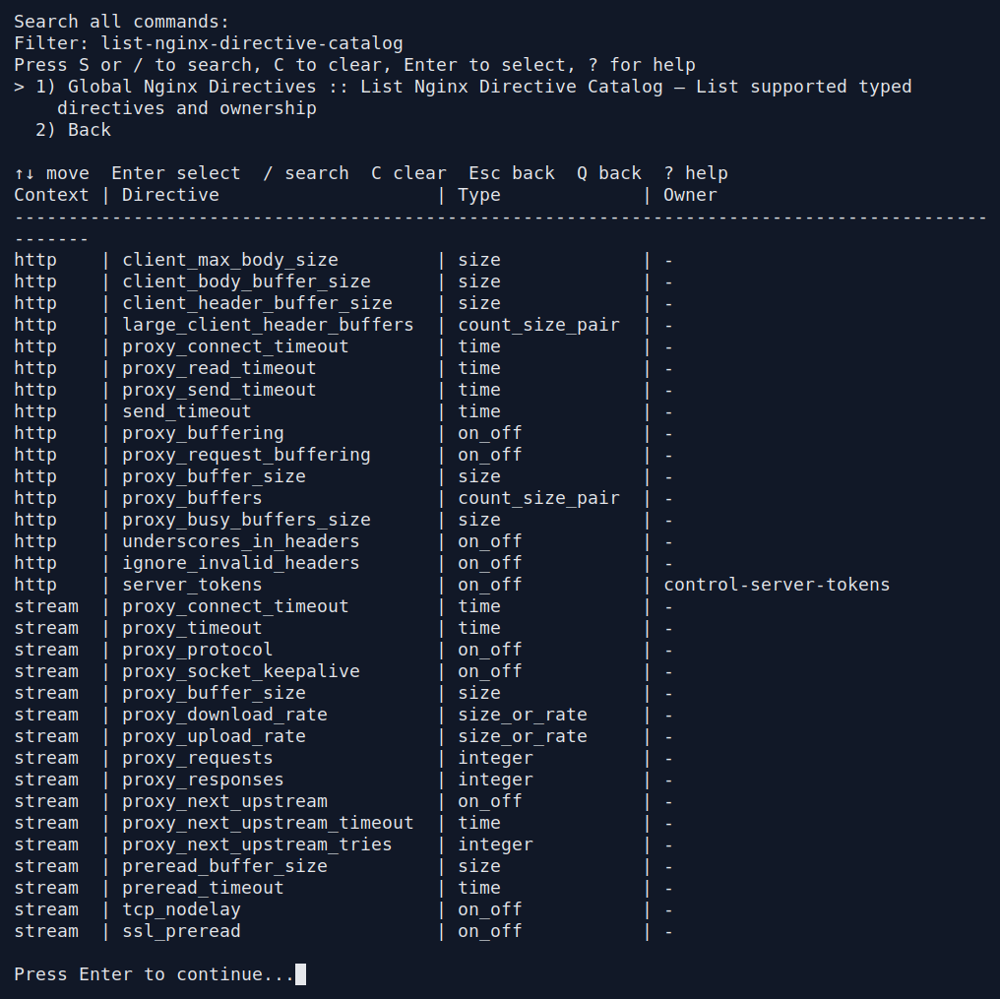

   [Read the captured terminal text](../assets/interactive/operations-runtime-list-nginx-directive-catalog/03-command-result.txt)

</details>

<details>
<summary>set-nginx-directive — inputs and result</summary>

1. Choose **Global (http)**.

   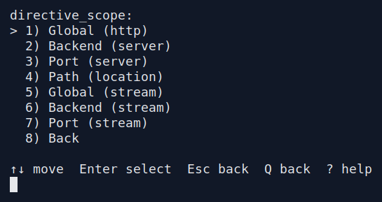

   [Read the captured terminal text](../assets/interactive/operations-runtime-set-nginx-directive/03-global-http.txt)

2. Choose **client_max_body_size**.

   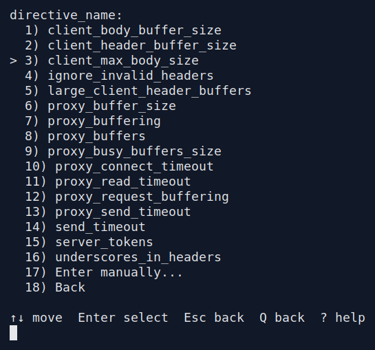

   [Read the captured terminal text](../assets/interactive/operations-runtime-set-nginx-directive/04-client-max-body-size.txt)

3. Enter `2m`.

   

   [Read the captured terminal text](../assets/interactive/operations-runtime-set-nginx-directive/05-enter-value.txt)

4. Review the collected inputs, then choose **Run**.

   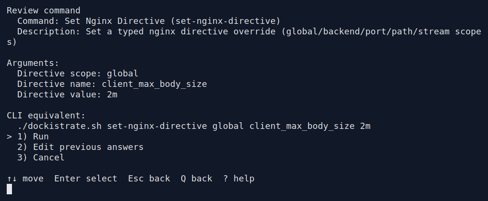

   [Read the captured terminal text](../assets/interactive/operations-runtime-set-nginx-directive/06-run.txt)

5. Command result.

   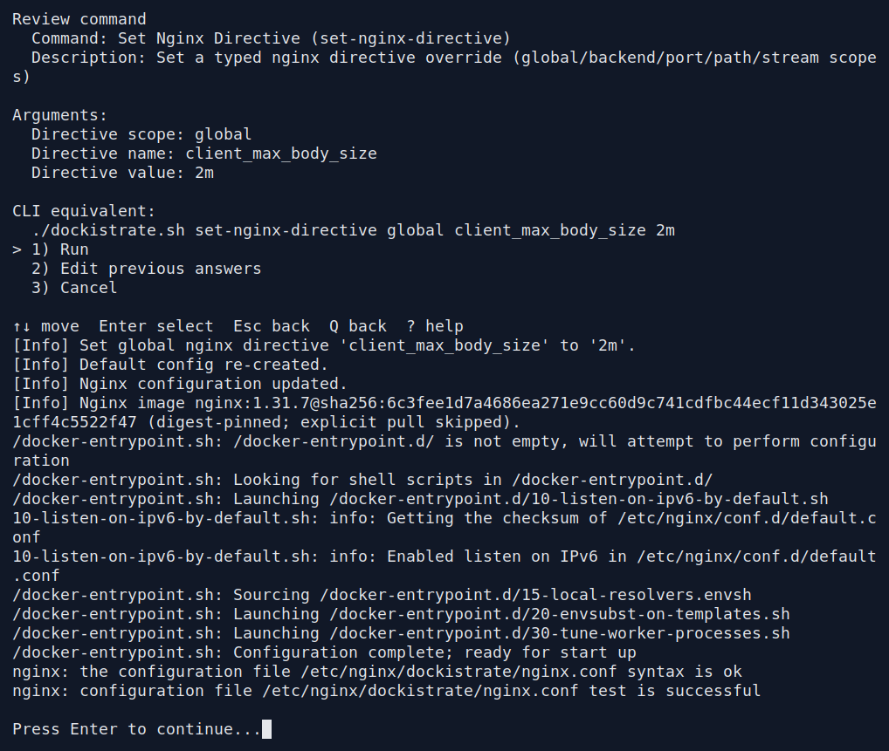

   [Read the captured terminal text](../assets/interactive/operations-runtime-set-nginx-directive/07-command-result.txt)

</details>

<details>
<summary>list-nginx-directives — inputs and result</summary>

1. Choose **All scopes**.

   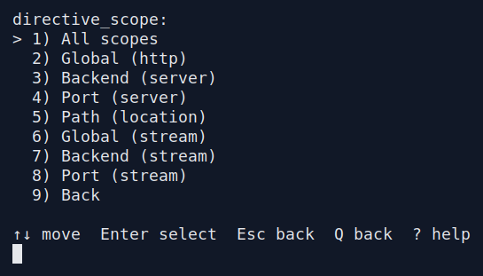

   [Read the captured terminal text](../assets/interactive/operations-runtime-list-nginx-directives/03-all-scopes.txt)

2. Command result.

   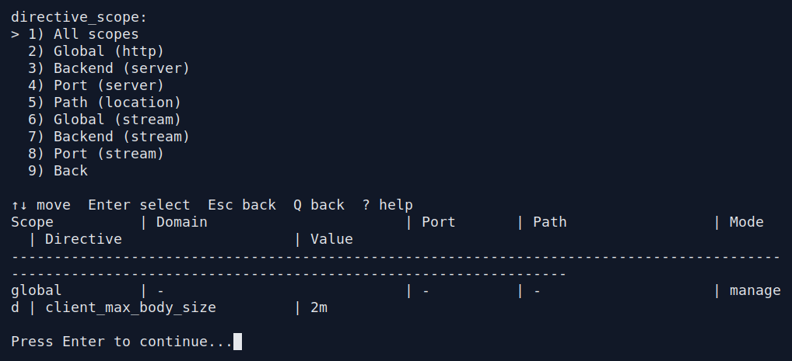

   [Read the captured terminal text](../assets/interactive/operations-runtime-list-nginx-directives/04-command-result.txt)

</details>

<details>
<summary>Verify the configured request body limit</summary>

1. Verify the configured request body limit.

   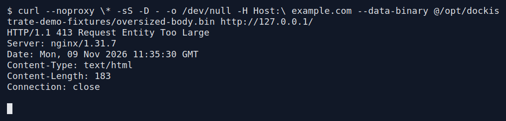

   [Read the captured terminal text](../assets/interactive/operations-runtime-body-limit-verification/01-verify-the-configured-request-body-limit.txt)

</details>

<details>
<summary>set-nginx-directive-raw — inputs and result</summary>

1. Choose **Global (http)**.

   

   [Read the captured terminal text](../assets/interactive/operations-runtime-set-nginx-directive-raw/03-global-http.txt)

2. Choose **Enter manually...**.

   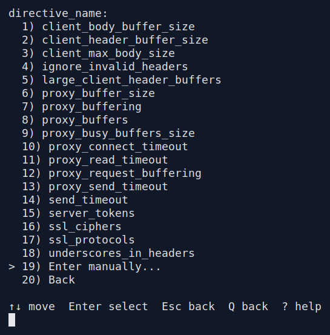

   [Read the captured terminal text](../assets/interactive/operations-runtime-set-nginx-directive-raw/04-enter-manually.txt)

3. Enter `keepalive_requests`.

   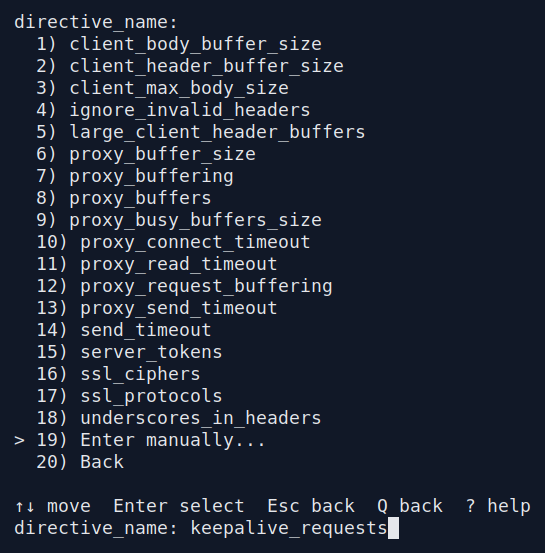

   [Read the captured terminal text](../assets/interactive/operations-runtime-set-nginx-directive-raw/05-enter-value.txt)

4. Enter `200`.

   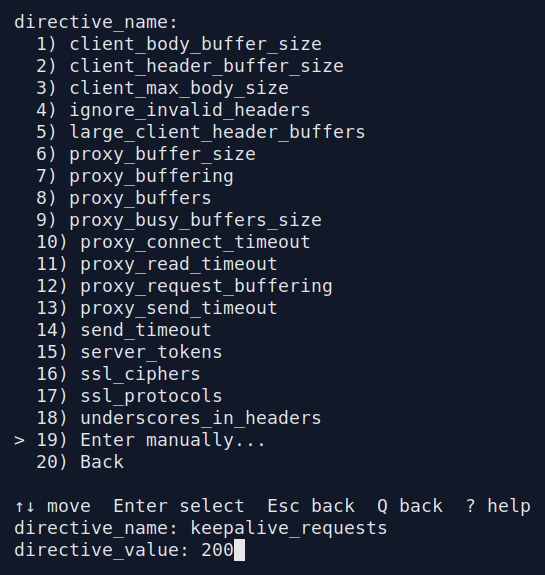

   [Read the captured terminal text](../assets/interactive/operations-runtime-set-nginx-directive-raw/06-enter-value.txt)

5. Review the collected inputs, then choose **Run**.

   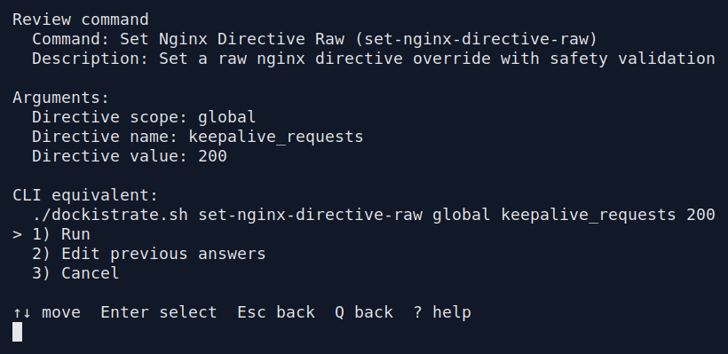

   [Read the captured terminal text](../assets/interactive/operations-runtime-set-nginx-directive-raw/07-run.txt)

6. Command result.

   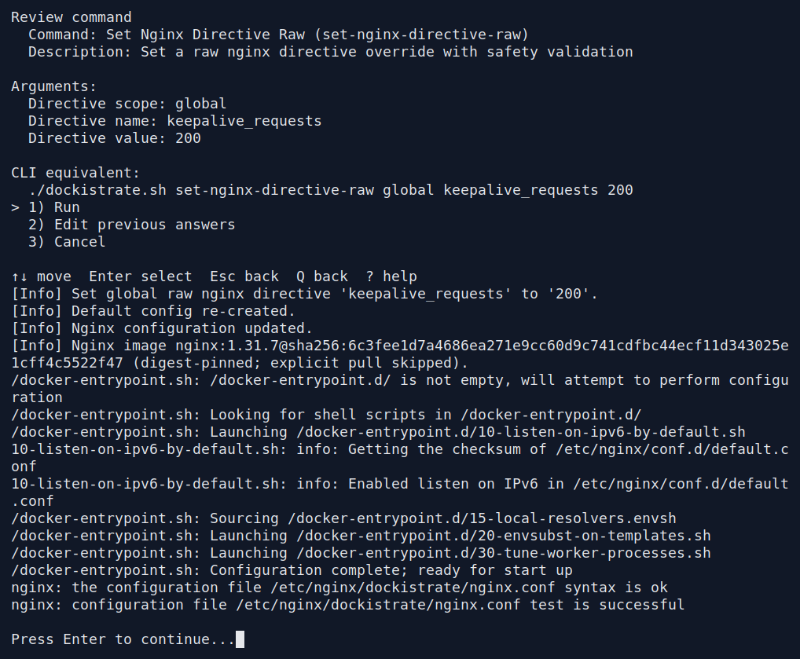

   [Read the captured terminal text](../assets/interactive/operations-runtime-set-nginx-directive-raw/08-command-result.txt)

</details>

<details>
<summary>show-nginx-directive-strict — inputs and result</summary>

1. Command result.

   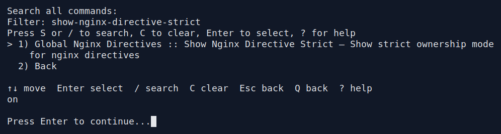

   [Read the captured terminal text](../assets/interactive/operations-runtime-show-nginx-directive-strict/03-command-result.txt)

</details>

<details>
<summary>set-nginx-directive-strict — inputs and result</summary>

1. Choose **off**.

   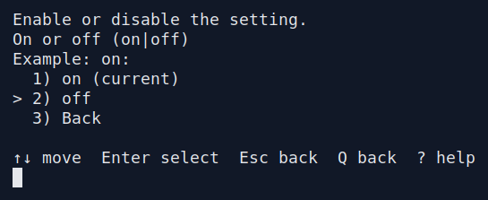

   [Read the captured terminal text](../assets/interactive/operations-runtime-set-nginx-directive-strict/03-off.txt)

2. Review the collected inputs, then choose **Run**.

   

   [Read the captured terminal text](../assets/interactive/operations-runtime-set-nginx-directive-strict/04-run.txt)

3. Command result.

   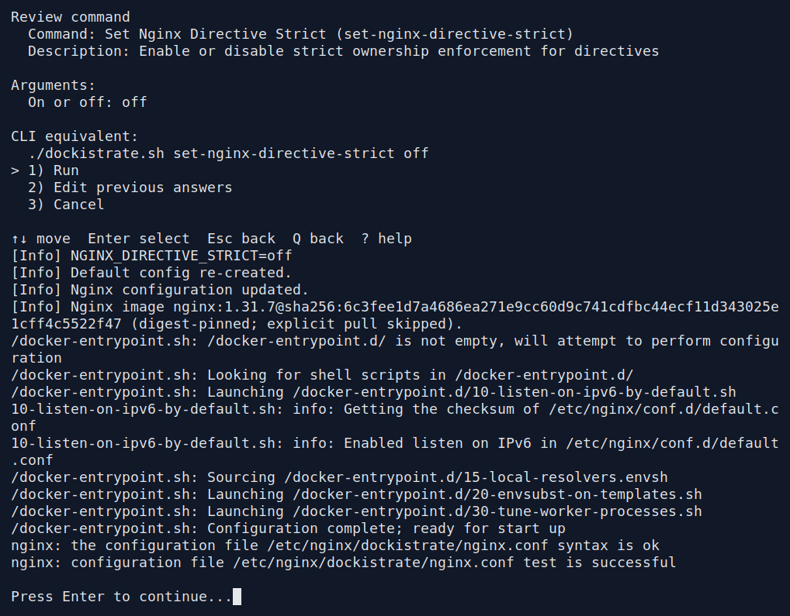

   [Read the captured terminal text](../assets/interactive/operations-runtime-set-nginx-directive-strict/05-command-result.txt)

</details>

<details>
<summary>show-nginx-directive-strict — inputs and result</summary>

1. Command result.

   

   [Read the captured terminal text](../assets/interactive/operations-runtime-show-nginx-directive-strict--session-002/03-command-result.txt)

</details>

<details>
<summary>set-nginx-directive-strict — inputs and result</summary>

1. Choose **on**.

   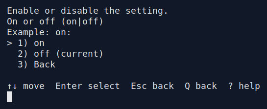

   [Read the captured terminal text](../assets/interactive/operations-runtime-directive-strict-restored/03-on.txt)

2. Review the collected inputs, then choose **Run**.

   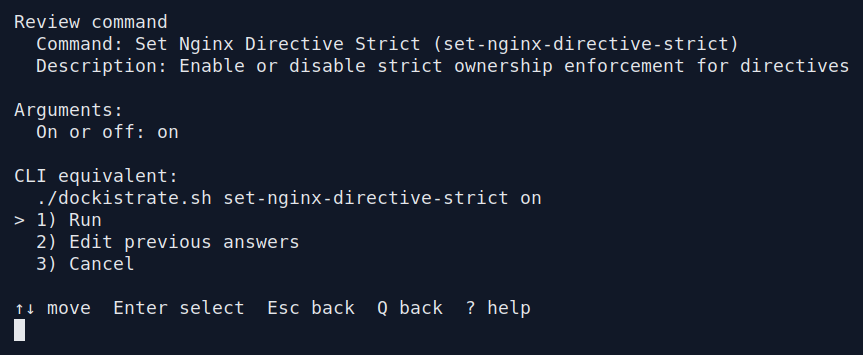

   [Read the captured terminal text](../assets/interactive/operations-runtime-directive-strict-restored/04-run.txt)

3. Command result.

   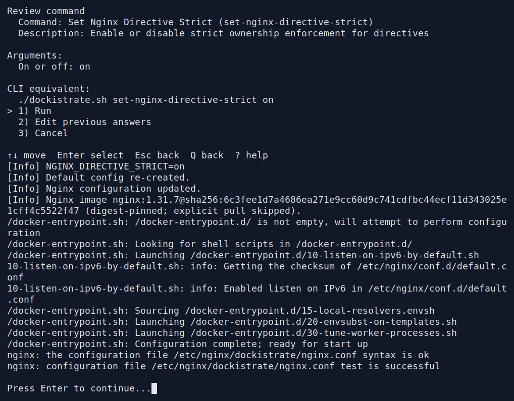

   [Read the captured terminal text](../assets/interactive/operations-runtime-directive-strict-restored/05-command-result.txt)

</details>

<details>
<summary>check-config — inputs and result</summary>

1. Configuration test passed.

   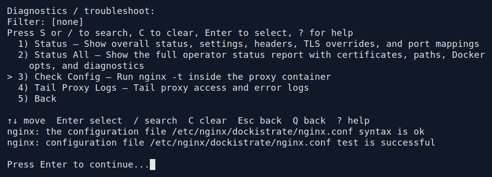

   [Read the captured terminal text](../assets/interactive/operations-runtime-directive-config/03-configuration-test-passed.txt)

</details>

<details>
<summary>remove-nginx-directive — inputs and result</summary>

1. Choose **Global (http)**.

   

   [Read the captured terminal text](../assets/interactive/operations-runtime-remove-nginx-directive/03-global-http.txt)

2. Choose **client_max_body_size**.

   

   [Read the captured terminal text](../assets/interactive/operations-runtime-remove-nginx-directive/04-client-max-body-size.txt)

3. Review the collected inputs, then choose **Run**.

   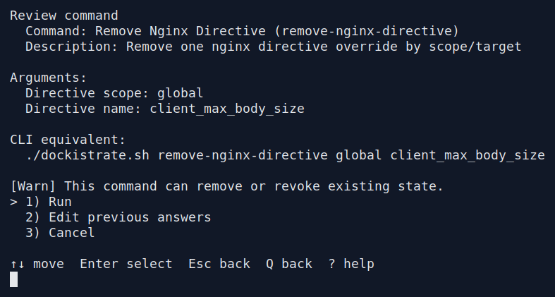

   [Read the captured terminal text](../assets/interactive/operations-runtime-remove-nginx-directive/05-run.txt)

4. Enter `YES`.

   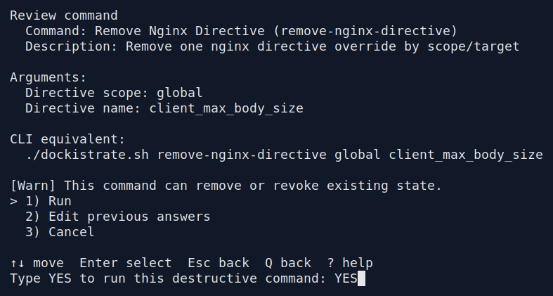

   [Read the captured terminal text](../assets/interactive/operations-runtime-remove-nginx-directive/06-enter-value.txt)

5. Command result.

   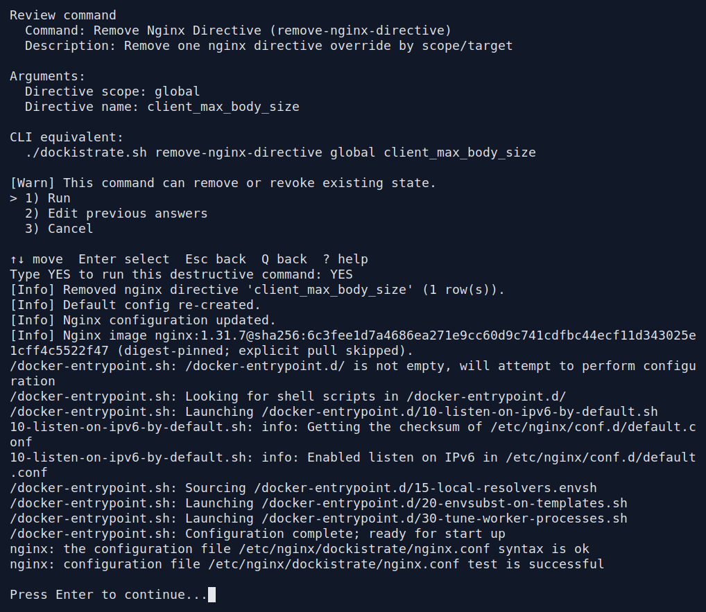

   [Read the captured terminal text](../assets/interactive/operations-runtime-remove-nginx-directive/07-command-result.txt)

</details>

<details>
<summary>remove-all-nginx-directives — inputs and result</summary>

1. Choose **Global (http)**.

   

   [Read the captured terminal text](../assets/interactive/operations-runtime-remove-all-nginx-directives/03-global-http.txt)

2. Review the collected inputs, then choose **Run**.

   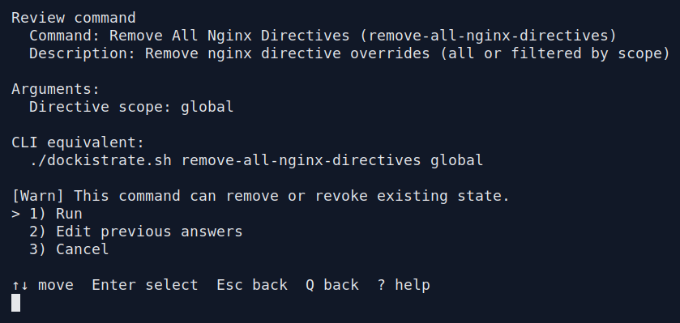

   [Read the captured terminal text](../assets/interactive/operations-runtime-remove-all-nginx-directives/04-run.txt)

3. Enter `YES`.

   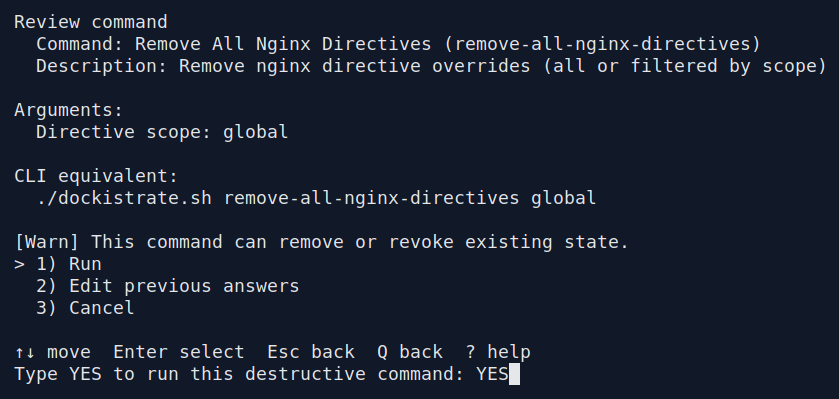

   [Read the captured terminal text](../assets/interactive/operations-runtime-remove-all-nginx-directives/05-enter-value.txt)

4. Command result.

   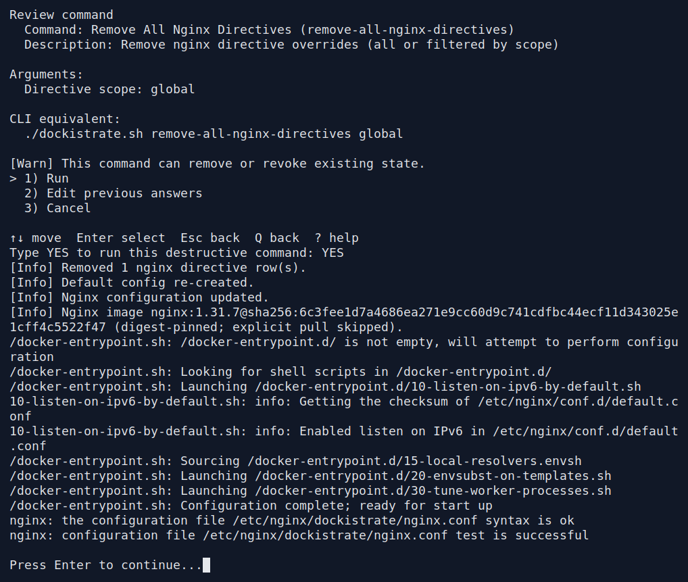

   [Read the captured terminal text](../assets/interactive/operations-runtime-remove-all-nginx-directives/06-command-result.txt)

</details>

<details>
<summary>list-nginx-directives — inputs and result</summary>

1. Choose **All scopes**.

   

   [Read the captured terminal text](../assets/interactive/operations-runtime-directives-restored/03-all-scopes.txt)

2. Command result.

   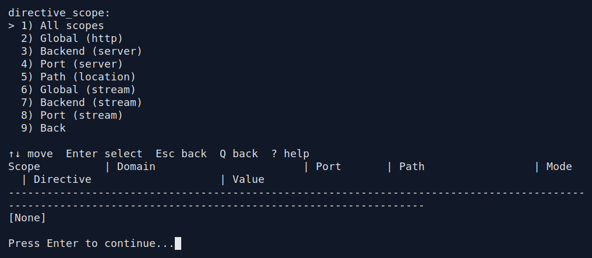

   [Read the captured terminal text](../assets/interactive/operations-runtime-directives-restored/04-command-result.txt)

</details>

<details>
<summary>set-nginx-directive — Limit one path</summary>

1. Choose **Path (location)**.

   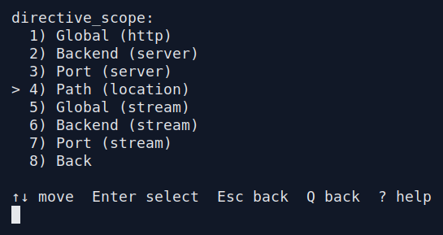

   [Read the captured terminal text](../assets/interactive/operations-branches-scoped-directive/03-path-location.txt)

2. Choose **example.com**.

   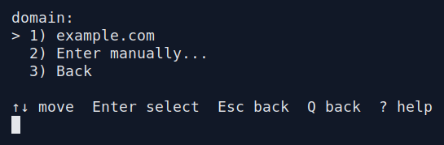

   [Read the captured terminal text](../assets/interactive/operations-branches-scoped-directive/04-example-com.txt)

3. Choose **80 -> 80 proto=http ws=no cert=none**.

   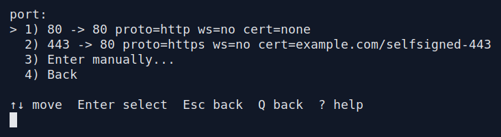

   [Read the captured terminal text](../assets/interactive/operations-branches-scoped-directive/05-80-80-proto-http-ws-no-cert-none.txt)

4. Choose **/limited**.

   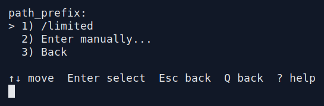

   [Read the captured terminal text](../assets/interactive/operations-branches-scoped-directive/06-limited.txt)

5. Choose **client_max_body_size**.

   

   [Read the captured terminal text](../assets/interactive/operations-branches-scoped-directive/07-client-max-body-size.txt)

6. Enter `1k`.

   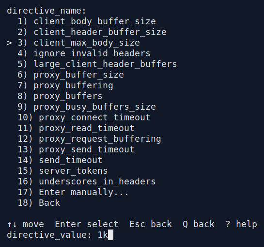

   [Read the captured terminal text](../assets/interactive/operations-branches-scoped-directive/08-enter-value.txt)

7. Review the collected inputs, then choose **Run**.

   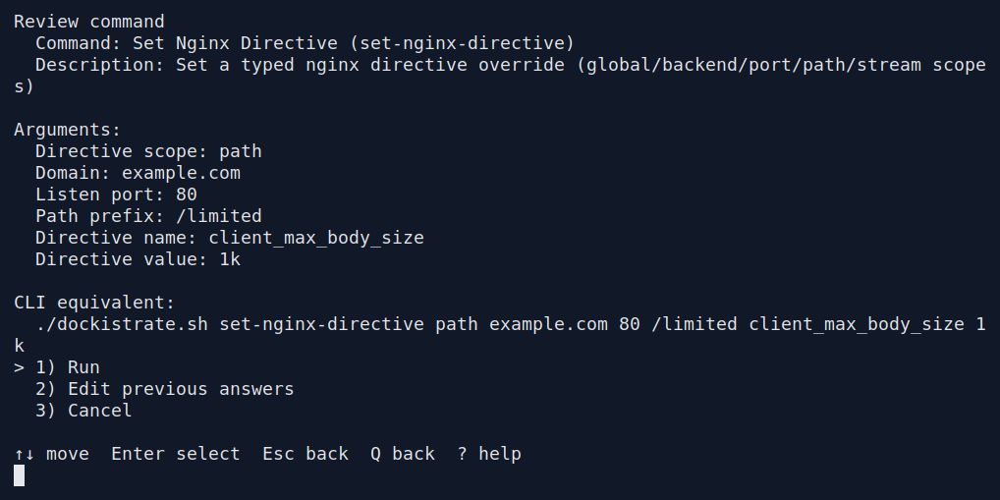

   [Read the captured terminal text](../assets/interactive/operations-branches-scoped-directive/09-run.txt)

8. Command result.

   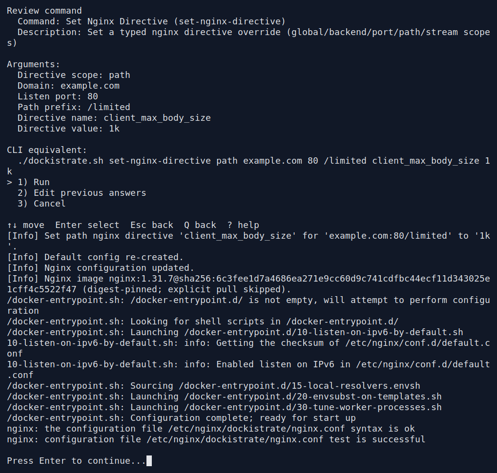

   [Read the captured terminal text](../assets/interactive/operations-branches-scoped-directive/10-command-result.txt)

</details>

<details>
<summary>list-nginx-directives — Inspect the path override</summary>

1. Choose **Path (location)**.

   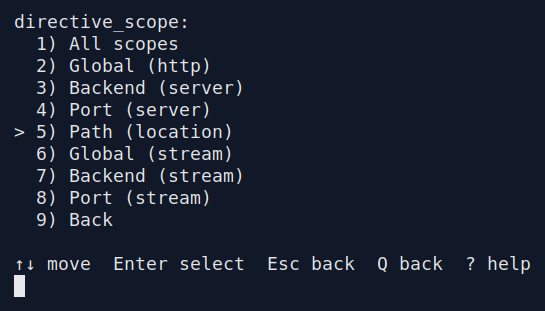

   [Read the captured terminal text](../assets/interactive/operations-branches-scoped-directive-list/03-path-location.txt)

2. Choose **example.com**.

   

   [Read the captured terminal text](../assets/interactive/operations-branches-scoped-directive-list/04-example-com.txt)

3. Choose **80 -> 80 proto=http ws=no cert=none**.

   

   [Read the captured terminal text](../assets/interactive/operations-branches-scoped-directive-list/05-80-80-proto-http-ws-no-cert-none.txt)

4. Choose **/limited**.

   

   [Read the captured terminal text](../assets/interactive/operations-branches-scoped-directive-list/06-limited.txt)

5. Command result.

   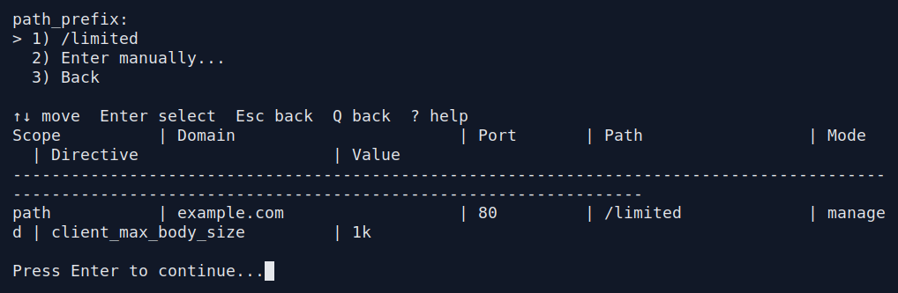

   [Read the captured terminal text](../assets/interactive/operations-branches-scoped-directive-list/07-command-result.txt)

</details>

<details>
<summary>Verify the path-specific request body limit</summary>

1. Verify the path-specific request body limit.

   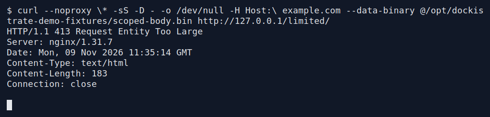

   [Read the captured terminal text](../assets/interactive/operations-branches-scoped-directive-verified/01-verify-the-path-specific-request-body-limit.txt)

</details>

<details>
<summary>remove-nginx-directive — Remove the path override</summary>

1. Choose **Path (location)**.

   

   [Read the captured terminal text](../assets/interactive/operations-branches-scoped-directive-remove/03-path-location.txt)

2. Choose **example.com**.

   

   [Read the captured terminal text](../assets/interactive/operations-branches-scoped-directive-remove/04-example-com.txt)

3. Choose **80 -> 80 proto=http ws=no cert=none**.

   

   [Read the captured terminal text](../assets/interactive/operations-branches-scoped-directive-remove/05-80-80-proto-http-ws-no-cert-none.txt)

4. Choose **/limited**.

   

   [Read the captured terminal text](../assets/interactive/operations-branches-scoped-directive-remove/06-limited.txt)

5. Choose **client_max_body_size**.

   

   [Read the captured terminal text](../assets/interactive/operations-branches-scoped-directive-remove/07-client-max-body-size.txt)

6. Review the collected inputs, then choose **Run**.

   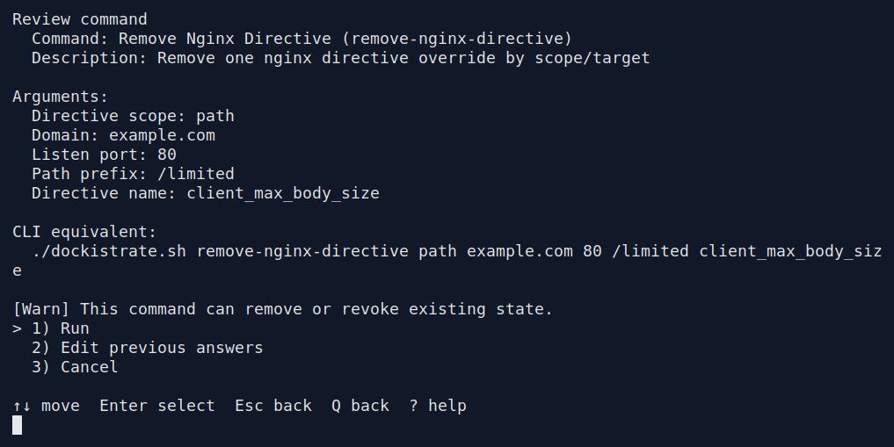

   [Read the captured terminal text](../assets/interactive/operations-branches-scoped-directive-remove/08-run.txt)

7. Enter `YES`.

   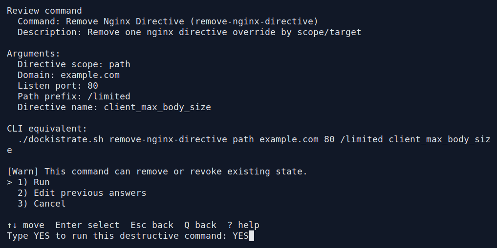

   [Read the captured terminal text](../assets/interactive/operations-branches-scoped-directive-remove/09-enter-value.txt)

8. Command result.

   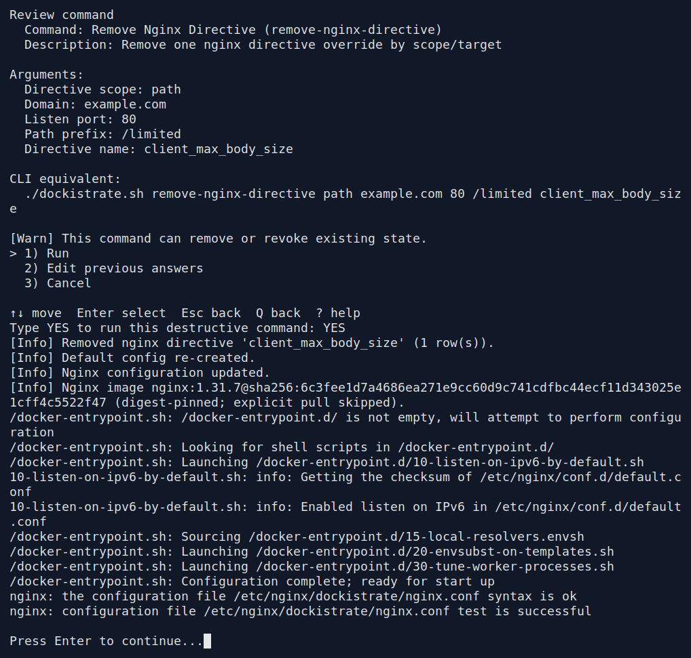

   [Read the captured terminal text](../assets/interactive/operations-branches-scoped-directive-remove/10-command-result.txt)

</details>

<details>
<summary>Verify the request reaches the application after removal</summary>

1. Verify the request reaches the application after removal.

   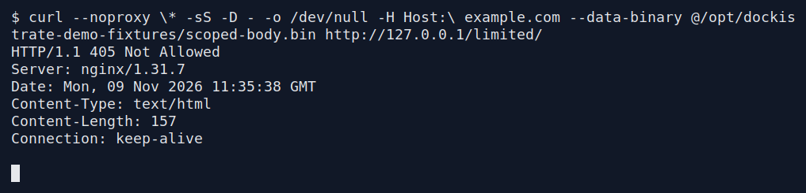

   [Read the captured terminal text](../assets/interactive/operations-branches-scoped-directive-recovered/01-verify-the-request-reaches-the-application-after-removal.txt)

</details>

<!-- /walkthrough: nginx-directives -->

3. Choose **List Nginx Directives → Global (http)** and **Check Config**. For the
   stock demo, confirm that an ordinary GET still returns `200` while a POST
   containing 2,097,153 bytes (2 MiB + 1) returns `413`. Test accepted uploads
   separately against an application that supports them. The limit is global
   unless a narrower setting takes precedence.
4. Use **Remove Nginx Directive → Global (http) → client_max_body_size**, review
   and **Run** to return to the generated default. If an override already
   existed, restore its recorded value instead.

```bash
./dockistrate.sh list-nginx-directive-catalog
./dockistrate.sh set-nginx-directive global client_max_body_size 2m
./dockistrate.sh list-nginx-directives global
./dockistrate.sh check-config
./dockistrate.sh remove-nginx-directive global client_max_body_size
```

For a different scope, the picker asks for the corresponding target before
the directive: **Backend (server)** → domain; **Port (server)** → domain/port;
**Path (location)** → domain/port/existing path. Stream scopes follow the same
target pattern without paths. Enter a directive value without a trailing
semicolon or a new configuration block.

For a path-only example, first create `/limited` on `example.com:80` using the
[path walkthrough](path-routing.md). Choose **Set Nginx Directive → Path
(location) → example.com → 80 → /limited → client_max_body_size**, enter `1k`,
review and **Run**. A 2 KiB POST to `/limited` should receive `413`, while the
same POST to `/` reaches the stock demo's `405` response. Remove that path's
`client_max_body_size` override and repeat: `/limited` should return `405`
again. Other applications may accept POST and return a different application
status; the comparison checks where the size limit applies.

```bash
./dockistrate.sh set-nginx-directive path example.com 80 /limited client_max_body_size 1k
./dockistrate.sh remove-nginx-directive path example.com 80 /limited client_max_body_size
```

| Menu action and inputs | CLI equivalent after `./dockistrate.sh` | Result / undo |
| --- | --- | --- |
| <a id="cmd-list-nginx-directive-catalog"></a>**List Nginx Directive Catalog** | `list-nginx-directive-catalog` | Read supported typed directives and scopes. |
| <a id="cmd-set-nginx-directive"></a>**Set Nginx Directive** → scope → target if needed → name → value | `set-nginx-directive global client_max_body_size 2m` | Set a validated override; remove it or restore the old value to undo. |
| <a id="cmd-set-nginx-directive-raw"></a>**Set Nginx Directive Raw** → scope → target → name → value | `set-nginx-directive-raw global keepalive_requests 200` | Use an uncatalogued value/directive with the same scope and safety checks; validate actual Nginx support. |
| <a id="cmd-list-nginx-directives"></a>**List Nginx Directives** → scope and target, or **All scopes** | `list-nginx-directives all` | Inspect effective saved overrides; value visibility follows the selected policy. |
| <a id="cmd-remove-nginx-directive"></a>**Remove Nginx Directive** → scope → target → name | `remove-nginx-directive global client_max_body_size` | Remove one override; regenerate and verify inherited/default behavior. |
| <a id="cmd-remove-all-nginx-directives"></a>**Remove All Nginx Directives** → scope and target | `remove-all-nginx-directives global` | Remove that selection's overrides. **All scopes**/no CLI arguments clears every scope; save values first. |
| <a id="cmd-set-nginx-directive-strict"></a>**Set Nginx Directive Strict** → `on` or `off` | `set-nginx-directive-strict on` | Set ownership checks for specialized directives; restore the previous setting to undo. |
| <a id="cmd-show-nginx-directive-strict"></a>**Show Nginx Directive Strict** | `show-nginx-directive-strict` | Inspect the setting. |

Before bulk removal, review the selected scope and choose **Cancel** if it is
wider than intended. Strict mode protects directives owned by dedicated
features; use their commands for TLS, headers and server tokens. Turning it off
does not bypass syntax, injection or write-safety validation.

## Walkthrough: choose HTTP behavior

1. Open **Advanced command browser → Backend Protocol & IP Overrides → Set
   Backend HTTP Version**, choose `example.com`, then `http2`.
2. Review and **Run**, then inspect **List Backends** and **Check Config**.

<!-- walkthrough: http-version -->

<details>
<summary>set-http-version — inputs and result</summary>

1. Choose **http1.1**.

   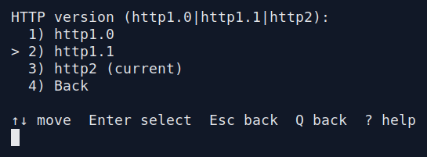

   [Read the captured terminal text](../assets/interactive/operations-runtime-set-http-version/03-http1-1.txt)

2. Review the collected inputs, then choose **Run**.

   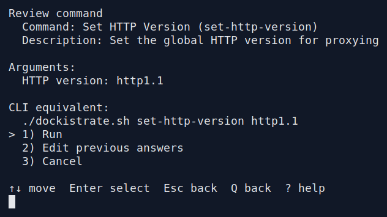

   [Read the captured terminal text](../assets/interactive/operations-runtime-set-http-version/04-run.txt)

3. Command result.

   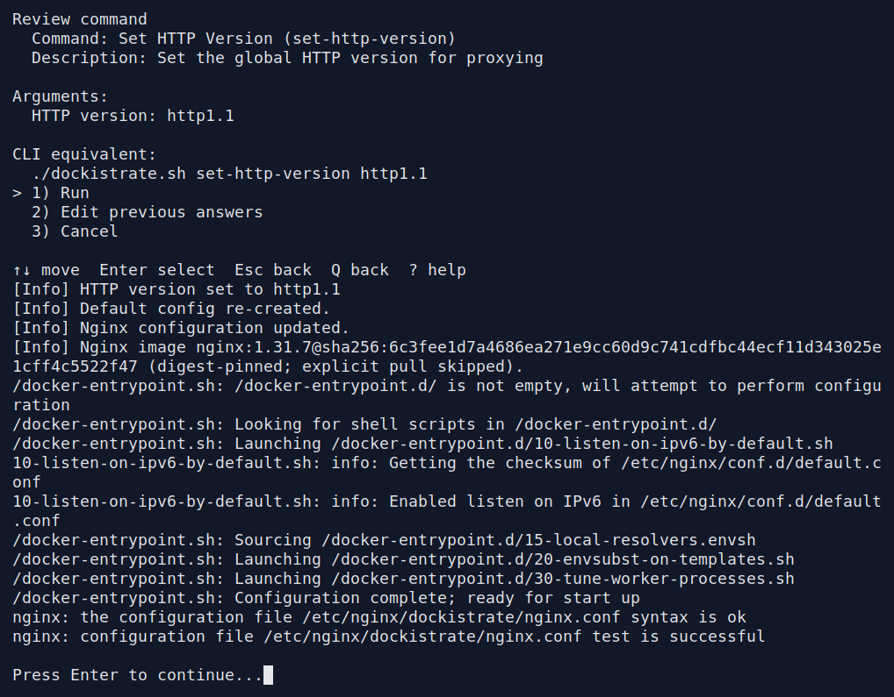

   [Read the captured terminal text](../assets/interactive/operations-runtime-set-http-version/05-command-result.txt)

</details>

<details>
<summary>set-backend-http-version — inputs and result</summary>

1. Choose **example.com**.

   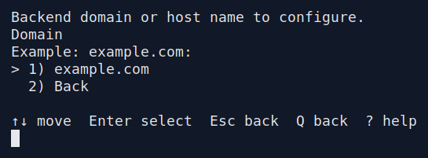

   [Read the captured terminal text](../assets/interactive/operations-runtime-set-backend-http-version/03-example-com.txt)

2. Choose **http2**.

   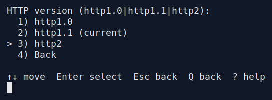

   [Read the captured terminal text](../assets/interactive/operations-runtime-set-backend-http-version/04-http2.txt)

3. Review the collected inputs, then choose **Run**.

   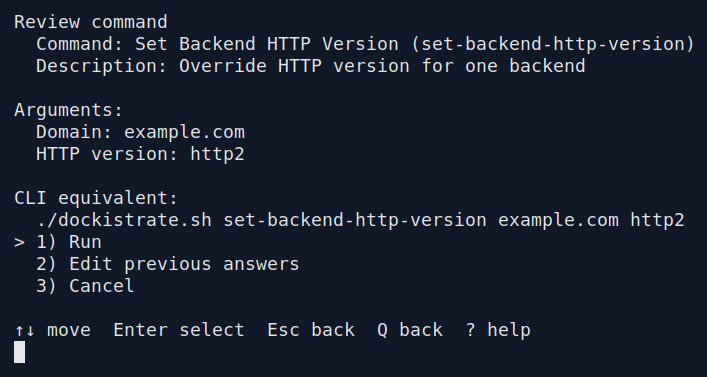

   [Read the captured terminal text](../assets/interactive/operations-runtime-set-backend-http-version/05-run.txt)

4. Command result.

   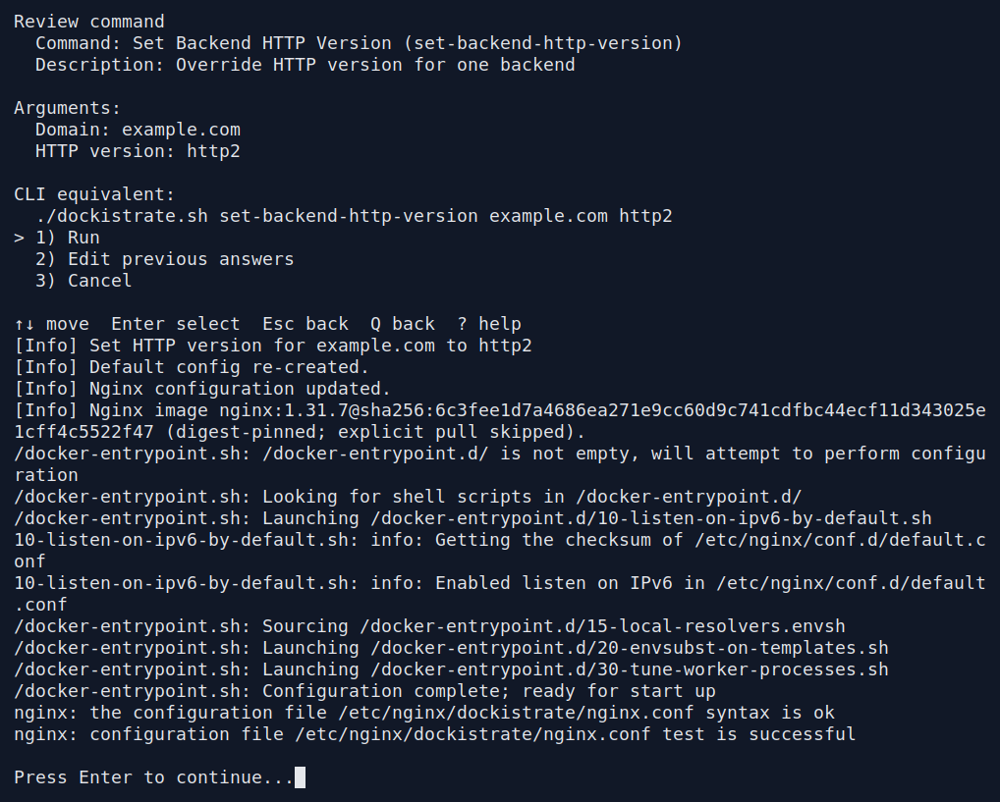

   [Read the captured terminal text](../assets/interactive/operations-runtime-set-backend-http-version/06-command-result.txt)

</details>

<details>
<summary>Verify HTTP2 negotiation</summary>

1. Verify HTTP2 negotiation.

   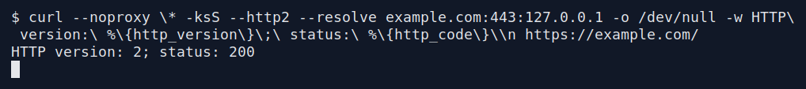

   [Read the captured terminal text](../assets/interactive/operations-runtime-http2-negotiation/01-verify-http2-negotiation.txt)

</details>

<details>
<summary>remove-backend-http-version — inputs and result</summary>

1. Choose **example.com**.

   

   [Read the captured terminal text](../assets/interactive/operations-runtime-remove-backend-http-version/03-example-com.txt)

2. Review the collected inputs, then choose **Run**.

   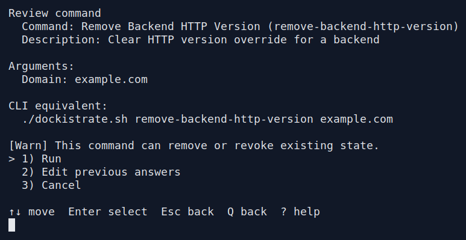

   [Read the captured terminal text](../assets/interactive/operations-runtime-remove-backend-http-version/04-run.txt)

3. Enter `YES`.

   

   [Read the captured terminal text](../assets/interactive/operations-runtime-remove-backend-http-version/05-enter-value.txt)

4. Command result.

   

   [Read the captured terminal text](../assets/interactive/operations-runtime-remove-backend-http-version/06-command-result.txt)

</details>

<details>
<summary>Verify inherited HTTP1.1</summary>

1. Verify inherited HTTP1.1.

   

   [Read the captured terminal text](../assets/interactive/operations-runtime-http-version-inheritance/01-verify-inherited-http1-1.txt)

</details>

<!-- /walkthrough: http-version -->

3. On an HTTPS listener, use an HTTP/2-capable client and confirm the negotiated
   response protocol. Inspect the generated upstream `proxy_http_version`
   separately: selecting `http2` enables client HTTP/2, while upstream proxying
   still uses HTTP/1.1. A client may continue to use HTTP/1.1.
4. Use **Remove Backend HTTP Version → example.com → Run** to resume the global
   setting, or restore a prior explicit override.

| Menu action and inputs | CLI equivalent | Scope / undo |
| --- | --- | --- |
| <a id="cmd-set-http-version"></a>**Global TLS & Runtime → Set HTTP Version** → `http1.0`, `http1.1` or `http2` | `set-http-version http1.1` | Set global behavior; restore the recorded global value to undo. |
| <a id="cmd-set-backend-http-version"></a>**Set Backend HTTP Version** → domain → version | `set-backend-http-version example.com http2` | Set a primary-backend or dedicated-host override. Ordinary aliases inherit the primary setting. |
| <a id="cmd-remove-backend-http-version"></a>**Remove Backend HTTP Version** → domain | `remove-backend-http-version example.com` | Resume inherited behavior. |

IP-header overrides in the same menu have their walkthrough in
[client IP and proxy trust](headers-real-ip-hsts-csp.md#walkthrough-preserve-the-real-client-address-through-a-proxy).

## Walkthrough: change proxy runtime options and images

1. Open **Advanced command browser → Global TLS & Runtime → Show Nginx Docker
   Opts** and record the current string. **Set Nginx Docker Opts** replaces that
   entire string: enter `--label docs-example=true` only if that is the complete intended setting.
2. Review and **Run**, then inspect **Show Nginx Docker Opts**, **Status** and
   **Check Config**. Request a backend again after proxy recreation.

<!-- walkthrough: runtime-options -->

<details>
<summary>show-nginx-docker-opts — inputs and result</summary>

1. Command result.

   

   [Read the captured terminal text](../assets/interactive/operations-runtime-show-nginx-docker-opts/03-command-result.txt)

</details>

<details>
<summary>set-nginx-docker-opts — inputs and result</summary>

1. Choose **Enter manually...**.

   

   [Read the captured terminal text](../assets/interactive/operations-runtime-set-nginx-docker-opts/03-enter-manually.txt)

2. Enter `--label docs-example=true`.

   

   [Read the captured terminal text](../assets/interactive/operations-runtime-set-nginx-docker-opts/04-enter-value.txt)

3. Press Enter to accept the displayed default or leave the optional value blank.

   

   [Read the captured terminal text](../assets/interactive/operations-runtime-set-nginx-docker-opts/05-enter-value.txt)

4. Review the collected inputs, then choose **Run**.

   

   [Read the captured terminal text](../assets/interactive/operations-runtime-set-nginx-docker-opts/06-run.txt)

5. Command result.

   

   [Read the captured terminal text](../assets/interactive/operations-runtime-set-nginx-docker-opts/07-command-result.txt)

</details>

<details>
<summary>show-nginx-docker-opts — inputs and result</summary>

1. Command result.

   

   [Read the captured terminal text](../assets/interactive/operations-runtime-show-nginx-docker-opts--session-002/03-command-result.txt)

</details>

<details>
<summary>set-nginx-docker-opts — inputs and result</summary>

1. Choose **Clear current options**.

   

   [Read the captured terminal text](../assets/interactive/operations-runtime-runtime-options-cleared/03-clear-current-options.txt)

2. Review the collected inputs, then choose **Run**.

   

   [Read the captured terminal text](../assets/interactive/operations-runtime-runtime-options-cleared/04-run.txt)

3. Command result.

   

   [Read the captured terminal text](../assets/interactive/operations-runtime-runtime-options-cleared/05-command-result.txt)

</details>

<details>
<summary>set-nginx-image — inputs and result</summary>

1. Choose **Use current image: nginx:1.31.7@sha256:6c3fee1d7a4686ea271e9cc60d9c741cdfbc44ecf11d343025e1cff4c5522f47 (current)**.

   

   [Read the captured terminal text](../assets/interactive/operations-runtime-set-nginx-image/03-use-current-image-nginx-1-31-7-sha256-6c3fee1d7a4686ea271e9cc60d9c741cdfbc44ecf1.txt)

2. Choose **Refresh latest-tagged images on use (existing behavior) (current)**.

   

   [Read the captured terminal text](../assets/interactive/operations-runtime-set-nginx-image/04-refresh-latest-tagged-images-on-use-existing-behavior-current.txt)

3. Review the collected inputs, then choose **Run**.

   

   [Read the captured terminal text](../assets/interactive/operations-runtime-set-nginx-image/05-run.txt)

4. Command result.

   

   [Read the captured terminal text](../assets/interactive/operations-runtime-set-nginx-image/06-command-result.txt)

</details>

<details>
<summary>set-certbot-image — inputs and result</summary>

1. Choose **Use current image: certbot/certbot:v5.8.0@sha256:f70ad0adbb7e117f0fe42a63c553f28ea451edabc0148757b6efcd9735acaa20 (current)**.

   

   [Read the captured terminal text](../assets/interactive/operations-runtime-set-certbot-image/03-use-current-image-certbot-certbot-v5-8-0-sha256-f70ad0adbb7e117f0fe42a63c553f28e.txt)

2. Choose **Refresh latest-tagged images on use (existing behavior) (current)**.

   

   [Read the captured terminal text](../assets/interactive/operations-runtime-set-certbot-image/04-refresh-latest-tagged-images-on-use-existing-behavior-current.txt)

3. Review the collected inputs, then choose **Run**.

   

   [Read the captured terminal text](../assets/interactive/operations-runtime-set-certbot-image/05-run.txt)

4. Command result.

   

   [Read the captured terminal text](../assets/interactive/operations-runtime-set-certbot-image/06-command-result.txt)

</details>

<details>
<summary>check-config — inputs and result</summary>

1. Configuration test passed.

   

   [Read the captured terminal text](../assets/interactive/operations-runtime-runtime-options-config/03-configuration-test-passed.txt)

</details>

<details>
<summary>set-nginx-image — Enter the proxy image reference manually</summary>

1. Choose **Enter manually...**.

   

   [Read the captured terminal text](../assets/interactive/operations-branches-manual-nginx-image/03-enter-manually.txt)

2. Enter `nginx:1.31.7@sha256:6c3fee1d7a4686ea271e9cc60d9c741cdfbc44ecf11d343025e1cff4c5522f47`.

   

   [Read the captured terminal text](../assets/interactive/operations-branches-manual-nginx-image/04-enter-value.txt)

3. Choose **Skip explicit pulls; Docker can fetch missing images**.

   

   [Read the captured terminal text](../assets/interactive/operations-branches-manual-nginx-image/05-skip-explicit-pulls-docker-can-fetch-missing-images.txt)

4. Review the collected inputs, then choose **Run**.

   

   [Read the captured terminal text](../assets/interactive/operations-branches-manual-nginx-image/06-run.txt)

5. Command result.

   

   [Read the captured terminal text](../assets/interactive/operations-branches-manual-nginx-image/07-command-result.txt)

</details>

<details>
<summary>set-certbot-image — Enter the Certbot image reference manually</summary>

1. Choose **Enter manually...**.

   

   [Read the captured terminal text](../assets/interactive/operations-branches-manual-certbot-image/03-enter-manually.txt)

2. Enter `certbot/certbot:v5.8.0@sha256:f70ad0adbb7e117f0fe42a63c553f28ea451edabc0148757b6efcd9735acaa20`.

   

   [Read the captured terminal text](../assets/interactive/operations-branches-manual-certbot-image/04-enter-value.txt)

3. Choose **Skip explicit pulls; Docker can fetch missing images**.

   

   [Read the captured terminal text](../assets/interactive/operations-branches-manual-certbot-image/05-skip-explicit-pulls-docker-can-fetch-missing-images.txt)

4. Review the collected inputs, then choose **Run**.

   

   [Read the captured terminal text](../assets/interactive/operations-branches-manual-certbot-image/06-run.txt)

5. Command result.

   

   [Read the captured terminal text](../assets/interactive/operations-branches-manual-certbot-image/07-command-result.txt)

</details>

<details>
<summary>check-config — Check configuration after image selection</summary>

1. Configuration test passed.

   

   [Read the captured terminal text](../assets/interactive/operations-branches-manual-image-config/03-configuration-test-passed.txt)

</details>

<!-- /walkthrough: runtime-options -->

3. Select **Set Nginx Image** or **Set Certbot Image**. **Use current image:**
   retains the saved reference; to change it, choose manual entry and paste the
   desired reviewed reference. Select the intended pull mode, review and **Run**.
   For this example, keep the current image and select the latest-tag refresh mode.
   The current reviewed digest
   references are [below](#images); registry access or a suitable cached image
   is required.
4. Restore the recorded options/image/pull mode to undo. An empty Docker-options
   value clears the string; it does not restore previous options. The Nginx image
   setter recreates the proxy, while the Certbot image affects future certificate
   work. Verify an actual request after a proxy change.

To exercise manual image entry, choose **Enter manually...**, paste the pinned
reference displayed by **Use current image:**, and choose **Skip explicit
pulls**. Review and **Run**. Repeat for **Set Certbot Image**, then run **Check
Config** and request the application. Reusing the displayed reference makes
this an input-flow demonstration; use a reviewed new reference when actually
changing an image. This option skips Dockistrate's explicit pull; Docker may
still fetch a missing image when creating a container.

| Menu action and inputs | CLI equivalent | Check / recovery |
| --- | --- | --- |
| <a id="cmd-set-nginx-docker-opts"></a>**Set Nginx Docker Opts** → complete options string | `set-nginx-docker-opts '--label docs-example=true'` | Show the new options; `set-nginx-docker-opts ''` clears them. |
| <a id="cmd-show-nginx-docker-opts"></a>**Show Nginx Docker Opts** | `show-nginx-docker-opts` | Inspect the stored string before and after replacement. |
| <a id="cmd-set-nginx-image"></a>**Set Nginx Image** → image → pull mode | `set-nginx-image nginx:mainline-alpine if-missing` | Example mutable tag; prefer the reviewed digest below when pinning. Restore the old reference to undo. |
| <a id="cmd-set-certbot-image"></a>**Set Certbot Image** → image → pull mode | `set-certbot-image certbot/certbot:v5.8.0 if-missing` | Configure future issuance/renewal; changing it does not prove ACME issuance works. |

Intentional privileged Docker options remain available to trusted operators.
Options that conflict with Dockistrate's ownership/network/lifecycle, or whose
argument boundaries cannot be parsed safely, are rejected. See
[runtime option details](#docker-runtime-options). Backend container options
belong to **Add Backend / Update Backend** in the [backend guide](backends-and-ports.md).

## Walkthrough: hide operator values in future display and history

1. In **Global TLS & Runtime**, choose **Show Visibility Policy** and record it.
   Choose **Set Visibility Policy → redacted**, review and **Run**.
2. Inspect a saved header/directive/runtime value in its list or review screen;
   it should display `[REDACTED]`. Check **Show Visibility Policy** again.

<!-- walkthrough: visibility -->

<details>
<summary>set-visibility-policy — inputs and result</summary>

1. Choose **Redacted display/history/audit**.

   

   [Read the captured terminal text](../assets/interactive/operations-runtime-set-visibility-policy/03-redacted-display-history-audit.txt)

2. Review the collected inputs, then choose **Run**.

   

   [Read the captured terminal text](../assets/interactive/operations-runtime-set-visibility-policy/04-run.txt)

3. Command result.

   

   [Read the captured terminal text](../assets/interactive/operations-runtime-set-visibility-policy/05-command-result.txt)

</details>

<details>
<summary>show-visibility-policy — inputs and result</summary>

1. Command result.

   

   [Read the captured terminal text](../assets/interactive/operations-runtime-show-visibility-policy/03-command-result.txt)

</details>

<details>
<summary>status — inputs and result</summary>

1. Command result (start).

   

   [Read the captured terminal text](../assets/interactive/operations-runtime-redacted-status/06-command-result-earlier-output-3.txt)

2. Command result (continued).

   

   [Read the captured terminal text](../assets/interactive/operations-runtime-redacted-status/05-command-result-earlier-output-2.txt)

3. Command result (continued).

   

   [Read the captured terminal text](../assets/interactive/operations-runtime-redacted-status/04-command-result-earlier-output-1.txt)

4. Command result (end).

   

   [Read the captured terminal text](../assets/interactive/operations-runtime-redacted-status/03-command-result.txt)

</details>

<details>
<summary>set-visibility-policy — inputs and result</summary>

1. Choose **Full visibility**.

   

   [Read the captured terminal text](../assets/interactive/operations-runtime-visibility-restored/03-full-visibility.txt)

2. Review the collected inputs, then choose **Run**.

   

   [Read the captured terminal text](../assets/interactive/operations-runtime-visibility-restored/04-run.txt)

3. Command result.

   

   [Read the captured terminal text](../assets/interactive/operations-runtime-visibility-restored/05-command-result.txt)

</details>

<details>
<summary>status — inputs and result</summary>

1. Command result (start).

   

   [Read the captured terminal text](../assets/interactive/operations-runtime-full-status/06-command-result-earlier-output-3.txt)

2. Command result (continued).

   

   [Read the captured terminal text](../assets/interactive/operations-runtime-full-status/05-command-result-earlier-output-2.txt)

3. Command result (continued).

   

   [Read the captured terminal text](../assets/interactive/operations-runtime-full-status/04-command-result-earlier-output-1.txt)

4. Command result (end).

   

   [Read the captured terminal text](../assets/interactive/operations-runtime-full-status/03-command-result.txt)

</details>

<!-- /walkthrough: visibility -->

3. Restore `full` if you want normal operator-visible values again. This setting
   affects display/history copies, not the value used by Nginx. It does not
   erase older logs/history or mask ordinary terminal input as a password.

| Menu action | CLI equivalent | Result |
| --- | --- | --- |
| <a id="cmd-set-visibility-policy"></a>**Set Visibility Policy** → full/redacted | `set-visibility-policy redacted` | Change future display/history handling; `set-visibility-policy full` restores full visibility. |
| <a id="cmd-show-visibility-policy"></a>**Show Visibility Policy** | `show-visibility-policy` | Inspect the active policy. |

## Storage and detailed behavior

Domain configuration stores Docker arguments as ordered rows in
`state/domains/<domain>/config/docker_options.csv` and domain Nginx overrides in
`nginx_directives.csv`. The files are data and are never executed as shell code.
Global Nginx options remain shared. See
[Domain configuration files](domain-configuration.md) for the explicit apply
workflow and migration from aggregate state.

Advanced options let trusted operators customize proxy images, container runtime
flags, backend Docker runtime flags, and generated Nginx directives.

## Common Commands

```text
set-nginx-image <image-ref> [always|if-missing|never]
set-nginx-docker-opts <opts>
show-nginx-docker-opts
set-visibility-policy <full|redacted>
show-visibility-policy
set-certbot-image <image-ref> [always|if-missing|never]

set-nginx-directive <scope> [target...] <directive> <value>
set-nginx-directive-raw <scope> [target...] <directive> <value>
remove-nginx-directive <scope> [target...] <directive>
remove-all-nginx-directives [scope...]
list-nginx-directives [scope...]
list-nginx-directive-catalog
set-nginx-directive-strict <on|off>
show-nginx-directive-strict

add-backend <domain> <image> <container_port> <protocol> [--docker-opts opts] [--network net]
update-backend <domain> [--docker-opts opts] [--network net]
```

## Images

Persist the Nginx proxy image:

```bash
./dockistrate.sh set-nginx-image nginx:mainline-alpine
./dockistrate.sh set-nginx-image nginx:latest never
```

Choose a startup image and save it for subsequent starts:

```bash
./dockistrate.sh start-nginx --nginx-image nginx:mainline-alpine
```

Saved and explicit image references are validated before Docker inspection,
pulling, or container replacement. Names beginning with `-`, embedded whitespace
or control characters, and invalid reference syntax are rejected. Registry ports,
IPv6 registry addresses, tags, and digests remain supported. This applies to
Nginx, Certbot, backends, capture, and the TLS keylog helper.

An `<image-ref>` accepts a name, a tag, a digest, or a tag with a digest. Names
without a tag or digest default to `:latest` for operator overrides. Every tag,
including an exact version tag, is mutable. Only a digest pins the selected
content; it does not authenticate the publisher.

Pull behavior is unchanged. When Dockistrate prepares a Nginx or Certbot image:

| Reference | Pull mode | Dockistrate's explicit pull |
| --- | --- | --- |
| `:latest`, without a digest | `always` or `if-missing` | Attempts a pull, including when cached; `if-missing` is promoted to `always` for this reference |
| `:latest`, without a digest | `never` | Skipped |
| Any other tag or any digest | Any mode | Skipped |

Docker may still fetch a missing image when creating a container. `never` is
therefore not an offline guarantee. A failed explicit pull warns and permits use
of an available local copy. Interactive mode exposes the same modes and keeps
the image presets' existing defaults.

Fresh state defaults to the digest-pinned Nginx and Certbot references below.
Dockistrate does not silently replace an image already saved in
`state/config/global_settings.csv`. Upgrade an existing selection explicitly:

```bash
./dockistrate.sh set-nginx-image nginx:1.31.7@sha256:6c3fee1d7a4686ea271e9cc60d9c741cdfbc44ecf11d343025e1cff4c5522f47 if-missing
./dockistrate.sh set-certbot-image certbot/certbot:v5.8.0@sha256:f70ad0adbb7e117f0fe42a63c553f28ea451edabc0148757b6efcd9735acaa20 if-missing
./dockistrate.sh check-config
./dockistrate.sh status
```

The Nginx setter recreates the proxy; the Certbot setter changes the image used
for future issuance and renewal. In `./dockistrate.sh -i`, choose either image
setter, select manual entry, paste its full reference, choose the pull mode and
review the command before execution. Existing custom tags and digests remain
valid in both modes.

See [image maintenance](../security/image-maintenance.md) for the reviewed
digests, upstream sources, evidence limitations and refresh procedure. A pinned
digest does not receive later image rebuilds until it is explicitly updated.

## Docker Runtime Options

Persist proxy container options:

```bash
./dockistrate.sh set-nginx-docker-opts '--cpus 1'
./dockistrate.sh show-nginx-docker-opts
./dockistrate.sh set-nginx-docker-opts ''
```

Proxy Docker options reject flags owned by Dockistrate, including container
name, network, published ports, mounts, entrypoint, and removal behavior. The
same checks apply when compatible short flags are bundled, such as `-itp...`.
Labels under `com.dockistrate.*` are also reserved.

Candidate configuration checks run in a temporary container while the serving
proxy remains active. The validator omits static IP/MAC addresses and network
aliases to avoid claiming the serving proxy's endpoint. Saved options still
apply to the serving container; its environment and runtime capabilities are
also used for validation. Validation always runs in the foreground without an
interactive terminal, including when saved Docker flags use shorthand bundles.

Backend Docker options are set per backend:

```bash
./dockistrate.sh add-backend example.com nginx:alpine 80 http --docker-opts '-e MODE=preview'
./dockistrate.sh update-backend example.com --docker-opts '-e MODE=stable'
```

Dockistrate rejects backend options that conflict with its container ownership,
network, and cleanup model. Direct backend labels `com.dockistrate.managed`,
`com.dockistrate.role`, `com.dockistrate.state-dir`,
`com.dockistrate.backend-domain`, and `com.dockistrate.backend-launch` are
reserved. Label files remain supported; Dockistrate appends its ownership
labels after operator options and verifies the created container.

Both CLI and interactive input use the same option validation. Recognized
boolean flags such as `--use-api-socket` do not consume the next word; recognized
value-taking flags such as `--cpus 1` consume one value. An extra image, command,
or `--` separator is rejected. Intentional operator options such as
`--privileged`, capabilities, and backend bind mounts remain available.

For a long option that Dockistrate does not recognize, use `--option=value`;
use `--option=true` or `--option=false` for a boolean. Bare unrecognized options
and unrecognized short flags are rejected because their value boundaries are
unknown. Docker validates the option's availability and value. Use an explicit
value when the value starts with `-`, for example `--oom-score-adj=-500`.

Known shorthand bundles follow Docker's boundaries: `-it=false` sets `-i` and
sets `-t` to false, while `-im 128m` gives `128m` to `-m`. In
`-ePUBLISH_HINT=-p`, the trailing text belongs to the environment value.
Backend creation validates options before transaction or certificate work;
updates validate selected or saved options before starting a transaction or
creating the target network. Direct
proxy recreation rejects invalid saved options before preparing runtime state
or removing the existing proxy.

## Operator Value Visibility

Dockistrate defaults to full visibility for trusted operators. Docker options,
header values, and generic Nginx directive values appear in operator-facing
output, audit/verbose command entries, interactive review screens, recents, and
favorites.

Use redacted mode when those operator-entered values should be hidden from
display/history/audit copies:

```bash
./dockistrate.sh set-visibility-policy redacted
./dockistrate.sh show-visibility-policy
./dockistrate.sh set-visibility-policy full
```

Redacted mode replaces these values with `[REDACTED]` in command previews,
audit/verbose command entries, success messages, and status/list output. For
`set-nginx-directive` and `set-nginx-directive-raw`, the whole directive value is
hidden in all seven scopes (`global`, `backend`, `port`, `path`, `stream-global`,
`stream-backend`, and `stream-port`), even when it contains no secret. Directive
names and targets remain visible.

The same argument classification protects CLI and interactive command copies.
It follows actual command options and scope-dependent value positions, including
Docker option values that contain flag-like text. Reordering supported options
does not expose a later sensitive value. Malformed command arguments are still
validated by the command itself; redaction does not make them valid.

Affected interactive commands are not recorded in recents or added to favorites,
and existing affected entries are omitted while redacted mode is active.
Execution inputs, stored state, and generated Nginx files retain their original
values. The default `full` mode is unchanged; select it explicitly when you need
to inspect these values. Switching policies does not erase earlier logs or
saved history, sanitize shell history or process arguments, or filter proxy and
backend logs. Interactive keyboard input can still appear on the terminal; redacted mode does not turn those prompts into
password prompts. Protect those artifacts and the terminal separately.

Saved-command CSV format is unchanged. Leading empty argument fields are now
preserved when writing rows. Malformed saved argument payloads are omitted from
recents/favorites in either visibility mode, and cannot be added as favorites;
the existing rows are not repaired or deleted. No state migration is needed.

### Saved values and retention

The saved-command files `state/config/interactive_recent.csv` and
`interactive_favorites.csv`, the Dockistrate application log
`state/logs/docker_manager.log`, and `state/logs/audit.log` and `audit.log.1` use
owner-only `600` permissions under both visibility policies. Existing copies
are tightened during runtime preparation, permission repair, and their normal
read/write paths. New copies and replacements must be private before values
are written or published. If private access cannot be established, the affected
history/log operation refuses persistence; logging failures do not echo the
raw message as a fallback.

This protects these additional copies without changing `full`, command replay,
execution arguments, or CSV formats. It does not encrypt data or make every
canonical configuration file owner-only: `global_settings.csv`, for example,
defaults to `640`, preserves tighter modes, and can contain Nginx Docker options.
Ordinary saves preserve its existing owner/group and verify the replacement
before publication. Startup and restore also enforce the `640` ceiling. See the
[saved-settings upgrade note](backups-restore-cleanup.md#saved-global-settings-permissions-after-upgrade).
Protect the complete state tree and its trusted owner/group access separately. The
private-file checks verify Unix mode bits and regular-file/link properties;
they do not clear extended ACLs or control privileged access, filesystem
sharing, or external collection. Review those access mechanisms separately.

| Artifact | Retention |
| --- | --- |
| Recent commands | The latest 10 successful selections, with exact duplicates moved to the front; no age-based expiry. |
| Favorites | Retained until explicitly removed through the saved-command action menu or operator cleanup. |
| Audit log | Attempted commands are recorded before dispatch, including commands that later fail validation or roll back. A log larger than 1 MiB rotates on the next write to one `audit.log.1`; there is no age-based expiry. |
| Application log | No built-in size or age limit. |
| Backups | Config backups can contain saved commands and earlier sensitive settings. The default is to keep backups indefinitely; configured backup retention applies when a backup is created. |

Removing a backend, header, or directive, or running `clean-all`, does not purge
these historical copies. Switching to `redacted` prevents affected future
command copies but does not erase old entries or exported/collected logs.
No automatic history purge is added. See the
[backup and cleanup guide](backups-restore-cleanup.md#saved-command-and-log-cleanup)
for explicit cleanup and the
[access upgrade note](backups-restore-cleanup.md#saved-history-and-log-access-after-upgrade)
for group-based collectors.

## Nginx Directive Overrides

Use typed directives when possible:

```bash
./dockistrate.sh list-nginx-directive-catalog
./dockistrate.sh set-nginx-directive global client_max_body_size 20m
```

Use raw directives only when the typed catalog does not cover the needed
setting:

```bash
./dockistrate.sh set-nginx-directive-raw backend example.com add_header "X-Env preview"
```

Supported scopes include HTTP global/backend/port/path scopes and stream
global/backend/port scopes. Generic directive strict mode protects directives
owned by specialized commands, such as `server_tokens`, TLS protocols, and TLS
ciphers.

Both directive setters and `list-nginx-directives` honor the selected visibility
policy, including directive rows displayed by `status` and `status-all`.
Redaction affects display only; Nginx receives the configured directive value.

## Verification

```bash
./dockistrate.sh show-nginx-docker-opts
./dockistrate.sh show-visibility-policy
./dockistrate.sh show-nginx-directive-strict
./dockistrate.sh list-nginx-directives all
./dockistrate.sh update-nginx-config
./dockistrate.sh check-config
```
