# Backends and Ports

Use backend commands to run application containers and port commands to expose
them through the shared Nginx proxy.

You can also declare a complete backend and its listeners in
`state/domains/<domain>/config/`, then validate and apply those files from the
CLI or interactive menu. Existing commands apply immediately and preserve
pending manual edits by reporting conflicts. See
[Domain configuration files](domain-configuration.md) for templates and examples.
Open `./dockistrate.sh -i`. The walkthroughs below use the names displayed in
the picker; [navigation and review](interactive-workflows.md) are shared by every command.

Ports are decimal numbers from 1 through 65535 in CLI commands, interactive
prompts, and domain CSVs. Leading zeros do not change the port: `080` means 80
and `08` means 8. Equivalent spellings share the same listener identity, so
zero padding cannot create a second mapping for an occupied port.

## Example

<a id="cmd-add-backend"></a>
### Run a web application

**Before you start:** Docker must be available and the chosen host port must be
free. This example uses `nginx:alpine`, which serves HTTP on container port 80.

1. Choose **Add a new backend** → **Enter domain**; enter `example.com`.
2. Choose **HTTP**, your Docker **Network**, then **Docker image** →
   **Enter manually...** → `nginx:alpine`. Choose container port `80`.
3. Choose **Listen port** → **Use default: 80**, **WebSocket support** →
   **Disabled**, then **Expose port now** → **Expose now**. Leave additional
   Docker options empty for this example.
4. Check the domain, image, network, and port on the review screen; choose **Run**.
   Exposing the listener also starts the proxy.

<!-- walkthrough: backend-create -->

<details>
<summary>add-backend — inputs and result</summary>

1. Choose **Enter domain**.

   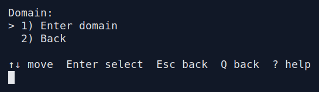

   [Read the captured terminal text](../assets/interactive/core-all-http-backend/02-enter-a-new-domain.txt)

2. Enter `example.com`.

   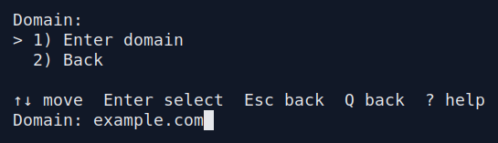

   [Read the captured terminal text](../assets/interactive/core-all-http-backend/03-name-the-application.txt)

3. Choose **HTTP**.

   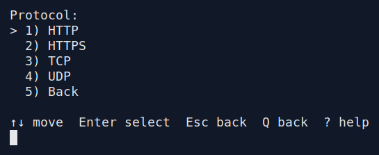

   [Read the captured terminal text](../assets/interactive/core-all-http-backend/04-choose-http.txt)

4. Choose **dockistrate-net**.

   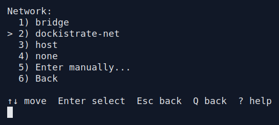

   [Read the captured terminal text](../assets/interactive/core-all-http-backend/05-use-the-default-network.txt)

5. Choose **Enter manually...**.

   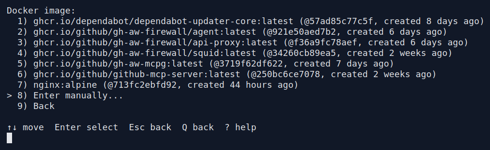

   [Read the captured terminal text](../assets/interactive/core-all-http-backend/06-enter-the-application-image.txt)

6. Enter `nginx:alpine`.

   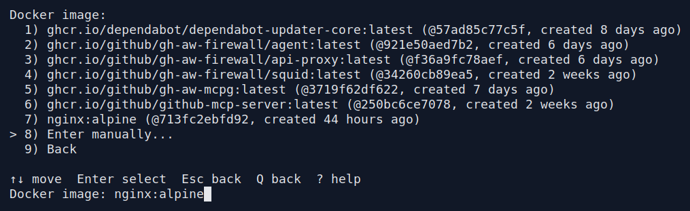

   [Read the captured terminal text](../assets/interactive/core-all-http-backend/07-use-nginx-alpine.txt)

7. Choose **80**.

   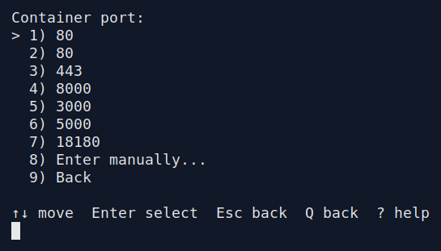

   [Read the captured terminal text](../assets/interactive/core-all-http-backend/08-set-container-port-80.txt)

8. Choose **Use default: 80**.

   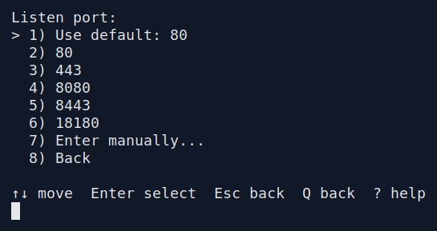

   [Read the captured terminal text](../assets/interactive/core-all-http-backend/09-expose-http-port-80.txt)

9. Choose **Disabled**.

   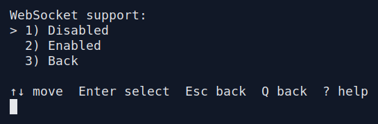

   [Read the captured terminal text](../assets/interactive/core-all-http-backend/10-leave-websocket-disabled.txt)

10. Choose **Expose now**.

    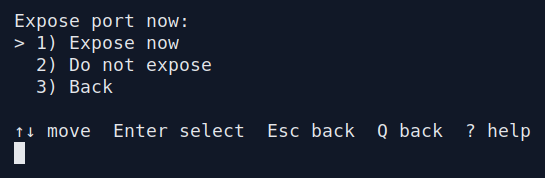

    [Read the captured terminal text](../assets/interactive/core-all-http-backend/11-expose-the-application-now.txt)

11. Press Enter to accept the displayed default or leave the optional value blank.

    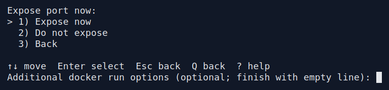

    [Read the captured terminal text](../assets/interactive/core-all-http-backend/12-keep-docker-options-empty.txt)

12. Review the collected inputs, then choose **Run**.

    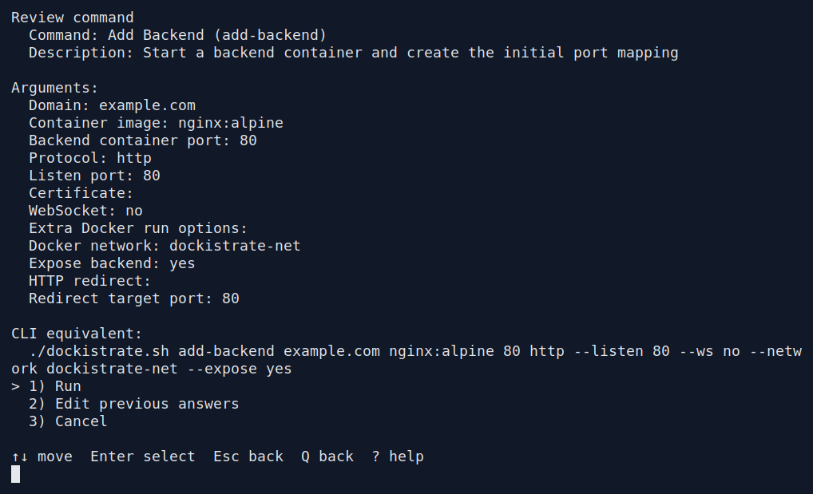

    [Read the captured terminal text](../assets/interactive/core-all-http-backend/13-review-the-http-backend.txt)

13. Backend created.

    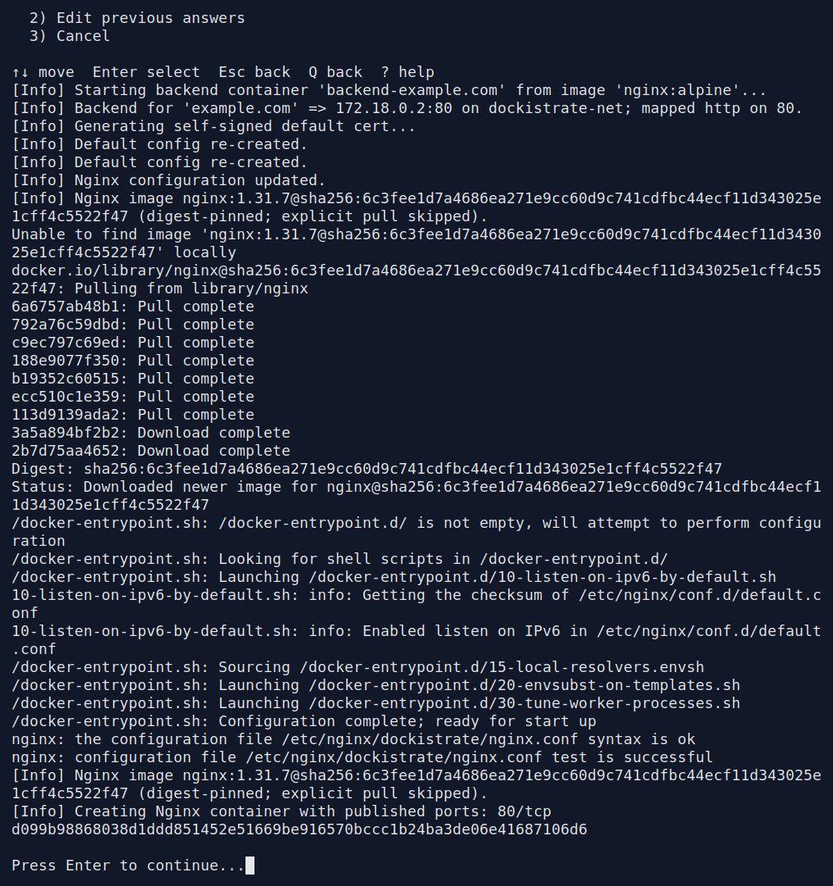

    [Read the captured terminal text](../assets/interactive/core-all-http-backend/14-backend-created.txt)

</details>

<details>
<summary>set-backend-acl-policy — inputs and result</summary>

1. Choose **Backend Access Overrides**.

   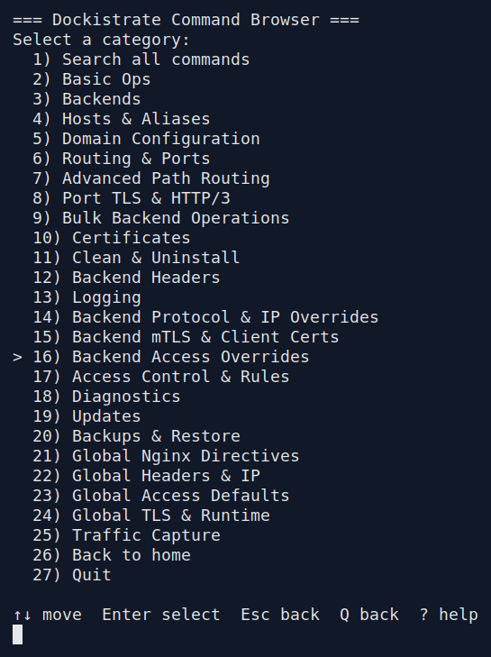

   [Read the captured terminal text](../assets/interactive/core-all-public-demo-access/02-open-backend-access-settings.txt)

2. Choose **Set Backend ACL Policy — Override ACL allow/deny policy for a backend, alias, or**.

   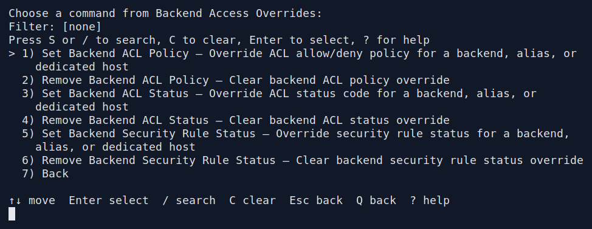

   [Read the captured terminal text](../assets/interactive/core-all-public-demo-access/03-set-the-domain-acl-policy.txt)

3. Choose **example.com**.

   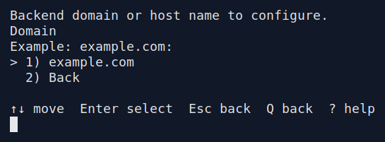

   [Read the captured terminal text](../assets/interactive/core-all-public-demo-access/04-select-example-com.txt)

4. Choose **allow**.

   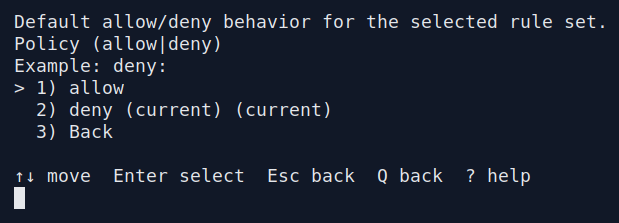

   [Read the captured terminal text](../assets/interactive/core-all-public-demo-access/05-allow-this-public-demo.txt)

5. Review the collected inputs, then choose **Run**.

   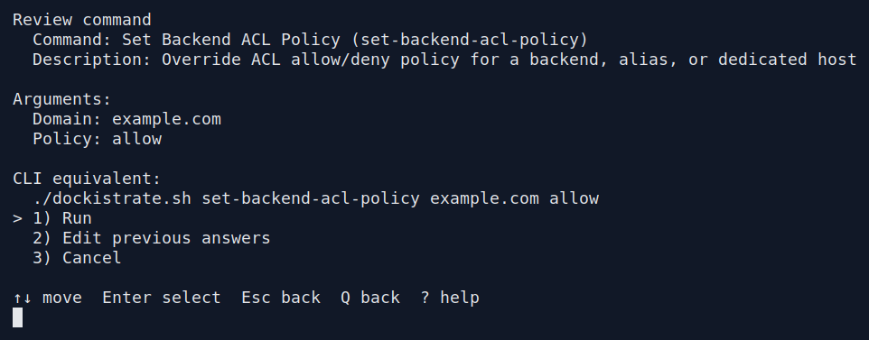

   [Read the captured terminal text](../assets/interactive/core-all-public-demo-access/06-review-the-public-demo-policy.txt)

6. Public demo policy applied.

   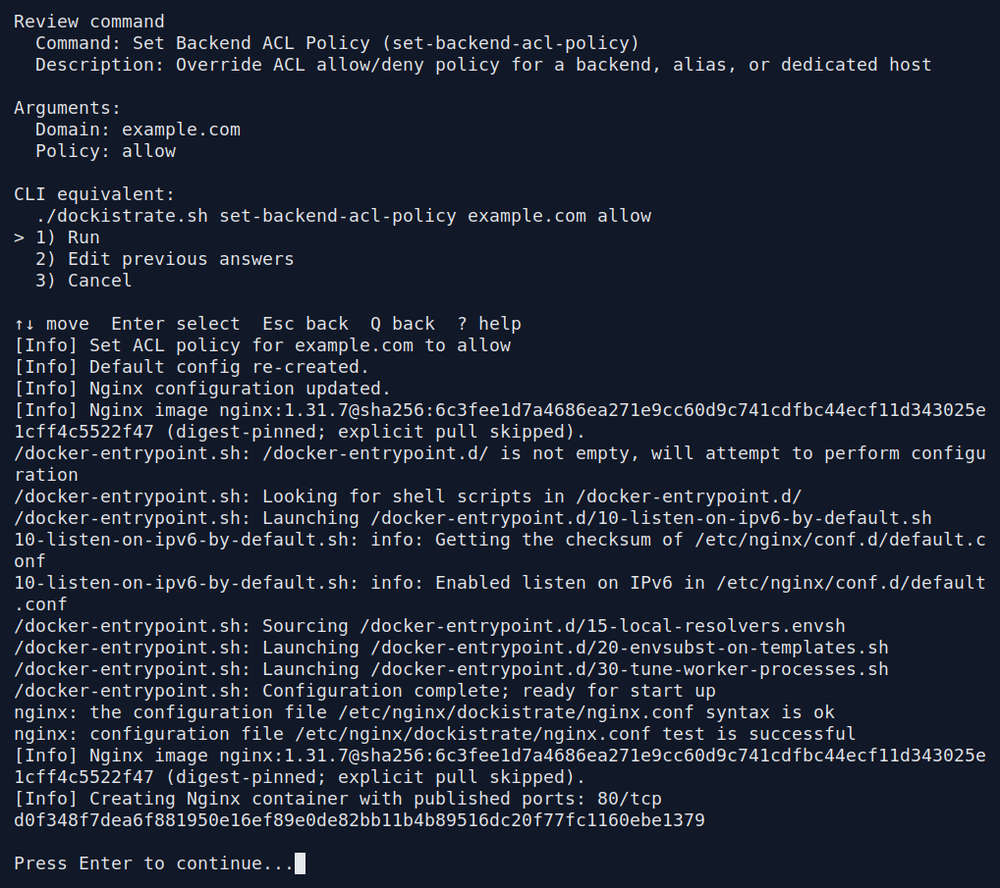

   [Read the captured terminal text](../assets/interactive/core-all-public-demo-access/07-public-demo-policy-applied.txt)

</details>

<details>
<summary>HTTP responds successfully</summary>

1. HTTP responds successfully.

   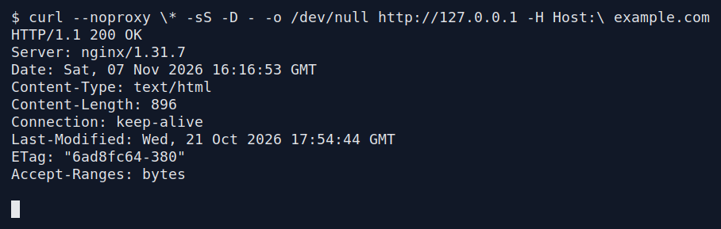

   [Read the captured terminal text](../assets/interactive/core-all-verify-http/01-http-responds-successfully.txt)

</details>

<details>
<summary>check-config — inputs and result</summary>

1. Configuration test passed.

   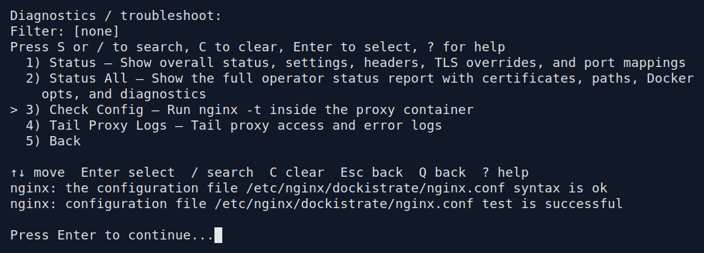

   [Read the captured terminal text](../assets/interactive/core-all-check-http/03-configuration-test-passed.txt)

</details>

<!-- /walkthrough: backend-create -->

**Check:** **List Backends** should list `example.com`; **List Port Mappings**
should show HTTP `80 → 80`. New configurations deny requests at both ACL address
layers. For an isolated public demo, set the backend ACL policy to `allow`, then
request the page as shown in [Verification](#verification). For a private service,
configure the intended client and peer allowances instead.

**CLI:** `./dockistrate.sh add-backend example.com nginx:alpine 80 http`

Choose **Do not expose** to create only the backend (`--no-expose` in the CLI).
HTTPS adds certificate, HTTP-to-HTTPS redirect, and redirect-target choices;
follow the [certificate guide](tls-certificates-http3.md). TCP and UDP omit
certificate, redirect, and WebSocket questions. To undo this demo, use
[Remove Backend](#cmd-remove-backend); it removes the container and its mappings.

<a id="cmd-update-backend"></a>
### Replace an image or change container options

1. Open **Advanced command browser** → **Backends** → **Update Backend** and
   select `example.com`.
2. At the image choice, select **Enter manually...** and enter the required image
   tag or digest. **Keep current** avoids an image replacement and retains the
   saved image. Choose **Keep current** at the container-port prompt to retain it.
3. When changing the image, select its container port. For Docker options choose
   **Keep current**, clear them, or enter the complete replacement options;
   finish manual options with an empty line. Choose the existing or a new network.
4. Review the resulting command and choose **Run**. Check **List Backends** and
   request the application again. A stopped backend remains stopped.

<!-- walkthrough: backend-update -->

<details>
<summary>update-backend — inputs and result</summary>

1. Choose **example.com**.

   

   [Read the captured terminal text](../assets/interactive/core-services-backend-update/03-example-com.txt)

2. Choose **Enter manually...**.

   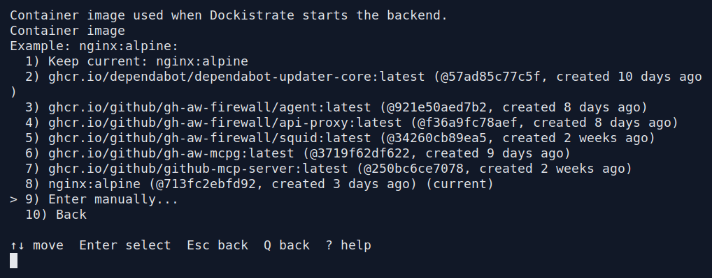

   [Read the captured terminal text](../assets/interactive/core-services-backend-update/04-enter-manually.txt)

3. Enter `nginx:alpine`.

   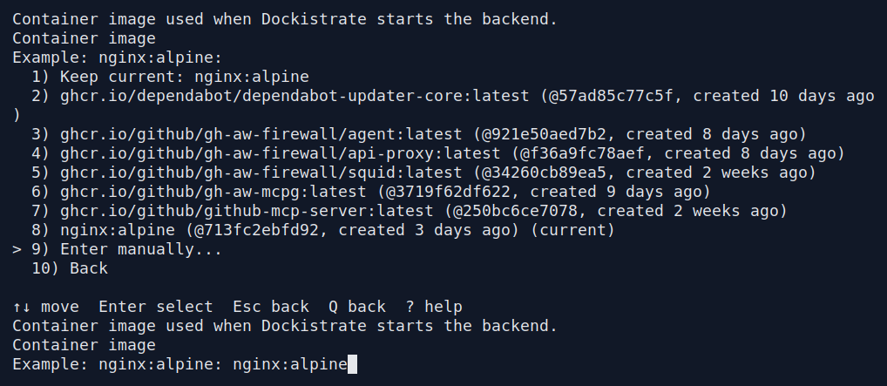

   [Read the captured terminal text](../assets/interactive/core-services-backend-update/05-enter-value.txt)

4. Choose **Keep current: 80**.

   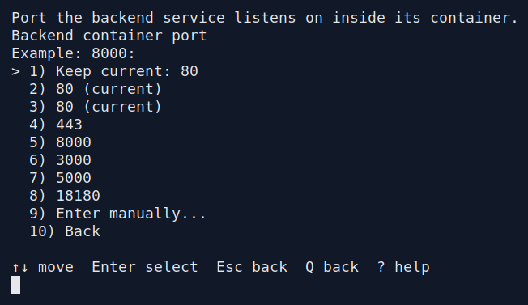

   [Read the captured terminal text](../assets/interactive/core-services-backend-update/06-keep-current-80.txt)

5. Choose **Keep current: (none)**.

   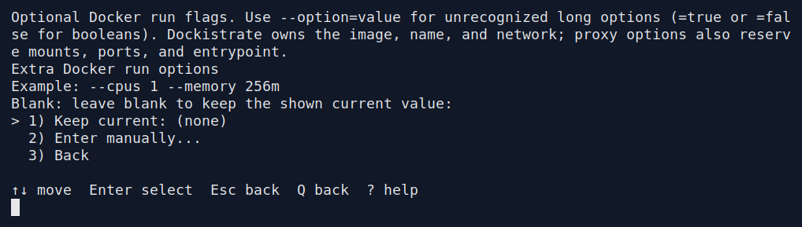

   [Read the captured terminal text](../assets/interactive/core-services-backend-update/07-keep-current-none.txt)

6. Choose **dockistrate-net (current)**.

   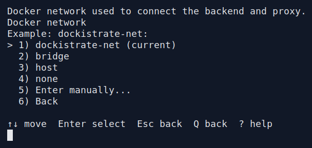

   [Read the captured terminal text](../assets/interactive/core-services-backend-update/08-dockistrate-net-current.txt)

7. Review the collected inputs, then choose **Run**.

   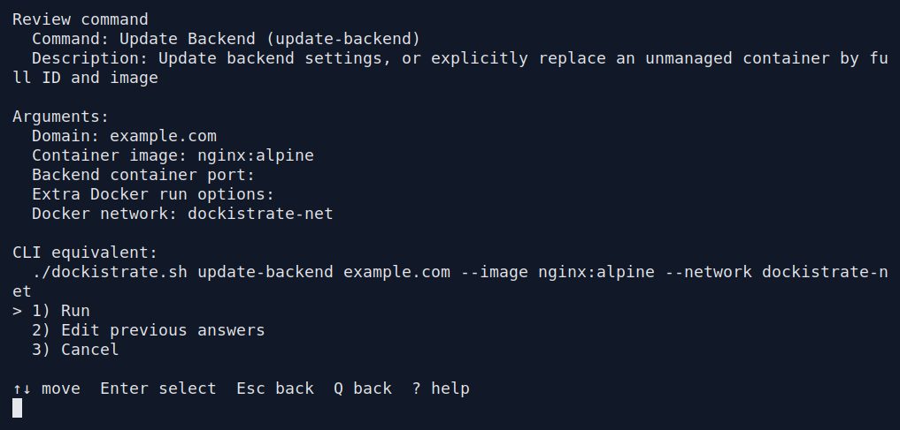

   [Read the captured terminal text](../assets/interactive/core-services-backend-update/09-review-and-run-update-backend.txt)

8. update-backend result.

   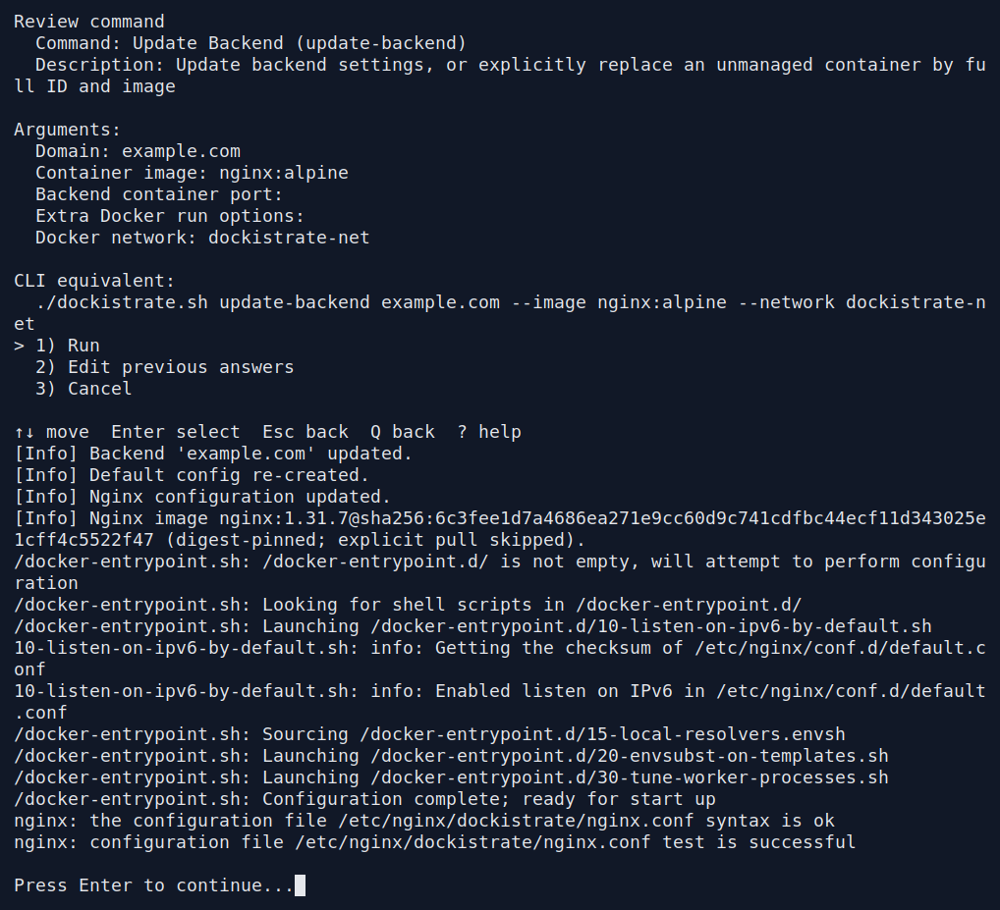

   [Read the captured terminal text](../assets/interactive/core-services-backend-update/10-update-backend-result.txt)

</details>

<details>
<summary>replace-backend-network — inputs and result</summary>

1. Choose **example.com**.

   

   [Read the captured terminal text](../assets/interactive/core-services-backend-network/03-example-com.txt)

2. Choose **Enter manually...**.

   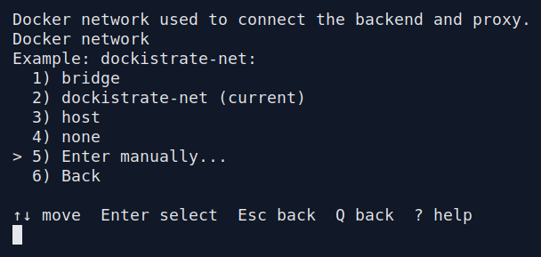

   [Read the captured terminal text](../assets/interactive/core-services-backend-network/04-enter-manually.txt)

3. Enter `docs-secondary`.

   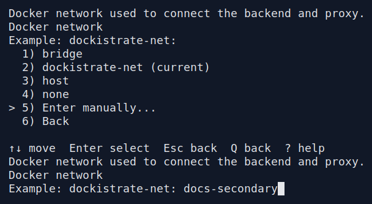

   [Read the captured terminal text](../assets/interactive/core-services-backend-network/05-enter-value.txt)

4. Review the collected inputs, then choose **Run**.

   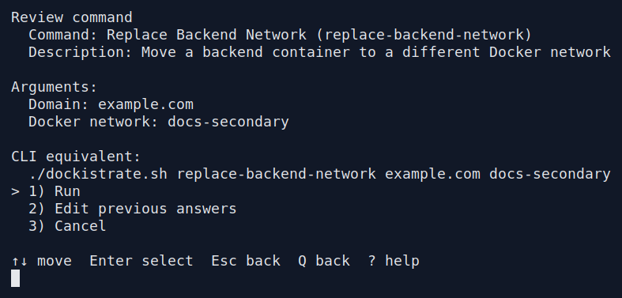

   [Read the captured terminal text](../assets/interactive/core-services-backend-network/06-review-and-run-replace-backend-network.txt)

5. replace-backend-network result.

   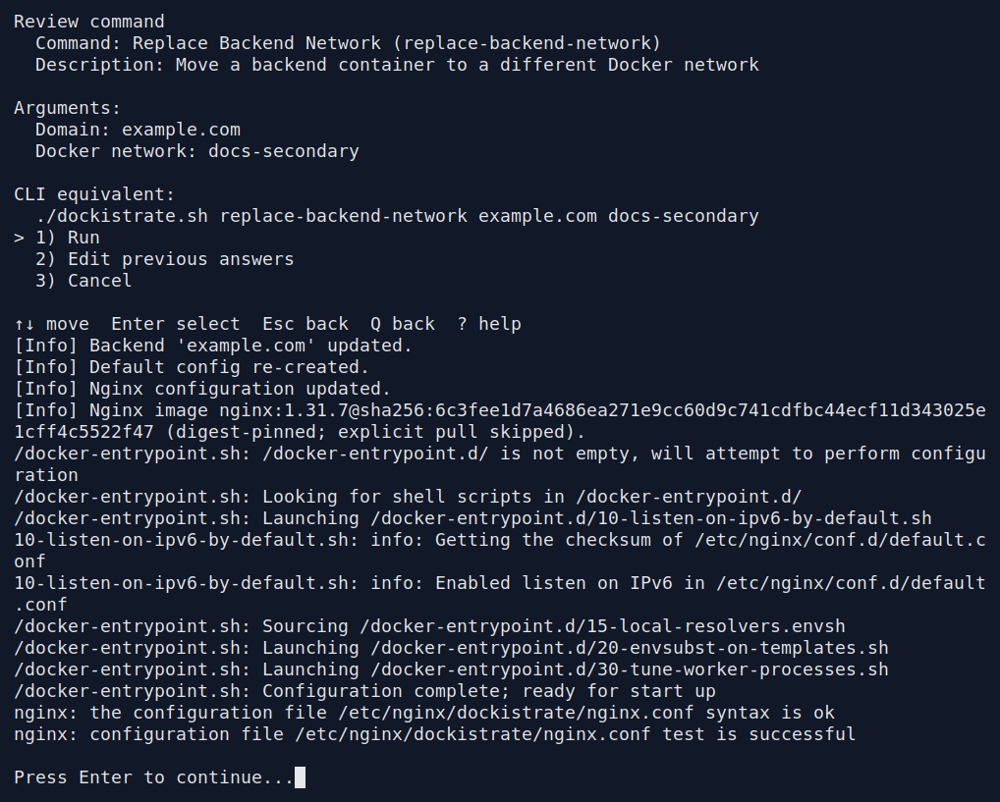

   [Read the captured terminal text](../assets/interactive/core-services-backend-network/07-replace-backend-network-result.txt)

</details>

<!-- /walkthrough: backend-update -->

**CLI:** `./dockistrate.sh update-backend example.com --image nginx:alpine`

Image replacement interrupts connections and does not copy the old container's
writable layer. Keep application data in persistent storage. To revert an image,
run Update Backend with the previous tag or digest and saved options; use your
application backup if its data changed. Missing ownership identity adds an
explicit full-container-ID step; see [Backend Identity and Upgrades](#backend-identity-and-upgrades).

<a id="cmd-replace-backend-network"></a>
**Move only the network:** choose **Replace Backend Network**, select the backend,
then the destination network (or **Enter manually...**), review, and **Run**.
Verify the reported network and a request; select the original network to undo.
The command also moves a stopped backend without starting it.

**CLI:** `./dockistrate.sh replace-backend-network example.com docs-secondary`

### Start, stop, and inspect services

Open **Start / stop services** from Home, or **Advanced command browser** →
**Backends**. Select the operation and backend, review the target, then **Run**. Read-only list commands run directly; removal also asks for `YES`.
Use `./dockistrate.sh` before each CLI equivalent below.
Operations such as **Stop Nginx** and **Stop All Backends** need no target
arguments: their review shows `(none)`; check the command's scope before running.

<!-- walkthrough: backend-lifecycle -->

<details>
<summary>list-backends — inputs and result</summary>

1. list-backends result.

   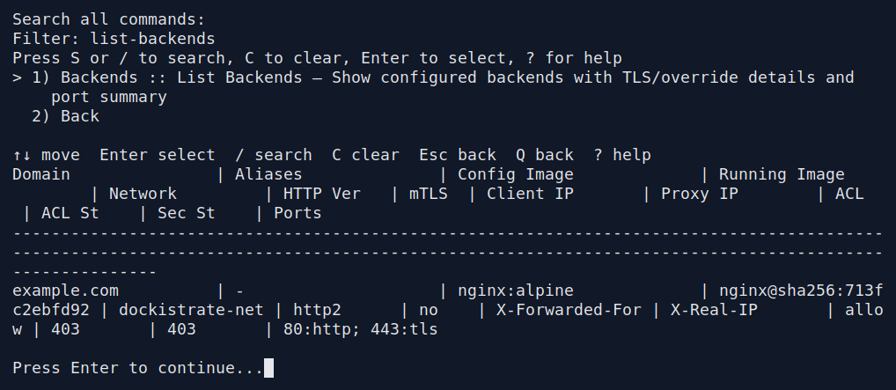

   [Read the captured terminal text](../assets/interactive/core-services-list-backends/03-list-backends-result.txt)

</details>

<details>
<summary>stop-backend — inputs and result</summary>

1. Choose **example.com**.

   

   [Read the captured terminal text](../assets/interactive/core-services-backend-lifecycle-stop/03-example-com.txt)

2. Review the collected inputs, then choose **Run**.

   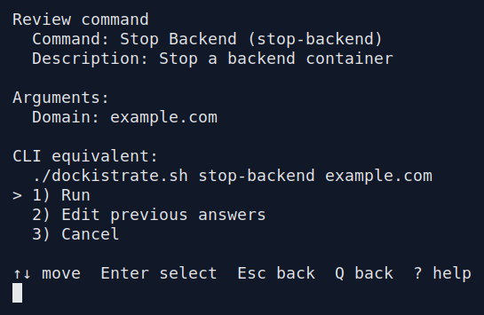

   [Read the captured terminal text](../assets/interactive/core-services-backend-lifecycle-stop/04-review-and-run-stop-backend.txt)

3. stop-backend result.

   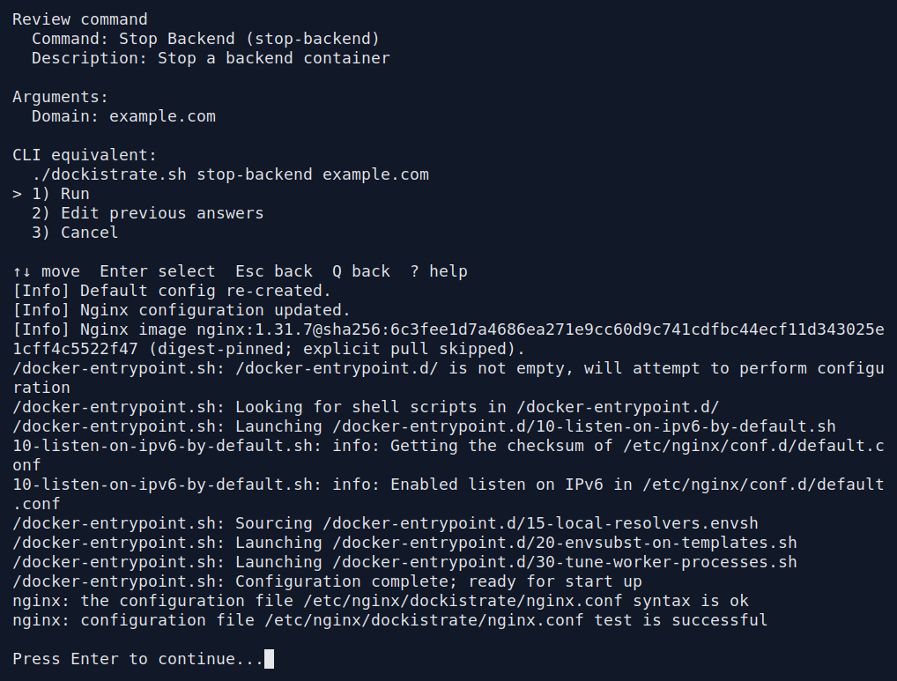

   [Read the captured terminal text](../assets/interactive/core-services-backend-lifecycle-stop/05-stop-backend-result.txt)

</details>

<details>
<summary>start-backend — inputs and result</summary>

1. Choose **example.com**.

   

   [Read the captured terminal text](../assets/interactive/core-services-backend-lifecycle-start/03-example-com.txt)

2. Review the collected inputs, then choose **Run**.

   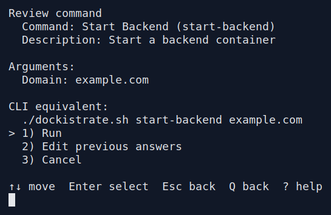

   [Read the captured terminal text](../assets/interactive/core-services-backend-lifecycle-start/04-review-and-run-start-backend.txt)

3. start-backend result.

   

   [Read the captured terminal text](../assets/interactive/core-services-backend-lifecycle-start/05-start-backend-result.txt)

</details>

<details>
<summary>restart-backend — inputs and result</summary>

1. Choose **example.com**.

   

   [Read the captured terminal text](../assets/interactive/core-services-backend-lifecycle-restart/03-example-com.txt)

2. Review the collected inputs, then choose **Run**.

   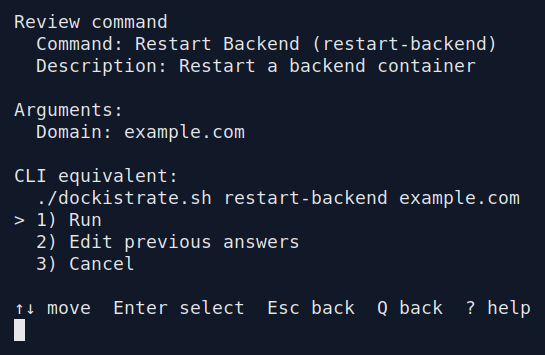

   [Read the captured terminal text](../assets/interactive/core-services-backend-lifecycle-restart/04-review-and-run-restart-backend.txt)

3. restart-backend result.

   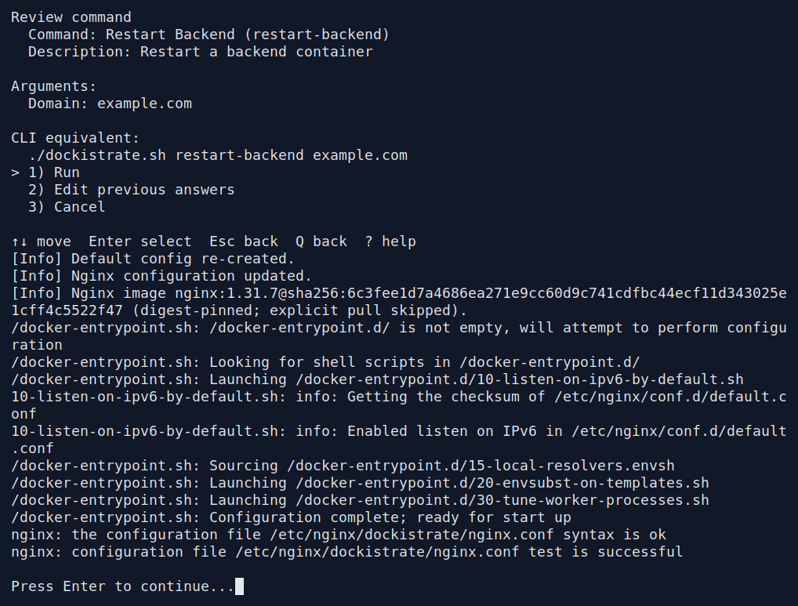

   [Read the captured terminal text](../assets/interactive/core-services-backend-lifecycle-restart/05-restart-backend-result.txt)

</details>

<details>
<summary>update-nginx-config — inputs and result</summary>

1. Review the collected inputs, then choose **Run**.

   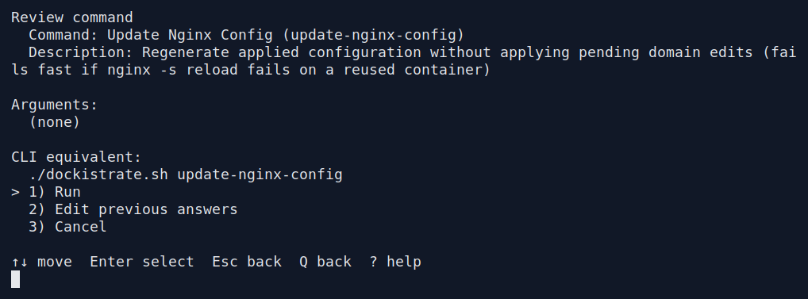

   [Read the captured terminal text](../assets/interactive/core-services-proxy-regenerate/03-review-and-run-update-nginx-config.txt)

2. update-nginx-config result.

   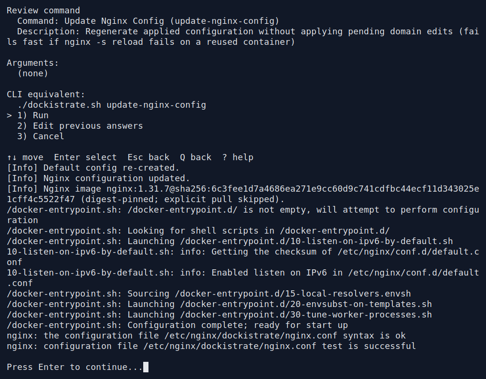

   [Read the captured terminal text](../assets/interactive/core-services-proxy-regenerate/04-update-nginx-config-result.txt)

</details>

<details>
<summary>check-config — inputs and result</summary>

1. Configuration test passed.

   

   [Read the captured terminal text](../assets/interactive/core-services-proxy-regenerate-check/03-configuration-test-passed.txt)

</details>

<details>
<summary>stop-nginx — inputs and result</summary>

1. Review the collected inputs, then choose **Run**.

   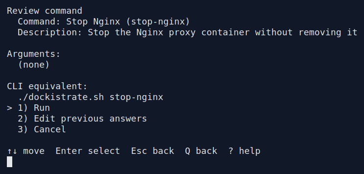

   [Read the captured terminal text](../assets/interactive/core-services-proxy-stop/03-review-and-run-stop-nginx.txt)

2. stop-nginx result.

   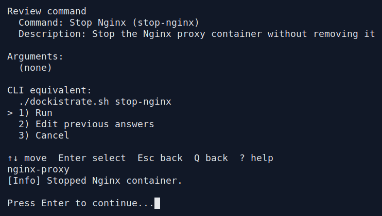

   [Read the captured terminal text](../assets/interactive/core-services-proxy-stop/04-stop-nginx-result.txt)

</details>

<details>
<summary>remove-nginx — inputs and result</summary>

1. Review the collected inputs, then choose **Run**.

   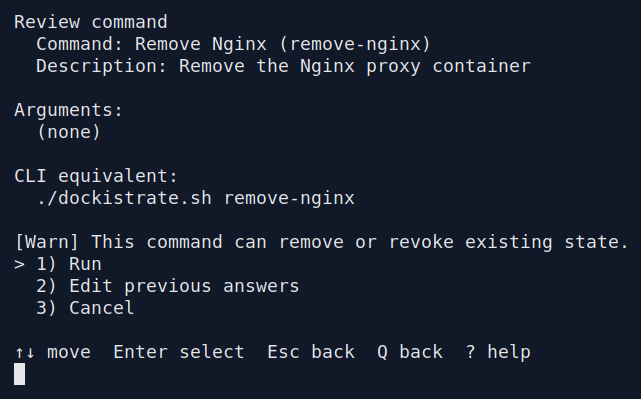

   [Read the captured terminal text](../assets/interactive/core-services-proxy-remove/03-review-and-run-remove-nginx.txt)

2. Enter `YES`.

   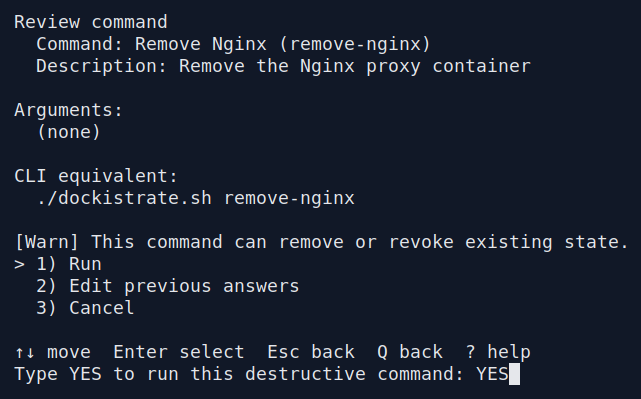

   [Read the captured terminal text](../assets/interactive/core-services-proxy-remove/04-confirm-removal.txt)

3. remove-nginx result.

   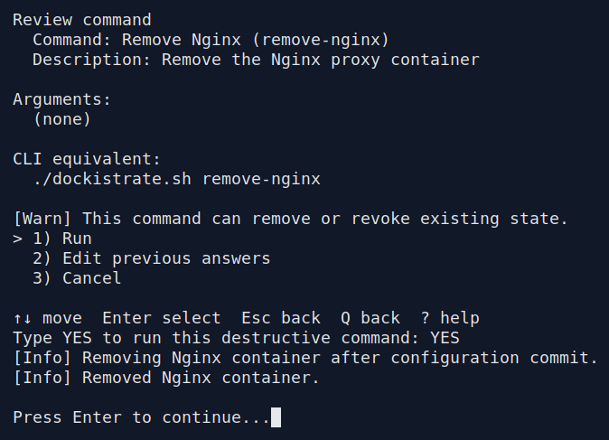

   [Read the captured terminal text](../assets/interactive/core-services-proxy-remove/05-remove-nginx-result.txt)

</details>

<details>
<summary>remove-backend — inputs and result</summary>

1. Choose **protocol.example.com**.

   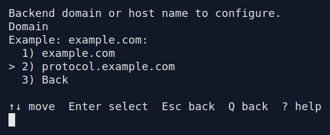

   [Read the captured terminal text](../assets/interactive/core-protocols-backend-remove/03-protocol-example-com.txt)

2. Review the collected inputs, then choose **Run**.

   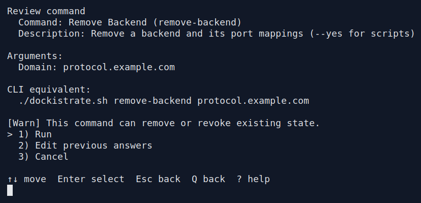

   [Read the captured terminal text](../assets/interactive/core-protocols-backend-remove/04-review-and-run-remove-backend.txt)

3. Enter `YES`.

   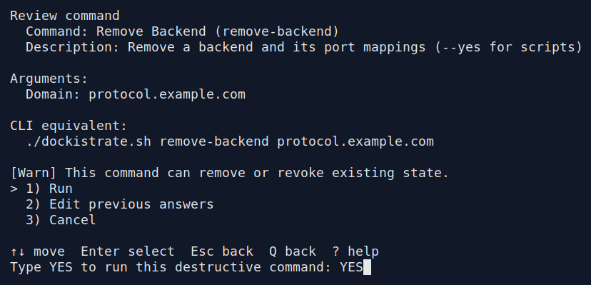

   [Read the captured terminal text](../assets/interactive/core-protocols-backend-remove/05-confirm-removal.txt)

4. Enter `y`.

   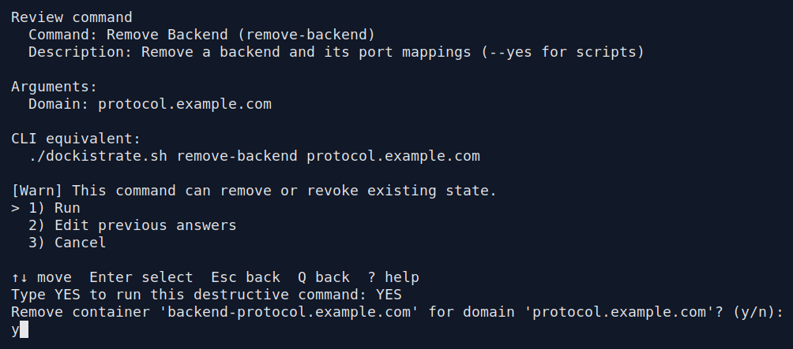

   [Read the captured terminal text](../assets/interactive/core-protocols-backend-remove/06-confirm-container-removal.txt)

5. remove-backend result.

   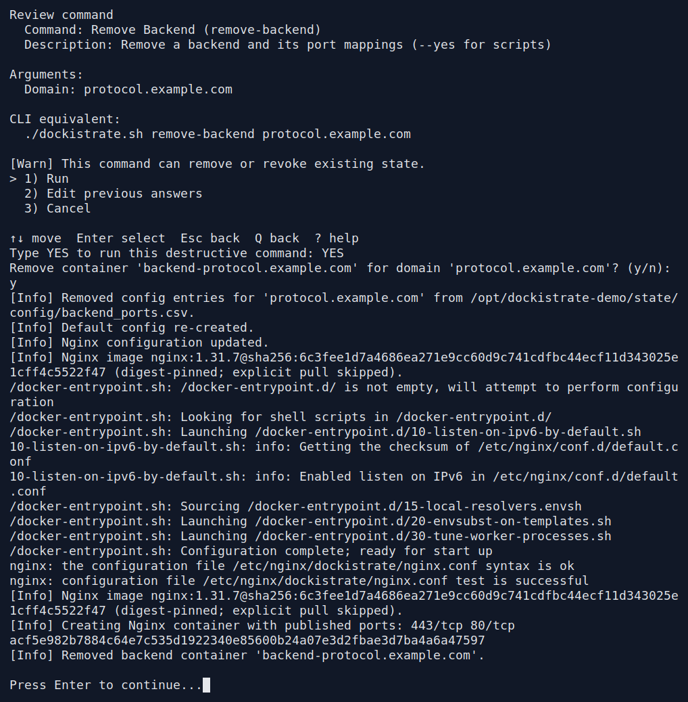

   [Read the captured terminal text](../assets/interactive/core-protocols-backend-remove/07-remove-backend-result.txt)

</details>

<!-- /walkthrough: backend-lifecycle -->

| Operation | Selection and check | CLI equivalent |
| --- | --- | --- |
| <a id="cmd-list-backends"></a>List Backends | No arguments; inspect the configured domains and container state. | `list-backends` |
| <a id="cmd-start-backend"></a>Start Backend | Select `example.com`; check it is running and serving its application. Undo with Stop Backend. | `start-backend example.com` |
| <a id="cmd-stop-backend"></a>Stop Backend | Select `example.com`; check it is stopped. Start Backend resumes it. | `stop-backend example.com` |
| <a id="cmd-restart-backend"></a>Restart Backend | Select `example.com`; check it returns to running. Existing connections are interrupted. | `restart-backend example.com` |
| <a id="cmd-remove-backend"></a>Remove Backend | From **Backends**, select `example.com`; review removal and answer the displayed container-removal confirmation. Check the backend and its mappings are absent. Restore requires the saved configuration and application data. | `remove-backend --yes example.com` |
| <a id="cmd-start-nginx"></a>Start Nginx | Choose the proxy image and Docker options; **Keep current** preserves each saved value. Review, Run, then Check Config and request a configured listener. | `start-nginx` |
| <a id="cmd-stop-nginx"></a>Stop Nginx | No target arguments; all proxied traffic stops. Check Status; Start Nginx resumes service. | `stop-nginx` |
| <a id="cmd-remove-nginx"></a>Remove Nginx | No target arguments; removes the proxy container. Check Status; Start Nginx recreates it from saved settings. | `remove-nginx` |
| <a id="cmd-update-nginx-config"></a>Update Nginx Config | From **Basic Ops**, review and Run to regenerate the applied configuration. Check Config verifies syntax; this does not apply pending CSV edits. | `update-nginx-config` |

### Choose a proxy image and clear saved options

**Before starting:** use a disposable installation with the HTTP backend above.
Record the current proxy image and options. The capture uses a local alias of
the already running proxy image so its Nginx capabilities remain the same:

```bash
docker tag "$(docker inspect --format '{{.Config.Image}}' nginx-proxy)" docs-nginx:review
```

This image-tag preparation uses Docker because Dockistrate does not create image
aliases. All proxy changes below use Dockistrate.

1. Choose **Start / stop services → Start Nginx**. For the image, choose
   **Enter manually...** → `docs-nginx:review`; for **Extra Docker run options**,
   choose **Enter manually...** → `--memory 256m`, then submit an empty line to
   finish the options input.
2. Review **nginx image: docs-nginx:review** and **Extra Docker run options:
   --memory 256m**, then **Run**. **Check Config** must pass; request the backend
   and inspect the proxy's image and memory limit (`268435456` bytes).
3. Open **Start Nginx** again. Keep the current image and choose **Clear current
   options**. Review **Extra Docker run options: (clear)** and **Run**. The image
   stays selected and Docker's memory limit returns to `0` (unlimited). Repeat
   **Check Config** and the application request.

<!-- walkthrough: proxy-start-settings -->

<details>
<summary>start-nginx — Keep the current image and Docker options</summary>

1. Choose **Keep current: nginx:1.31.7@sha256:6c3fee1d7a4686ea271e9cc60d9c741cdfbc44ecf11d343025e1cff4c5522f47**.

   

   [Read the captured terminal text](../assets/interactive/core-services-proxy-start/03-keep-current-nginx-1-31-7-sha256-6c3fee1d7a4686ea271e9cc60d9c741cdfbc44ecf11d343.txt)

2. Choose **Keep current: (none)**.

   

   [Read the captured terminal text](../assets/interactive/core-services-proxy-start/04-keep-current-none.txt)

3. Review the collected inputs, then choose **Run**.

   

   [Read the captured terminal text](../assets/interactive/core-services-proxy-start/05-review-and-run-start-nginx.txt)

4. start-nginx result.

   

   [Read the captured terminal text](../assets/interactive/core-services-proxy-start/06-start-nginx-result.txt)

</details>

<details>
<summary>start-nginx — Choose an image and a memory limit</summary>

1. Choose **Enter manually...**.

   

   [Read the captured terminal text](../assets/interactive/core-services-proxy-start-custom/03-enter-manually.txt)

2. Enter `docs-nginx:review`.

   

   [Read the captured terminal text](../assets/interactive/core-services-proxy-start-custom/04-enter-value.txt)

3. Choose **Enter manually...**.

   

   [Read the captured terminal text](../assets/interactive/core-services-proxy-start-custom/05-enter-manually.txt)

4. Enter `--memory 256m`.

   

   [Read the captured terminal text](../assets/interactive/core-services-proxy-start-custom/06-enter-value.txt)

5. Press Enter on an empty line to finish entering Docker options.

   

   [Read the captured terminal text](../assets/interactive/core-services-proxy-start-custom/07-enter-value.txt)

6. Review the collected inputs, then choose **Run**.

   

   [Read the captured terminal text](../assets/interactive/core-services-proxy-start-custom/08-review-and-run-start-nginx.txt)

7. start-nginx result.

   

   [Read the captured terminal text](../assets/interactive/core-services-proxy-start-custom/09-start-nginx-result.txt)

</details>

<details>
<summary>Verify the selected proxy image and memory limit</summary>

1. Verify the selected proxy image and memory limit.

   

   [Read the captured terminal text](../assets/interactive/core-services-proxy-custom-verified/01-verify-the-selected-proxy-image-and-memory-limit.txt)

</details>

<details>
<summary>check-config — inputs and result</summary>

1. Configuration test passed.

   

   [Read the captured terminal text](../assets/interactive/core-services-proxy-custom-config/03-configuration-test-passed.txt)

</details>

<details>
<summary>Verify the application response</summary>

1. Verify the application response.

   

   [Read the captured terminal text](../assets/interactive/core-services-proxy-custom-response/01-verify-the-application-response.txt)

</details>

<details>
<summary>start-nginx — Clear saved Docker options while retaining the image</summary>

1. Choose **Keep current: docs-nginx:review**.

   

   [Read the captured terminal text](../assets/interactive/core-services-proxy-start-clear/03-keep-current-docs-nginx-review.txt)

2. Choose **Clear current options**.

   

   [Read the captured terminal text](../assets/interactive/core-services-proxy-start-clear/04-clear-current-options.txt)

3. Review the collected inputs, then choose **Run**.

   

   [Read the captured terminal text](../assets/interactive/core-services-proxy-start-clear/05-review-and-run-start-nginx.txt)

4. start-nginx result.

   

   [Read the captured terminal text](../assets/interactive/core-services-proxy-start-clear/06-start-nginx-result.txt)

</details>

<details>
<summary>Verify cleared options and the retained proxy image</summary>

1. Verify cleared options and the retained proxy image.

   

   [Read the captured terminal text](../assets/interactive/core-services-proxy-clear-verified/01-verify-cleared-options-and-the-retained-proxy-image.txt)

</details>

<details>
<summary>check-config — inputs and result</summary>

1. Configuration test passed.

   

   [Read the captured terminal text](../assets/interactive/core-services-proxy-cleared-config/03-configuration-test-passed.txt)

</details>

<details>
<summary>Verify the application response</summary>

1. Verify the application response.

   

   [Read the captured terminal text](../assets/interactive/core-services-proxy-cleared-response/01-verify-the-application-response.txt)

</details>

<!-- /walkthrough: proxy-start-settings -->

```bash
./dockistrate.sh start-nginx --nginx-image docs-nginx:review --docker-opts '--memory 256m'
docker inspect --format '{{.Config.Image}}|{{.HostConfig.Memory}}' nginx-proxy
./dockistrate.sh start-nginx --docker-opts ''
./dockistrate.sh check-config
curl --noproxy '*' -i http://127.0.0.1 -H 'Host: example.com'
```

To undo, select the recorded original image and options through **Start Nginx**.
Choose **Keep current** when a saved value should remain unchanged; clearing
options is an explicit choice.

### Operate on every backend

Open **Advanced command browser** → **Bulk Backend Operations**. These commands
have no domain prompt: review the all-backend scope before **Run**. Use a disposable
setup for removal examples; a sequence of removals is not one reversible operation.
Interactive removal asks separately about each container. Declined backends remain
configured and are excluded from the reported removal count. CLI removal without
`-i` automatically confirms; `./dockistrate.sh -i remove-all-backends` asks per container.

<!-- walkthrough: backend-bulk -->

<details>
<summary>stop-all-backends — inputs and result</summary>

1. Review the collected inputs, then choose **Run**.

   

   [Read the captured terminal text](../assets/interactive/core-services-backend-bulk-stop/03-review-and-run-stop-all-backends.txt)

2. stop-all-backends result.

   

   [Read the captured terminal text](../assets/interactive/core-services-backend-bulk-stop/04-stop-all-backends-result.txt)

</details>

<details>
<summary>start-all-backends — inputs and result</summary>

1. Review the collected inputs, then choose **Run**.

   

   [Read the captured terminal text](../assets/interactive/core-services-backend-bulk-start/03-review-and-run-start-all-backends.txt)

2. start-all-backends result.

   

   [Read the captured terminal text](../assets/interactive/core-services-backend-bulk-start/04-start-all-backends-result.txt)

</details>

<details>
<summary>restart-all-backends — inputs and result</summary>

1. Review the collected inputs, then choose **Run**.

   

   [Read the captured terminal text](../assets/interactive/core-services-backend-bulk-restart/03-review-and-run-restart-all-backends.txt)

2. restart-all-backends result.

   

   [Read the captured terminal text](../assets/interactive/core-services-backend-bulk-restart/04-restart-all-backends-result.txt)

</details>

<details>
<summary>remove-all-backends — inputs and result</summary>

1. Review the collected inputs, then choose **Run**.

   

   [Read the captured terminal text](../assets/interactive/core-services-backend-bulk-remove/03-review-and-run-remove-all-backends.txt)

2. Enter `YES`.

   

   [Read the captured terminal text](../assets/interactive/core-services-backend-bulk-remove/04-confirm-removal.txt)

3. Enter `y`.

   

   [Read the captured terminal text](../assets/interactive/core-services-backend-bulk-remove/05-confirm-container-removal.txt)

4. Enter `y`.

   

   [Read the captured terminal text](../assets/interactive/core-services-backend-bulk-remove/06-confirm-container-removal.txt)

5. remove-all-backends result.

   

   [Read the captured terminal text](../assets/interactive/core-services-backend-bulk-remove/07-remove-all-backends-result.txt)

</details>

<!-- /walkthrough: backend-bulk -->

| Operation | Result to check with List Backends | CLI equivalent |
| --- | --- | --- |
| <a id="cmd-start-all-backends"></a>Start All Backends | All configured backend containers are running. | `start-all-backends` |
| <a id="cmd-stop-all-backends"></a>Stop All Backends | All configured backend containers are stopped; Start All Backends resumes them. | `stop-all-backends` |
| <a id="cmd-restart-all-backends"></a>Restart All Backends | All configured containers return to running, including previously stopped ones. Connections are interrupted. | `restart-all-backends` |
| <a id="cmd-remove-all-backends"></a>Remove All Backends | After Run and `YES`, answer `y` or `n` for each managed container. Declining preserves that backend and continues to the next; the summary counts actual removals. Check List Backends. Recovery requires saved configuration and application data. | `remove-all-backends` |

<a id="cmd-add-port"></a>
### Expose another HTTP port

**Before you start:** `example.com` must exist and serve container port 80;
host port 8080 must be free.

1. Choose **Expose or update a port** → **Add Port** and select `example.com`.
2. Select or manually enter listen port `8080`, container port `80`, then **HTTP**.
3. Choose WebSocket `no`. Review `8080 → 80` and the protocol, then **Run**.
4. Open **List Port Mappings**, then **Check Config**. Request
   `http://127.0.0.1:8080` with `Host: example.com` after configuring its ACL.

<!-- walkthrough: ports-http -->

<details>
<summary>add-port — inputs and result</summary>

1. Choose **example.com**.

   

   [Read the captured terminal text](../assets/interactive/core-all-https-port/03-select-the-existing-application.txt)

2. Choose **443**.

   

   [Read the captured terminal text](../assets/interactive/core-all-https-port/04-expose-https-port-443.txt)

3. Choose **80**.

   

   [Read the captured terminal text](../assets/interactive/core-all-https-port/05-keep-backend-port-80.txt)

4. Choose **HTTPS**.

   

   [Read the captured terminal text](../assets/interactive/core-all-https-port/06-choose-https.txt)

5. Choose **Generate self-signed certificate (current)**.

   

   [Read the captured terminal text](../assets/interactive/core-all-https-port/07-generate-a-local-certificate.txt)

6. Choose **no (current)**.

   

   [Read the captured terminal text](../assets/interactive/core-all-https-port/08-keep-websocket-off.txt)

7. Choose **Off (current)**.

   

   [Read the captured terminal text](../assets/interactive/core-all-https-port/09-keep-http3-off.txt)

8. Choose **Auto (current)**.

   

   [Read the captured terminal text](../assets/interactive/core-all-https-port/10-keep-automatic-alt-svc.txt)

9. Review the collected inputs, then choose **Run**.

   

   [Read the captured terminal text](../assets/interactive/core-all-https-port/11-review-https-configuration.txt)

10. HTTPS listener created.

    

    [Read the captured terminal text](../assets/interactive/core-all-https-port/12-https-listener-created.txt)

</details>

<details>
<summary>Local HTTPS responds successfully</summary>

1. Local HTTPS responds successfully.

   

   [Read the captured terminal text](../assets/interactive/core-all-verify-https/01-local-https-responds-successfully.txt)

</details>

<details>
<summary>check-config — inputs and result</summary>

1. Configuration test passed.

   

   [Read the captured terminal text](../assets/interactive/core-all-check-https/03-configuration-test-passed.txt)

</details>

<details>
<summary>list-port-mappings — inputs and result</summary>

1. list-port-mappings result.

   

   [Read the captured terminal text](../assets/interactive/core-services-navigation-search/03-list-port-mappings-result.txt)

</details>

<details>
<summary>add-port — inputs and result</summary>

1. Choose **example.com**.

   

   [Read the captured terminal text](../assets/interactive/core-routing-ports-http/03-example-com.txt)

2. Choose **Enter manually...**.

   

   [Read the captured terminal text](../assets/interactive/core-routing-ports-http/04-enter-manually.txt)

3. Enter `8080`.

   

   [Read the captured terminal text](../assets/interactive/core-routing-ports-http/05-enter-value.txt)

4. Choose **Enter manually...**.

   

   [Read the captured terminal text](../assets/interactive/core-routing-ports-http/06-enter-manually.txt)

5. Enter `80`.

   

   [Read the captured terminal text](../assets/interactive/core-routing-ports-http/07-enter-value.txt)

6. Choose **HTTP (current)**.

   

   [Read the captured terminal text](../assets/interactive/core-routing-ports-http/08-http-current.txt)

7. Choose **no (current)**.

   

   [Read the captured terminal text](../assets/interactive/core-routing-ports-http/09-no-current.txt)

8. Review the collected inputs, then choose **Run**.

   

   [Read the captured terminal text](../assets/interactive/core-routing-ports-http/10-review-and-run-add-port.txt)

9. add-port result.

   

   [Read the captured terminal text](../assets/interactive/core-routing-ports-http/11-add-port-result.txt)

</details>

<details>
<summary>Verify the application response</summary>

1. Verify the application response.

   

   [Read the captured terminal text](../assets/interactive/core-routing-http-extra-port/01-verify-the-application-response.txt)

</details>

<details>
<summary>update-port — inputs and result</summary>

1. Choose **example.com**.

   

   [Read the captured terminal text](../assets/interactive/core-routing-ports-update/03-example-com.txt)

2. Choose **8080 -> 80 proto=http ws=no cert=none**.

   

   [Read the captured terminal text](../assets/interactive/core-routing-ports-update/04-8080-80-proto-http-ws-no-cert-none.txt)

3. Choose **Enter manually...**.

   

   [Read the captured terminal text](../assets/interactive/core-routing-ports-update/05-enter-manually.txt)

4. Enter `8081`.

   

   [Read the captured terminal text](../assets/interactive/core-routing-ports-update/06-enter-value.txt)

5. Choose **Keep current: 80**.

   

   [Read the captured terminal text](../assets/interactive/core-routing-ports-update/07-keep-current-80.txt)

6. Choose **Keep current: http**.

   

   [Read the captured terminal text](../assets/interactive/core-routing-ports-update/08-keep-current-http.txt)

7. Choose **Keep current: no**.

   

   [Read the captured terminal text](../assets/interactive/core-routing-ports-update/09-keep-current-no.txt)

8. Review the collected inputs, then choose **Run**.

   

   [Read the captured terminal text](../assets/interactive/core-routing-ports-update/10-review-and-run-update-port.txt)

9. update-port result.

   

   [Read the captured terminal text](../assets/interactive/core-routing-ports-update/11-update-port-result.txt)

</details>

<details>
<summary>Verify the application response</summary>

1. Verify the application response.

   

   [Read the captured terminal text](../assets/interactive/core-routing-http-moved-port/01-verify-the-application-response.txt)

</details>

<details>
<summary>remove-port — inputs and result</summary>

1. Choose **example.com**.

   

   [Read the captured terminal text](../assets/interactive/core-routing-ports-remove/03-example-com.txt)

2. Choose **8081 -> 80 proto=http ws=no cert=none**.

   

   [Read the captured terminal text](../assets/interactive/core-routing-ports-remove/04-8081-80-proto-http-ws-no-cert-none.txt)

3. Review the collected inputs, then choose **Run**.

   

   [Read the captured terminal text](../assets/interactive/core-routing-ports-remove/05-review-and-run-remove-port.txt)

4. Enter `YES`.

   

   [Read the captured terminal text](../assets/interactive/core-routing-ports-remove/06-confirm-removal.txt)

5. remove-port result.

   

   [Read the captured terminal text](../assets/interactive/core-routing-ports-remove/07-remove-port-result.txt)

</details>

<!-- /walkthrough: ports-http -->

**CLI:** `./dockistrate.sh add-port example.com 8080 80 http none`

HTTPS also asks for a certificate, WebSocket support, HTTP/3, and Alt-Svc.
See [HTTPS and HTTP/3](tls-certificates-http3.md) for that branch.

### Expose a TCP or UDP service

**Before you start:** create an application that actually serves the protocol.
The illustrated disposable `protocol.example.com` test application echoes TCP
on container port 9090 and UDP on 9091; it initially uses **Do not expose**.

1. Choose **Add Port** → `protocol.example.com`.
2. Enter listen port `19090`, container port `9090`, then choose **TCP**.
   For the UDP branch, use `19091`, `9091`, and **UDP** instead.
3. Review → **Run**. Both branches skip certificate and WebSocket prompts.

<!-- walkthrough: ports-stream -->

<details>
<summary>add-port — inputs and result</summary>

1. Choose **protocol.example.com**.

   

   [Read the captured terminal text](../assets/interactive/core-protocols-ports-stream-tcp/03-protocol-example-com.txt)

2. Choose **Enter manually...**.

   

   [Read the captured terminal text](../assets/interactive/core-protocols-ports-stream-tcp/04-enter-manually.txt)

3. Enter `19090`.

   

   [Read the captured terminal text](../assets/interactive/core-protocols-ports-stream-tcp/05-enter-value.txt)

4. Choose **Enter manually...**.

   

   [Read the captured terminal text](../assets/interactive/core-protocols-ports-stream-tcp/06-enter-manually.txt)

5. Enter `9090`.

   

   [Read the captured terminal text](../assets/interactive/core-protocols-ports-stream-tcp/07-enter-value.txt)

6. Choose **TCP**.

   

   [Read the captured terminal text](../assets/interactive/core-protocols-ports-stream-tcp/08-tcp.txt)

7. Review the collected inputs, then choose **Run**.

   

   [Read the captured terminal text](../assets/interactive/core-protocols-ports-stream-tcp/09-review-and-run-add-port.txt)

8. add-port result.

   

   [Read the captured terminal text](../assets/interactive/core-protocols-ports-stream-tcp/10-add-port-result.txt)

</details>

<details>
<summary>TCP application responds through the proxy</summary>

1. TCP application responds through the proxy.

   

   [Read the captured terminal text](../assets/interactive/core-protocols-tcp-proxy-response/01-tcp-application-responds-through-the-proxy.txt)

</details>

<details>
<summary>add-port — inputs and result</summary>

1. Choose **protocol.example.com**.

   

   [Read the captured terminal text](../assets/interactive/core-protocols-ports-stream-udp/03-protocol-example-com.txt)

2. Choose **Enter manually...**.

   

   [Read the captured terminal text](../assets/interactive/core-protocols-ports-stream-udp/04-enter-manually.txt)

3. Enter `19091`.

   

   [Read the captured terminal text](../assets/interactive/core-protocols-ports-stream-udp/05-enter-value.txt)

4. Choose **Enter manually...**.

   

   [Read the captured terminal text](../assets/interactive/core-protocols-ports-stream-udp/06-enter-manually.txt)

5. Enter `9091`.

   

   [Read the captured terminal text](../assets/interactive/core-protocols-ports-stream-udp/07-enter-value.txt)

6. Choose **UDP**.

   

   [Read the captured terminal text](../assets/interactive/core-protocols-ports-stream-udp/08-udp.txt)

7. Review the collected inputs, then choose **Run**.

   

   [Read the captured terminal text](../assets/interactive/core-protocols-ports-stream-udp/09-review-and-run-add-port.txt)

8. add-port result.

   

   [Read the captured terminal text](../assets/interactive/core-protocols-ports-stream-udp/10-add-port-result.txt)

</details>

<details>
<summary>UDP application responds through the proxy</summary>

1. UDP application responds through the proxy.

   

   [Read the captured terminal text](../assets/interactive/core-protocols-udp-proxy-response/01-udp-application-responds-through-the-proxy.txt)

</details>

<details>
<summary>check-config — inputs and result</summary>

1. Configuration test passed.

   

   [Read the captured terminal text](../assets/interactive/core-protocols-stream-and-websocket-config/03-configuration-test-passed.txt)

</details>

<!-- /walkthrough: ports-stream -->

**Check:** List Port Mappings should show the chosen protocol; send a request
with that application's TCP or UDP client and check its response. An open port
alone does not prove a response. The illustrated fixture returns `docs-tcp:ping`
and `docs-udp:ping` to a `ping` request.

For a Redis application, the equivalent setup uses its actual port 6379:

```bash
./dockistrate.sh add-backend tcp.example.com redis:alpine 6379 tcp --no-expose
./dockistrate.sh add-port tcp.example.com 16379 6379 tcp none
```

### Change or remove a mapping

Removal also asks you to type `YES` after Run.

| Operation | Interactive steps and check | CLI equivalent |
| --- | --- | --- |
| <a id="cmd-update-port"></a>Update Port | Select backend → current mapping → **New listen port** → **Backend container port** → **Protocol**. Keep or change each value; HTTPS then asks **Certificate**, **HTTP/3**, **Alt-Svc**, and **WebSocket**. HTTP asks only WebSocket; TCP/UDP skip these. Review → Run. Check mappings and request the new port. Reapply the old values to undo. | `update-port example.com 8080 --nginx-port 8081` |
| <a id="cmd-remove-port"></a>Remove Port | Select backend → mapping → review → Run. Check the row is absent. Associated paths and listener settings are also removed; re-adding the port alone does not restore those overrides. | `remove-port example.com 8081` |
| <a id="cmd-list-port-mappings"></a>List Port Mappings | Runs directly; inspect domains, listeners, upstream ports, and protocol options. | `list-port-mappings` |

## Common Commands

```text
add-backend <domain> <image> <container_port> <http|https|tcp|udp> [options]
update-backend <domain> [--image img] [--container-port port] [--docker-opts opts] [--network net] [--replace-unmanaged-container full-id]
replace-backend-network <domain> <network>
remove-backend [--yes] <domain>
list-backends

add-port <domain> <nginx_port> <container_port> <http|https|tcp|udp> <cert_path|none> [yes|no ws] [--http3 on|off] [--alt-svc auto|off|value]
update-port <domain> [current_port] [--nginx-port port] [--container-port port] [--protocol http|https|tcp|udp] [--cert path|none] [--ws yes|no] [--http3 on|off] [--alt-svc auto|off|value]
remove-port <domain> <nginx_port>
list-port-mappings
```

## Failed Starts and Recovery

Both CLI and interactive `add-backend` and `update-backend` recover when Docker
creates a container but cannot start it, such as when its entrypoint does not
exist. Recovery removes only containers belonging to that launch attempt and
restores saved configuration. An unrelated container with the same name is
preserved, including one that appears while recovery is running.

For a replacement, the original container remains available for recovery until
the configuration transaction commits. A failed replacement restores that
container and its previous running or stopped state. If Docker is unavailable
or another container prevents restoration, the command reports incomplete
runtime recovery and retains the original container for operator inspection.
Check `status` and the reported error before retrying.

Updating a stopped backend preserves its stopped state: Dockistrate creates
the replacement without starting it. Use `start-backend` when it should run.

In both CLI and interactive mode, `update-backend --network` and
`replace-backend-network` also move a stopped container's network attachment
without starting it, even when Docker reports no assigned IP address. A failed
disconnect that leaves the old attachment in place fails the operation and
triggers rollback. When applying a domain draft that changes both the network
and `state` from `stopped` to `running`, Dockistrate moves the attachment before
starting the container, then records its current IP address.

Operator Docker options such as `--cidfile` remain supported. The persisted
identity described below is also restored when a replacement fails.

## Backend Identity and Upgrades

New backend containers carry Dockistrate ownership labels for their role,
physical state directory, domain, and launch token. A private
`state/config/backend_identity.csv` binds the domain to that token and the
container's full immutable ID. Address/network refresh, status, lifecycle,
backend-scoped capture, and cleanup check this identity instead of trusting
`backend-<domain>` names. A restart keeps the identity; a successful replacement
records a new ID and token. Reserved ownership labels cannot be supplied in
backend `--label` options. Other labels and label files remain supported.

Missing, malformed, duplicate or mismatched identity stops runtime management.
No automatic name-based adoption occurs. A verification error prevents new
runtime discovery and regeneration; it does not automatically stop the existing
proxy or clear its active routing. Cleanup can remove stale state when the
recorded container is definitely absent, or a legacy backend genuinely has no
identity record, and Docker confirms the expected name is unoccupied. Malformed
identity or a failed Docker query does not establish absence. When cleaning
absent or legacy runtime, a foreign name collision leaves state and that
container untouched. `clean-all` and
`uninstall-all` also check surviving identity records whose backend rows are
missing, so they do not discard ownership proof while leaving a managed
container behind. If final container deletion fails after state cleanup commits,
Dockistrate preserves the remaining container identities in a separate locked
transaction before attempting runtime recovery. It reports the failure; it does
not claim to restore configuration or containers already deleted. Conflicting
new identities are never overwritten, and identity-state recovery errors
identify the original cleanup backup when available.
Status reports `missing` when Docker confirms the saved container ID is absent;
unproven identity or a failed Docker query is reported as `unverified`.

Compared with 1.0.1, existing backends need an explicit identity upgrade. For
each backend without a saved identity, inspect the intended container and
verify its **full 64-character ID**, image, mounts and data before selecting it.
If the state still uses schema 1, first run `migrate-state --backend-details`
with complete image/state declarations as described in the
[migration guide](domain-configuration.md#upgrade-existing-state). This converts
storage even when legacy container names are occupied, without adopting or
replacing them. Then use the chosen replacement image:

```bash
./dockistrate.sh update-backend example.com \
  --replace-unmanaged-container <full-64-character-container-id> \
  --image nginx:alpine
```

Replace the placeholder with the verified ID; do not enter a container name or
short ID. The command requires an explicit image and rejects this flag if an
identity record already exists. It preserves saved port mappings, settings and
Docker options, stages only the selected original ID, and launches a fully
labelled replacement. This interrupts that backend's connections. As with any
image replacement, container-writable-layer data is not transferred; use the
backend's normal persistent storage and backups. Failure restores the original
container and saved state; a conflicting name can require operator recovery.
Use the inspected immutable image digest to preserve the exact image rather
than following a tag that may have changed.

For application files copied into this checkout, `apps/<domain>/public/` is a
convenient operator-managed location. Supply its absolute path in the backend's
Docker options, for example:

```text
--mount type=bind,src=/path/to/dockistrate/apps/example.com/public,dst=/usr/local/apache2/htdocs,readonly
```

`apps/` is ignored by Git and excluded from Dockistrate state backups. Back it
up separately, along with any other application bind mounts and volumes.
Replacement preserves saved Docker options unless `--docker-opts` explicitly
changes them; copying files alone does not update a mount's source path.

In the interactive update flow, choose explicit replacement when identity is
missing, and supply the full ID and image. Both modes use the same checks.
“Keep current” retains the saved image, port, or options at the corresponding
prompt without changing that value; an identity upgrade still requires an explicit replacement image.
When upgrading multiple backends, complete this step for every existing backend.
During an explicit upgrade, other backends still awaiting identity retain their
saved upstreams and networks without Docker discovery; ordinary regeneration
remains strict until all identities are established. Ownership conflicts or
malformed identity state are never ignored. A backup's identity records refer
to the original containers and physical state root; copying a backup elsewhere
does not authorize adoption of same-name containers there.
When moving between checkouts, remove the old proxy using the checkout that
owns it before starting the new one with the same name and listening ports.
Each successful backend replacement commits separately and then removes its
original container. A later failure cannot recover previously committed
containers from a configuration backup alone; retain the application backups,
original image references, and old state needed for reconstruction.

## WebSockets and Redirects

### Enable an application's WebSocket endpoint

The upstream must support WebSocket upgrades; enabling this option does not add
WebSocket behavior to a static web server.

1. Open **Advanced command browser** → **Routing & Ports** → **Enable WS**.
2. Select the backend and enter its HTTP/HTTPS listen port. The illustrated
   test application uses `protocol.example.com` / `18080`. Review → **Run**.
3. Check List Port Mappings and connect with the application's WebSocket client.
   An accepted upgrade should return HTTP `101`.

<!-- walkthrough: ports-websocket -->

<details>
<summary>add-port — inputs and result</summary>

1. Choose **protocol.example.com**.

   

   [Read the captured terminal text](../assets/interactive/core-protocols-ports-websocket-http/03-protocol-example-com.txt)

2. Choose **Enter manually...**.

   

   [Read the captured terminal text](../assets/interactive/core-protocols-ports-websocket-http/04-enter-manually.txt)

3. Enter `18080`.

   

   [Read the captured terminal text](../assets/interactive/core-protocols-ports-websocket-http/05-enter-value.txt)

4. Choose **Enter manually...**.

   

   [Read the captured terminal text](../assets/interactive/core-protocols-ports-websocket-http/06-enter-manually.txt)

5. Enter `8080`.

   

   [Read the captured terminal text](../assets/interactive/core-protocols-ports-websocket-http/07-enter-value.txt)

6. Choose **HTTP (current)**.

   

   [Read the captured terminal text](../assets/interactive/core-protocols-ports-websocket-http/08-http-current.txt)

7. Choose **no (current)**.

   

   [Read the captured terminal text](../assets/interactive/core-protocols-ports-websocket-http/09-no-current.txt)

8. Review the collected inputs, then choose **Run**.

   

   [Read the captured terminal text](../assets/interactive/core-protocols-ports-websocket-http/10-review-and-run-add-port.txt)

9. add-port result.

   

   [Read the captured terminal text](../assets/interactive/core-protocols-ports-websocket-http/11-add-port-result.txt)

</details>

<details>
<summary>Verify the application response</summary>

1. Verify the application response.

   

   [Read the captured terminal text](../assets/interactive/core-protocols-protocol-http/01-verify-the-application-response.txt)

</details>

<details>
<summary>enable-ws — inputs and result</summary>

1. Choose **protocol.example.com**.

   

   [Read the captured terminal text](../assets/interactive/core-protocols-ports-websocket-enable/03-protocol-example-com.txt)

2. Enter `18080`.

   

   [Read the captured terminal text](../assets/interactive/core-protocols-ports-websocket-enable/04-enter-value.txt)

3. Review the collected inputs, then choose **Run**.

   

   [Read the captured terminal text](../assets/interactive/core-protocols-ports-websocket-enable/05-review-and-run-enable-ws.txt)

4. enable-ws result.

   

   [Read the captured terminal text](../assets/interactive/core-protocols-ports-websocket-enable/06-enable-ws-result.txt)

</details>

<details>
<summary>WebSocket upgrade and response frame</summary>

1. WebSocket upgrade and response frame.

   

   [Read the captured terminal text](../assets/interactive/core-protocols-websocket-upgrade-and-frame/01-websocket-upgrade-and-response-frame.txt)

</details>

<details>
<summary>disable-ws — inputs and result</summary>

1. Choose **protocol.example.com**.

   

   [Read the captured terminal text](../assets/interactive/core-protocols-ports-websocket-disable/03-protocol-example-com.txt)

2. Enter `18080`.

   

   [Read the captured terminal text](../assets/interactive/core-protocols-ports-websocket-disable/04-enter-value.txt)

3. Review the collected inputs, then choose **Run**.

   

   [Read the captured terminal text](../assets/interactive/core-protocols-ports-websocket-disable/05-review-and-run-disable-ws.txt)

4. disable-ws result.

   

   [Read the captured terminal text](../assets/interactive/core-protocols-ports-websocket-disable/06-disable-ws-result.txt)

</details>

<details>
<summary>WebSocket off returns the ordinary HTTP response</summary>

1. WebSocket off returns the ordinary HTTP response.

   

   [Read the captured terminal text](../assets/interactive/core-protocols-websocket-upgrade-disabled/01-websocket-off-returns-the-ordinary-http-response.txt)

</details>

<!-- /walkthrough: ports-websocket -->

| Operation | Input and reversal | CLI equivalent |
| --- | --- | --- |
| <a id="cmd-enable-ws"></a>Enable WS | Backend `protocol.example.com`, listener `18080`; Disable WS reverses it. | `enable-ws protocol.example.com 18080` |
| <a id="cmd-disable-ws"></a>Disable WS | Same backend and listener; check the WebSocket flag is off. | `disable-ws protocol.example.com 18080` |

### Redirect HTTP requests to HTTPS

**Before you start:** provide a working HTTPS listener and certificate for the hostname.

1. In **Routing & Ports**, choose **Set Port Redirect** → `example.com` → its
   HTTP listener `80`.
2. Choose `on`, then **Moved Permanently** (`301`). For HTTPS on 8443, use the
   custom value `301:8443` instead.
3. Review → **Run**. Request the HTTP URL without following redirects; check
   the status and `Location` header point to the intended HTTPS URL.

<!-- walkthrough: ports-redirect -->

<details>
<summary>set-port-redirect — inputs and result</summary>

1. Choose **example.com**.

   

   [Read the captured terminal text](../assets/interactive/core-routing-ports-redirect/03-example-com.txt)

2. Choose **80 -> 80 proto=http ws=no cert=none**.

   

   [Read the captured terminal text](../assets/interactive/core-routing-ports-redirect/04-80-80-proto-http-ws-no-cert-none.txt)

3. Choose **on**.

   

   [Read the captured terminal text](../assets/interactive/core-routing-ports-redirect/05-on.txt)

4. Choose **Moved Permanently (current)**.

   

   [Read the captured terminal text](../assets/interactive/core-routing-ports-redirect/06-moved-permanently-current.txt)

5. Review the collected inputs, then choose **Run**.

   

   [Read the captured terminal text](../assets/interactive/core-routing-ports-redirect/07-review-and-run-set-port-redirect.txt)

6. set-port-redirect result.

   

   [Read the captured terminal text](../assets/interactive/core-routing-ports-redirect/08-set-port-redirect-result.txt)

</details>

<details>
<summary>Verify the application response</summary>

1. Verify the application response.

   

   [Read the captured terminal text](../assets/interactive/core-routing-http-redirect/01-verify-the-application-response.txt)

</details>

<details>
<summary>remove-port-redirect — inputs and result</summary>

1. Choose **example.com**.

   

   [Read the captured terminal text](../assets/interactive/core-routing-ports-redirect-remove/03-example-com.txt)

2. Choose **80 -> 80 proto=http ws=no cert=none**.

   

   [Read the captured terminal text](../assets/interactive/core-routing-ports-redirect-remove/04-80-80-proto-http-ws-no-cert-none.txt)

3. Review the collected inputs, then choose **Run**.

   

   [Read the captured terminal text](../assets/interactive/core-routing-ports-redirect-remove/05-review-and-run-remove-port-redirect.txt)

4. Enter `YES`.

   

   [Read the captured terminal text](../assets/interactive/core-routing-ports-redirect-remove/06-confirm-removal.txt)

5. remove-port-redirect result.

   

   [Read the captured terminal text](../assets/interactive/core-routing-ports-redirect-remove/07-remove-port-redirect-result.txt)

</details>

<details>
<summary>Verify the application response</summary>

1. Verify the application response.

   

   [Read the captured terminal text](../assets/interactive/core-routing-http-redirect-removed/01-verify-the-application-response.txt)

</details>

<!-- /walkthrough: ports-redirect -->

| Operation | Input and reversal | CLI equivalent |
| --- | --- | --- |
| <a id="cmd-set-port-redirect"></a>Set Port Redirect | Backend, HTTP listener, `on`/`off`, status and optional target port. | `set-port-redirect example.com 80 on 301` |
| <a id="cmd-remove-port-redirect"></a>Remove Port Redirect | Select backend and listener → review → Run; check ordinary HTTP serving resumes. | `remove-port-redirect example.com 80` |

## Host Aliases

Follow [Add another hostname](hosts-and-aliases.md#cmd-add-host-alias) for an
ordinary alias, including inherited ACLs and cleanup behavior.

## Dedicated Hosts

Follow [Use independent hostname settings](hosts-and-aliases.md#cmd-add-dedicated-host)
for per-host inheritance, overrides, and proxy-replacement effects.

## Verification

```bash
./dockistrate.sh list-backends
./dockistrate.sh list-port-mappings
./dockistrate.sh status
./dockistrate.sh check-config
```

Fresh configs deny traffic at both ACL address layers. This **public demo**
opens both layers only for `example.com`, then verifies routing over IPv4:

```bash
./dockistrate.sh set-backend-acl-policy example.com allow
curl --noproxy '*' -i http://127.0.0.1 -H 'Host: example.com'
```

For a private application, retain `deny` and configure both the intended L7
clients and exact L3 peers. Local Docker requests may arrive from a bridge
gateway rather than loopback. See [address layers and private services](access-control-security-rules.md#address-layers-and-private-services)
for exact-address and client-subnet examples.

## Cleanup

```bash
./dockistrate.sh remove-port example.com 80
./dockistrate.sh remove-backend --yes example.com
```
