# Backups, Restore, and Cleanup

Save configuration, restore a known state, or remove resources intentionally.
Configuration backups include managed certificates and domain settings;
application files, bind mounts, and volumes need separate backups.

## Back up, change, and restore

<a id="cmd-create-backup"></a>
<a id="cmd-list-backups"></a>
<a id="cmd-restore-backup"></a>

Use a disposable demonstration backend for this walkthrough. Open **Advanced
command browser → Backups & Restore**.

1. Choose **Create Backup**, enter `before-demo-change`, review, then **Run**.
   Use **List Backups** to record the resulting backup name.
2. Add the response header `X-Restore-Example: changed` using the
   [header guide](headers-real-ip-hsts-csp.md), then make a request to confirm it.
3. Choose **Restore Backup** and select the saved backup. Leave optional legacy
   backend details empty for a current-format backup. Inspect the selection and
   **Run**, then follow the operation's confirmation prompts.
4. Run **Check Config**, inspect **Status**, and repeat the request. The saved
   response setting should be restored. Review pending drafts separately rather
   than assuming a restore applies them.

If the backup is stored elsewhere, choose **Enter backup path manually** from
the missing-backup screen and enter its full path. The same review and restore
confirmation follow; check the application response afterward. The additional
walkthrough below uses a real backup moved into the demonstration fixture folder.

<!-- walkthrough: backup-restore -->

<details>
<summary>create-backup — inputs and result</summary>

1. Enter `before-demo-change`.

   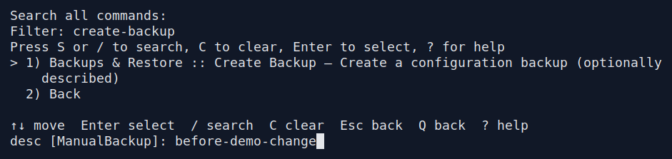

   [Read the captured terminal text](../assets/interactive/operations-backup-create-backup/03-enter-value.txt)

2. Review the collected inputs, then choose **Run**.

   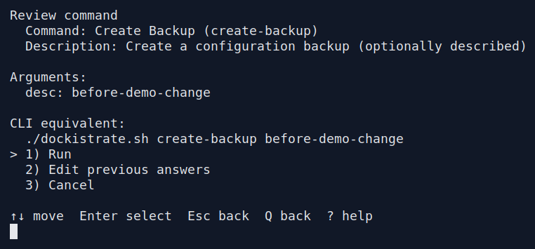

   [Read the captured terminal text](../assets/interactive/operations-backup-create-backup/04-run.txt)

3. Command result.

   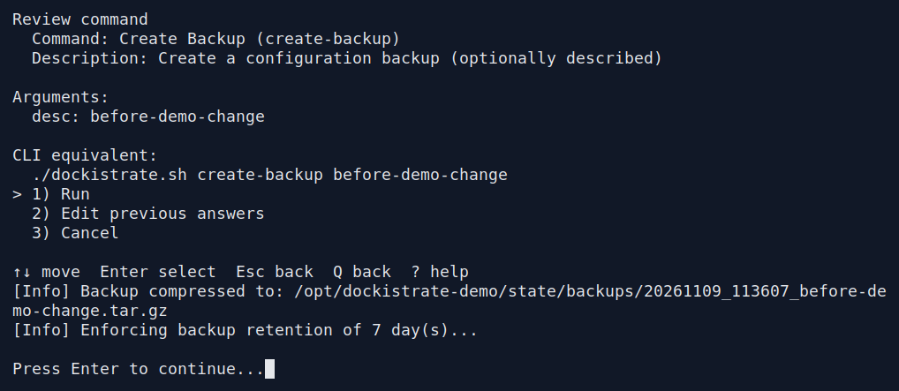

   [Read the captured terminal text](../assets/interactive/operations-backup-create-backup/05-command-result.txt)

</details>

<details>
<summary>list-backups — inputs and result</summary>

1. Command result.

   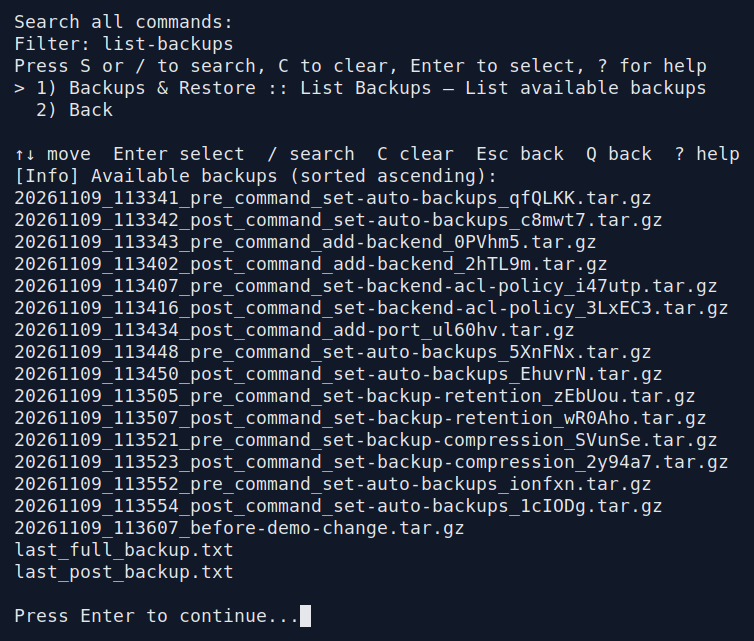

   [Read the captured terminal text](../assets/interactive/operations-backup-list-backups/03-command-result.txt)

</details>

<details>
<summary>restore-backup — inputs and result</summary>

1. Choose **20261109_113607_before-demo-change.tar.gz**.

   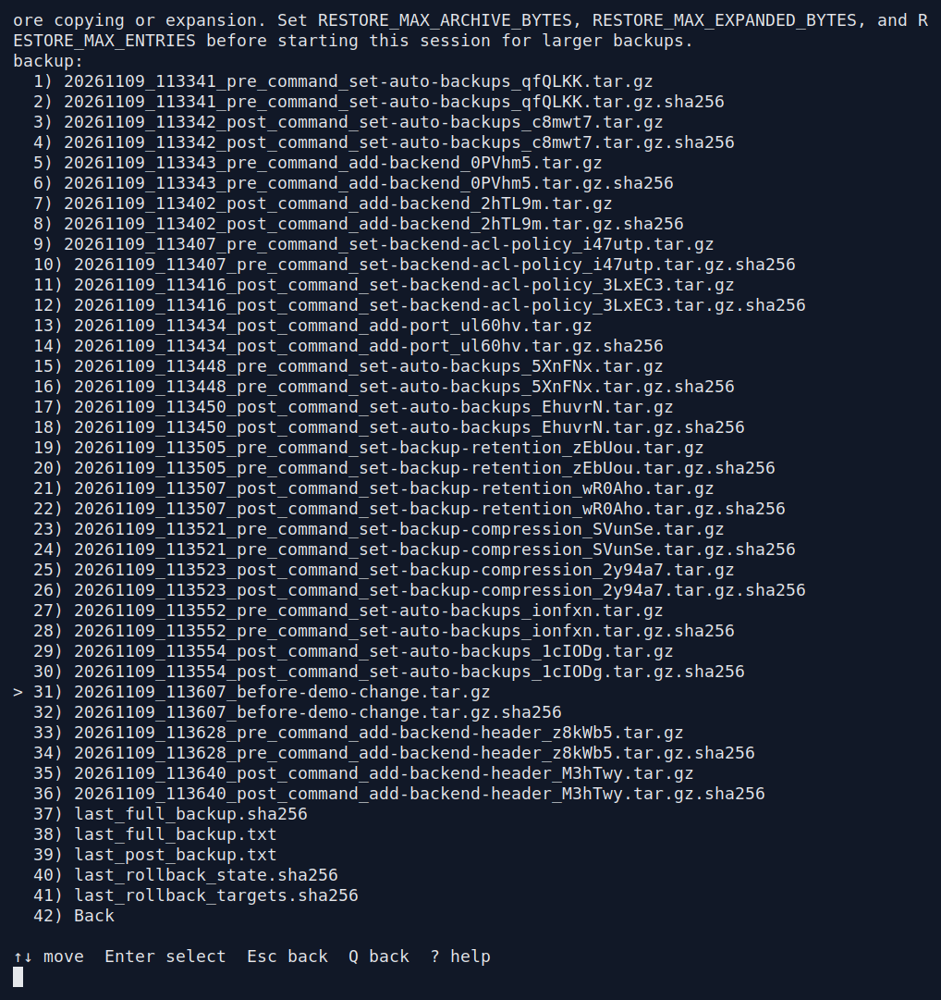

   [Read the captured terminal text](../assets/interactive/operations-backup-restore-backup/03-20261109-113607-before-demo-change-tar-gz.txt)

2. Press Enter to accept the displayed default or leave the optional value blank.

   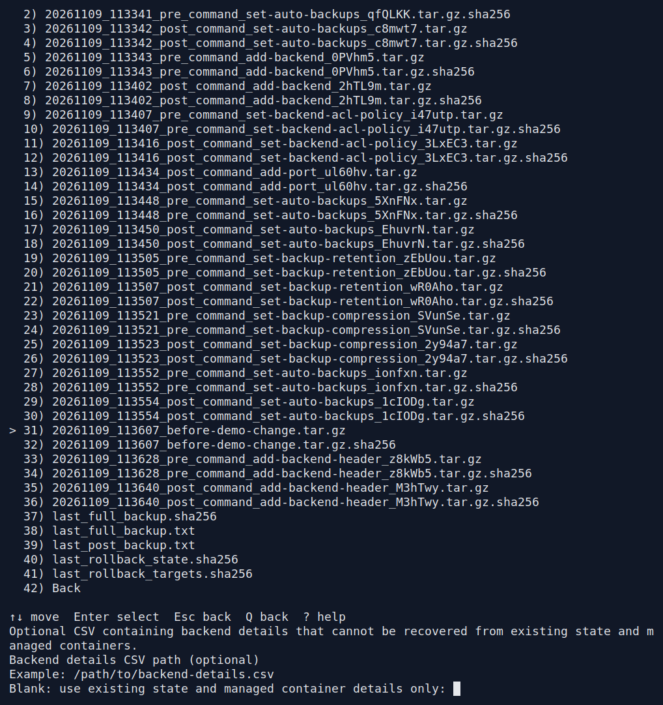

   [Read the captured terminal text](../assets/interactive/operations-backup-restore-backup/04-enter-value.txt)

3. Review the collected inputs, then choose **Run**.

   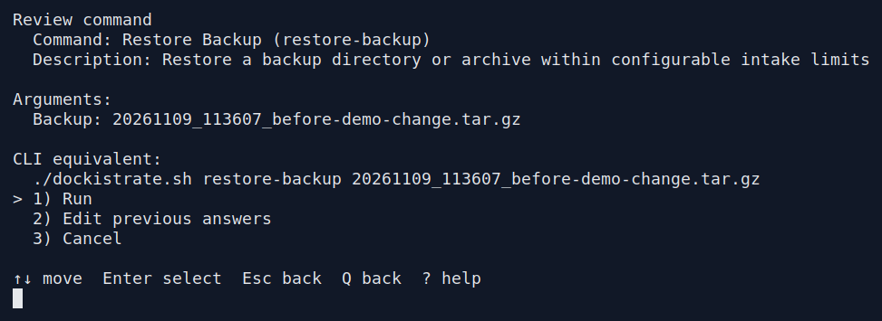

   [Read the captured terminal text](../assets/interactive/operations-backup-restore-backup/05-run.txt)

4. Enter `y`.

   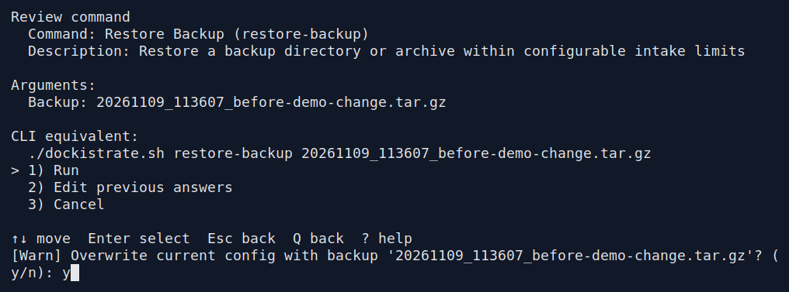

   [Read the captured terminal text](../assets/interactive/operations-backup-restore-backup/06-enter-value.txt)

5. Command result.

   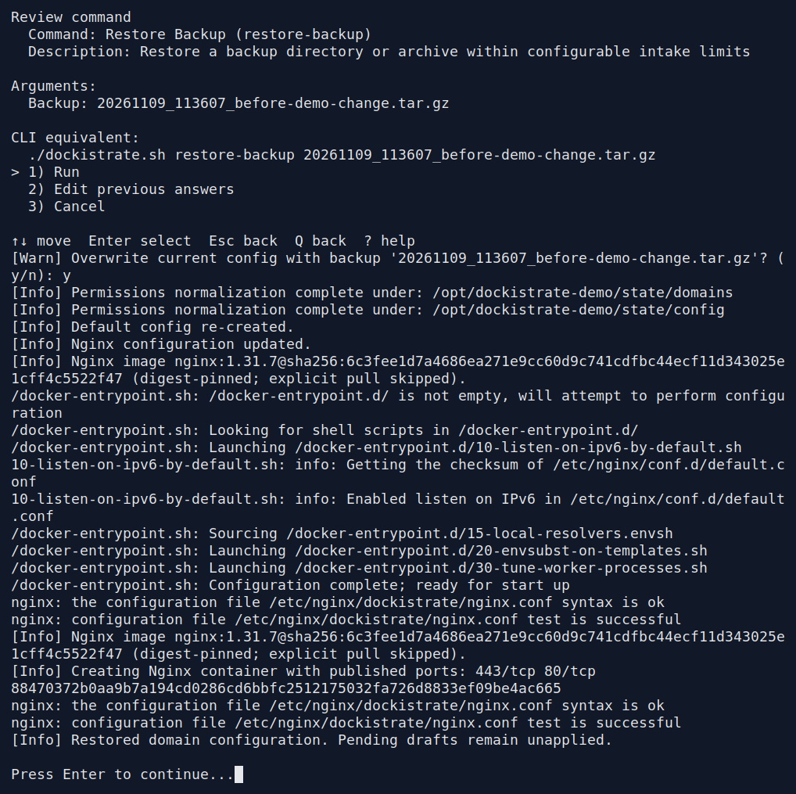

   [Read the captured terminal text](../assets/interactive/operations-backup-restore-backup/07-command-result.txt)

</details>

<details>
<summary>check-config — inputs and result</summary>

1. Configuration test passed.

   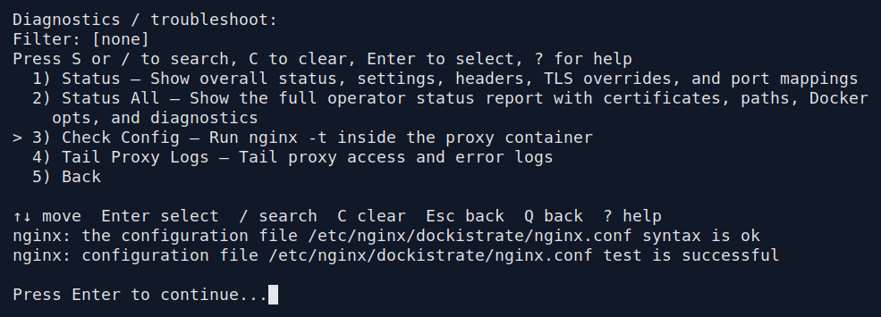

   [Read the captured terminal text](../assets/interactive/operations-backup-restore-config/03-configuration-test-passed.txt)

</details>

<details>
<summary>The later header is active before restoration</summary>

1. The later header is active before restoration.

   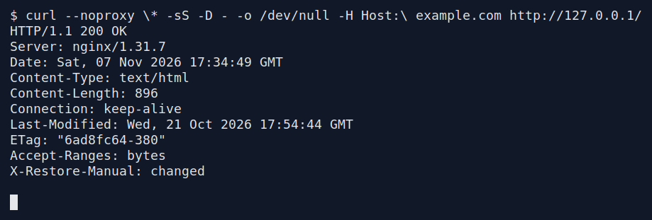

   [Read the captured terminal text](../assets/interactive/core-branches-manual-restore-before/01-the-later-header-is-active-before-restoration.txt)

</details>

<details>
<summary>restore-backup — Restore a backup stored outside the backup folder</summary>

1. Choose **Enter backup path manually**.

   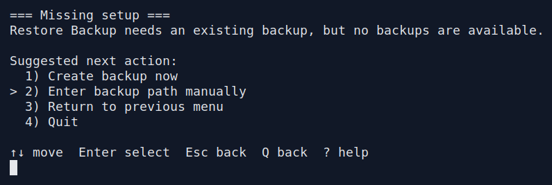

   [Read the captured terminal text](../assets/interactive/core-branches-navigation-restore-manual/03-use-a-backup-outside-the-local-backup-folder.txt)

2. Enter `/opt/dockistrate-demo-fixtures/manual-restore.tar.gz`.

   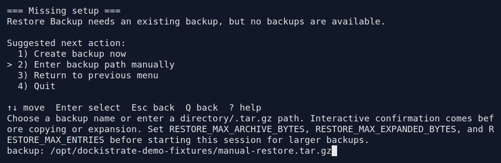

   [Read the captured terminal text](../assets/interactive/core-branches-navigation-restore-manual/04-enter-the-received-backup-path.txt)

3. Press Enter to accept the displayed default or leave the optional value blank.

   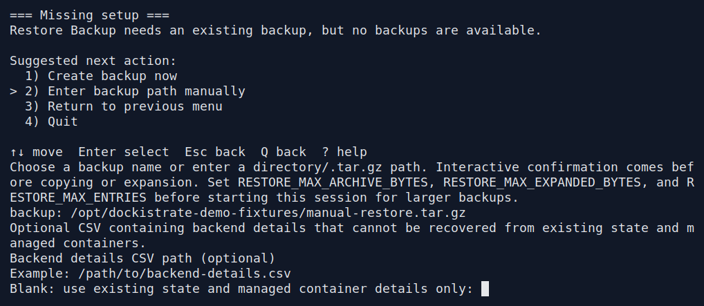

   [Read the captured terminal text](../assets/interactive/core-branches-navigation-restore-manual/05-keep-the-optional-backend-details-empty.txt)

4. Review the collected inputs, then choose **Run**.

   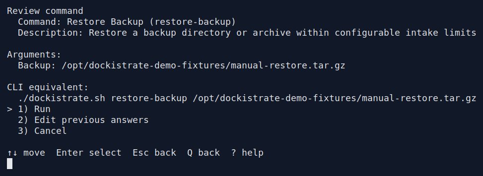

   [Read the captured terminal text](../assets/interactive/core-branches-navigation-restore-manual/06-run.txt)

5. Enter `y`.

   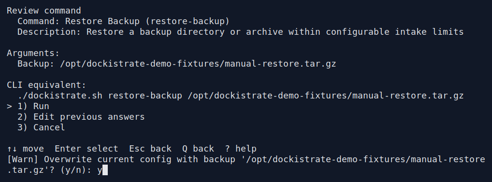

   [Read the captured terminal text](../assets/interactive/core-branches-navigation-restore-manual/07-confirm-restoring-the-received-backup.txt)

6. The external backup is restored.

   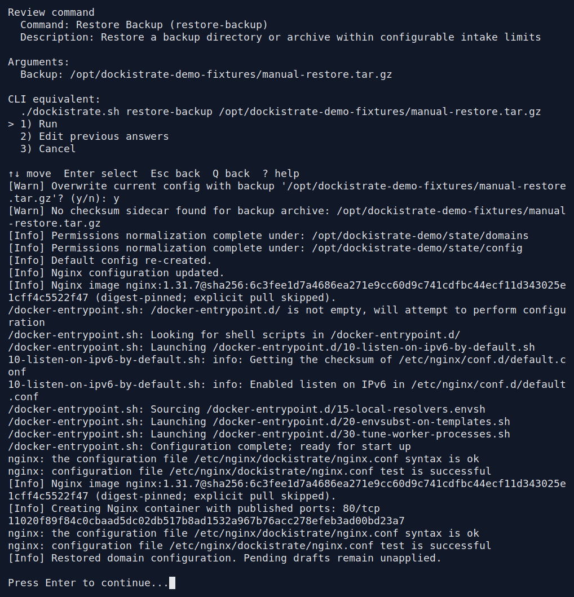

   [Read the captured terminal text](../assets/interactive/core-branches-navigation-restore-manual/08-the-external-backup-is-restored.txt)

</details>

<details>
<summary>The restored response no longer has the later header</summary>

1. The restored response no longer has the later header.

   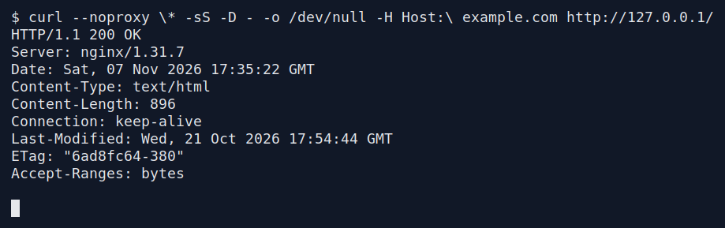

   [Read the captured terminal text](../assets/interactive/core-branches-manual-restore-after/01-the-restored-response-no-longer-has-the-later-header.txt)

</details>

<details>
<summary>check-config — inputs and result</summary>

1. Configuration test passed.

   

   [Read the captured terminal text](../assets/interactive/core-branches-manual-restore-config/03-configuration-test-passed.txt)

</details>

<!-- /walkthrough: backup-restore -->

**Recovery:** make another backup before replacing a state you may need. To
reverse the demonstration restore, select that newer backup and verify again.
See [restore intake limits](#restore-intake-limits) for rejected backups and
[mTLS integrity](#mtls-integrity-and-recovery) for required identity history.

```bash
./dockistrate.sh create-backup before-demo-change
./dockistrate.sh list-backups
./dockistrate.sh restore-backup <backup-name>
```

## Configure automatic backups

<a id="cmd-set-auto-backups"></a>
<a id="cmd-set-backup-retention"></a>
<a id="cmd-set-backup-compression"></a>

Use the same **Backups & Restore** section. Review each setting before **Run**.

| Action | Example selection | Check or undo |
| --- | --- | --- |
| **Set Auto Backups** | `true` | Inspect Status; use `false` to disable. |
| **Set Backup Retention** | `7` days | Inspect the saved value; restore your earlier retention value to undo. |
| **Set Backup Compression** | `true` | Create a new backup and inspect its format; restore the earlier setting to undo. |

<!-- walkthrough: backup-settings -->

<details>
<summary>set-auto-backups — inputs and result</summary>

1. Choose **true**.

   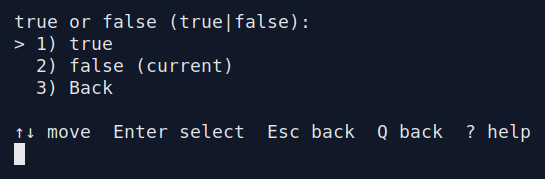

   [Read the captured terminal text](../assets/interactive/operations-backup-set-auto-backups/03-true.txt)

2. Review the collected inputs, then choose **Run**.

   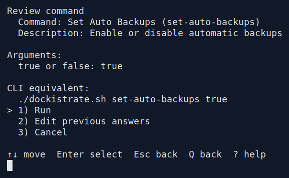

   [Read the captured terminal text](../assets/interactive/operations-backup-set-auto-backups/04-run.txt)

3. Command result.

   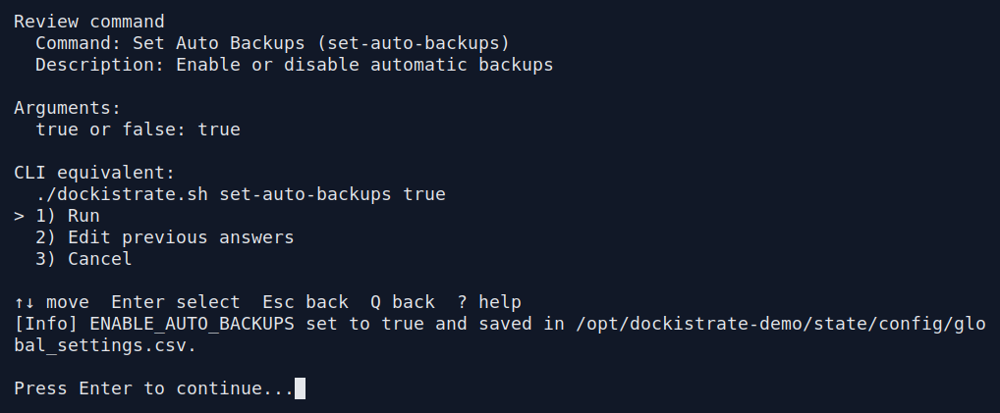

   [Read the captured terminal text](../assets/interactive/operations-backup-set-auto-backups/05-command-result.txt)

</details>

<details>
<summary>set-backup-retention — inputs and result</summary>

1. Enter `7`.

   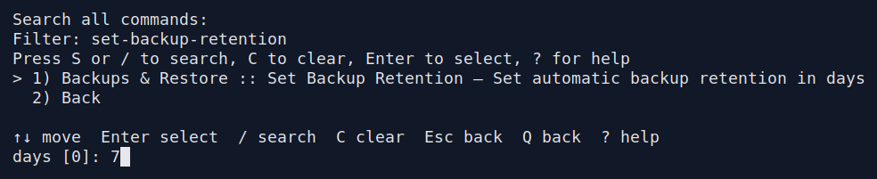

   [Read the captured terminal text](../assets/interactive/operations-backup-set-backup-retention/03-enter-value.txt)

2. Review the collected inputs, then choose **Run**.

   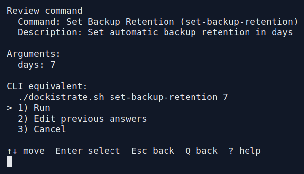

   [Read the captured terminal text](../assets/interactive/operations-backup-set-backup-retention/04-run.txt)

3. Command result.

   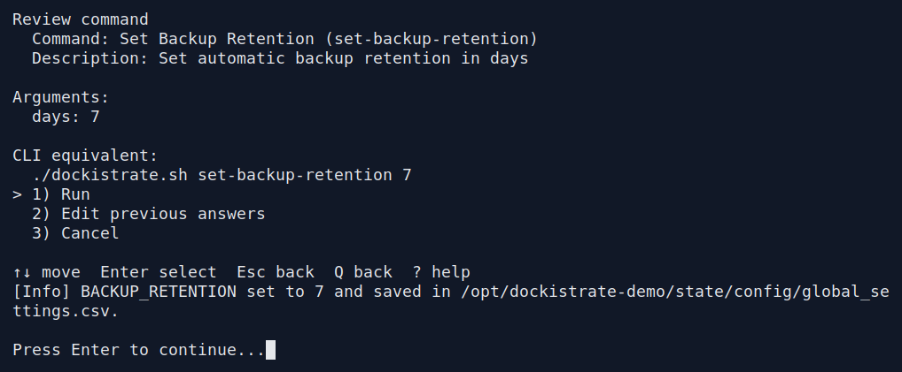

   [Read the captured terminal text](../assets/interactive/operations-backup-set-backup-retention/05-command-result.txt)

</details>

<details>
<summary>set-backup-compression — inputs and result</summary>

1. Choose **true (current)**.

   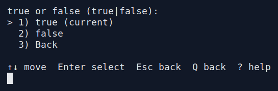

   [Read the captured terminal text](../assets/interactive/operations-backup-set-backup-compression/03-true-current.txt)

2. Review the collected inputs, then choose **Run**.

   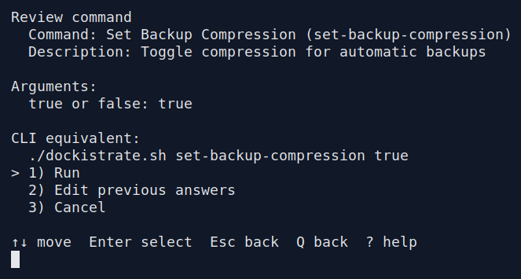

   [Read the captured terminal text](../assets/interactive/operations-backup-set-backup-compression/04-run.txt)

3. Command result.

   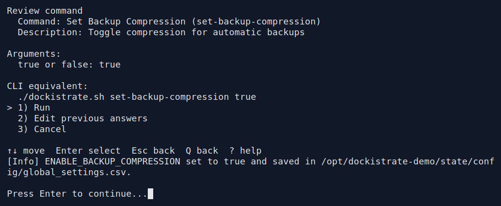

   [Read the captured terminal text](../assets/interactive/operations-backup-set-backup-compression/05-command-result.txt)

</details>

<details>
<summary>status — inputs and result</summary>

1. Command result (start).

   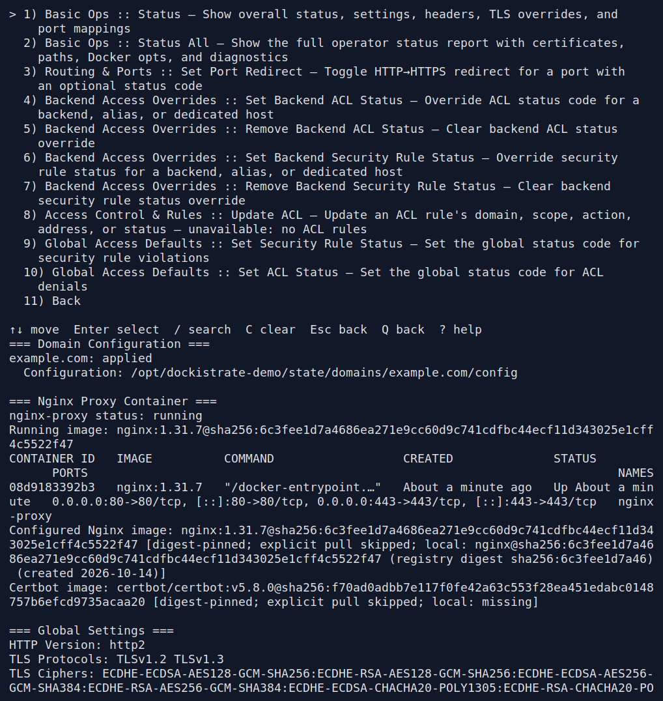

   [Read the captured terminal text](../assets/interactive/operations-backup-backup-settings-status/06-command-result-earlier-output-3.txt)

2. Command result (continued).

   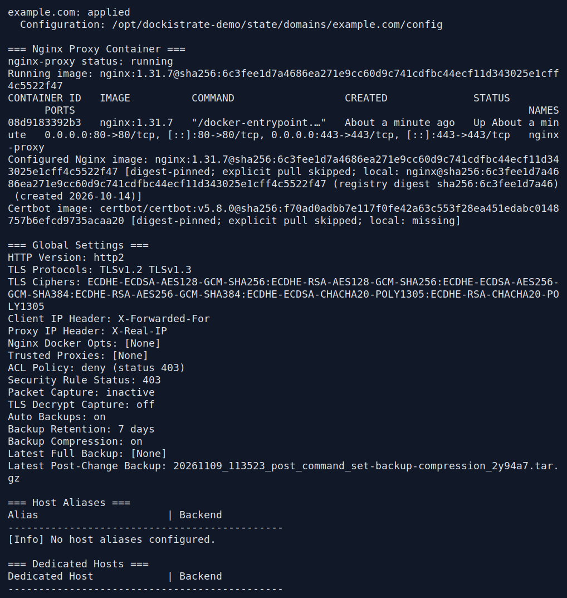

   [Read the captured terminal text](../assets/interactive/operations-backup-backup-settings-status/05-command-result-earlier-output-2.txt)

3. Command result (continued).

   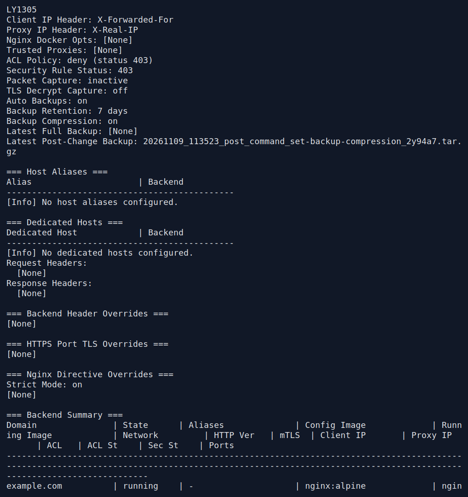

   [Read the captured terminal text](../assets/interactive/operations-backup-backup-settings-status/04-command-result-earlier-output-1.txt)

4. Command result (end).

   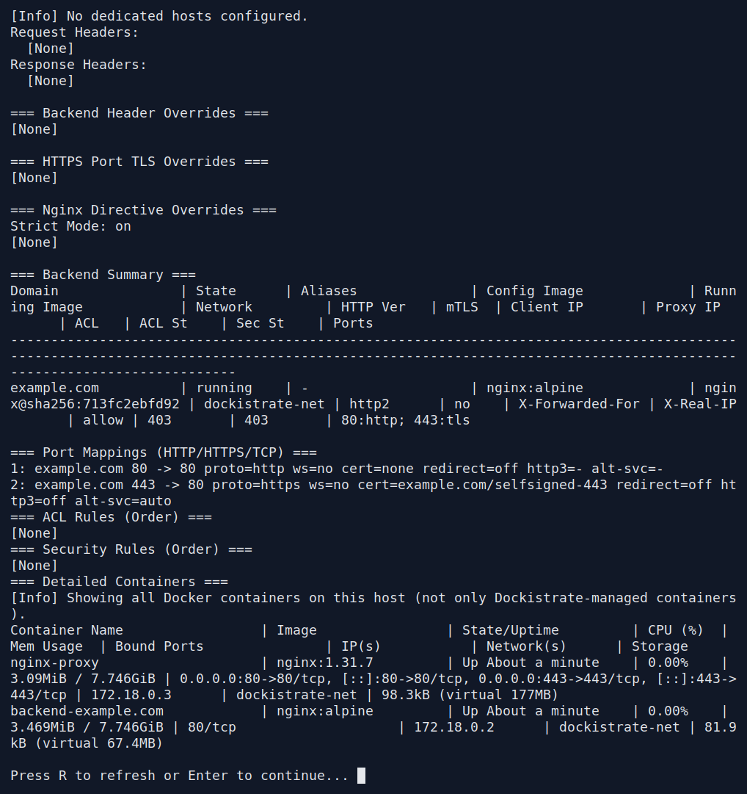

   [Read the captured terminal text](../assets/interactive/operations-backup-backup-settings-status/03-command-result.txt)

</details>

<details>
<summary>set-auto-backups — inputs and result</summary>

1. Choose **false**.

   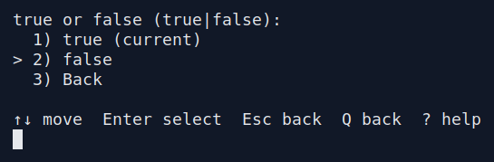

   [Read the captured terminal text](../assets/interactive/operations-backup-auto-backups-restored/03-false.txt)

2. Review the collected inputs, then choose **Run**.

   

   [Read the captured terminal text](../assets/interactive/operations-backup-auto-backups-restored/04-run.txt)

3. Command result.

   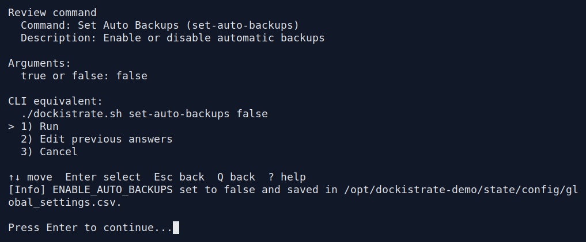

   [Read the captured terminal text](../assets/interactive/operations-backup-auto-backups-restored/05-command-result.txt)

</details>

<!-- /walkthrough: backup-settings -->

CLI equivalents are `set-auto-backups true`, `set-backup-retention 7`, and
`set-backup-compression true`. Retention affects cleanup of saved backups;
changing it does not protect application data outside configuration backups.

## Repair configuration and permissions

<a id="cmd-fix-default-config"></a>
<a id="cmd-fix-permissions"></a>

Use **Search all commands** to find **Fix Default Config** or **Fix Permissions**.
For default configuration repair, review the command and `(none)` arguments,
choose **Run**, then use **Check Config**.
For permission repair, choose the default managed repair unless you need a
specific supported mode, review **Run**, and inspect the reported result.
Permission repair can run before ordinary runtime initialization.

<!-- walkthrough: configuration-repair -->

<details>
<summary>fix-default-config — inputs and result</summary>

1. Review the collected inputs, then choose **Run**.

   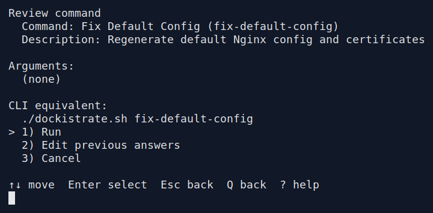

   [Read the captured terminal text](../assets/interactive/operations-backup-fix-default-config/03-run.txt)

2. Command result.

   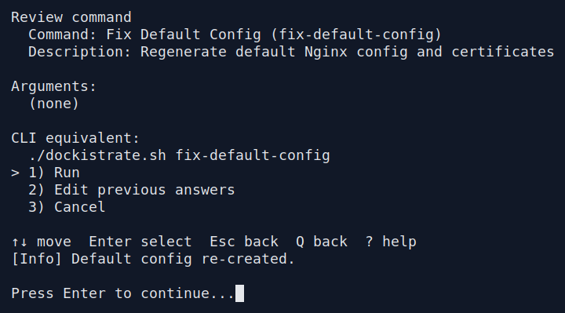

   [Read the captured terminal text](../assets/interactive/operations-backup-fix-default-config/04-command-result.txt)

</details>

<details>
<summary>fix-permissions — inputs and result</summary>

1. Choose **Normalize repository permissions (current)**.

   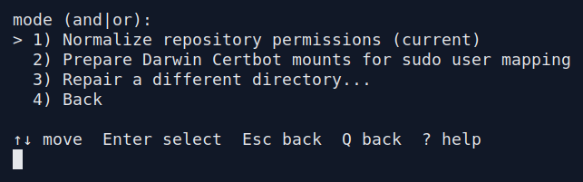

   [Read the captured terminal text](../assets/interactive/operations-backup-fix-permissions/03-normalize-repository-permissions-current.txt)

2. Review the collected inputs, then choose **Run**.

   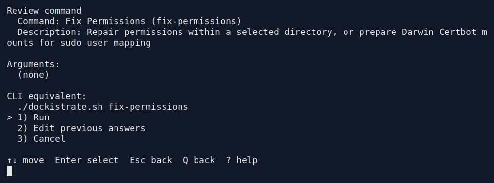

   [Read the captured terminal text](../assets/interactive/operations-backup-fix-permissions/04-run.txt)

3. Command result.

   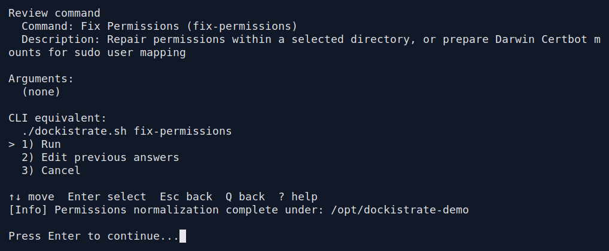

   [Read the captured terminal text](../assets/interactive/operations-backup-fix-permissions/05-command-result.txt)

</details>

<details>
<summary>check-config — inputs and result</summary>

1. Configuration test passed.

   

   [Read the captured terminal text](../assets/interactive/operations-backup-repair-config/03-configuration-test-passed.txt)

</details>

<!-- /walkthrough: configuration-repair -->

**Check:** the required files are accessible to their intended owner and the
configuration check passes. Repair is not a way to apply pending domain edits.
Record intentional permission requirements before changing them; details and
recovery notes are in [Permissions](#permissions).

CLI equivalents: `./dockistrate.sh fix-default-config` and
`./dockistrate.sh fix-permissions`.

## Clean a domain or uninstall

<a id="cmd-clean-all"></a>
<a id="cmd-uninstall-all"></a>

Perform the example only in a disposable installation with an expendable domain.
First create a backup and inspect which resources the selected scope owns.

1. Open **Advanced command browser → Clean & Uninstall**.
2. For **Clean All**, select the demo domain. For **Uninstall All**, choose the
   displayed removal scope. Read its description before selecting it.
3. Check **Uninstall scope** (for example, `all`) for uninstall, or the domain
   for cleanup. Choose **Run** and complete the destructive confirmation only
   when the target is correct. Cancel to leave it untouched.
4. Inspect Status and remaining listeners. Verify that removed resources are
   gone, unrelated resources remain, and remaining routes still respond.
   After uninstall, inspect containers and files before launching another
   Dockistrate command. Logs and backups remain. Returning to Home can recreate
   the menu's recent-command history; this does not restore removed applications.

<!-- walkthrough: cleanup -->

<details>
<summary>clean-all — inputs and result</summary>

1. Choose **example.com**.

   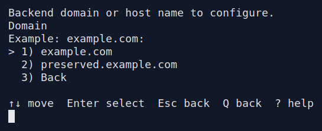

   [Read the captured terminal text](../assets/interactive/operations-cleanup-clean-all/03-example-com.txt)

2. Review the collected inputs, then choose **Run**.

   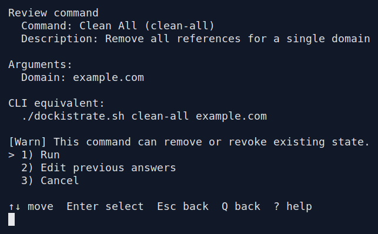

   [Read the captured terminal text](../assets/interactive/operations-cleanup-clean-all/04-run.txt)

3. Enter `YES`.

   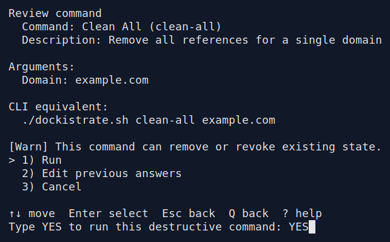

   [Read the captured terminal text](../assets/interactive/operations-cleanup-clean-all/05-enter-value.txt)

4. Command result.

   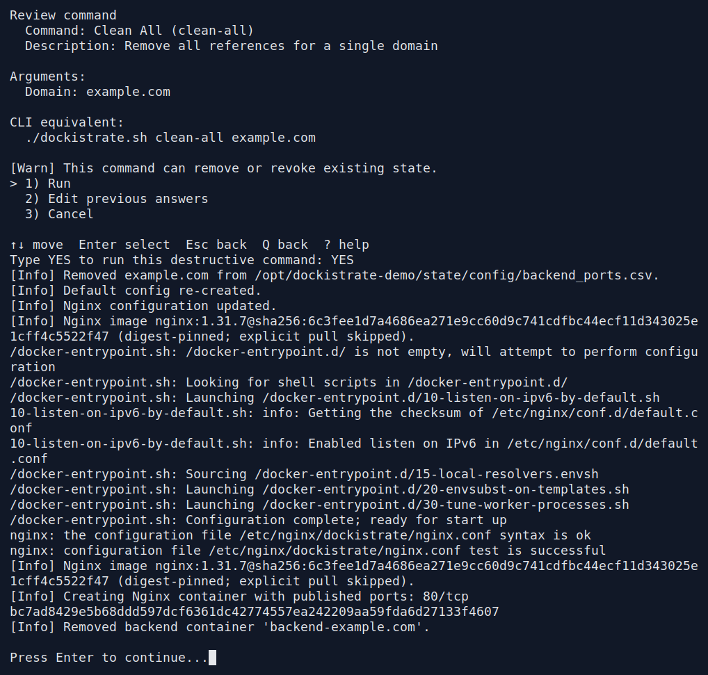

   [Read the captured terminal text](../assets/interactive/operations-cleanup-clean-all/06-command-result.txt)

</details>

<details>
<summary>Verify the other application still responds</summary>

1. Verify the other application still responds.

   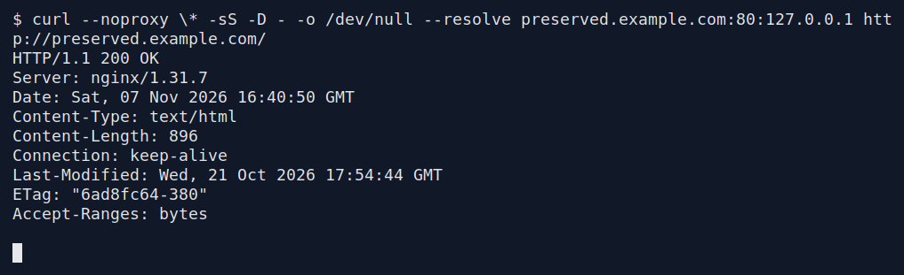

   [Read the captured terminal text](../assets/interactive/operations-cleanup-clean-preserved-route/01-verify-the-other-application-still-responds.txt)

</details>

<details>
<summary>Inspect the remaining backend</summary>

1. Inspect the remaining backend.

   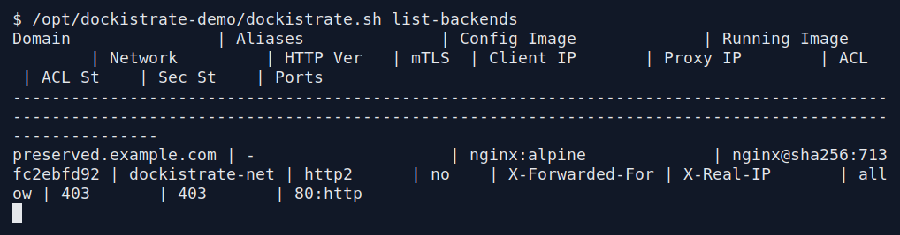

   [Read the captured terminal text](../assets/interactive/operations-cleanup-clean-remaining-backends/01-inspect-the-remaining-backend.txt)

</details>

<details>
<summary>uninstall-all — inputs and result</summary>

1. Choose **Config + certs + runtime tmp/capture/acme**.

   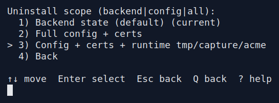

   [Read the captured terminal text](../assets/interactive/operations-uninstall-uninstall-all/03-config-certs-runtime-tmp-capture-acme.txt)

2. Review the collected inputs, then choose **Run**.

   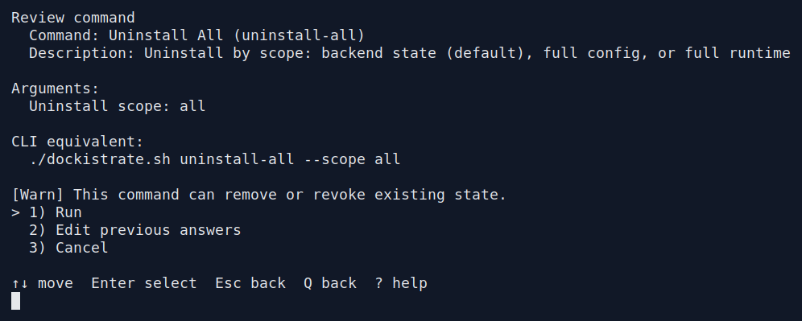

   [Read the captured terminal text](../assets/interactive/operations-uninstall-uninstall-all/04-run.txt)

3. Enter `YES`.

   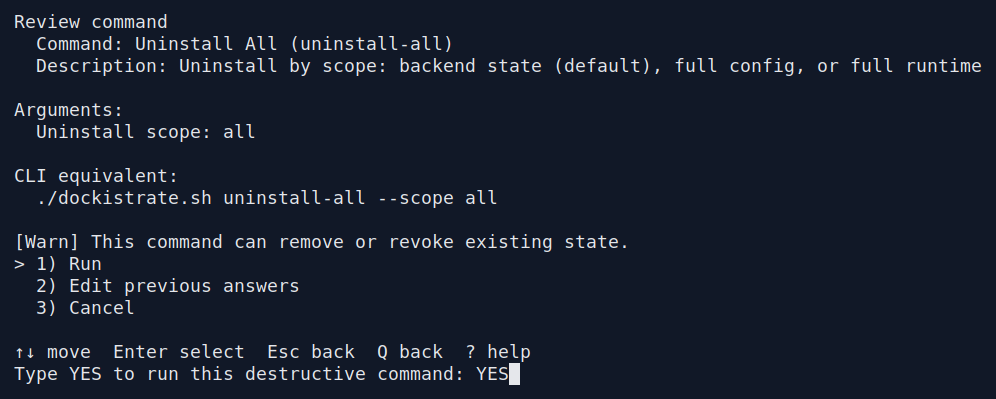

   [Read the captured terminal text](../assets/interactive/operations-uninstall-uninstall-all/05-enter-value.txt)

4. Enter `YES`.

   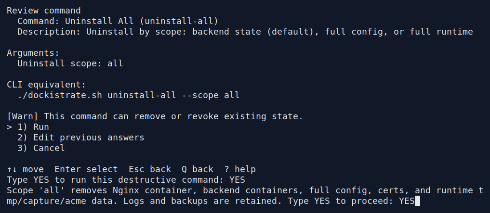

   [Read the captured terminal text](../assets/interactive/operations-uninstall-uninstall-all/06-enter-value.txt)

5. Command result.

   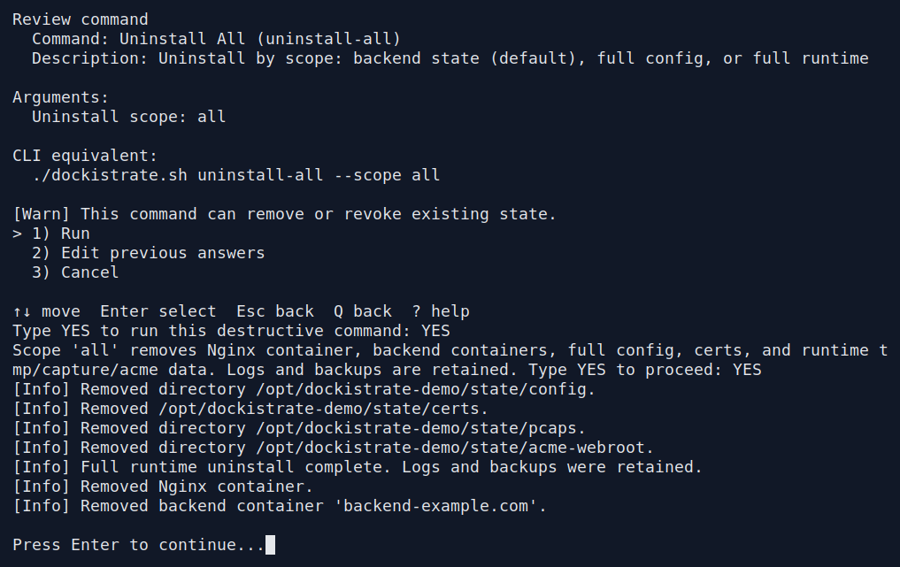

   [Read the captured terminal text](../assets/interactive/operations-uninstall-uninstall-all/07-command-result.txt)

</details>

<details>
<summary>Verify the unrelated container remains</summary>

1. Verify the unrelated container remains.

   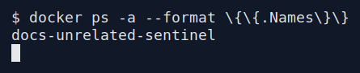

   [Read the captured terminal text](../assets/interactive/operations-uninstall-uninstall-remaining-containers/01-verify-the-unrelated-container-remains.txt)

</details>

<!-- /walkthrough: cleanup -->

**Recovery:** restore the configuration backup when appropriate; restore
application data from its separate backup. The [cleanup reference](#cleanup-and-uninstall)
explains scope, dependent settings, saved history, and certificate ownership.
The review screen shows the exact CLI equivalent for the selected scope.

## Detailed reference

## Common Commands

```text
create-backup [desc]
list-backups
restore-backup <backup_name|backup_path> [--backend-details <csv>]

clean-all <domain>
uninstall-all [--scope backend|config|all]
fix-permissions [--certbot-darwin-user|target_dir]
```

## Backups

Create and list backups:

```bash
./dockistrate.sh create-backup before-change
./dockistrate.sh list-backups
```

Backups snapshot managed config/state and can be compressed depending on
settings. If compression fails, Dockistrate keeps the usable backup directory
instead of leaving only a failed archive. Config backups include saved command
history/favorites and can retain earlier Docker options, header values, and
Nginx directive values. Their contents are not scrubbed when a setting or
backend is later removed.

Application data is separate from these state snapshots. Checkout-local
`apps/<domain>/public/` files, other bind mounts, and Docker volumes need their
own backups. Backend replacement does not transfer container writable-layer
data. Keep application backups and exact image references when moving a
deployment between checkouts; a state archive alone cannot reconstruct its
application payloads or containers already removed by a committed replacement.

Automatic backup requests within one domain change are combined into one
snapshot after its editable and applied files are published, before the change
commits. Nested cleanup steps do not create intermediate snapshots. Unrelated
pending drafts remain in the backup. Declarative file-only applies and backend
start/stop/restart commands and certificate removals also request this finalized
snapshot; unchanged applies do not. Explicit `create-backup` requests still
run immediately, and internal rollback snapshots remain separate.
If finalization fails, rollback removes the uncommitted automatic snapshot and
restores the previous full-backup pointers.
Retention for that automatic snapshot runs only after the change commits.
For `uninstall-all --scope config|all`, finalization preserves the preceding
full-backup pointers instead of publishing an empty post-uninstall backup.

Format-5 backups include each domain's editable files, applied snapshot,
certificate and mTLS material, plus shared ACME renewal state and certificate
receipts. Generated proxy files and certificate projections, runtime journals,
logs, and captures are excluded. Invalid or unfinished drafts are retained;
restore validates and activates the saved applied snapshots while leaving those
drafts pending. Regular draft subdirectories, hidden files, and empty directories
are preserved too; they do not become supported configuration inputs. Symlinks
and special filesystem objects remain rejected. Standard Certbot live-to-archive links are stored as regular
files with validated link metadata, so public intake retains its prohibition
on archive symlinks. Only those known links are reconstructed in private staging.

The manifest is a singleton table with header
`format_version,state_schema_version` and values `5,5`. Restore verifies archive
checksums and identifies the format before validating settings. Older archives
are converted in private staging; their payloads and checksum files are never
rewritten. Schema-2, schema-3, and schema-4 archives retain separate draft/applied
records during conversion. Split listener and certificate options from schemas
2 and 3 are joined into their corresponding records. Historical security rules
gain `action=require`, preserving their existing behavior. Format-4 conversion
adds the action column after `enabled` in `security_rules.csv` and updates
`domain.csv` to schema 5; other draft files and regular subdirectories are retained.
Current-format drafts are preserved byte for byte, even when invalid, except
for the matching owned mTLS path normalization described below. Unfinished
recovery journals are not reformatted in place.

Restore uses currently verified container identities rather than IDs copied
from a backup. Legacy configuration-only backups are converted before
activation. Supply missing backend image/state data with
`restore-backup <backup> --backend-details /path/backend-details.csv`, using the
`domain,image,state` format described in the domain configuration guide.

A restore cannot omit an existing managed backend or change its role. Remove
that backend explicitly first; this prevents an older backup from orphaning its
container or discarding its ownership record. Source files are captured before
restore validation, and later edits are preserved if a conflict or failure
causes runtime rollback. Legacy restore copies available local certificate
material while preserving the original files and current shared renewal state.
Restored certificate declarations must have matching saved certificate and key
files. Restore synchronizes their metadata without requesting new certificates;
expired saved certificates can be restored for explicit renewal afterwards.
Restore recreates the proxy with the saved image and Docker runtime options,
even when listeners and certificates are unchanged, then checks readiness.
If activation fails, recovery restores the preceding settings and proxy.

### mTLS backup portability

Both CLI and interactive restore can move domain mTLS material to a different
checkout without access to the original checkout. New command-generated
`mtls.csv` records leave `directory` blank, which already means the current
domain's owned `state/domains/<domain>/mtls` directory. The schema, command
arguments, and certificate/key material are unchanged; no migration is required.

For older domain backups, restore recognizes an applied absolute path ending
in `/domains/<same-domain>/mtls` with no empty, dot, parent, or control-character
components. It replaces that location with the blank default in private staging;
the old path is never opened or used to find material. Restored material comes
from the backup's owning domain, and generated paths use the destination checkout.
Normal configuration validation still rejects arbitrary or cross-domain paths.

A well-formed editable `mtls.csv` is normalized only when its directory exactly
matches the archived applied directory. Other fields, including a pending
`enabled=no`, retain their meaning and remain unapplied. Malformed files,
different draft paths, and draft-only domains are preserved without rewriting;
an old absolute path in such a draft may need an explicit correction before
apply. Archive payloads and checksums are unchanged. A failed activation restores
the preceding material/configuration and preserves concurrent draft edits.

### mTLS integrity and recovery

CLI and interactive restore validate each authority needed by the saved applied
configuration before publishing material or changing backend/proxy runtime.
An enabled authority requires regular, non-symlink `ca.crt`, `ca.key`,
`index.txt`, `serial`, and `crlnumber` files. The certificate and key must match;
the issuance database and counters must be valid. An existing `ca.crl` must be
signed by that authority, and its revoked serials must exactly match the
database's revoked serials. A correctly signed older CRL that omits a recorded
revocation is rejected. An empty database is valid for an unused authority,
but a missing database is not reconstructed from client certificates or a CRL.

Missing or inconsistent authority/history material rejects the restore before
live changes. Restore never generates a replacement CA or resets the database
or counters. `openssl.cnf`, a missing `newcerts/` output directory, and a missing
CRL can be prepared in the private restore workspace only after the original
authority and database pass validation. A missing CRL is generated from the
validated database, preserving its recorded revocations. Existing valid CA,
client, database, and CRL material is retained. Archive files and checksums are
not rewritten.

Validation follows applied settings, so pending enable drafts stay pending.
Disabled domains retain their archived mTLS files, including incomplete
material, without activating or repairing them. Re-enabling later requires
the same integrity checks. Legacy configuration-only restores may reuse staged
local material, but cannot invent missing material required by enabled mTLS.
Expired saved material remains structurally restorable; normal activation and
client verification retain their existing checks. These consistency checks do
not prove the completeness of historical records that were deliberately
rewritten together.

Keep a complete backup to recover damaged authority material. Manual backup
creation remains available to preserve the current files for recovery; making
a snapshot does not certify that its mTLS state can be activated. For an enabled
mTLS mapping, `replace-backend-ca` deliberately replaces the authority and
discards its old client trust, including when the authority directory is missing;
issue replacement client credentials afterward. Recover damaged material
retained by a disabled domain from a complete backup before re-enabling it.
Listing client certificates is read-only and never initializes missing bookkeeping.
Command arguments and backup/configuration formats are unchanged; complete
existing backups need no migration.

Backups are kept indefinitely by default. To select an age limit, use the same
command through CLI or the interactive picker:

```bash
./dockistrate.sh set-backup-retention 30
```

Eligible older backups are pruned when a backup is created; this is not a
background expiry service and does not apply to live history or logs. A value
of `0` keeps backups indefinitely. Review backup/recovery requirements before
changing this setting.
Guarded deletion preserves the exact selected filename, including trailing
newlines in existing backup directory names; a plain-name sibling is a different
target and is left untouched.

Internal transaction snapshots are restricted to physically resolved descendants
of the active `state/` root. The root itself, symlinks supplied as snapshot roots,
unresolved targets, and sibling or outside-root paths are rejected before `tar` runs, and failed
attempts leave no archive or checksum artifact. Archive operands follow
`tar --`, and failures restore the caller's umask. This is defense in depth for
the normal production callers, which already pass managed state paths.
Targets are deduplicated after resolving parent aliases, including overlapping
parent and child selections. Snapshot filenames retain their timestamp and
transaction label, with a random suffix reserved without overwriting an
existing archive. Repeated attempts within the same second keep separate
recovery copies. Use the exact name from `list-backups` when selecting a backup.

A previous successful transaction's snapshot can be reused only when its checksum
is valid and the selected targets, contents, links, modes, and modification times
still match. Permission-only or timestamp-only changes require a fresh snapshot,
including changes to a selected directory itself. If the metadata needed to
verify reuse cannot be read, the operation fails before mutation.
Transaction completion checks every metadata write. The reusable archive pointer
is published only after both signatures are saved; a failure triggers rollback
and cannot leave a new archive paired with stale signatures for later reuse.

Within those roots, transaction snapshots preserve relative links such as
Certbot's `live/example.com/privkey.pem` pointing into `archive/example.com/`.
Links must resolve entirely within the selected snapshot. Unsupported entries
(including special files, hard-linked regular files, and escaping or dangling
links) fail snapshot creation before the operation starts. Snapshot archives
keep their existing layout; older safe archives remain readable.

## Restore

Restore by exact backup name from `list-backups`, or by safe archive path:

```bash
./dockistrate.sh restore-backup 20260516_153000_before-change.tar.gz
```

Both CLI and interactive restore replace global and `stream-global` Nginx
directives with the backup's saved values. For example, restoring a backup with
`server_tokens off` replaces a later `on` setting. Overrides added after the
backup are removed; a backup without `nginx_directives.csv` supplies no global
overrides. Domain-scoped directives are rebuilt from the archived applied domain
configuration, while pending drafts stay unapplied. This restore bug fix changes
no backup formats, commands, or arguments and requires no migration.

Interactive restore asks for confirmation before it copies a directory or
archive, lists archive members, or decompresses an archive. Answering no leaves
the live configuration unchanged and creates no restore workspace. CLI restore
retains its existing noninteractive automatic approval; adding `-i` enables the
confirmation prompt. Both modes use the same intake checks. Runtime
initialization and configuration migration wait until the selected backup has
passed intake and configuration validation. Canceled restores do not append
command history or audit entries.

### Restore intake limits

Public `restore-backup` limits the work performed while taking and inspecting
the private input snapshot. Set these environment variables before invoking the
CLI or starting the interactive picker:

| Environment variable | Default | What it limits |
| --- | --- | --- |
| `RESTORE_MAX_ARCHIVE_BYTES` | `1073741824` (1 GiB) | Compressed `.tar.gz` bytes copied into private storage. |
| `RESTORE_MAX_EXPANDED_BYTES` | `4294967296` (4 GiB) | Each of the uncompressed tar stream (including headers and padding) and total logical regular-file payload bytes. Directory inputs use the payload limit. |
| `RESTORE_MAX_ENTRIES` | `20000` | Files and directories, including the directory-input root and implicit parent directories in archives. |

Values must be decimal integers from `1` through `9007199254740990`. Leading
zeros are accepted as decimal. An explicitly empty value, zero, negative value,
unit suffix, or out-of-range value is rejected; zero does not disable a limit.
Unset variables use the defaults. Archive metadata headers count toward stream
bytes but do not count as separate filesystem entries. The limits are enforced
during intake, so an oversized input is rejected before live restore begins.
Rejected intake removes its private temporary files and leaves the live
configuration unchanged. A fresh checkout may retain an empty guarded
`state/tmp` parent directory. If temporary-file cleanup itself fails, the error
identifies the retained private workspace for manual cleanup. Internal
transaction rollback does not use these public intake limits.

During intake, HUP, INT, or TERM sent to the command also stops its owned
copying, decompression, and archive processes before staging cleanup. Producers
that do not stop during a short grace period are terminated. This cancellation
handling covers intake; an accepted restore then uses the existing transaction
and rollback lifecycle.

For an intentionally larger trusted backup, raise only the limits it needs.
For example, allow a 2 GiB archive, 8 GiB of expanded data, and 40,000 entries:

```bash
RESTORE_MAX_ARCHIVE_BYTES=2147483648 \
RESTORE_MAX_EXPANDED_BYTES=8589934592 \
RESTORE_MAX_ENTRIES=40000 \
  ./dockistrate.sh restore-backup /path/to/large-backup.tar.gz
```

The same overrides apply to every restore selected during an interactive
session:

```bash
RESTORE_MAX_ARCHIVE_BYTES=2147483648 \
RESTORE_MAX_EXPANDED_BYTES=8589934592 \
RESTORE_MAX_ENTRIES=40000 \
  ./dockistrate.sh -i
```

These limits are per input, not a reservation of free disk space. Allow space
for private snapshots, extracted files, and the pre-change recovery backup.

**Restore limits after upgrade:** existing backup arguments and noninteractive
approval remain supported. Backups exceeding the defaults require explicit
larger environment limits as shown above. Limits are not saved into or loaded
from a backup's configuration. Format-5 backups include domain files and private
material; legacy configuration-only backups use the conversion described above.
Archive member paths must be unambiguous: duplicate or conflicting paths,
control characters, and backslashes are rejected. Recreate such an archive
with distinct ordinary paths before restoring it. A `.tar.gz` input must
contain a tar archive after one gzip decompression layer. Nested compression
and other archive formats are rejected; recreate them as ordinary `.tar.gz`
backups. Validation reads through tar padding so appended members receive the
same path and resource checks.

An optional `.sha256` sidecar must contain one SHA-256 record, with an optional
matching archive filename, and fit within 4096 bytes. Recreate a malformed or
oversized sidecar from a verified backup. A missing sidecar retains the existing
warning behavior.

### Restore and recovery behavior

Restore rejects unsafe archive paths, requires one top-level directory, restores
`state/config` in place, refreshes permissions, regenerates Nginx config, and
checks config when Docker validation is available. If validation fails
mid-restore, rollback validates and stages the entire pre-change snapshot before
replacing live files and removing entries created by the failed operation.
Archived file modes are preserved, including group-readable `640` certificates.
Existing directories remain in place to preserve their bind mounts, with their
archived modes (including special permission bits) and modification times restored
after their children. Archive
ownership, ACLs, extended attributes, and file flags are not restored; existing
directory ownership remains unchanged. Rollback verifies the applied directory
modes, treating silent permission loss as a recovery failure. Displaced files and previous directory
metadata are retained privately until replay completes; an installation or
metadata replay error attempts to restore the state that existed immediately
before replay. Cleanup also restores directory timestamps after removing
private recovery files. A cleanup or final metadata error reports incomplete
recovery and retains the validated snapshot.
After file recovery, restored settings are loaded before runtime recovery hooks
recreate containers. A settings reload failure skips those hooks and reports
incomplete recovery.
Explicit directory and archive inputs are first copied into private
temporary storage; directory symlinks and special files are rejected, and an
archive is checksum-checked, inspected, and extracted from the same snapshot.
Archive and checksum-sidecar symlink aliases remain supported when they open
regular files; the opened input is checked for replacement or changes while
it is copied. Symlinks inside directory inputs or archive members remain
rejected.

These recovery guarantees apply to both CLI and interactive operations. A
missing, corrupt, or unsafe rollback archive leaves the current live files
untouched. If file replay, runtime recovery hooks, or configuration reload fails,
Dockistrate reports incomplete rollback and identifies the retained backup or
private recovery workspace. Keep those files for manual recovery; do not treat
the failed command as successfully reverted. Public `restore-backup` inputs
continue to reject symlinks and special archive members.

### Restored settings validation

Before a restore starts its transaction or changes the running proxy, Dockistrate
checks saved global settings, backend HTTP/header/ACL overrides, and dedicated-host
inheritance in the private snapshot, using the archived global settings. This
includes the archived strict-mode setting for raw Nginx directives. Malformed CSV, duplicate setting/domain rows,
invalid enum values, unsafe header tokens, and Docker image/option confusion are
rejected. Valid restored global settings are loaded before configuration is
regenerated and the proxy is recreated. A later regeneration, runtime, or transaction metadata failure
uses the transaction rollback path.

State schema `5` uses named CSV columns, consolidated listener/certificate records,
and explicit Require, Block, or Allow security-rule actions. Restore validates
and activates the actions from the saved applied snapshots; draft action changes
remain pending. Existing valid custom images, explicit
header `off` values, inheritance `no`, and deliberate TLS protocol/cipher choices
remain supported. Conversion maps old empty domain IP-header overrides to `off`;
empty global IP-header fields retain their disabled meaning. If validation
reports an invalid saved setting, correct that field in the CSV or backup and
retry; an invalid value is not silently replaced with a default. Unknown global
extension columns remain inert data. Both CLI and interactive
restore use the same validation. Validated global settings are restricted to the
`640` ceiling in private staging before live publication. Existing tighter
staged permissions are preserved; archive extraction or copy umasks may narrow
them further. Explicit restore retains its existing invoking-owner/group policy;
it does not copy the replaced live file's access settings onto the backup.
Accepted mixed-case backend override and inheritance domains remain updateable
and removable; updates match the normalized domain and write a lowercase key.
If a later render validation fails inside a mutation, its transaction rolls back
before completion rather than committing the partially changed settings.

## Compression Regression Check

The detailed compression-failure check is useful for maintainers rather than
README readers. It can be run from the repo root:

```bash
previous_compression="$(bash -c 'source lib/config.sh; source lib/utils.sh; load_config; printf "%s\n" "$ENABLE_BACKUP_COMPRESSION"')"
./dockistrate.sh set-backup-compression true
./dockistrate.sh create-backup precheck
tmp_bin="$(mktemp -d)"
printf '%s\n' '#!/usr/bin/env bash' 'echo "tar failed intentionally" >&2' 'exit 2' > "${tmp_bin}/tar"
chmod +x "${tmp_bin}/tar"
PATH="${tmp_bin}:$PATH" ./dockistrate.sh create-backup compression-failure-test
find state/backups -maxdepth 2 -mindepth 1
rm -rf "$tmp_bin"
./dockistrate.sh create-backup compression-restored
./dockistrate.sh set-backup-compression "${previous_compression:-true}"
```

This avoids nested heredoc Markdown in documentation while preserving the
reproduction steps.

## Cleanup and Uninstall

Remove a backend through the interactive picker or CLI:

```bash
./dockistrate.sh remove-backend --yes example.com
```

To remove a dedicated host while keeping its backend:

```bash
./dockistrate.sh remove-dedicated-host app.example.com
```

Backend removal also removes its aliases and dedicated hosts, their managed
policies and generated ACL includes, and their owned mTLS material. This includes
keys retained after an earlier `disable-backend-mtls`. Dedicated-host removal
cleans only that host's owned material; inherited trust material belongs to its
backend. Cleanup preserves unrelated hosts and restores removed material if the
configuration transaction fails.

Disabling mTLS alone retains keys for reuse. Server certificates are retained by
backend/host removal, and a domain that still owns them remains a certificate-only
domain. Remove those certificates explicitly when they are no longer needed.
Existing backups can still contain removed keys and configuration.

Remove all references for one domain:

```bash
./dockistrate.sh clean-all example.com
```

`clean-all` also removes that domain's unused server certificates. Certificates
still consumed by another domain remain available to that consumer.

Uninstall by scope:

```bash
./dockistrate.sh -i uninstall-all --scope backend
./dockistrate.sh -i uninstall-all --scope config
./dockistrate.sh -i uninstall-all --scope all
```

`uninstall-all` requires an interactive confirmation with exact `YES`.
Container removals use Docker volume cleanup for anonymous volumes attached to
Dockistrate-managed containers. All uninstall scopes retain logs and backups.
The `config` and `all` scopes remove the current config directory, including
saved recents/favorites; the `backend` scope retains them. Existing backups can
still contain the removed configuration and saved commands.
Finalization leaves the removed config directory absent. A failure before commit
restores configuration and domain sources; when cleanup removed a mounted
directory, recovery recreates the managed proxy against the restored directory.

Domain and path cleanup keeps the runtime-preparation lock through its
transaction so persisted mappings cannot change between validation and
mutation. Persisted path-header names are validated before include deletion,
and shared header consumers are recomputed under that lock. Canonical stale
mTLS mappings remain removable when the mTLS root is genuinely absent;
noncanonical, symlinked, nested, sibling, outside-root, or special-file
mappings still fail atomically.

### Saved command and log cleanup

Backend/header removal and `clean-all` remove active configuration, not audit
or saved-command history. Recent commands retain the latest 10 successful
selections without an age limit; favorites remain until removed. To remove a
single favorite, open Favorites in the interactive picker and choose
**Remove from favorites**. This leaves its recent-command entry and any audit
or backup copies unchanged.

For an explicit reset of all saved commands and Dockistrate logs, first select
`set-visibility-policy redacted` if affected future copies are unwanted. Then
stop Dockistrate commands and interactive sessions, scheduled invocations, and
log collectors that could write or hold these files open. From the intended
checkout, verify `state`, `state/config`, and `state/logs` are the expected real
directories, review the exact files below, and confirm each deletion:

```bash
rm -i -- state/config/interactive_recent.csv \
  state/config/interactive_favorites.csv \
  state/logs/audit.log state/logs/audit.log.1 \
  state/logs/docker_manager.log
```

This optional operation discards all entries in those five files, including
replayable favorites; it does not remove active configuration or require
stopping the proxy/backends. Dockistrate recreates needed files privately on
later use. There is no built-in history/log purge command, so this procedure
uses explicit filesystem removal. It does not erase backups, external log
collections, shell history, filesystem snapshots, or recoverable disk blocks.
Review those copies under their separate retention policies.

## Permissions

Repair permissions in the repository, or select another directory:

```bash
./dockistrate.sh fix-permissions
./dockistrate.sh fix-permissions /path/to/certificate-copy
```

Permission repair uses Bash 3-compatible helpers and the standard Linux or
macOS filesystem tools. The same implementation is used when backup restore
normalizes permissions. Changes operate on verified open file handles or the
verified current directory, so a replaced pathname cannot redirect them.
Dockistrate does not fall back to unchecked pathname-based `chmod` or `chown`.
No host Python installation is needed.

A regular file that needs repair must be readable by the invoking user, or the
repair must run with sufficient privileges (`sudo`). Write-only files also need
that privilege; repair never uses a writable open that could create or truncate
a raced target. Opening a file has a bounded wait, so a FIFO substituted during
the operation is rejected without an indefinite hang.

In the interactive picker, select **Basic Ops → Fix Permissions → Repair a
different directory...** to enter a target path. The CLI and picker use the same
repair operation. It only changes real files and directories inside the selected physical directory; active state
and repository scripts outside that directory are untouched. Symlinks, including
Certbot's `live` links, are left unchanged. Their real archive files are repaired
when those files are inside the selected directory. Regular files with multiple
hard links are rejected before any ownership or mode changes.
Directory names with spaces, leading dashes, or trailing newlines are resolved
as literal names without changing the selected repair scope.

Repair itself does not initialize runtime state or append audit/history entries,
including in `-v -i` mode and when replaying an older saved repair command.
When the selected target includes Nginx configuration, it reads the existing
image setting to preserve the appropriate directory access for that image.

Private-key names (`*.key`, `*key.pem`, `*privkey*.pem`) and PKCS#12 bundles
(`*.p12`, `*.pfx`) are recognized case-insensitively, regardless of the configured
certificate directory. Other `.pem` files are checked for private-key PEM
markers, without printing their contents. Key and bundle modes are limited to
owner read/write, preserving existing stricter modes: `640` becomes `600`, while
`400`, `200`, and `000` remain unchanged. Ordinary files and directories also
keep stricter access; known runtime directory boundaries retain their required
`750`/`700` modes, and Dockistrate executable entrypoints inside the target regain
executable permissions when needed.

Repair checks traversal, file metadata, and PEM reads before changing metadata.
For each ownership or mode change, it opens directory components without
following symlinks, checks the root and entry identity and current metadata,
then changes the opened file descriptor. A swapped filename or ancestor cannot
redirect that operation to an external symlink target. Rollback uses the same
descriptor-based operation. If a target that needs a change cannot be opened
with the invoking user's access, use sufficient privileges (usually `sudo`);
repair does not temporarily widen access to open it.
It verifies ownership and mode changes and restores recorded ownership/modes if
a later operation fails. Before restoring an entry, rollback checks that its
metadata still matches the repair's last recorded result. If it detects another
process's change, or a failed utility leaves unexpected metadata, it leaves that
entry untouched and reports incomplete rollback; inspect the selected target
before retrying. For example, an operator's later tightening from `600` to `400`
must not be undone by recovery. Repair reports incomplete rollback as an error.
This transaction records metadata only; it does not copy private-key contents
into backup archives.

For upgrades from 1.0.1, permission repair no longer grants missing key access or
repairs active state outside the selected directory. If a service needs access
to a deliberately restricted key, explicitly set the required ownership and
permissions for that service, then validate its TLS configuration. Run repair
separately on an external runtime root when needed. File contents and state
formats do not change; no schema migration is required. Extended ACLs and
filesystem sharing retain their existing policy.

On macOS, prepare Certbot mounts for the invoking sudo user:

```bash
sudo ./dockistrate.sh fix-permissions --certbot-darwin-user
```

The Darwin Certbot path validates mount roots and their existing ancestors,
creates missing directories relative to checked directory descriptors, and
uses the same descriptor-based metadata changes and rollback. Symlinked
runtime roots or unsafe ancestor links are rejected; the existing trusted macOS
system-alias policy still applies. TLS private keys remain restricted.
Metadata changes across both mount trees share one rollback journal. When
mount preparation creates missing parent directories, those new directories receive the
mapped user's ownership and mode `750` so the mounts are reachable. Existing
parent directories keep their ownership and access. If preparation fails,
newly created empty directories may remain at
mode `700`; repair does not recursively delete them during recovery.

### Saved history and log access after upgrade

Saved recents/favorites and Dockistrate application/audit logs, including
`audit.log.1`, now require owner-only `600` permissions. Normal runtime
preparation and file access tighten existing copies; `fix-permissions` also
applies this policy. If the required private permissions cannot be established,
the affected operation reports the access problem and does not write another
copy or echo a raw log message as a fallback. Correct ownership/access before
retrying.

This is an access change from the `644` saved-history and `640` log modes used
by 1.0.1. Existing CSV data, full visibility, and valid replay/favorites remain
unchanged; no schema migration or automatic content purge occurs. A collector
that previously relied on group-read mode bits must run with the owning
account's access or consume a deliberately controlled export. Extended ACLs and
filesystem sharing are not rewritten; review those access mechanisms separately. Manually widening these
managed files is not persistent: normal access and permission repair restore
`600`. Other state retains its existing access policy; in particular,
`global_settings.csv` defaults to `640` and can contain Nginx Docker options;
its stricter access policy is described below.

### Saved global-settings permissions after upgrade

New `state/config/global_settings.csv` files use `640`. Runtime preparation,
ordinary saves, and explicit restore enforce this ceiling: broader modes are
restricted, and tighter modes such as `600` or `400` remain tighter. Ordinary
saves also preserve the existing numeric owner and group. Settings replacements
are written in private staging, checked for the required ownership and mode,
and then atomically published. Unsafe file types, symlinks, multiple hard links,
or an inability to verify the required metadata cause the operation to fail.
Read-only validation, including backup preflight and scoped permission repair,
does not change a file merely because its mode is broader than `640`.

Compared with 1.0.1, normal startup no longer widens a deliberately restricted
settings file to `640`, and a save cannot fall back to a world-readable default.
Correct ownership or filesystem access if permission verification fails, then
retry. If a group reader needs access to an existing `600` file, grant that
access explicitly; Dockistrate will not widen it automatically. Explicit restore
and `fix-permissions` retain their documented ownership policies. Restore secures
the staged settings before copying them into live state; extraction/copy umasks
may further restrict access. Transaction rollback restores pre-change contents and modes using its existing
invoking-owner policy; it does not apply the new-save permission ceiling during
recovery. If final verification or private staging cleanup fails after a bootstrap
replacement, startup reports failure; lock-only bootstrap does not undo an already
published replacement. Inspect the reported file before retrying.

This applies to CLI and interactive commands. Settings data, command syntax,
and state formats are unchanged; no schema migration is required. Extended ACLs,
privileged access, and filesystem sharing remain governed by the operating
system and are not rewritten by these mode checks.
