# Domain Configuration Files

Each normalized domain has a folder under `state/domains/<domain>/`. Edit the
small CSV files in its `config/` directory to describe the desired setup, then
validate and explicitly apply it. This workflow is available from both the CLI
and **Domain configuration files** in the interactive home menu.
The walkthrough below separates editing, checking, previewing, and activation.
Changes in a text editor do not change live traffic until you apply them.

```text
state/domains/example.com/
  config/              Editable configuration
  runtime/applied/     Last successfully applied configuration
  runtime/             Managed container and certificate metadata
  generated/           Generated Nginx configuration
  certs/               Certificates owned by this domain
  mtls/                Private mTLS material
```

Global settings, shared listeners, defaults, and operational backups remain
shared. An alias and a dedicated hostname each have their own domain folder
and explicitly name their target backend. Certificates can also belong to a
domain that has no backend container.

Port numbers and path priorities are interpreted as decimal, including leading
zeros. For example, ports `080` and `80` identify the same listener; declaring
both is a duplicate. Reads normalize these values in memory without rewriting
your files, and padding alone does not create pending changes. Certificate IDs
and certificate suffix labels remain unchanged. Rule `order`, condition order,
and Docker argument positions retain their documented positive-integer format
without leading zeros.

## Edit, preview, and apply a change

**Before you start:** use an existing backend with an HTTP listener, such as
`example.com`. Know its current response and access policy. Open
`./dockistrate.sh -i` → **Domain configuration files**.

1. In your text editor, open `state/domains/example.com/config/headers.csv`.
   Preserve its header and other rows; add or update this response-header row:

   ```csv
   response,X-Interactive-Draft,activated
   ```

   Save the file. A request should still show the previously applied headers.
   Editing the CSV happens in your editor, outside Dockistrate's menu.
2. Choose **Validate Domain Config** → `example.com`.
   Read the validation result. Repair reported file/row errors before continuing.
3. Choose **Apply Domain Config** → `example.com` →
   **Review changes without applying them**.
   Read the planned changes; the preview must not activate the header.
4. Choose **Apply Domain Config** again → `example.com` → **Apply changes**.
   Inspect the validated change preview and choose **Run** to activate it.
5. Run **Check Config**, then request the application. The response should now
   include `X-Interactive-Draft: activated`; the domain should have no pending changes.

When another command finds pending edits, choose **Review file changes** to
inspect them without applying anything. This nested review immediately returns
to the menu. For a preview you can read at your own pace, use **Apply Domain
Config** → **Review changes without applying them** instead.
**Apply file changes** opens its own
review; after you confirm **Run**, Dockistrate asks for the original command's
arguments again against the newly applied state. Review those answers before
running the original command. **Cancel command** keeps the pending files intact.

<!-- walkthrough: domain-apply -->

<details>
<summary>The edited draft contains a new header</summary>

1. The edited draft contains a new header.

   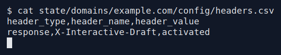

   [Read the captured terminal text](../assets/interactive/core-all-inspect-draft-file/01-the-edited-draft-contains-a-new-header.txt)

</details>

<details>
<summary>The draft header is not active yet</summary>

1. The draft header is not active yet.

   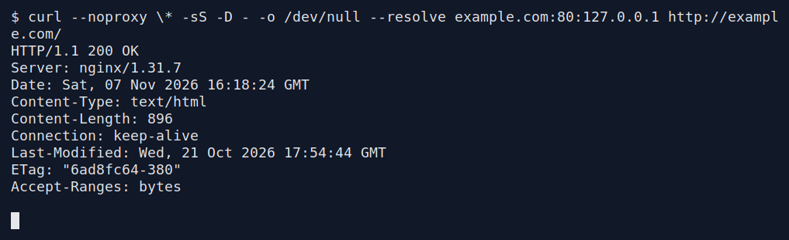

   [Read the captured terminal text](../assets/interactive/core-all-verify-draft-inactive/01-the-draft-header-is-not-active-yet.txt)

</details>

<details>
<summary>validate-domain-config — inputs and result</summary>

1. Choose **example.com (invalid draft)**.

   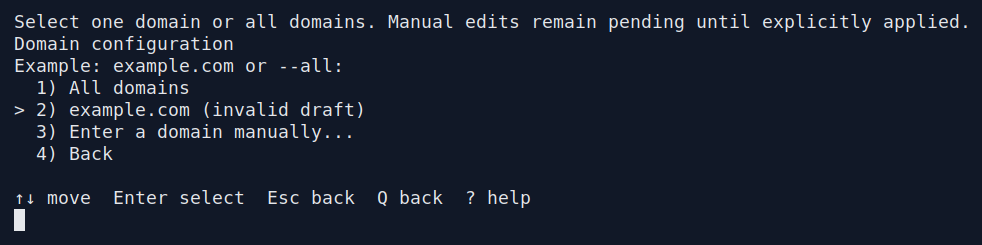

   [Read the captured terminal text](../assets/interactive/core-all-validate-draft/03-select-example-com.txt)

2. Command result.

   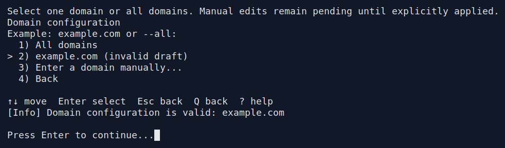

   [Read the captured terminal text](../assets/interactive/core-all-validate-draft/04-command-result.txt)

</details>

<details>
<summary>apply-domain-config — inputs and result</summary>

1. Choose **example.com (invalid draft)**.

   

   [Read the captured terminal text](../assets/interactive/core-all-preview-draft/03-select-example-com.txt)

2. Choose **Review changes without applying them (current)**.

   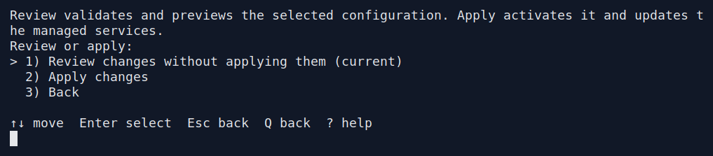

   [Read the captured terminal text](../assets/interactive/core-all-preview-draft/04-choose-preview-or-apply.txt)

3. Command result.

   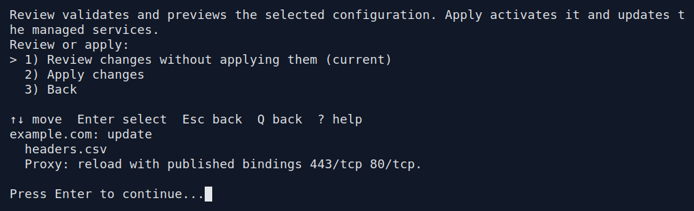

   [Read the captured terminal text](../assets/interactive/core-all-preview-draft/05-command-result.txt)

</details>

<details>
<summary>stop-backend — inputs and result</summary>

1. Choose **example.com**.

   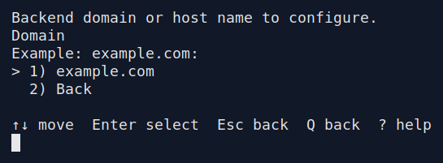

   [Read the captured terminal text](../assets/interactive/core-all-pending-edit-cancel/03-select-the-edited-domain.txt)

2. Choose **Cancel command**.

   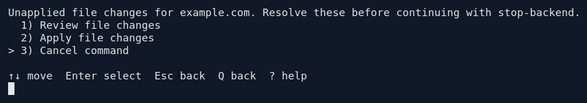

   [Read the captured terminal text](../assets/interactive/core-all-pending-edit-cancel/04-preserve-the-pending-draft.txt)

3. Choose **Back**.

   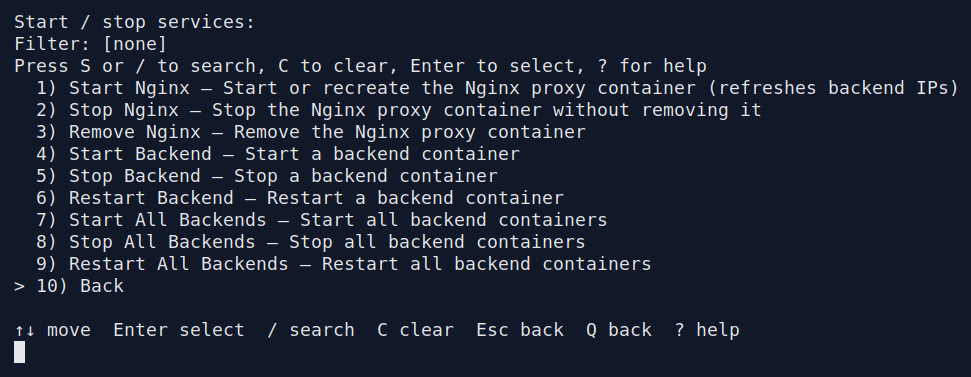

   [Read the captured terminal text](../assets/interactive/core-all-pending-edit-cancel/05-return-without-stopping.txt)

</details>

<details>
<summary>apply-domain-config — inputs and result</summary>

1. Choose **example.com (invalid draft)**.

   

   [Read the captured terminal text](../assets/interactive/core-all-apply-draft/03-select-example-com.txt)

2. Choose **Apply changes**.

   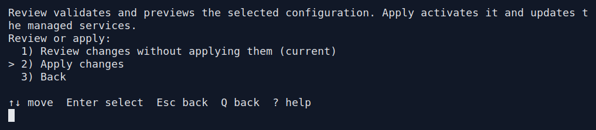

   [Read the captured terminal text](../assets/interactive/core-all-apply-draft/04-choose-preview-or-apply.txt)

3. Review the collected inputs, then choose **Run**.

   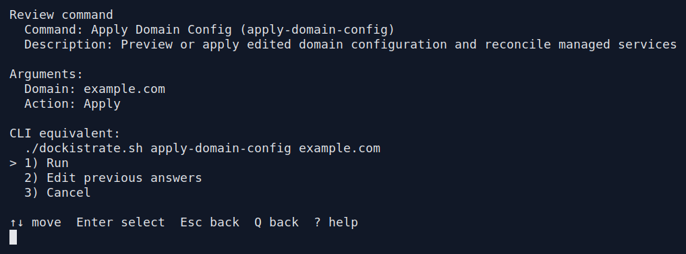

   [Read the captured terminal text](../assets/interactive/core-all-apply-draft/05-review-and-apply.txt)

4. Command result.

   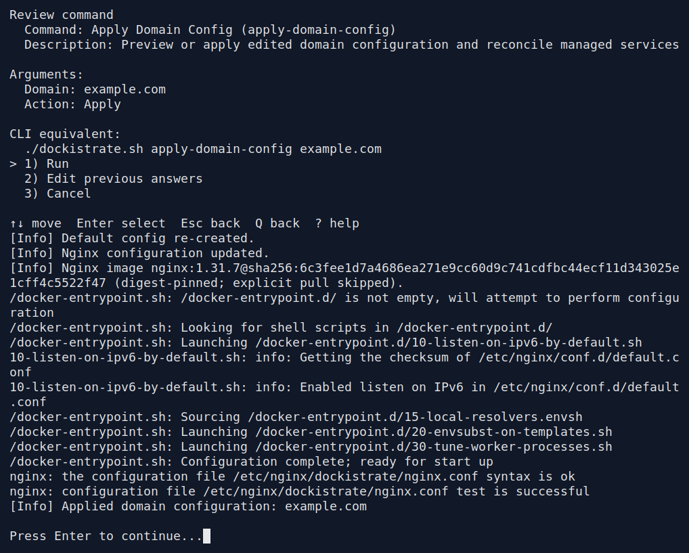

   [Read the captured terminal text](../assets/interactive/core-all-apply-draft/06-command-result.txt)

</details>

<details>
<summary>The applied header appears in a real response</summary>

1. The applied header appears in a real response.

   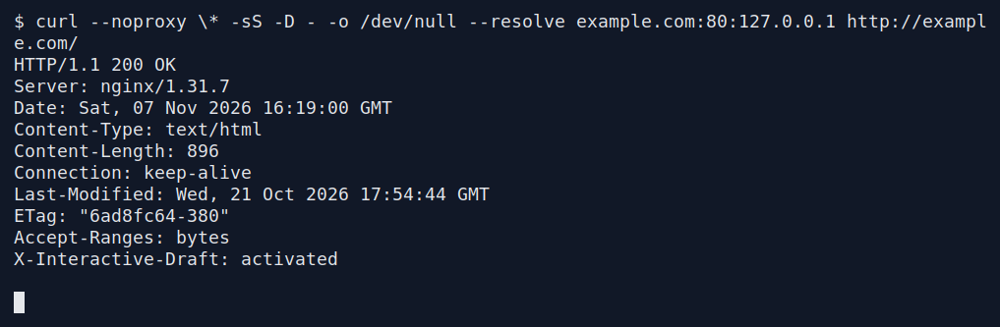

   [Read the captured terminal text](../assets/interactive/core-all-verify-draft-active/01-the-applied-header-appears-in-a-real-response.txt)

</details>

<details>
<summary>check-config — inputs and result</summary>

1. Configuration test passed.

   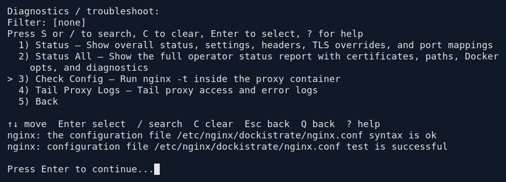

   [Read the captured terminal text](../assets/interactive/core-all-check-draft/03-configuration-test-passed.txt)

</details>

<details>
<summary>restart-backend — inputs and result</summary>

1. Choose **example.com**.

   

   [Read the captured terminal text](../assets/interactive/core-branches-pending-edit-review-apply/03-example-com.txt)

2. Choose **Review file changes**.

   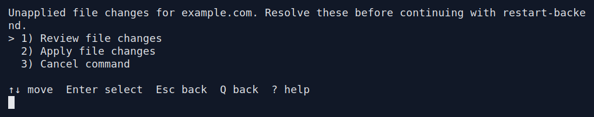

   [Read the captured terminal text](../assets/interactive/core-branches-pending-edit-review-apply/04-review-the-pending-file-changes-before-restarting.txt)

3. Choose **Apply file changes**.

   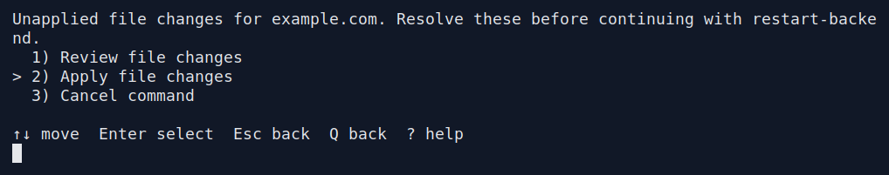

   [Read the captured terminal text](../assets/interactive/core-branches-pending-edit-review-apply/05-apply-the-pending-files-through-the-nested-review.txt)

4. Review the collected inputs, then choose **Run**.

   

   [Read the captured terminal text](../assets/interactive/core-branches-pending-edit-review-apply/06-confirm-applying-the-pending-header.txt)

5. Pending files applied; collect the original command again.

   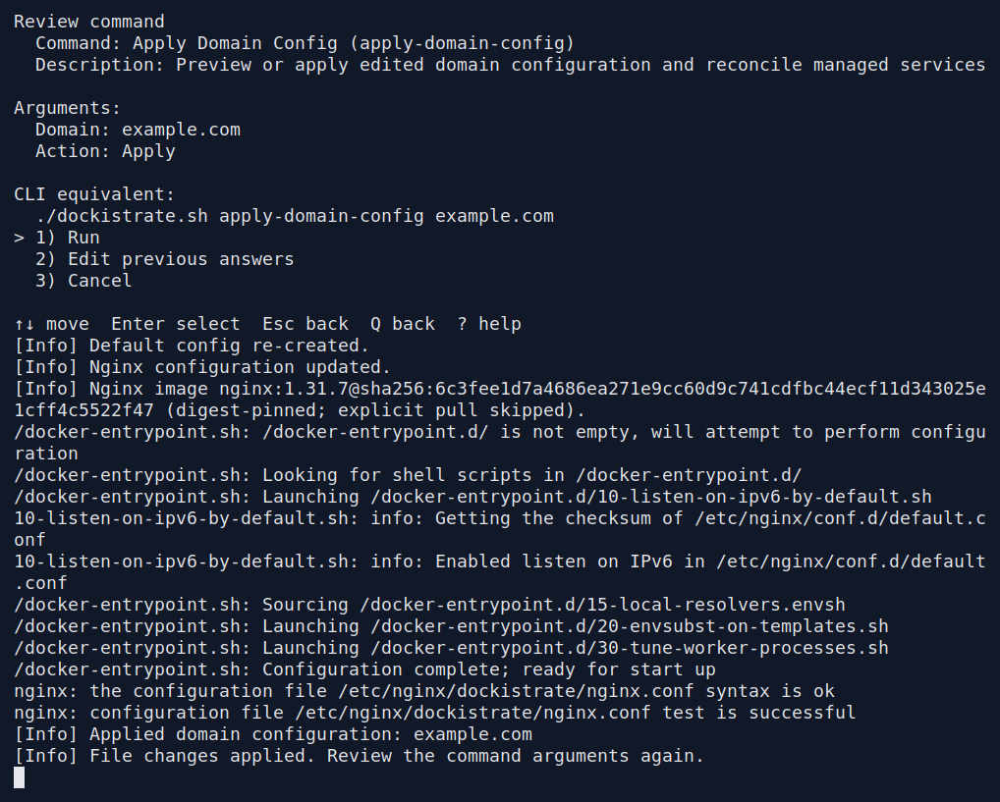

   [Read the captured terminal text](../assets/interactive/core-branches-pending-edit-review-apply/07-pending-files-applied-collect-the-original-command-again.txt)

6. Choose **example.com**.

   

   [Read the captured terminal text](../assets/interactive/core-branches-pending-edit-review-apply/08-select-the-backend-again-after-applying-files.txt)

7. Review the collected inputs, then choose **Run**.

   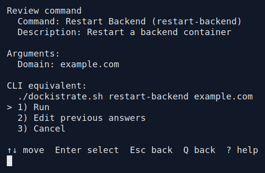

   [Read the captured terminal text](../assets/interactive/core-branches-pending-edit-review-apply/09-review-the-recollected-restart-command.txt)

8. The original restart command completes after recollection.

   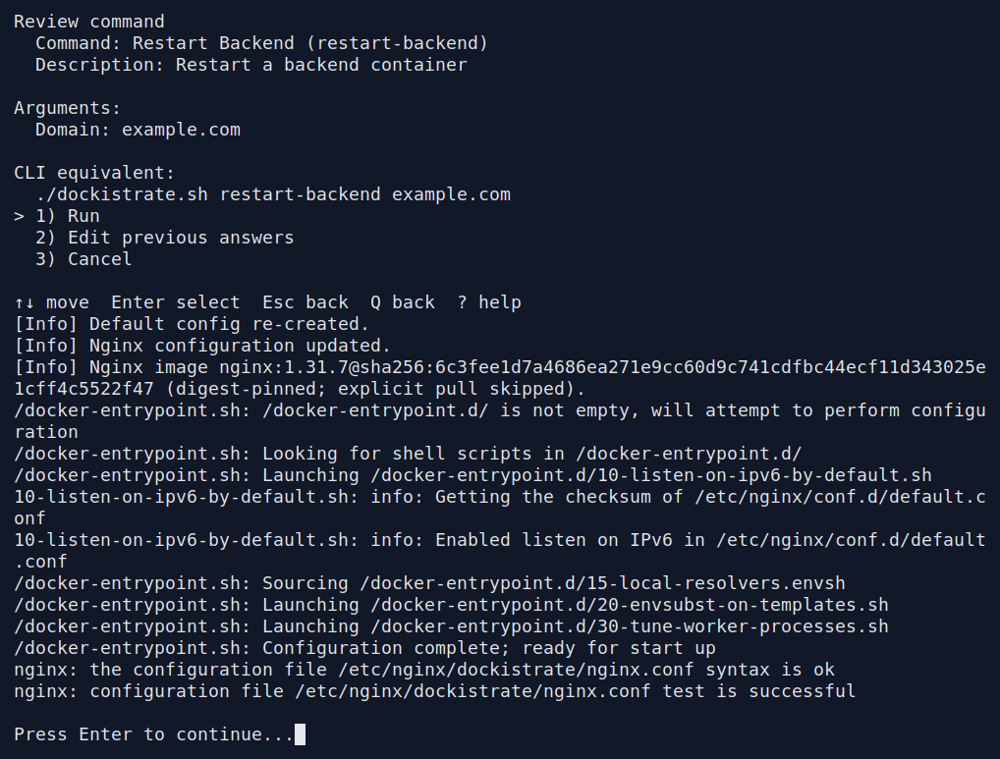

   [Read the captured terminal text](../assets/interactive/core-branches-pending-edit-review-apply/10-the-original-restart-command-completes-after-recollection.txt)

</details>

<details>
<summary>The applied header remains active after restarting</summary>

1. The applied header remains active after restarting.

   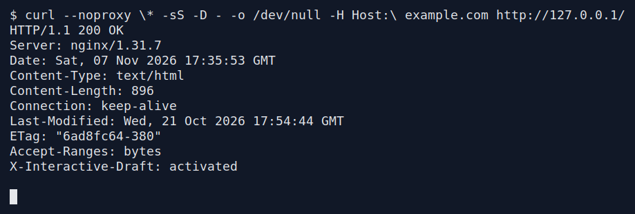

   [Read the captured terminal text](../assets/interactive/core-branches-pending-edit-active-response/01-the-applied-header-remains-active-after-restarting.txt)

</details>

<details>
<summary>check-config — inputs and result</summary>

1. Configuration test passed.

   

   [Read the captured terminal text](../assets/interactive/core-branches-pending-edit-final-config/03-configuration-test-passed.txt)

</details>

<!-- /walkthrough: domain-apply -->

```bash
./dockistrate.sh validate-domain-config example.com
./dockistrate.sh apply-domain-config example.com --dry-run
./dockistrate.sh apply-domain-config example.com
./dockistrate.sh check-config
curl --noproxy '*' -i http://127.0.0.1 -H 'Host: example.com'
```

**Undo:** restore this row's previous value (or remove only the added row), then
validate, preview, and apply again. Preserve other people's pending edits.
Choose **All domains** when several drafts depend on one another; a single-domain
operation combines only the selected draft with the other domains' applied state.

<a id="cmd-init-domain-config"></a>
### Create editable templates

Choose **Init Domain Config**, enter a new domain such as `new.example.com`, and
select **Backend with its own container**, **Alias for an existing backend**,
**Dedicated hostname with independent settings**, or **Certificates without a
backend container**. Review → **Run**. Check that its `config/` templates exist;
this step starts no container and exposes no listener. Fill the required values
using [Create a Backend from Files](#create-a-backend-from-files) and
[Finding a Setting](#finding-a-setting), then follow the validation/apply steps.

<!-- walkthrough: domain-init -->

<details>
<summary>init-domain-config — inputs and result</summary>

1. Enter `draft.example.com`.

   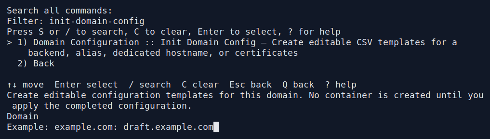

   [Read the captured terminal text](../assets/interactive/core-migration-domain-init/03-enter-value.txt)

2. Choose **Certificates without a backend container**.

   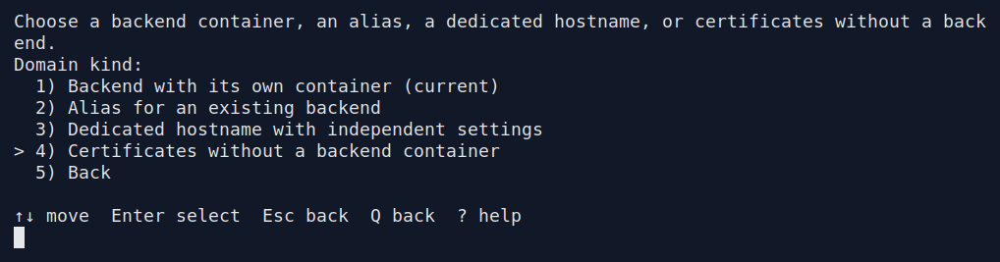

   [Read the captured terminal text](../assets/interactive/core-migration-domain-init/04-certificates-without-a-backend-container.txt)

3. Review the collected inputs, then choose **Run**.

   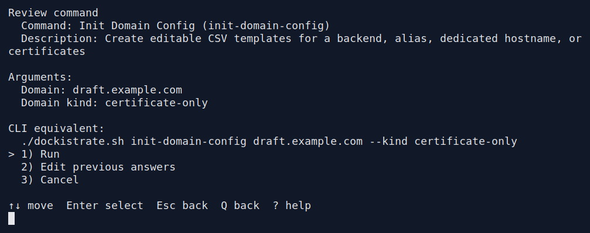

   [Read the captured terminal text](../assets/interactive/core-migration-domain-init/05-review-and-run-init-domain-config.txt)

4. init-domain-config result.

   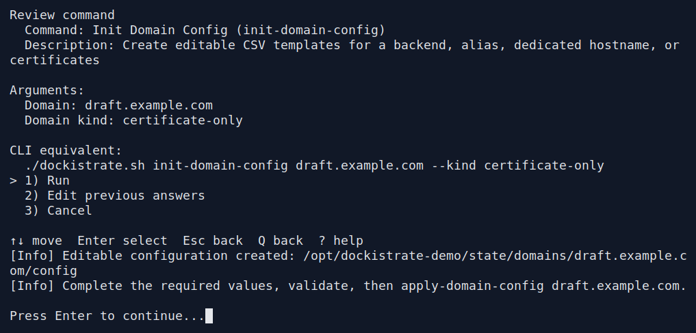

   [Read the captured terminal text](../assets/interactive/core-migration-domain-init/06-init-domain-config-result.txt)

</details>

<!-- /walkthrough: domain-init -->

**CLI:** `./dockistrate.sh init-domain-config new.example.com --kind backend`

It refuses to overwrite existing configuration. Remove only an intentionally
abandoned, never-applied draft to discard it; deleting a domain folder is not a
backend-removal operation.

### Commands used in the workflow

| Operation | Interactive input and result | CLI equivalent |
| --- | --- | --- |
| <a id="cmd-validate-domain-config"></a>Validate Domain Config | Domain or **All domains**. Runs directly and reports valid configuration or actionable errors; changes nothing live. | `validate-domain-config example.com` / `validate-domain-config --all` |
| <a id="cmd-apply-domain-config"></a>Apply Domain Config | Domain or **All domains** → **Review changes without applying them** or **Apply changes**. Preview runs directly; **Apply changes** shows the validated preview before Run. Verify the intended response after applying. | `apply-domain-config example.com --dry-run`, then `apply-domain-config example.com` |
| <a id="cmd-migrate-state"></a>Migrate State | **Review changes without applying them** → optional backend-details CSV path. The preview runs directly. For a legacy upgrade, follow the prerequisites below, then repeat with **Apply changes** and the same details file. | `migrate-state --dry-run --backend-details /absolute/path/backend-details.csv`, then omit `--dry-run` to apply |

### Preview and convert legacy state

For a schema-1 installation, first complete the backup and inventory steps in
[Upgrade Existing State](#upgrade-existing-state). The illustrated isolated
example declares an intentionally stopped backend in `backend-details.csv`:

```csv
domain,image,state
legacy.example.com,nginx:alpine,stopped
```

1. Choose **Migrate State** → **Review changes without applying them** and enter
   the absolute path to that CSV. Check the reported source schema, target
   schema, and domains. Preview must leave the existing configuration unchanged.
2. Choose **Migrate State** again → **Apply changes** and enter the same path.
   Read the conversion preview, then choose **Run**.
3. Check the reported schema is 5 and compare the new domain's editable
   `config/backend.csv` with `runtime/applied/backend.csv`: image, container port,
   network, and stopped/running declaration should match the intended inventory.
   Existing proxy configuration and containers stay unchanged during migration.

<!-- walkthrough: domain-migrate -->

<details>
<summary>migrate-state — inputs and result</summary>

1. Choose **Review changes without applying them (current)**.

   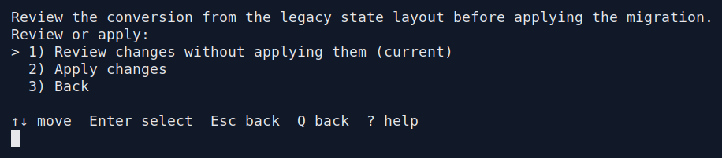

   [Read the captured terminal text](../assets/interactive/core-migration-domain-migrate-preview/03-review-changes-without-applying-them-current.txt)

2. Enter `/opt/dockistrate-demo-fixtures/migration/backend-details.csv`.

   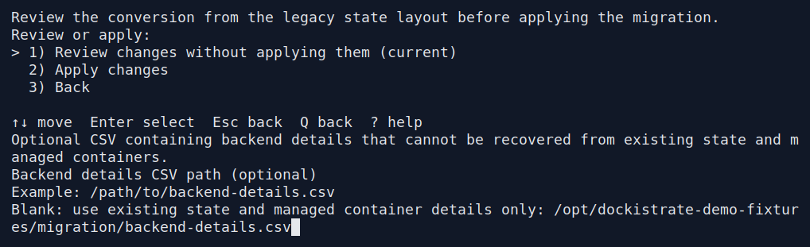

   [Read the captured terminal text](../assets/interactive/core-migration-domain-migrate-preview/04-enter-value.txt)

3. migrate-state result.

   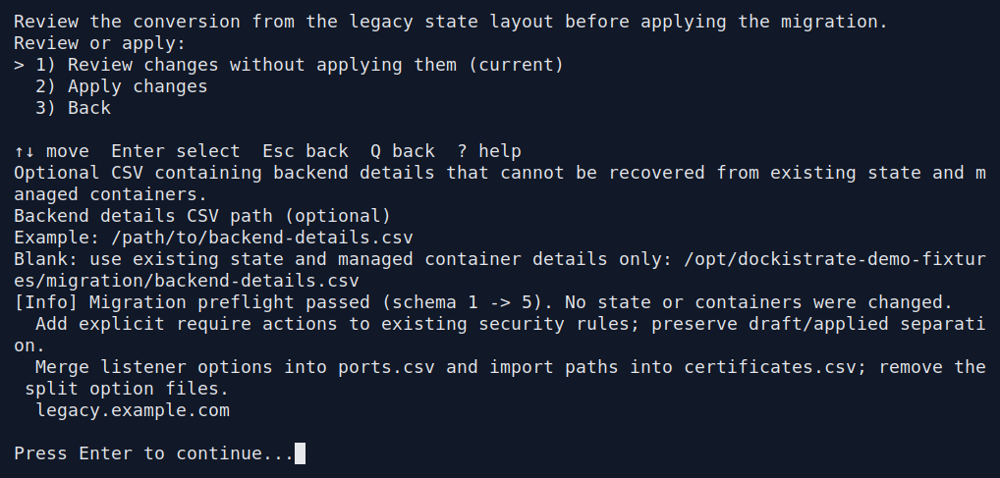

   [Read the captured terminal text](../assets/interactive/core-migration-domain-migrate-preview/05-migrate-state-result.txt)

</details>

<details>
<summary>migrate-state — inputs and result</summary>

1. Choose **Apply changes**.

   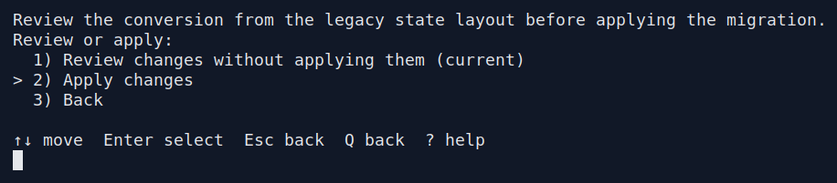

   [Read the captured terminal text](../assets/interactive/core-migration-domain-migrate-apply/03-apply-changes.txt)

2. Enter `/opt/dockistrate-demo-fixtures/migration/backend-details.csv`.

   

   [Read the captured terminal text](../assets/interactive/core-migration-domain-migrate-apply/04-enter-value.txt)

3. Review the collected inputs, then choose **Run**.

   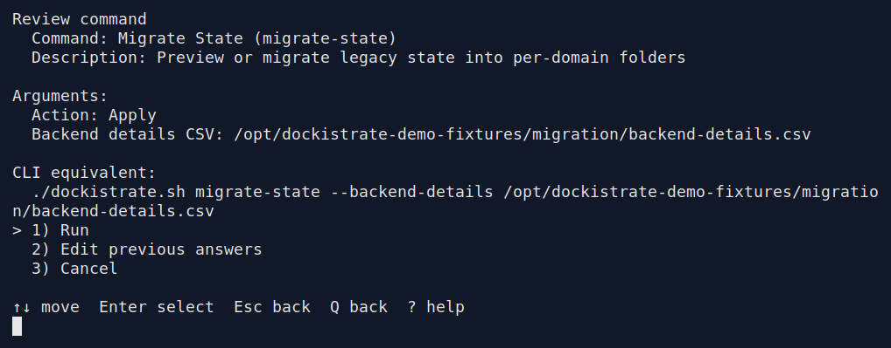

   [Read the captured terminal text](../assets/interactive/core-migration-domain-migrate-apply/05-review-and-run-migrate-state.txt)

4. migrate-state result.

   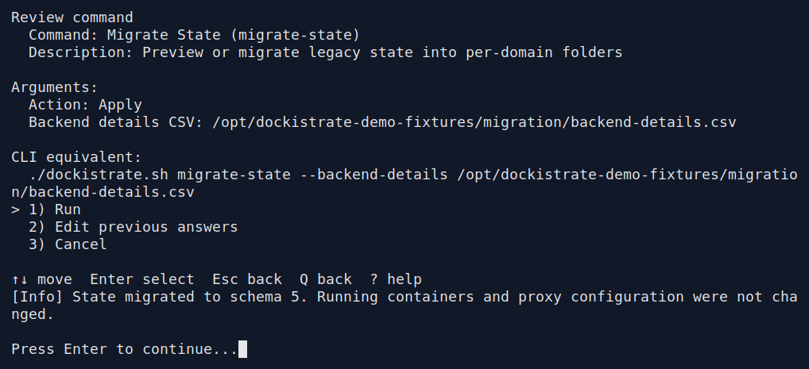

   [Read the captured terminal text](../assets/interactive/core-migration-domain-migrate-apply/06-migrate-state-result.txt)

</details>

<details>
<summary>Editable and applied configuration after migration</summary>

1. Editable and applied configuration after migration.

   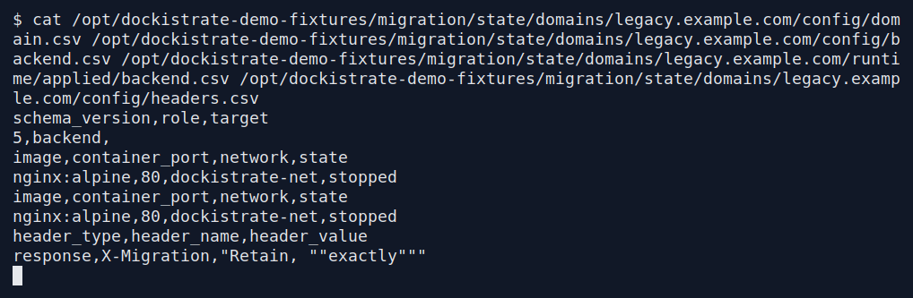

   [Read the captured terminal text](../assets/interactive/core-migration-migration-converted-files/01-editable-and-applied-configuration-after-migration.txt)

</details>

<!-- /walkthrough: domain-migrate -->

Migration is for older state, not ordinary CSV edits. A current-state run may
report that no migration is needed. For legacy state, back up first, supply the
required image/state declarations, and use the exact
[upgrade sequence](#upgrade-existing-state); do not infer a successful migration
from an already-current result.

## Commands

```text
init-domain-config <domain> [--kind backend|alias|dedicated|certificate-only]
validate-domain-config <domain>|--all
apply-domain-config <domain>|--all [--dry-run]
migrate-state [--dry-run] [--backend-details <csv>]
```

`init-domain-config` writes templates without starting a container or exposing
a listener. It refuses to overwrite an existing configuration. The default
kind is `backend`; complete its required values before validating it.

Validation checks the selected configuration together with the other domains'
applied settings. `--all` checks the complete desired setup, including references
between new domains. Preview with `--dry-run` before applying changes.

Interactive Apply shows the same validated preview before the Run confirmation.
Invalid files stop there without activating changes.

Applying security rules, ACLs, client-IP interpretation, or related host
inheritance changes recreates the proxy and checks readiness, matching the
corresponding CLI/menu commands. Preview identifies the recreation. Ordinary
header and listener option edits use the normal reload path when possible.
When automatic backups are enabled, a successful apply also backs up the
final editable/applied configuration, including file-only edits. An unchanged
apply creates no additional backup or proxy reload.

## Create a Backend from Files

```bash
./dockistrate.sh init-domain-config example.com
```

The generated `config/domain.csv` identifies the kind and schema:

```csv
schema_version,role,target
5,backend,
```

Set the image, application port, Docker network, and desired running state in
`config/backend.csv`:

```csv
image,container_port,network,state
nginx:alpine,80,dockistrate-net,running
```

Add an HTTP listener in `config/ports.csv`:

```csv
listen_port,upstream_port,protocol,certificate_owner,certificate_id,websocket,redirect_enabled,redirect_code,http3_enabled,alt_svc
8080,80,http,,,no,off,,off,auto
```

```bash
./dockistrate.sh validate-domain-config example.com
./dockistrate.sh apply-domain-config example.com --dry-run
./dockistrate.sh apply-domain-config example.com
./dockistrate.sh status
```

The apply operation reconciles the backend, its declared certificates, and the
proxy configuration. Set the `state` cell to `stopped` to keep the backend stopped through
subsequent configuration changes. Observed container status does not silently
change this declared state.

Changing `network` while keeping `state` set to `stopped` moves the container's
network attachment without starting it, even when it has no IP address. If the
same draft changes `state` to `running`, apply moves the attachment while the
container is stopped, then starts it and records its current IP address. These
rules apply through both the CLI and interactive menu; a failed network change
rolls back instead of publishing the draft.

To add HTTPS using a domain-owned self-signed certificate, add this row to
`config/certificates.csv`:

```csv
certificate_id,provider,port_suffix,source_fullchain,source_privkey
selfsigned-443,selfsigned,443,,
```

Then add a listener row to `config/ports.csv`:

```csv
listen_port,upstream_port,protocol,certificate_owner,certificate_id,websocket,redirect_enabled,redirect_code,http3_enabled,alt_svc
443,80,https,example.com,selfsigned-443,no,off,,off,auto
```

Validate and apply again to provision the certificate and activate HTTPS. To
import an existing certificate, use provider `custom` and set both source paths
in that certificate's row. Certificate and key contents stay in managed files,
never in CSV cells. Changing an option means editing its existing listener or
certificate row; there is no second options file to coordinate.

For a new alias, initialize with `--kind alias` and set the `target` cell to `example.com` in
its `domain.csv`. Use `--kind dedicated` for a hostname with independently
controlled inheritance and overrides. Apply related new domains together with
`apply-domain-config --all`.

Ordinary aliases share the target backend's HTTP version, client/proxy IP
headers, paths, Nginx directives, and mTLS configuration. Set those values on the
target backend, or use a dedicated host for independent settings. Alias folders
may declare request/response headers, security rules, ACL rules, and the
`acl_policy`, `acl_status`, and `security_rule_status` settings. They may also
own certificates. Validation rejects alias-local declarations that the shared
server configuration would ignore.

## Finding a Setting

All paths in this table are relative to the domain's `config/` directory.

| File | Purpose and columns |
| --- | --- |
| `domain.csv` | `schema_version,role,target`. |
| `backend.csv` | `image,container_port,network,state`. |
| `settings.csv` | `http_version,client_ip_header,proxy_ip_header,acl_policy,acl_status,security_rule_status`. |
| `inheritance.csv` | `mtls,acl,security_rules,headers,paths`. |
| `ports.csv` | `listen_port,upstream_port,protocol,certificate_owner,certificate_id,websocket,redirect_enabled,redirect_code,http3_enabled,alt_svc`. |
| `paths.csv` | `path_id,listen_port,path_prefix,match,priority,target,rewrite,header_set`. |
| `path_options.csv` | `path_id,websocket,redirect_enabled,redirect_code,reason,source_location`. |
| `headers.csv` | `header_type,header_name,header_value`: request or response headers. |
| `docker_options.csv` | `position,argument`: one Docker argument per row, in explicit numeric order. |
| `nginx_directives.csv` | `scope,listen_port,path_prefix,directive_mode,directive_name,directive_value`. |
| `security_rules.csv` | `rule_id,order,enabled,action,mode,status_code,reason,source_location`. |
| `security_conditions.csv` | `rule_id,condition_order,selector,name,operator,value`: conditions belonging to a security rule. |
| `acl.csv` | `rule_id,order,enabled,scope,action,ip_value,status_code`. |
| `mtls.csv` | `enabled,directory`. |
| `certificates.csv` | `certificate_id,provider,port_suffix,source_fullchain,source_privkey`: owned certificate declarations and optional custom import paths. |

Every CSV starts with field names, followed by complete value records.
`domain.csv`, `backend.csv`, `settings.csv`, `inheritance.csv`, and `mtls.csv`
have at most one values row; other files contain one row per entity. Keep all
columns supplied by the template. Readers accept reordered columns, and writers
restore the documented order. Unknown or duplicate column names, wrong row
widths, and duplicate entity records are rejected.

Files are CSV data and are never sourced as shell scripts. Quote values
containing commas; double embedded quotes. Values are single-line, and CRLF
line endings are accepted. For example:

```csv
header_type,header_name,header_value
response,Cache-Control,"public, max-age=60"
```

Each Docker argument is separate, including an option's value:

```csv
position,argument
1,--memory
2,256m
3,--env
4,APP_MODE=production
```

An omitted optional file means no entries. A header-only optional table
explicitly clears that feature when applied; a present zero-byte file is invalid.
Required domain identity and
backend fields must remain present. Deleting the whole domain folder does not
request backend removal; use `remove-backend` or the corresponding host-removal
command for that operation.
Backend container removal is deferred until configuration commits; its success
message appears only after the container has been deleted.

Changing an applied backend to another domain role first requires explicit
backend removal. Likewise, remove an existing host before changing it
into a backend. A certificate-only domain can become a backend directly.

Removing a certificate declaration leaves its material retained for recovery.
It stops appearing in new mapping choices. `list-certs` marks retained copies;
use the explicit certificate removal command to delete the material.

Rule and Docker-option order is represented by explicit columns. Changing CSV
quote style, line endings, column order, or physical row order alone does not change the
configuration's meaning.

## Values and Defaults

Blank optional settings inherit their effective defaults. Use `off` to disable
a client or proxy IP header explicitly. Empty header values in `headers.csv`
and empty Docker arguments are actual records and retain their meaning.

| `settings.csv` column | Accepted value | If blank or the optional record is absent |
| --- | --- | --- |
| `http_version` | `http1.0`, `http1.1`, `http2` | Use the effective inherited/global HTTP version. |
| `client_ip_header` | Header name or `off` | Use the effective inherited/global client IP header. `off` explicitly disables it. |
| `proxy_ip_header` | Header name or `off` | Use the effective inherited/global proxy IP header. `off` explicitly disables it. |
| `acl_policy` | `allow`, `deny` | Use the effective inherited/global ACL policy. |
| `acl_status` | HTTP status `100`–`599` | Use the effective inherited/global ACL status. |
| `security_rule_status` | HTTP status `100`–`599` | Use the effective inherited/global security-rule status. |

In `inheritance.csv`, each of `mtls`, `acl`, `security_rules`, `headers`, and
`paths` accepts `yes` or `no`, with blank cells defaulting to `yes`. Only a
dedicated host can set these switches. They control whether that feature falls
back to its target backend; explicit local overrides still take precedence.

| Other singleton file | Fields and defaults |
| --- | --- |
| `domain.csv` | `schema_version` must be `5`; `role` is required. `target` must name a primary backend for `alias` or `dedicated`; it must be blank for other roles. Host associations remain dormant when the target has no HTTP/HTTPS listeners. |
| `backend.csv` | `image` and `container_port` are required and nonblank. Blank `network` uses `DEFAULT_NETWORK` (normally `dockistrate-net`); blank `state` means `running`. |
| `mtls.csv` | `enabled` is `yes` or `no`, default `no`. `directory` is absent/blank for the owned `state/domains/<domain>/mtls` directory, or its exact absolute path; arbitrary directories are rejected. |

`mtls.csv` configures the domain's own authority. On a dedicated host,
an `enabled` value of `no` does not suppress inherited trust: set `mtls` to `no` in
`inheritance.csv` as well to disable the target backend's mTLS requirement.
CLI and interactive mTLS changes write a blank `directory`, keeping the owned
location portable without changing the CSV schema. Existing exact absolute
paths remain valid in their original checkout. Restore translates older applied
owned paths and matching editable paths to this blank default; unrelated or
unfinished draft edits remain pending. See [mTLS backup portability](backups-restore-cleanup.md#mtls-backup-portability).

A listener is identified by `(listen_port,protocol)` in `ports.csv`. Its options
are part of the same row. Every `path_options.csv` row must refer to an existing
`path_id` in `paths.csv`.

| Option key | Listener values/default | Path values/default |
| --- | --- | --- |
| `websocket` | `yes` or `no`; default `no` | `yes`, `no`, or `inherit`; default `inherit` |
| `redirect_enabled` | `on` or `off`; default `off` | `on`, `off`, or `inherit`; default `inherit` |
| `redirect_code` | Blank, `301`, `302`, `308`, or a code plus `:port`; blank uses `301` when enabled | Same values; blank inherits the listener's code and target port, then `301` if needed |
| `http3_enabled` | `on` or `off`; default `off` | Not a path option |
| `alt_svc` | `auto`, `off`, or a literal header value; default `auto` | Not a path option |
| `reason` | Not a listener option | Single-line diagnostic text; absent/blank/`-` means no custom reason |
| `source_location` | Not a listener option | Single-line diagnostic label; absent/blank/`auto` uses automatic location |

An HTTP listener with `redirect_enabled=on` and a blank `redirect_code` renders
`return 301 https://$host$request_uri;`. A path with `redirect_enabled=on` and a
blank code enables its redirect even when the listener's redirect is off; it
uses the listener's code and target port when available, otherwise `301`.
For example, a listener code of `308:8443` makes that path return `308` to HTTPS
port `8443`. Dedicated hosts use the same rules for inherited paths.

CLI and interactive validate, preview, and apply preserve these blank cells.
Changing a listener's code later also changes paths that inherit it; an explicit
path code stays fixed. `list-path-options` and `status-all` show an enabled path
with a blank code as `on(inherit)`. This differs from `redirect_enabled=inherit`,
which also follows whether the listener's redirect is enabled. Keep the code
blank when the redirect flag is `off` or `inherit`; nonblank codes still require
`on` and must be valid redirect specifications. Manual edits require apply.

Diagnostic text excludes control characters and Nginx statement delimiters
(`;`, `{`, `}`, `$`). Alt-Svc values exclude control characters and braces.
Blank option cells use their documented defaults. Listener and certificate
options live in their entity rows; path options remain in `path_options.csv`.

| Table/field | Blank or omitted behavior |
| --- | --- |
| `ports.csv` certificate fields | Both required for `https`; both blank for `http`, `tcp`, or `udp`. Listen/upstream ports and protocol are always required. |
| `paths.csv` `match` | Blank means `prefix`; alternatives are `exact` and `regex`. |
| `paths.csv` `priority` | Blank means `100`; otherwise a positive integer. |
| `paths.csv` `target` | Blank uses the listener's backend; otherwise a port or `hostname:port`. |
| `paths.csv` `rewrite` | Blank means `none`; alternatives are `strip-prefix` or `replace:/new-prefix`. |
| `paths.csv` `header_set` | Blank adds no named path-header include; a name selects that shared header set. |
| `headers.csv` `header_value` | Blank is an explicit empty header override, suppressing the inherited value. Removing the row restores normal inheritance. |
| `security_rules.csv` `action` | `block` rejects a match; `require` rejects a nonmatch; `allow` permits a match past later Block/Allow decisions. Blank means `require`. |
| `security_rules.csv` `status_code`, `reason`, `source_location` | Blank status or `-` uses the effective security-rule status; blank reason means `-`; blank location means `auto`. Allow retains these fields but does not use them to reject requests. |
| `acl.csv` `status_code` | Blank uses the effective ACL status; otherwise HTTP status `100`–`599`. |
| `certificates.csv` import fields | `source_fullchain` and `source_privkey` are only supported for `custom` certificates. A new import requires both file paths; existing matching managed material can be reused without importing again. |

IDs use letters, digits, `.`, `_`, and `-`, begin with a letter or digit, and
are at most 128 characters. Path IDs are local to a domain and certificate IDs
to their owner. Security-rule IDs and their `order` values must be unique
across all domains; ACL IDs/orders have a separate global namespace. Orders and
Docker `position` values are positive decimal integers without leading zeros
(at most nine digits); gaps are allowed. Conditions use consecutive
`condition_order` values from `1` through at most `10` within each rule.
One condition requires mode `single`; multiple conditions use `and` or `or`.
Rule/ACL `enabled` is `0` or `1`.

Every applicable Require rule must pass. Block and Allow rules then run in
global `order`, with the first matching decision taking effect. Allow does not
bypass Require, ACLs, or mTLS. A request matching neither Block nor Allow
continues through the existing controls; adding an Allow rule does not create
a default-deny policy. See the [security rule guide](access-control-security-rules.md)
for examples and inheritance details.

Existing CLI commands that take numeric rule IDs still select the current
global list position shown by the list commands. Those numbers are distinct
from the stable `rule_id` strings in the editable files.

## Pending Edits and Existing Commands

The files under `runtime/applied/` describe the last successful configuration.
They are maintained by Dockistrate; edit `config/` instead. Status and domain
selection distinguish applied configurations, drafts, pending changes, invalid
drafts, missing source files, and runtime drift. Runtime drift means the managed
backend's observed state differs from its applied configuration; applying the
domain reconciles it.

Existing CLI and interactive commands continue to apply changes immediately.
If their target domain has pending edits, resolve those edits before running a
configuration-changing command for that domain. The command does not overwrite
the edited files or silently activate them. Other domains remain usable.

The checked domain follows the command's existing target behavior. Individual
host headers, settings, and alias/dedicated-host removal check the named host.
Port/path and backend runtime commands resolve an alias or dedicated host to its
primary backend and check that backend. The existing
`remove-all-backend-headers <host>` command also resolves to the primary backend.
Removing a backend checks its dependent hosts too. A global setting value that
happens to resemble a domain name does not select that domain.

The picker offers **Review file changes**, **Apply file changes**, or **Cancel
command** when it finds pending edits. Applying first shows the candidate and
asks for the normal Run confirmation. After a successful apply, it collects
the original command's arguments again so its choices reflect the new state.
CLI commands report the pending domain and require an explicit apply first.

`update-nginx-config` regenerates applied configuration. `check-config` tests
the proxy configuration with `nginx -t`. Neither command applies pending files.
An incomplete manual edit does not prevent status or unrelated commands from
using the last applied configuration.
Full backups still reject unsupported symlinks and special files, including
those in drafts. Regular draft subdirectories, including hidden files and empty
directories, survive backup/restore but remain invalid for configuration apply.
Keep notes and editor backup files outside `config/`: apply accepts only the
documented CSV filenames, including when checking hidden entries.

Status checks new and pending drafts against the other domains' applied
configuration. Missing target, certificate, or listener references and conflicting
listeners or rule IDs/orders report `invalid draft`, even when the CSV syntax is
valid. Unrelated drafts are excluded, just as with single-domain apply.

A single-domain apply uses the other domains' applied configuration. To activate
coordinated edits across domains, use `apply-domain-config --all`. Apply works
from captured input files. Later edits remain pending, including when an apply
fails and the previous runtime configuration is restored.

## Upgrade Existing State

For the backup, release checkout, and verification sequence, follow the
[update guide](updates.md). Run migration with the newly selected code; restart
an interactive session after changing releases.

State schemas `1` (legacy shared configuration), `2` (vertical settings
records), `3` (named columns with separate listener/certificate options), and
`4` (consolidated records with implicit Require rules) need explicit migration
to schema `5`. Preview the conversion first:

```bash
./dockistrate.sh migrate-state --dry-run
./dockistrate.sh migrate-state
```

For schema-1 state, migration must recover a complete declaration for each backend, including its
image and running/stopped state. When those details cannot be recovered from
existing state and managed containers, supply them explicitly:

```csv
domain,image,state
example.com,nginx:alpine,running
paused.example.com,redis:alpine,stopped
```

```bash
./dockistrate.sh migrate-state --dry-run --backend-details /path/backend-details.csv
./dockistrate.sh migrate-state --backend-details /path/backend-details.csv
```

When a legacy backend has no saved container identity, a complete details row
also permits storage conversion while its existing container name is occupied.
The row declares the desired image and lifecycle; it does not prove container
ownership. Migration does not adopt the container, create an identity or launch
token, or change its runtime. A saved identity must still verify, and details
cannot override a verified image/state or bypass malformed or mismatched
ownership records.

After this storage-only conversion, explicitly replace each identity-less
backend using its inspected full container ID and chosen image:

```bash
./dockistrate.sh update-backend example.com \
  --replace-unmanaged-container <full-64-character-container-id> \
  --image <verified-image-reference>
```

Ordinary runtime management and apply remain subject to ownership checks.
Complete the replacements before using them to activate migrated configuration.
The interactive migration and backend-update flows support the same sequence;
see [backend identity and upgrades](backends-and-ports.md#backend-identity-and-upgrades).
Use the existing immutable image digest when recreation should preserve the
exact image; a tag such as `latest` may now identify a different image.

Migration validates the converted applied configuration and checks draft
structure before publication. Incomplete or invalid draft values remain pending;
malformed, duplicate, or orphan records stop conversion without changing state. Do not manually move files or substitute
symlinks for the migration. Backups and restore must include both editable
configuration and the applied state; see [backup and recovery](backups-restore-cleanup.md).
Duplicate backend/hostname ownership records must be corrected before migration;
Dockistrate does not choose one and discard the others.

Legacy certificate-directory arguments resolve through the saved references in
each certificate's metadata, including certificates with descriptive IDs. If a
legacy reference matches multiple certificates, use the explicit `owner/id`.
These references require no filesystem symlinks.

Migration leaves containers, images, certificate material, and the serving proxy
configuration in place. Schema-2 conversion separately transposes editable and
applied records, so pending drafts remain pending and missing source stays
missing. It converts shared settings, runtime/certificate metadata, and generated
CSV reports too. Existing explicit blank IP-header overrides become `off`.
Ambiguous or malformed old records stop migration before publication.
Concurrent source edits are preserved, and the schema marker is written last.
Schema-3 conversion joins listener options by `(listen_port,protocol)` and
certificate import paths by `certificate_id`, then removes the two separate
options files. It converts editable and applied files independently, preserving
pending edits and missing sources. Conflicting merged/split declarations and
orphan option rows stop conversion without discarding data.
Schema-4 conversion adds `action=require` to existing security rules and keeps
their order and behavior. Editable and applied records are converted separately,
including the generated aggregate cache. Safe draft subdirectories are retained;
malformed domain/security CSV structure prevents conversion before publication.
An unfinished older transaction must recover before conversion; preview reports
that requirement without attempting recovery.

After migration from schema 1, the first `apply-domain-config` also refreshes
the older proxy layout and reloads it as needed. Converting schemas `2`–`4`
to `5` does not require a proxy reload; unchanged applies remain no-ops.

The legacy aggregate CSVs under `state/config/` become generated compatibility
views after migration. They support existing commands and are not an additional
editable source. Domain changes belong in the per-domain files or the CLI/menu.

Application payloads are separate from these domain configuration directories.
If copying bind-mounted files into the checkout, use a location such as
`apps/<domain>/public/` and update the backend's Docker options to the selected
absolute path. Preserve a read-only mount when that is the existing behavior.
`apps/`, other bind-mounted paths, application volumes, and container writable
layers are outside Dockistrate's state backups; preserve application data with
its own backup procedure before replacement.

## Shared Settings and Generated Records

`state/config/global_settings.csv` follows the same header-and-values layout,
with one row and lowercase names such as `http_version`, `tls_protocols`,
`nginx_image`, and `enable_backup_compression`. Global blank client/proxy IP
headers remain disabled; blank trusted proxy ranges and Docker options remain
empty values. Existing extension columns are retained as inert data and are
never evaluated as shell variables. Column names that collide after case folding
are rejected. Reordering shared header or listener TLS columns does not rewrite
them during inspection. Use the normal settings commands or picker
to validate and activate global changes.

`generated/effective_settings.csv` contains effective setting values alongside
`<field>_source` columns. Repeated listener TLS results are in
`generated/effective_listeners.csv`, whose header is
`listen_port,protocol,tls_protocols,tls_protocols_source,tls_ciphers,tls_ciphers_source`.
These reports, runtime records, certificate
metadata, transaction journals, and backup manifests all use named-field
headers. They are maintained by Dockistrate and are not additional editable
domain sources. Existing entity tables, such as headers, rules, inventories,
and ordered Docker arguments, keep one record per entity.
