# Headers, Real IP, HSTS, and CSP

Start with `./dockistrate.sh -i`. Use a backend header for a single application,
and global settings when the same behavior is intended across applications.
The screenshots below come from live runs on disposable servers.
The [recording details](../assets/interactive/security-headers-provenance.json)
identify the source revision and passed header and proxy-trust checks.

**Before starting:** have an HTTP/HTTPS backend such as `example.com`, a known
listener (`80` in the HTTP examples), and an allowed test client. Record
existing values with **List Headers**, **List Backend Headers**, and **Status**.
Cancel an immediate edit if the domain has pending manual changes; resolve
them through the [domain workflow](domain-configuration.md) first.

List/show commands run directly without a mutation review. For **Remove…** or
**Revoke…**, choosing **Run** is followed by **Type YES to run this
destructive command:**; enter `YES` only when the displayed scope is intended.

## Walkthrough: add a response header to one application

1. Open **Advanced command browser → Backend Headers → Add Backend Header**.
   Choose `example.com`, `response`, enter `X-Guide`, then `preview`.
2. Check the domain, response direction, name and value in the review, then
   choose **Run**. Use harmless example values in screenshots: normal operator
   visibility includes entered values and saved command history.

<!-- walkthrough: headers -->

<details>
<summary>add-backend-header — inputs and result</summary>

1. Choose **example.com**.

   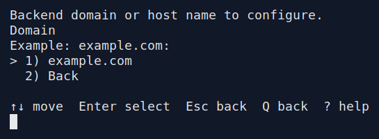

   [Read the captured terminal text](../assets/interactive/security-headers-headers/03-example-com.txt)

2. Choose **response**.

   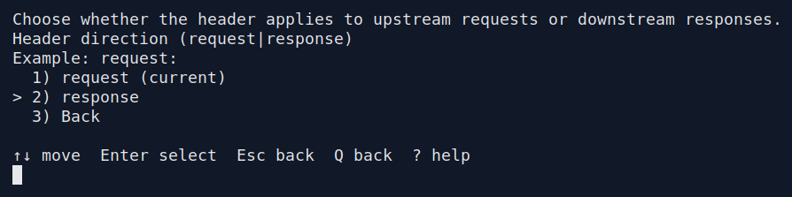

   [Read the captured terminal text](../assets/interactive/security-headers-headers/04-response.txt)

3. Enter `X-Guide`.

   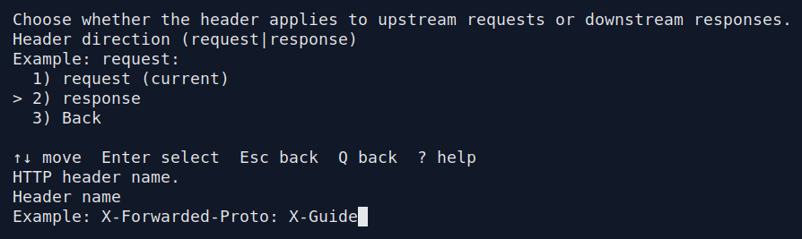

   [Read the captured terminal text](../assets/interactive/security-headers-headers/05-enter-value.txt)

4. Enter `preview`.

   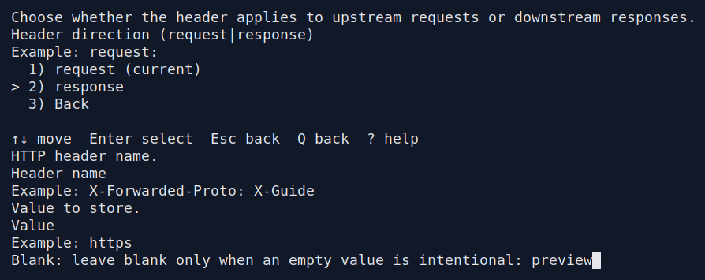

   [Read the captured terminal text](../assets/interactive/security-headers-headers/06-enter-value.txt)

5. Review the collected inputs, then choose **Run**.

   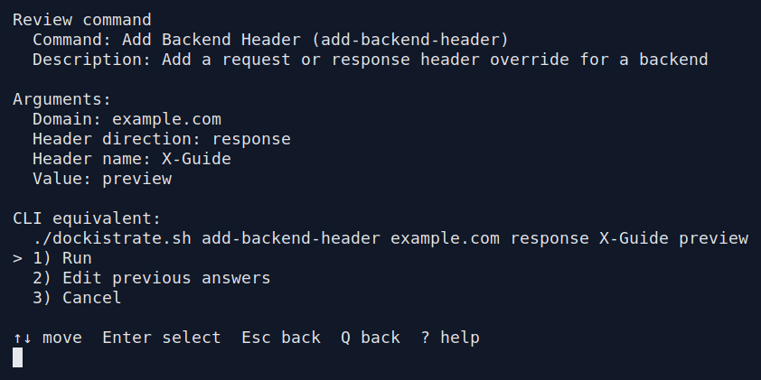

   [Read the captured terminal text](../assets/interactive/security-headers-headers/07-run.txt)

6. Command result.

   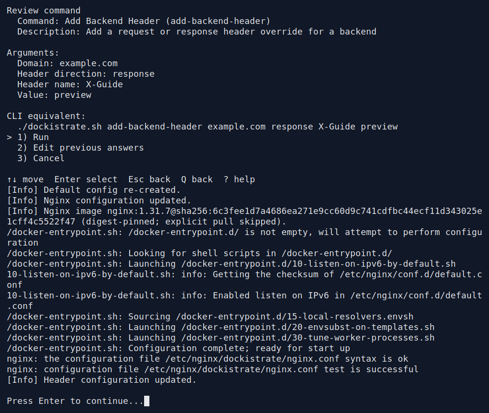

   [Read the captured terminal text](../assets/interactive/security-headers-headers/08-command-result.txt)

</details>

<details>
<summary>Read the new response header</summary>

1. Read the new response header.

   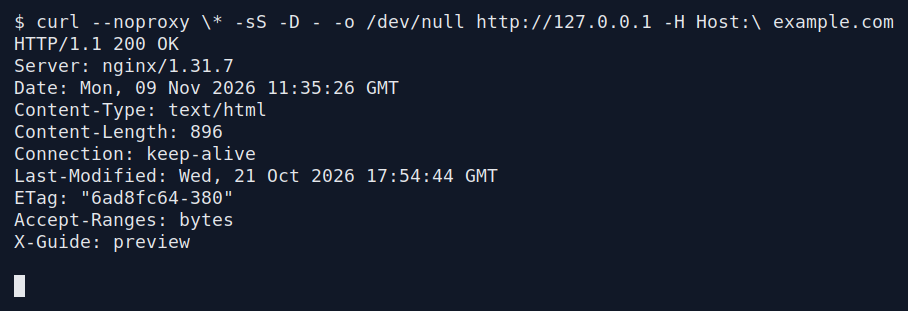

   [Read the captured terminal text](../assets/interactive/security-headers-headers-verified/01-read-the-new-response-header.txt)

</details>

<details>
<summary>list-backend-headers — inputs and result</summary>

1. Choose **example.com**.

   

   [Read the captured terminal text](../assets/interactive/security-headers-list-backend-headers/03-example-com.txt)

2. Command result.

   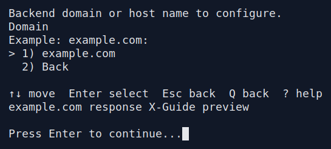

   [Read the captured terminal text](../assets/interactive/security-headers-list-backend-headers/04-command-result.txt)

</details>

<details>
<summary>update-backend-header — inputs and result</summary>

1. Choose **example.com**.

   

   [Read the captured terminal text](../assets/interactive/security-headers-update-backend-header/03-example-com.txt)

2. Choose **response**.

   

   [Read the captured terminal text](../assets/interactive/security-headers-update-backend-header/04-response.txt)

3. Choose **X-Guide**.

   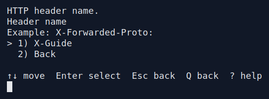

   [Read the captured terminal text](../assets/interactive/security-headers-update-backend-header/05-x-guide.txt)

4. Enter `reviewed`.

   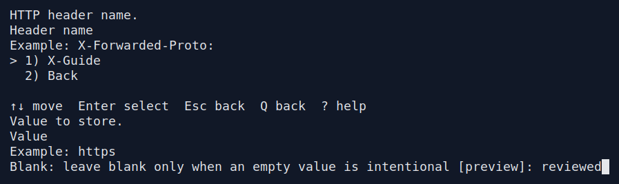

   [Read the captured terminal text](../assets/interactive/security-headers-update-backend-header/06-enter-value.txt)

5. Review the collected inputs, then choose **Run**.

   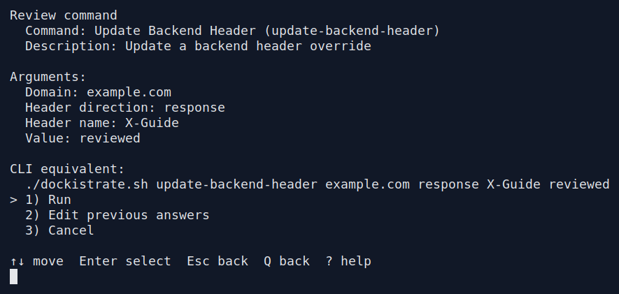

   [Read the captured terminal text](../assets/interactive/security-headers-update-backend-header/07-run.txt)

6. Command result.

   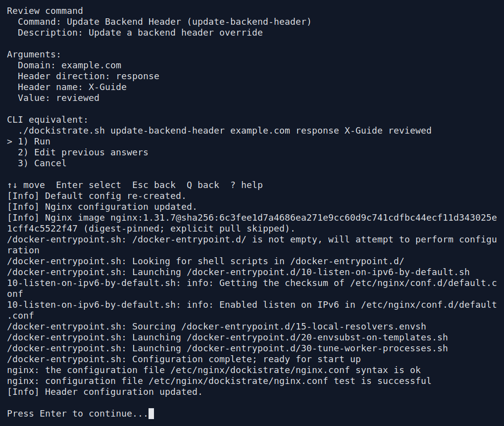

   [Read the captured terminal text](../assets/interactive/security-headers-update-backend-header/08-command-result.txt)

</details>

<details>
<summary>remove-backend-header — inputs and result</summary>

1. Choose **example.com**.

   

   [Read the captured terminal text](../assets/interactive/security-headers-remove-backend-header/03-example-com.txt)

2. Choose **response**.

   

   [Read the captured terminal text](../assets/interactive/security-headers-remove-backend-header/04-response.txt)

3. Choose **X-Guide**.

   

   [Read the captured terminal text](../assets/interactive/security-headers-remove-backend-header/05-x-guide.txt)

4. Review the collected inputs, then choose **Run**.

   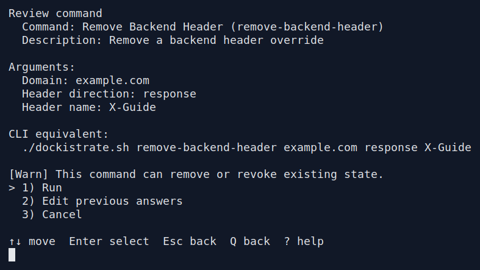

   [Read the captured terminal text](../assets/interactive/security-headers-remove-backend-header/06-run.txt)

5. Enter `YES`.

   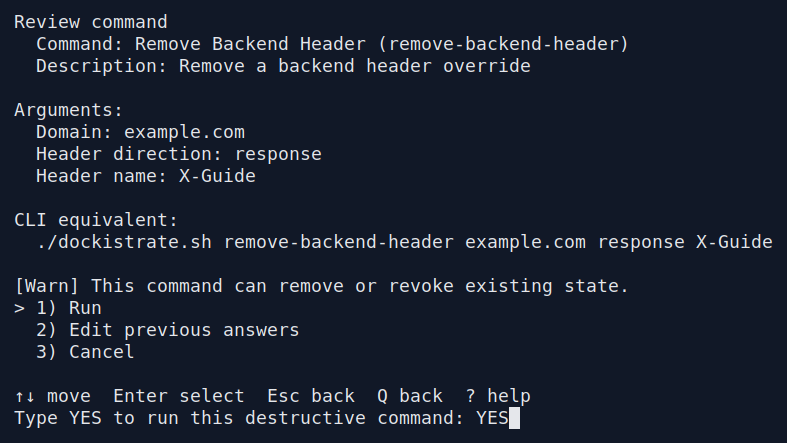

   [Read the captured terminal text](../assets/interactive/security-headers-remove-backend-header/07-enter-value.txt)

6. Command result.

   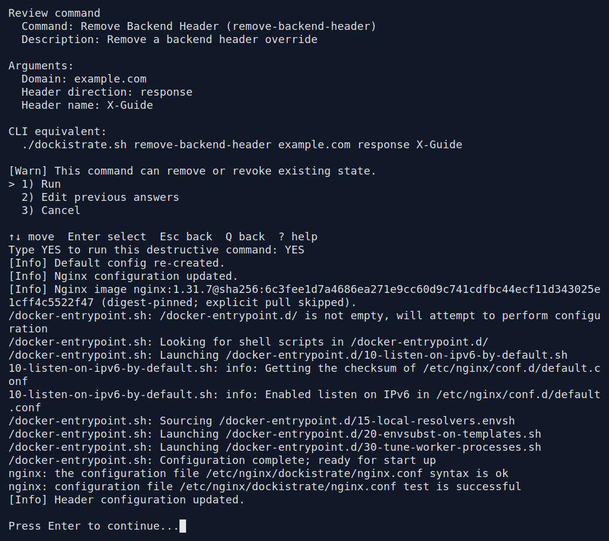

   [Read the captured terminal text](../assets/interactive/security-headers-remove-backend-header/08-command-result.txt)

</details>

<details>
<summary>Inspect headers after removal</summary>

1. Inspect headers after removal.

   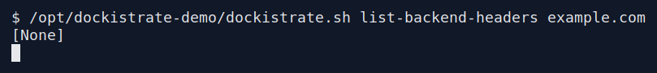

   [Read the captured terminal text](../assets/interactive/security-headers-headers-backend-removed/01-inspect-headers-after-removal.txt)

</details>

<details>
<summary>add-header — inputs and result</summary>

1. Choose **response**.

   

   [Read the captured terminal text](../assets/interactive/security-headers-add-header/03-response.txt)

2. Enter `X-Global-Guide`.

   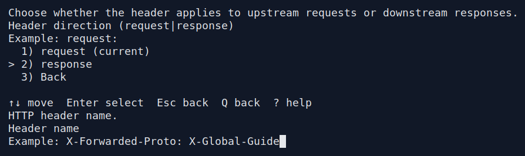

   [Read the captured terminal text](../assets/interactive/security-headers-add-header/04-enter-value.txt)

3. Enter `preview`.

   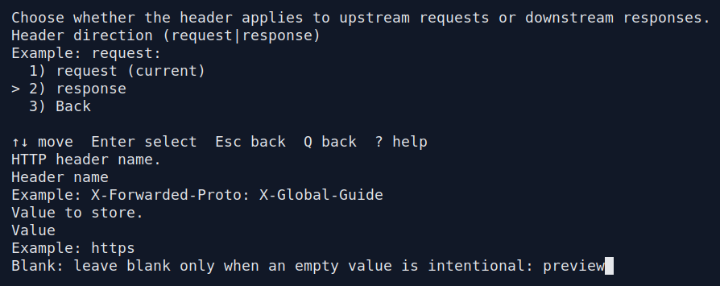

   [Read the captured terminal text](../assets/interactive/security-headers-add-header/05-enter-value.txt)

4. Review the collected inputs, then choose **Run**.

   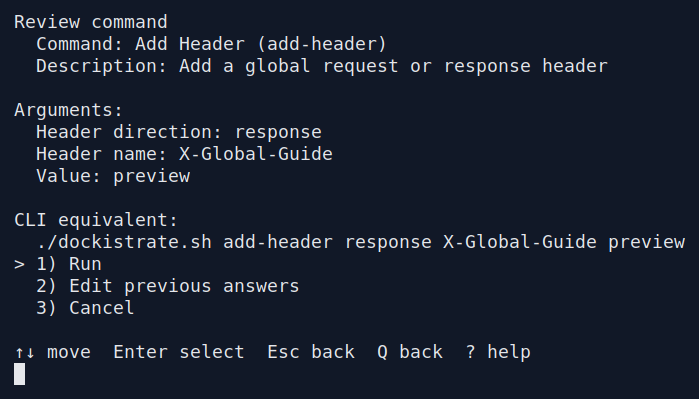

   [Read the captured terminal text](../assets/interactive/security-headers-add-header/06-run.txt)

5. Command result.

   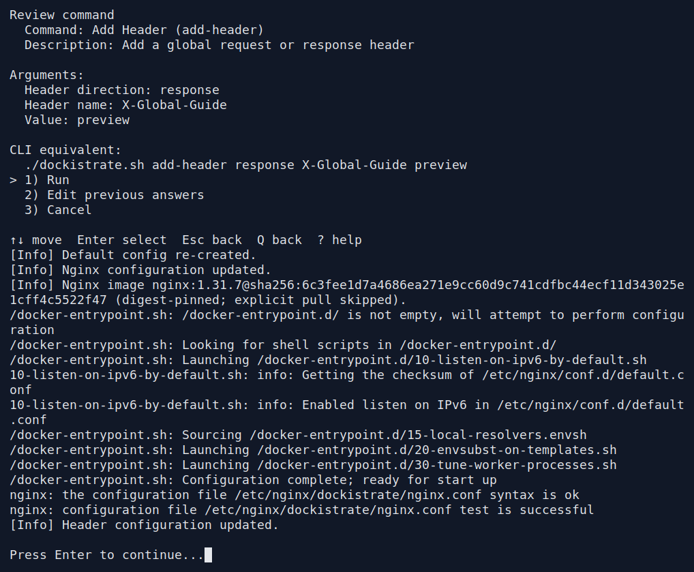

   [Read the captured terminal text](../assets/interactive/security-headers-add-header/07-command-result.txt)

</details>

<details>
<summary>list-headers — inputs and result</summary>

1. Command result.

   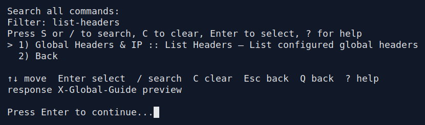

   [Read the captured terminal text](../assets/interactive/security-headers-list-headers/03-command-result.txt)

</details>

<details>
<summary>update-header — inputs and result</summary>

1. Choose **response**.

   

   [Read the captured terminal text](../assets/interactive/security-headers-update-header/03-response.txt)

2. Choose **X-Global-Guide**.

   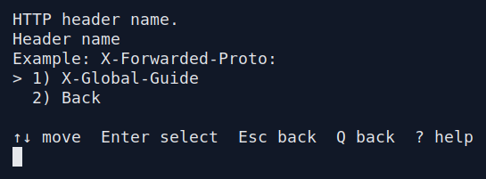

   [Read the captured terminal text](../assets/interactive/security-headers-update-header/04-x-global-guide.txt)

3. Enter `reviewed`.

   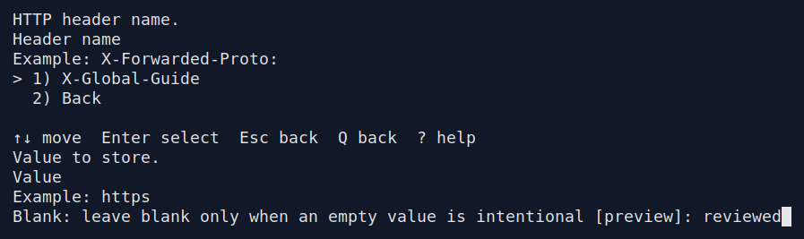

   [Read the captured terminal text](../assets/interactive/security-headers-update-header/05-enter-value.txt)

4. Review the collected inputs, then choose **Run**.

   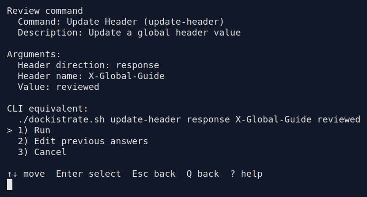

   [Read the captured terminal text](../assets/interactive/security-headers-update-header/06-run.txt)

5. Command result.

   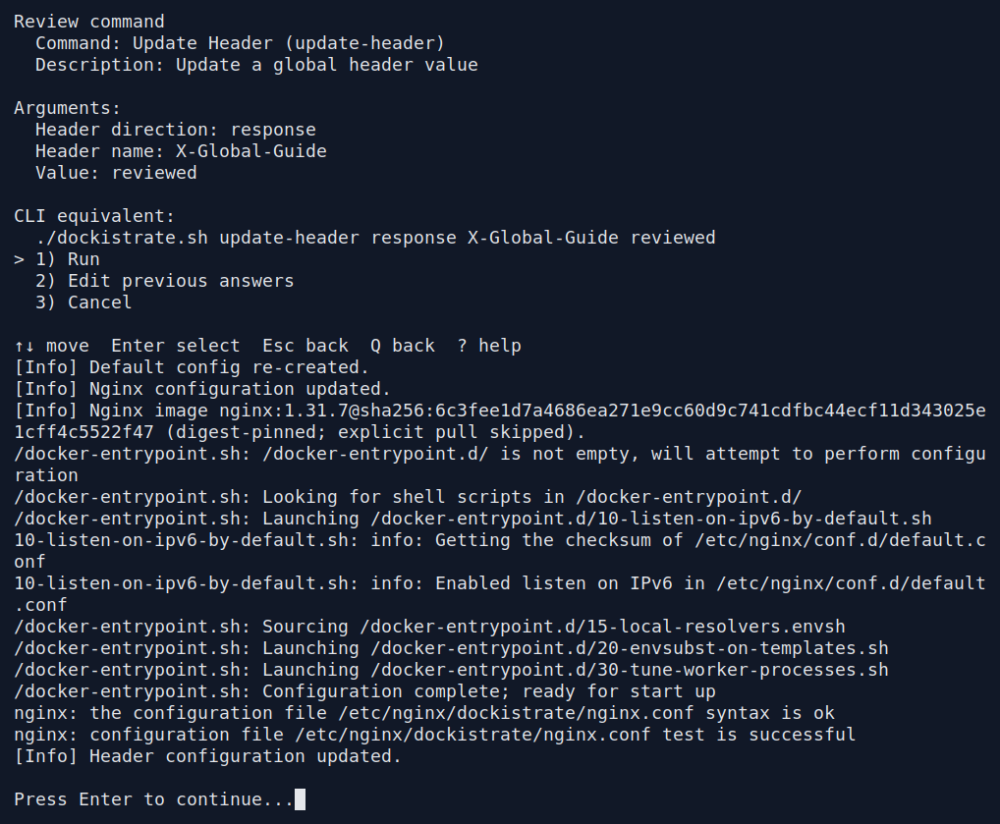

   [Read the captured terminal text](../assets/interactive/security-headers-update-header/07-command-result.txt)

</details>

<details>
<summary>remove-header — inputs and result</summary>

1. Choose **response**.

   

   [Read the captured terminal text](../assets/interactive/security-headers-remove-header/03-response.txt)

2. Choose **X-Global-Guide**.

   

   [Read the captured terminal text](../assets/interactive/security-headers-remove-header/04-x-global-guide.txt)

3. Review the collected inputs, then choose **Run**.

   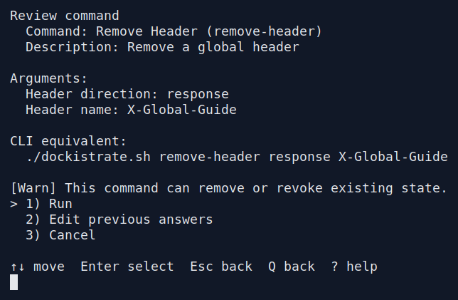

   [Read the captured terminal text](../assets/interactive/security-headers-remove-header/05-run.txt)

4. Enter `YES`.

   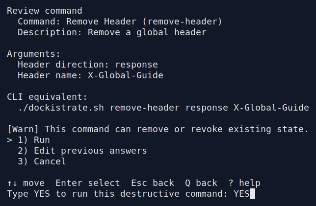

   [Read the captured terminal text](../assets/interactive/security-headers-remove-header/06-enter-value.txt)

5. Command result.

   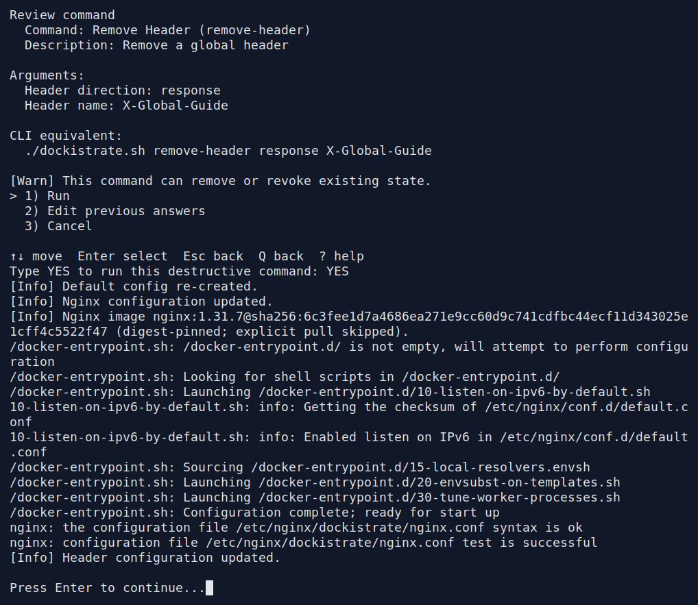

   [Read the captured terminal text](../assets/interactive/security-headers-remove-header/07-command-result.txt)

</details>

<details>
<summary>list-headers — inputs and result</summary>

1. Command result.

   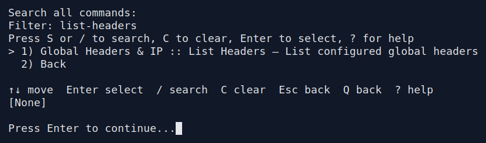

   [Read the captured terminal text](../assets/interactive/security-headers-headers-global-removed/03-command-result.txt)

</details>

<details>
<summary>set-hsts — inputs and result</summary>

1. Enter `max-age=300`.

   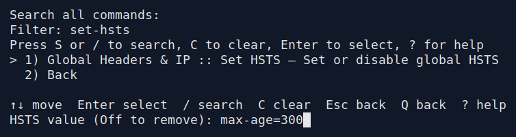

   [Read the captured terminal text](../assets/interactive/security-headers-set-hsts/03-enter-value.txt)

2. Review the collected inputs, then choose **Run**.

   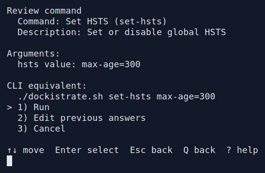

   [Read the captured terminal text](../assets/interactive/security-headers-set-hsts/04-run.txt)

3. Command result.

   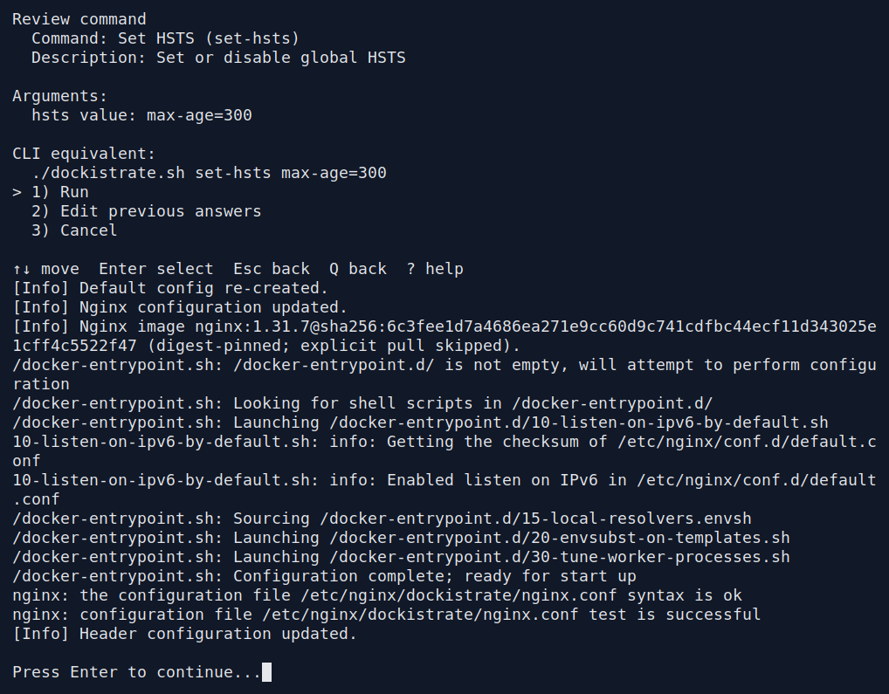

   [Read the captured terminal text](../assets/interactive/security-headers-set-hsts/05-command-result.txt)

</details>

<details>
<summary>set-csp — inputs and result</summary>

1. Enter `default-src 'self'`.

   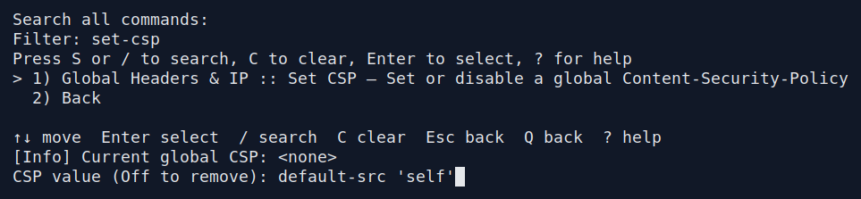

   [Read the captured terminal text](../assets/interactive/security-headers-set-csp/03-enter-value.txt)

2. Review the collected inputs, then choose **Run**.

   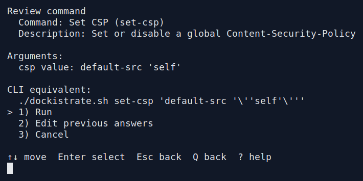

   [Read the captured terminal text](../assets/interactive/security-headers-set-csp/04-run.txt)

3. Command result.

   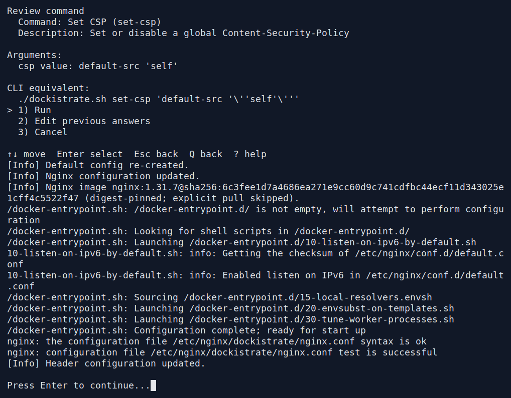

   [Read the captured terminal text](../assets/interactive/security-headers-set-csp/05-command-result.txt)

</details>

<details>
<summary>set-backend-hsts — inputs and result</summary>

1. Choose **example.com**.

   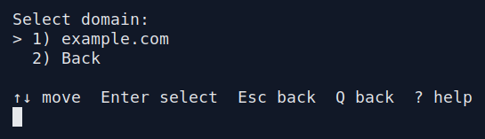

   [Read the captured terminal text](../assets/interactive/security-headers-set-backend-hsts/03-example-com.txt)

2. Enter `max-age=600`.

   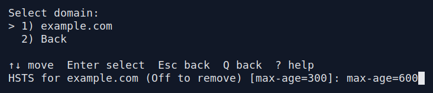

   [Read the captured terminal text](../assets/interactive/security-headers-set-backend-hsts/04-enter-value.txt)

3. Review the collected inputs, then choose **Run**.

   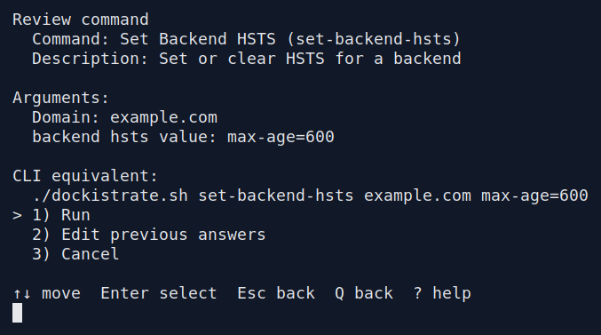

   [Read the captured terminal text](../assets/interactive/security-headers-set-backend-hsts/05-run.txt)

4. Command result.

   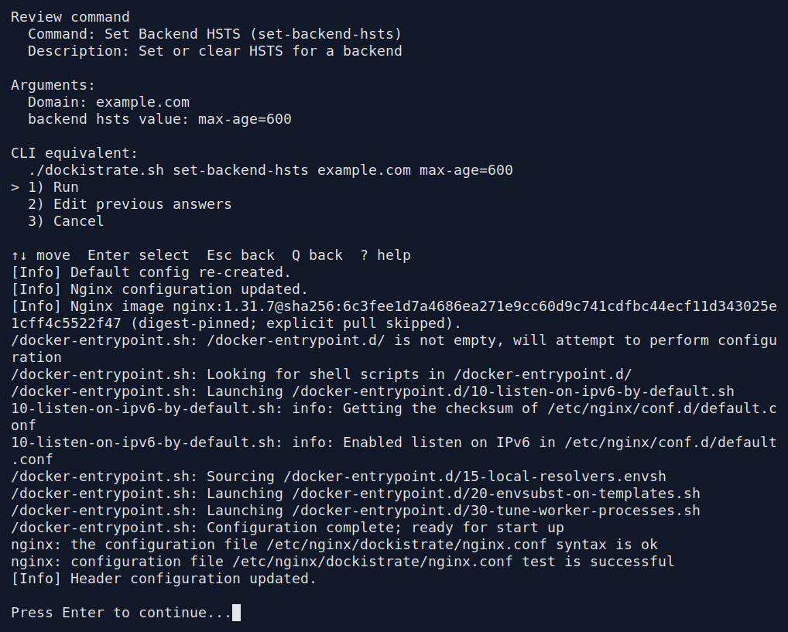

   [Read the captured terminal text](../assets/interactive/security-headers-set-backend-hsts/06-command-result.txt)

</details>

<details>
<summary>set-backend-csp — inputs and result</summary>

1. Choose **example.com**.

   

   [Read the captured terminal text](../assets/interactive/security-headers-set-backend-csp/03-example-com.txt)

2. Enter `default-src 'none'`.

   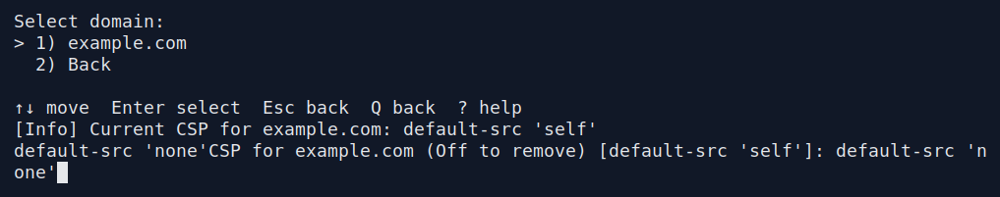

   [Read the captured terminal text](../assets/interactive/security-headers-set-backend-csp/04-enter-value.txt)

3. Review the collected inputs, then choose **Run**.

   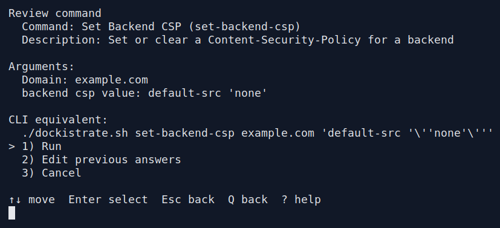

   [Read the captured terminal text](../assets/interactive/security-headers-set-backend-csp/05-run.txt)

4. Command result.

   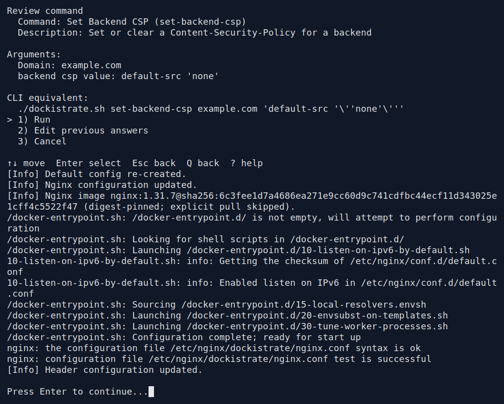

   [Read the captured terminal text](../assets/interactive/security-headers-set-backend-csp/06-command-result.txt)

</details>

<details>
<summary>remove-all-backend-headers — inputs and result</summary>

1. Choose **example.com**.

   

   [Read the captured terminal text](../assets/interactive/security-headers-headers-bulk-cancel/03-example-com.txt)

2. Choose **Cancel**.

   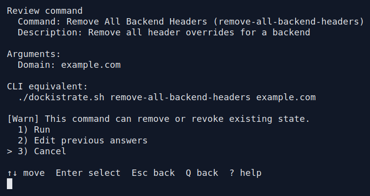

   [Read the captured terminal text](../assets/interactive/security-headers-headers-bulk-cancel/04-cancel.txt)

3. Choose **Back**.

   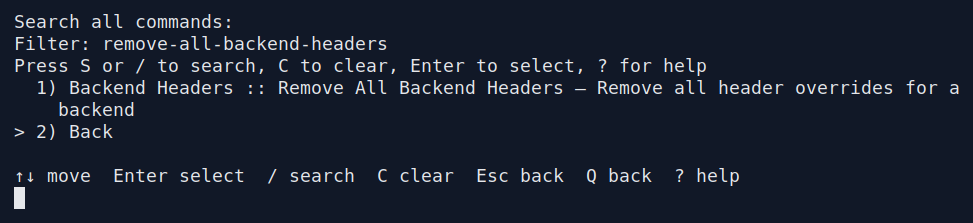

   [Read the captured terminal text](../assets/interactive/security-headers-headers-bulk-cancel/05-return-without-running.txt)

</details>

<details>
<summary>remove-all-backend-headers — inputs and result</summary>

1. Choose **example.com**.

   

   [Read the captured terminal text](../assets/interactive/security-headers-remove-all-backend-headers/03-example-com.txt)

2. Review the collected inputs, then choose **Run**.

   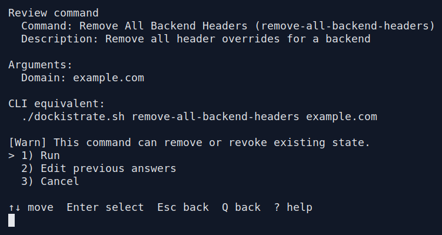

   [Read the captured terminal text](../assets/interactive/security-headers-remove-all-backend-headers/04-run.txt)

3. Enter `YES`.

   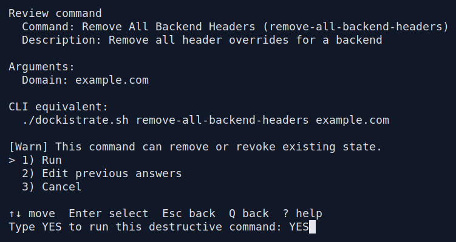

   [Read the captured terminal text](../assets/interactive/security-headers-remove-all-backend-headers/05-enter-value.txt)

4. Command result.

   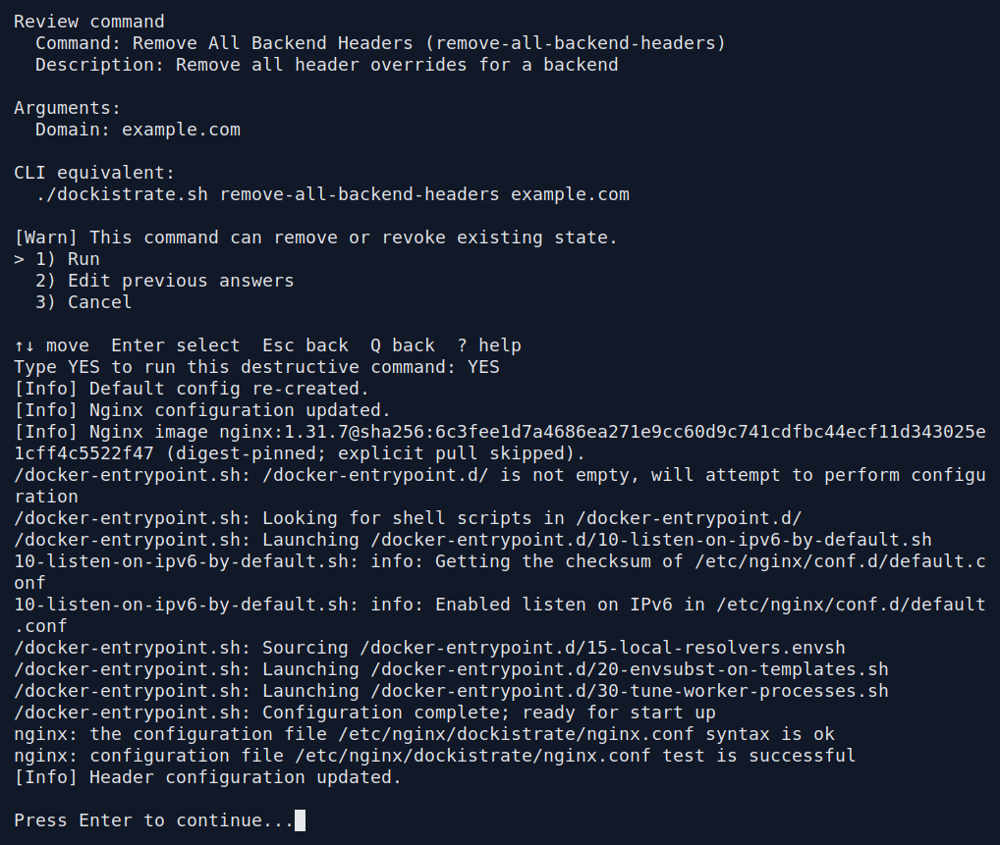

   [Read the captured terminal text](../assets/interactive/security-headers-remove-all-backend-headers/06-command-result.txt)

</details>

<details>
<summary>remove-all-headers — inputs and result</summary>

1. Review the collected inputs, then choose **Run**.

   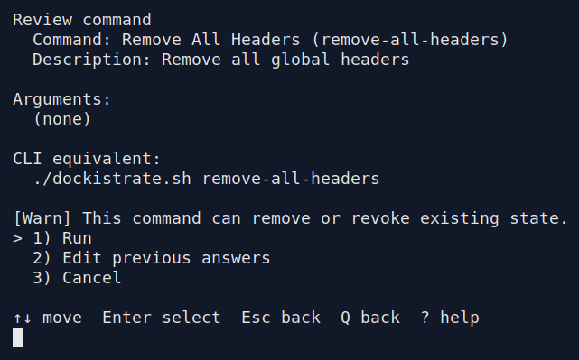

   [Read the captured terminal text](../assets/interactive/security-headers-remove-all-headers/03-run.txt)

2. Enter `YES`.

   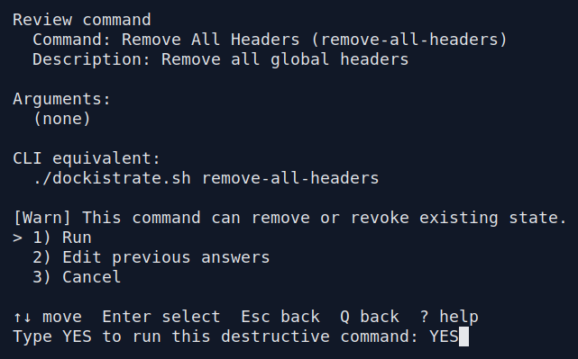

   [Read the captured terminal text](../assets/interactive/security-headers-remove-all-headers/04-enter-value.txt)

3. Command result.

   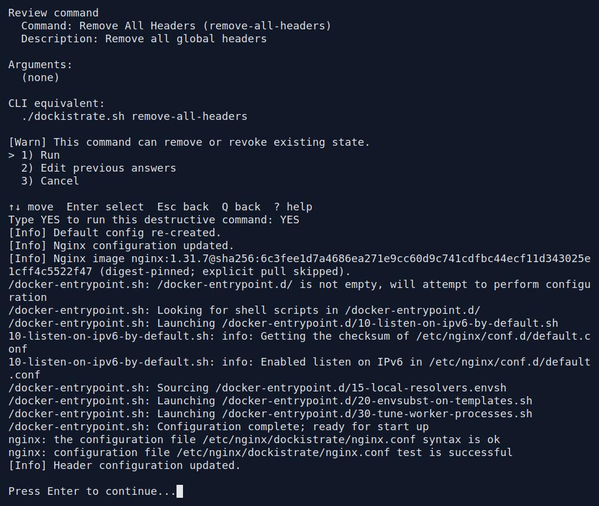

   [Read the captured terminal text](../assets/interactive/security-headers-remove-all-headers/05-command-result.txt)

</details>

<details>
<summary>control-server-tokens — inputs and result</summary>

1. Choose **off (current)**.

   

   [Read the captured terminal text](../assets/interactive/security-headers-control-server-tokens/03-off-current.txt)

2. Review the collected inputs, then choose **Run**.

   

   [Read the captured terminal text](../assets/interactive/security-headers-control-server-tokens/04-run.txt)

3. Command result.

   

   [Read the captured terminal text](../assets/interactive/security-headers-control-server-tokens/05-command-result.txt)

</details>

<details>
<summary>show-server-tokens — inputs and result</summary>

1. Command result.

   

   [Read the captured terminal text](../assets/interactive/security-headers-show-server-tokens/03-command-result.txt)

</details>

<details>
<summary>check-config — inputs and result</summary>

1. Configuration test passed.

   

   [Read the captured terminal text](../assets/interactive/security-headers-headers-config/03-configuration-test-passed.txt)

</details>

<details>
<summary>update-backend-header — inputs and result</summary>

1. Choose **Return to previous menu**.

   

   [Read the captured terminal text](../assets/interactive/core-branches-navigation-missing-headers/03-return-from-missing-headers-guidance.txt)

2. Choose **Back**.

   

   [Read the captured terminal text](../assets/interactive/core-branches-navigation-missing-headers/04-return-from-command-search.txt)

</details>

<!-- /walkthrough: headers -->

3. Select **List Backend Headers → example.com**, run **Check Config**, and
   request the listener below. Look for `X-Guide: preview` in the response.
   For a request header, use an application that displays or logs received
   headers; the downstream response does not by itself prove what was forwarded.
4. Choose **Update Backend Header → example.com → response → X-Guide** and enter
   `reviewed`, review and **Run**. Repeat the request to check the replacement.
5. Choose **Remove Backend Header** with the same domain/type/name, review and
   **Run**. Check that the example header is absent, unless a global/inherited
   header of that name still applies. Restore a recorded previous value if one
   existed before this walkthrough.

```bash
./dockistrate.sh add-backend-header example.com response X-Guide preview
./dockistrate.sh list-backend-headers example.com
./dockistrate.sh check-config
curl --noproxy '*' -i http://127.0.0.1:80/ -H 'Host: example.com'
./dockistrate.sh update-backend-header example.com response X-Guide reviewed
./dockistrate.sh remove-backend-header example.com response X-Guide
```

For global headers, use **Global Headers & IP** and omit the domain. Header
names are case-insensitive within one owner and direction. A request header
and response header of the same name are separate entries.

## Header lifecycle and browser policies

For each row, choose its named action in **Backend Headers** or **Global
Headers & IP**, enter the shown values, review, then **Run**. Use **Cancel** to
cancel. CLI cells follow `./dockistrate.sh`. List before and after edits, then
check a real response or the receiving application's request log.
**Remove All Headers** takes no arguments; its review shows `(none)` before
the removal confirmation. Check the command name to distinguish global removal
from removing headers on one backend.

| Menu action and inputs | CLI equivalent | Result / undo |
| --- | --- | --- |
| <a id="cmd-add-backend-header"></a>**Add Backend Header** → domain → response → name → value | `add-backend-header example.com response X-Guide preview` | Set one host header; remove or restore its prior value to undo. |
| <a id="cmd-update-backend-header"></a>**Update Backend Header** → domain → type → existing name → value | `update-backend-header example.com response X-Guide reviewed` | Replace its value; restore the recorded value to undo. |
| <a id="cmd-remove-backend-header"></a>**Remove Backend Header** → domain → type → name | `remove-backend-header example.com response X-Guide` | Remove the host entry; inherited/global behavior may remain. |
| <a id="cmd-list-backend-headers"></a>**List Backend Headers** → domain | `list-backend-headers example.com` | Inspect stored headers and directions. |
| <a id="cmd-remove-all-backend-headers"></a>**Remove All Backend Headers** → domain | `remove-all-backend-headers example.com` | Delete that host's headers, including its HSTS/CSP entries. CLI without a domain removes all backend headers. |
| <a id="cmd-add-header"></a>**Add Header** → response → name → value | `add-header response X-Global-Guide preview` | Add a global header; remove or restore its previous value to undo. |
| <a id="cmd-update-header"></a>**Update Header** → type → name → value | `update-header response X-Global-Guide reviewed` | Replace the global value. |
| <a id="cmd-remove-header"></a>**Remove Header** → type → name | `remove-header response X-Global-Guide` | Remove one global entry. |
| <a id="cmd-list-headers"></a>**List Headers** | `list-headers` | Inspect global entries. |
| <a id="cmd-remove-all-headers"></a>**Backend Headers → Remove All Headers** | `remove-all-headers` | Despite its menu category, this deletes **global** headers, including global HSTS/CSP; it does not delete backend entries. |
| <a id="cmd-set-hsts"></a>**Set HSTS** → policy text | `set-hsts 'max-age=300'` | Set global HSTS; `set-hsts off` removes it. Test only on an intended HTTPS host. |
| <a id="cmd-set-backend-hsts"></a>**Set Backend HSTS** → domain → policy text | `set-backend-hsts example.com 'max-age=300'` | Set the host entry; `set-backend-hsts example.com off` removes that entry. |
| <a id="cmd-set-csp"></a>**Set CSP** → policy text | `set-csp "default-src 'self'"` | Set global CSP; `set-csp off` removes it. Check application behavior in a browser. |
| <a id="cmd-set-backend-csp"></a>**Set Backend CSP** → domain → policy text | `set-backend-csp example.com "default-src 'self'"` | Set a host CSP; `set-backend-csp example.com off` removes that entry. |
| <a id="cmd-control-server-tokens"></a>**Control Server Tokens** → `off` | `control-server-tokens off` | Hide the Nginx version token; restore the previous on/off setting to undo. |
| <a id="cmd-show-server-tokens"></a>**Show Server Tokens** | `show-server-tokens` | Inspect the saved setting, then check actual response headers. |

For **Remove All…**, first inspect its review and choose **Cancel**. A confirmed
removal is not a temporary disable: recovery needs saved values or a backup.
HSTS `off` removes a server header; it does not erase a browser's already cached
HSTS policy. Removing a backend HSTS/CSP entry may expose the global policy
again. These examples are short test values, not an application-specific policy
recommendation.

## Walkthrough: preserve the real client address through a proxy

**Before starting:** identify the real trusted proxy connection addresses,
which header that proxy sets, and the application's forwarding needs. Example
`198.51.100.10/32` must be replaced with your proxy's actual range. Trust settings
do not create ACL allowances. These changes replace the managed proxy and
interrupt active sessions, including other backends' sessions.

1. Open **Advanced command browser → Global Headers & IP → Set Trusted Proxies**
   and enter your trusted ranges. Review the scope and **Run**.
2. Choose **Set Client IP Header**, enter `X-Forwarded-For`, review and **Run**.
   Set **Real IP Recursive** to the intended `on` or `off` behavior for your
   proxy chain. Use the backend override only where that host needs a different
   header; ordinary aliases inherit their primary backend's server settings.

<!-- walkthrough: client-ip -->

<details>
<summary>set-client-ip-header — inputs and result</summary>

1. Enter `X-Forwarded-For`.

   

   [Read the captured terminal text](../assets/interactive/security-headers-set-client-ip-header/03-enter-value.txt)

2. Review the collected inputs, then choose **Run**.

   

   [Read the captured terminal text](../assets/interactive/security-headers-set-client-ip-header/04-run.txt)

3. Command result.

   

   [Read the captured terminal text](../assets/interactive/security-headers-set-client-ip-header/05-command-result.txt)

</details>

<details>
<summary>set-proxy-ip-header — inputs and result</summary>

1. Enter `Proxy-IP`.

   

   [Read the captured terminal text](../assets/interactive/security-headers-set-proxy-ip-header/03-enter-value.txt)

2. Review the collected inputs, then choose **Run**.

   

   [Read the captured terminal text](../assets/interactive/security-headers-set-proxy-ip-header/04-run.txt)

3. Command result.

   

   [Read the captured terminal text](../assets/interactive/security-headers-set-proxy-ip-header/05-command-result.txt)

</details>

<details>
<summary>set-backend-client-ip-header — inputs and result</summary>

1. Choose **example.com**.

   

   [Read the captured terminal text](../assets/interactive/security-headers-client-ip/03-example-com.txt)

2. Enter `X-Real-IP`.

   

   [Read the captured terminal text](../assets/interactive/security-headers-client-ip/04-enter-value.txt)

3. Review the collected inputs, then choose **Run**.

   

   [Read the captured terminal text](../assets/interactive/security-headers-client-ip/05-run.txt)

4. Command result.

   

   [Read the captured terminal text](../assets/interactive/security-headers-client-ip/06-command-result.txt)

</details>

<details>
<summary>set-backend-proxy-ip-header — inputs and result</summary>

1. Choose **example.com**.

   

   [Read the captured terminal text](../assets/interactive/security-headers-set-backend-proxy-ip-header/03-example-com.txt)

2. Enter `Backend-Proxy-IP`.

   

   [Read the captured terminal text](../assets/interactive/security-headers-set-backend-proxy-ip-header/04-enter-value.txt)

3. Review the collected inputs, then choose **Run**.

   

   [Read the captured terminal text](../assets/interactive/security-headers-set-backend-proxy-ip-header/05-run.txt)

4. Command result.

   

   [Read the captured terminal text](../assets/interactive/security-headers-set-backend-proxy-ip-header/06-command-result.txt)

</details>

<details>
<summary>set-trusted-proxies — inputs and result</summary>

1. Enter `198.51.100.10/32`.

   

   [Read the captured terminal text](../assets/interactive/security-headers-set-trusted-proxies/03-enter-value.txt)

2. Review the collected inputs, then choose **Run**.

   

   [Read the captured terminal text](../assets/interactive/security-headers-set-trusted-proxies/04-run.txt)

3. Command result.

   

   [Read the captured terminal text](../assets/interactive/security-headers-set-trusted-proxies/05-command-result.txt)

</details>

<details>
<summary>set-real-ip-recursive — inputs and result</summary>

1. Choose **on (current)**.

   

   [Read the captured terminal text](../assets/interactive/security-headers-set-real-ip-recursive/03-on-current.txt)

2. Review the collected inputs, then choose **Run**.

   

   [Read the captured terminal text](../assets/interactive/security-headers-set-real-ip-recursive/04-run.txt)

3. Command result.

   

   [Read the captured terminal text](../assets/interactive/security-headers-set-real-ip-recursive/05-command-result.txt)

</details>

<details>
<summary>check-config — inputs and result</summary>

1. Configuration test passed.

   

   [Read the captured terminal text](../assets/interactive/security-headers-client-ip-config/03-configuration-test-passed.txt)

</details>

<details>
<summary>set-trusted-proxies — inputs and result</summary>

1. Enter `172.18.0.1/32`.

   

   [Read the captured terminal text](../assets/interactive/security-headers-client-ip-trusted-peer/03-enter-value.txt)

2. Review the collected inputs, then choose **Run**.

   

   [Read the captured terminal text](../assets/interactive/security-headers-client-ip-trusted-peer/04-run.txt)

3. Command result.

   

   [Read the captured terminal text](../assets/interactive/security-headers-client-ip-trusted-peer/05-command-result.txt)

</details>

<details>
<summary>Trusted header changes the client while retaining the peer</summary>

1. Trusted header changes the client while retaining the peer.

   

   [Read the captured terminal text](../assets/interactive/security-headers-verify-client-ip/01-trusted-header-changes-the-client-while-retaining-the-peer.txt)

</details>

<details>
<summary>remove-backend-client-ip-header — inputs and result</summary>

1. Choose **example.com**.

   

   [Read the captured terminal text](../assets/interactive/security-headers-remove-backend-client-ip-header/03-example-com.txt)

2. Review the collected inputs, then choose **Run**.

   

   [Read the captured terminal text](../assets/interactive/security-headers-remove-backend-client-ip-header/04-run.txt)

3. Enter `YES`.

   

   [Read the captured terminal text](../assets/interactive/security-headers-remove-backend-client-ip-header/05-enter-value.txt)

4. Command result.

   

   [Read the captured terminal text](../assets/interactive/security-headers-remove-backend-client-ip-header/06-command-result.txt)

</details>

<details>
<summary>remove-backend-proxy-ip-header — inputs and result</summary>

1. Choose **example.com**.

   

   [Read the captured terminal text](../assets/interactive/security-headers-remove-backend-proxy-ip-header/03-example-com.txt)

2. Review the collected inputs, then choose **Run**.

   

   [Read the captured terminal text](../assets/interactive/security-headers-remove-backend-proxy-ip-header/04-run.txt)

3. Enter `YES`.

   

   [Read the captured terminal text](../assets/interactive/security-headers-remove-backend-proxy-ip-header/05-enter-value.txt)

4. Command result.

   

   [Read the captured terminal text](../assets/interactive/security-headers-remove-backend-proxy-ip-header/06-command-result.txt)

</details>

<details>
<summary>set-trusted-proxies — inputs and result</summary>

1. Enter `none`.

   

   [Read the captured terminal text](../assets/interactive/security-headers-trusted-proxies-reset/03-enter-value.txt)

2. Review the collected inputs, then choose **Run**.

   

   [Read the captured terminal text](../assets/interactive/security-headers-trusted-proxies-reset/04-run.txt)

3. Command result.

   

   [Read the captured terminal text](../assets/interactive/security-headers-trusted-proxies-reset/05-command-result.txt)

</details>

<details>
<summary>set-real-ip-recursive — inputs and result</summary>

1. Choose **off**.

   

   [Read the captured terminal text](../assets/interactive/security-headers-real-ip-recursive-reset/03-off.txt)

2. Review the collected inputs, then choose **Run**.

   

   [Read the captured terminal text](../assets/interactive/security-headers-real-ip-recursive-reset/04-run.txt)

3. Command result.

   

   [Read the captured terminal text](../assets/interactive/security-headers-real-ip-recursive-reset/05-command-result.txt)

</details>

<!-- /walkthrough: client-ip -->

3. Run **Check Config**. Send one request through the trusted proxy and one
   directly with a forged forwarding header. Inspect the receiving application
   or proxy log: trusted forwarding should affect the resolved client address;
   an untrusted sender must not gain that trust. Verify L7 and L3 ACL behavior
   separately against the addresses actually observed.
4. Restore the previous ranges/header/recursive setting to undo. A backend
   **Remove…IP Header** command restores inheritance; setting a header to `off`
   is an explicit setting, not the same as removing an override.

| Menu action and inputs | CLI equivalent | Scope / result |
| --- | --- | --- |
| <a id="cmd-set-trusted-proxies"></a>**Set Trusted Proxies** → real CIDR list | `set-trusted-proxies 198.51.100.10/32` | Trust only the intended proxy ranges; `none` clears the list. |
| <a id="cmd-set-real-ip-recursive"></a>**Set Real IP Recursive** → `on` or `off` | `set-real-ip-recursive on` | Choose recursive client resolution; restore the prior value to undo. |
| <a id="cmd-set-client-ip-header"></a>**Set Client IP Header** → name or `off` | `set-client-ip-header X-Forwarded-For` | Global client-address header and real-IP trust input. |
| <a id="cmd-set-proxy-ip-header"></a>**Set Proxy IP Header** → name or `off` | `set-proxy-ip-header Proxy-IP` | Forward the direct connection address under this header. |
| <a id="cmd-set-backend-client-ip-header"></a>**Backend Protocol & IP Overrides → Set Backend Client IP Header** → domain → name/off | `set-backend-client-ip-header example.com X-Real-IP` | Override client forwarding/trust header for the host. |
| <a id="cmd-remove-backend-client-ip-header"></a>**Remove Backend Client IP Header** → domain | `remove-backend-client-ip-header example.com` | Restore the inherited client header. |
| <a id="cmd-set-backend-proxy-ip-header"></a>**Set Backend Proxy IP Header** → domain → name/off | `set-backend-proxy-ip-header example.com Proxy-IP` | Override direct-peer forwarding header. |
| <a id="cmd-remove-backend-proxy-ip-header"></a>**Remove Backend Proxy IP Header** → domain | `remove-backend-proxy-ip-header example.com` | Restore the inherited proxy header. |

HTTP-version overrides are covered in the
[runtime guide](advanced-nginx-docker-options.md#walkthrough-choose-http-behavior).
The reference sections below explain inheritance, quoting, repair and retention.

## Storage and detailed behavior

Header commands manage global and backend-specific request/response headers,
real client IP forwarding, proxy IP forwarding, HSTS, CSP, and Nginx
`server_tokens`.

Per-domain headers and forwarding overrides are readable in
`state/domains/<domain>/config/headers.csv` and `settings.csv`. Edit those files
and explicitly apply them, or continue using the commands below for immediate
changes. Global header settings remain shared. See
[Domain configuration files](domain-configuration.md).

## Common Commands

```text
control-server-tokens <on|off>
show-server-tokens

set-client-ip-header <header|off>
set-backend-client-ip-header <domain> <header|off>
remove-backend-client-ip-header <domain>

set-proxy-ip-header <header|off>
set-backend-proxy-ip-header <domain> <header|off>
remove-backend-proxy-ip-header <domain>

add-header <request|response> <name> <value>
update-header <request|response> <name> <value>
remove-header <request|response> <name>
list-headers

add-backend-header <domain> <request|response> <name> <value>
update-backend-header <domain> <request|response> <name> <value>
remove-backend-header <domain> <request|response> <name>
list-backend-headers <domain>

set-hsts <value|off>
set-backend-hsts <domain> <value|off>
set-csp <policy|off>
set-backend-csp <domain> <policy|off>
```

## Header Identity and Repair

Header names are case-insensitive within each owner and request/response type.
For example, `X-Trace` and `x-trace` identify the same request header on
`example.com`; the response header and another domain's header are independent.
This applies to CLI commands, interactive choices/defaults, validation, and
rendering. Ordinary stored spelling is retained. A dedicated host's explicit
header overrides the target backend's inherited header even when their names
use different capitalization.

Existing case variants with identical values are coalesced in generated views,
without rewriting editable or applied source files. Nginx receives one map and
directive per logical backend header/type, with each domain's own value; the
first encountered spelling is used for the directive. Conflicting values for
one logical header fail validation with the owner, type, and repair guidance.

An explicit add/update chooses one value and consolidates all matching case
variants. Removal deletes every matching variant in that owner/type. For
example, either command below repairs conflicting request `X-Trace`/`x-trace`
rows belonging to `example.com`:

```bash
./dockistrate.sh update-backend-header example.com request X-Trace 'chosen value'
# Or remove the logical header entirely:
./dockistrate.sh remove-backend-header example.com request x-trace
```

Global headers use `update-header` and `remove-header` with the same type/name
matching. The interactive update/remove choices offer one entry per logical
header, including when a conflict needs repair. Header repair is staged before
normal cache validation; the complete repaired configuration must validate
before it is published or activated. A pending draft on the target domain is
not overwritten: edit and apply that draft, or explicitly discard it before
using the immediate setter/removal. Unrelated drafts and concurrent edits
remain protected, and a failed activation rolls back the repair.

This protection also covers edits to the shared global header file,
`state/config/custom_headers.csv`, during global or backend header commands.
Global publication checks that the file still matches the staged revision;
commit also checks for edits through an already-open original file. Rollback
preserves newer global edits while restoring the previous runtime. If both the
original file and its published replacement were edited, both copies are kept
and their paths are reported for you to resolve before retrying recovery.

Command syntax, completion syntax, CSV formats, and value escaping are
unchanged. To regenerate valid applied settings after upgrading, run
`./dockistrate.sh update-nginx-config`, then `./dockistrate.sh check-config`.

## Header Example

Add a request header with spaces and verify the generated Nginx include quotes
the value:

```bash
./dockistrate.sh add-header request "X-App-Mode" "Preview Enabled"
cat state/config/nginx_conf/conf.d/custom_headers.conf
```

Expected generated directive:

```nginx
proxy_set_header X-App-Mode "Preview Enabled";
```

Backend request and response header maps preserve double quotes and backslashes
in values, including headers inherited by dedicated hosts. This applies to both
CLI and interactive changes. Nginx variables such as `$host` retain their
existing interpretation.

Existing saved header values are retained. After upgrading, run
`./dockistrate.sh update-nginx-config` to regenerate the maps from applied
settings and activate corrected escaping, then run `./dockistrate.sh check-config`.

Header values cannot include control characters, including newlines.
They are fully visible by default in operator-facing output and saved
interactive history. `set-visibility-policy redacted` hides header values from
display and audit/verbose command entries and skips affected interactive
recents/favorites without changing stored header state or generated Nginx
configuration. The same policy covers values supplied through generic Nginx
directive setters, including raw header directives. Existing logs and saved
history are not erased. Removing a header or its backend also leaves historical
command and backup copies intact. Saved commands and Dockistrate logs use
owner-only permissions; see
[operator value visibility](advanced-nginx-docker-options.md#operator-value-visibility).

## Client IP and Proxy IP

The default client IP header is `X-Forwarded-For`. With that header, Dockistrate
uses `$proxy_add_x_forwarded_for` so the connecting IP is appended. For single-IP
headers such as `X-Real-IP` or `CF-Connecting-IP`, Dockistrate forwards the
resolved trusted client address.

Use a custom proxy IP header when the backend needs to know the direct
connection address:

```bash
./dockistrate.sh set-proxy-ip-header Proxy-IP
```

If trusted proxy ranges are configured, the Nginx `real_ip` module trusts the
configured client IP header. L7/header ACLs and `ip:l7` security selectors use
the resolved `$remote_addr`; L3 ACLs and `ip:l3` selectors use
`$realip_remote_addr`, which preserves the direct/original connection address.
Generated `real_ip` directives are placed before ACL and security rule includes.

Changing trusted proxies, real-IP recursion, or the global/backend client-IP
header replaces the proxy and interrupts its active connections in CLI and
interactive mode. Removing a backend client-IP header override does the same.
This prevents connections authorized under the old identity settings from
surviving a trust revocation. Compared with 1.0.1, these updates no longer use
graceful reload; command syntax and state formats are unchanged. Outbound
proxy-IP headers retain their existing update behavior. See
[policy update behavior](access-control-security-rules.md#when-policy-changes-take-effect).

## HSTS, CSP, and Tokens

```bash
./dockistrate.sh set-hsts "max-age=31536000; includeSubDomains"
./dockistrate.sh set-csp "default-src 'self'"
./dockistrate.sh control-server-tokens off
```

Backend-specific HSTS, CSP, and header overrides follow the matched server
context, including primary domains, aliases, and dedicated hosts.
The interactive host pickers and shell completion expose all three identities.
HTTP-version, IP-header and mTLS settings remain server settings: ordinary
aliases inherit them from the primary backend, while dedicated hosts can have
independent values and are offered alongside backends for those commands.

## Verification

```bash
./dockistrate.sh list-headers
./dockistrate.sh list-backend-headers example.com
./dockistrate.sh show-server-tokens
./dockistrate.sh update-nginx-config
./dockistrate.sh check-config
```
