# Hosts and Aliases

Give an existing application another hostname without creating another backend.
Use an **alias** for shared behavior, or a **dedicated host** when it needs
independent settings. Open `./dockistrate.sh -i` → **Advanced command browser** →
**Hosts & Aliases**. Changes end with review → **Run**; listing and showing settings run directly.
Removal also requires typing `YES` when requested.

**Before you start:** create a backend with an HTTP/HTTPS mapping. For a browser,
point the new hostname at the proxy; local tests can supply a `Host` header.
HTTPS also needs a certificate covering that hostname. Neither host command
creates DNS records or makes a certificate valid for a new name.

<a id="cmd-add-host-alias"></a>
## Add another hostname

1. Choose **Add Host Alias**, then the target backend `example.com`.
2. Choose **Enter alias** and enter `www.example.com` at the alias prompt.
3. Review the alias and target, then **Run**.
4. Choose **List Host Aliases** and select `example.com`. Check the new mapping;
   request the same application with the alias as its Host header.

<!-- walkthrough: hosts-alias -->

<details>
<summary>add-host-alias — inputs and result</summary>

1. Choose **example.com**.

   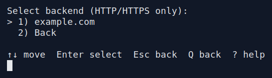

   [Read the captured terminal text](../assets/interactive/core-hosts-hosts-alias/03-example-com.txt)

2. Choose **Enter alias**.

   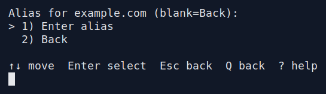

   [Read the captured terminal text](../assets/interactive/core-hosts-hosts-alias/04-enter-alias.txt)

3. Enter `www.example.com`.

   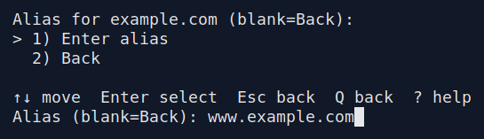

   [Read the captured terminal text](../assets/interactive/core-hosts-hosts-alias/05-enter-value.txt)

4. Review the collected inputs, then choose **Run**.

   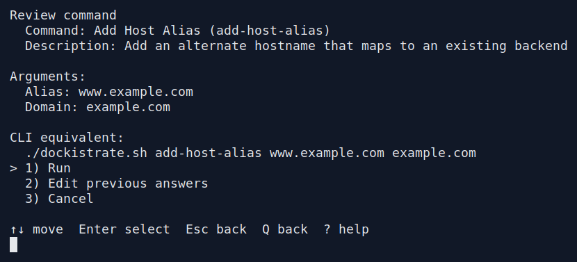

   [Read the captured terminal text](../assets/interactive/core-hosts-hosts-alias/06-review-and-run-add-host-alias.txt)

5. add-host-alias result.

   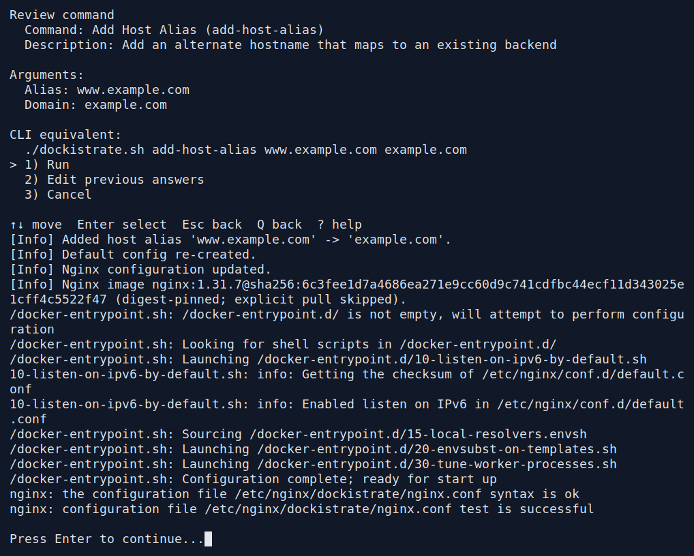

   [Read the captured terminal text](../assets/interactive/core-hosts-hosts-alias/07-add-host-alias-result.txt)

</details>

<details>
<summary>list-host-aliases — inputs and result</summary>

1. Choose **example.com**.

   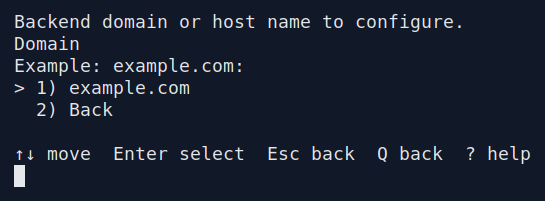

   [Read the captured terminal text](../assets/interactive/core-hosts-list-host-aliases/03-example-com.txt)

2. list-host-aliases result.

   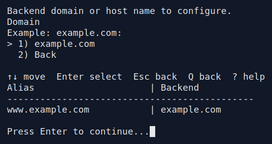

   [Read the captured terminal text](../assets/interactive/core-hosts-list-host-aliases/04-list-host-aliases-result.txt)

</details>

<details>
<summary>Verify the application response</summary>

1. Verify the application response.

   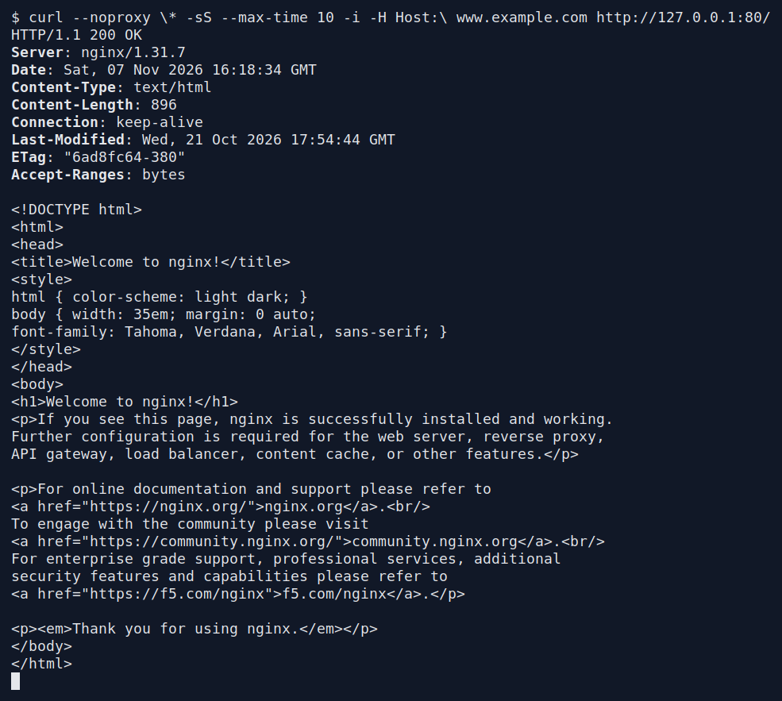

   [Read the captured terminal text](../assets/interactive/core-hosts-alias-request/01-verify-the-application-response.txt)

</details>

<details>
<summary>remove-host-alias — inputs and result</summary>

1. Enter `www.example.com`.

   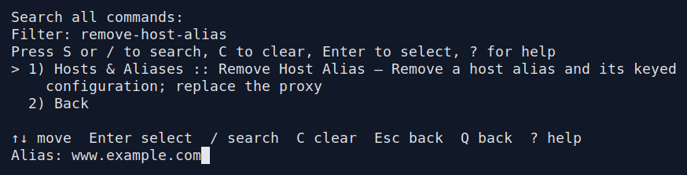

   [Read the captured terminal text](../assets/interactive/core-hosts-remove-host-alias/03-enter-value.txt)

2. Review the collected inputs, then choose **Run**.

   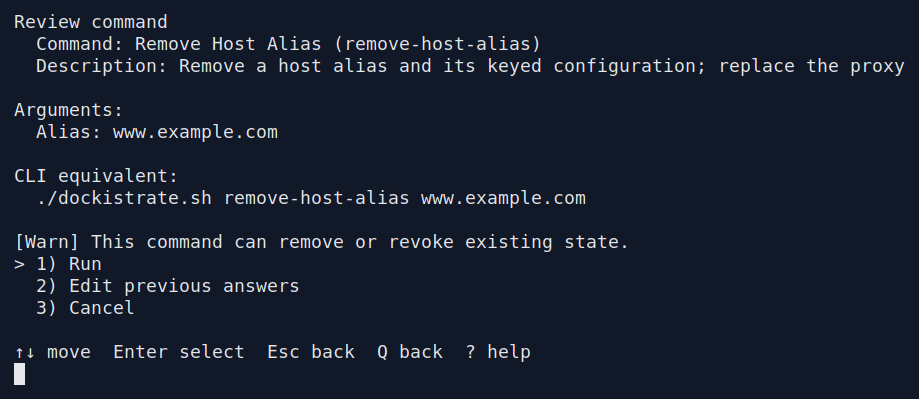

   [Read the captured terminal text](../assets/interactive/core-hosts-remove-host-alias/04-review-and-run-remove-host-alias.txt)

3. Enter `YES`.

   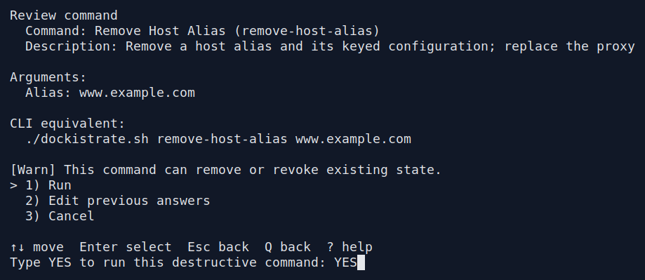

   [Read the captured terminal text](../assets/interactive/core-hosts-remove-host-alias/05-confirm-removal.txt)

4. remove-host-alias result.

   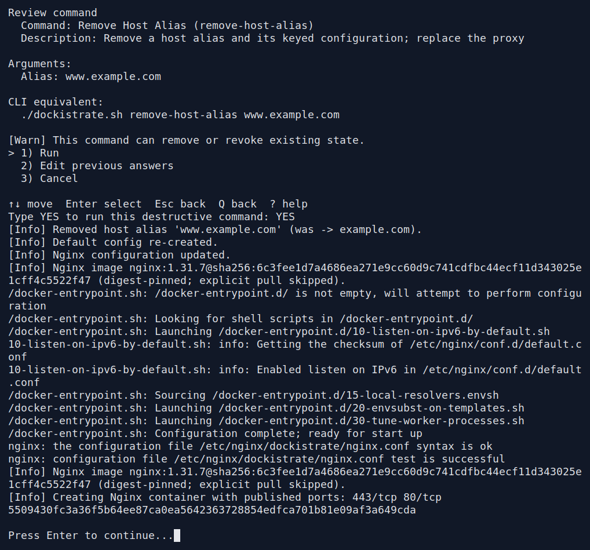

   [Read the captured terminal text](../assets/interactive/core-hosts-remove-host-alias/06-remove-host-alias-result.txt)

</details>

<!-- /walkthrough: hosts-alias -->

```bash
./dockistrate.sh add-host-alias www.example.com example.com
./dockistrate.sh list-host-aliases example.com
curl --noproxy '*' -i http://127.0.0.1 -H 'Host: www.example.com'
```

The response also depends on the application's [access policy](access-control-security-rules.md).
Aliases share the primary backend's HTTP version, client/proxy IP headers,
paths, Nginx directives, mTLS, and request security rules. Host headers, settings,
and explicit ACL rules can have their own records. Alias ACL policy/status
and rules apply to the alias's own HTTP/HTTPS serving block; see
[ordinary host alias ACLs](access-control-security-rules.md#ordinary-host-alias-acls).

| Operation | Selection and result to check | CLI equivalent |
| --- | --- | --- |
| <a id="cmd-list-host-aliases"></a>List Host Aliases | Select a backend; inspect alias → backend mappings. | `list-host-aliases example.com` (omit domain for all) |
| <a id="cmd-remove-host-alias"></a>Remove Host Alias | Enter alias `www.example.com` → review → Run → `YES`. Check the mapping is absent. Removal also deletes its keyed configuration and ACL includes and replaces the proxy, interrupting sessions. Re-add and restore overrides to undo. | `remove-host-alias www.example.com` |

<a id="cmd-add-dedicated-host"></a>
## Use independent hostname settings

1. Choose **Add Dedicated Host** and enter `app.example.com`.
2. Select target backend `example.com`.
3. Choose `yes` or `no` separately for inheritance of **mTLS**, **ACL**,
   **security rules**, **headers**, and **paths**. Keep all five at `yes` to
   begin with the backend's behavior.
4. Review → **Run**. Choose **Show Dedicated Host Inherit** → `app.example.com`
   and check all five switches. Request the application using that hostname.

<!-- walkthrough: hosts-dedicated -->

<details>
<summary>add-dedicated-host — inputs and result</summary>

1. Enter `app.example.com`.

   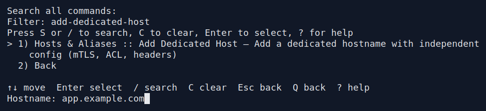

   [Read the captured terminal text](../assets/interactive/core-hosts-hosts-dedicated/03-enter-value.txt)

2. Choose **example.com**.

   

   [Read the captured terminal text](../assets/interactive/core-hosts-hosts-dedicated/04-example-com.txt)

3. Choose **Yes (current)**.

   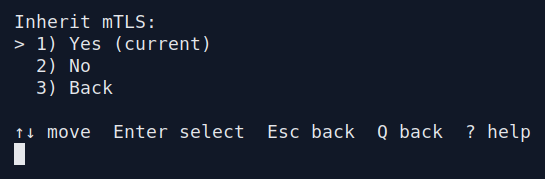

   [Read the captured terminal text](../assets/interactive/core-hosts-hosts-dedicated/05-yes-current.txt)

4. Choose **Yes (current)**.

   

   [Read the captured terminal text](../assets/interactive/core-hosts-hosts-dedicated/06-yes-current.txt)

5. Choose **Yes (current)**.

   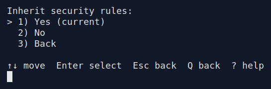

   [Read the captured terminal text](../assets/interactive/core-hosts-hosts-dedicated/07-yes-current.txt)

6. Choose **Yes (current)**.

   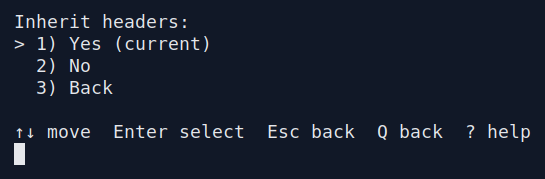

   [Read the captured terminal text](../assets/interactive/core-hosts-hosts-dedicated/08-yes-current.txt)

7. Choose **Yes (current)**.

   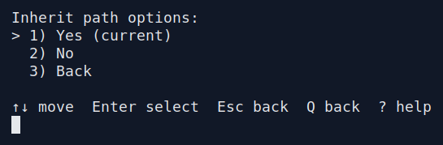

   [Read the captured terminal text](../assets/interactive/core-hosts-hosts-dedicated/09-yes-current.txt)

8. Review the collected inputs, then choose **Run**.

   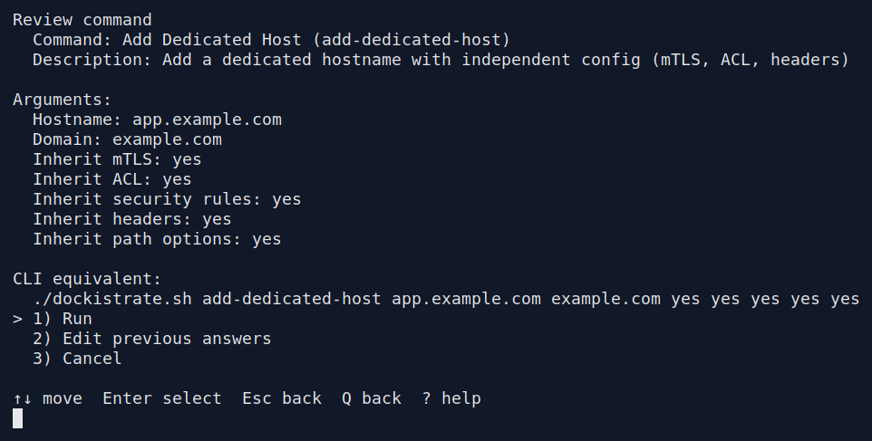

   [Read the captured terminal text](../assets/interactive/core-hosts-hosts-dedicated/10-review-and-run-add-dedicated-host.txt)

9. add-dedicated-host result.

   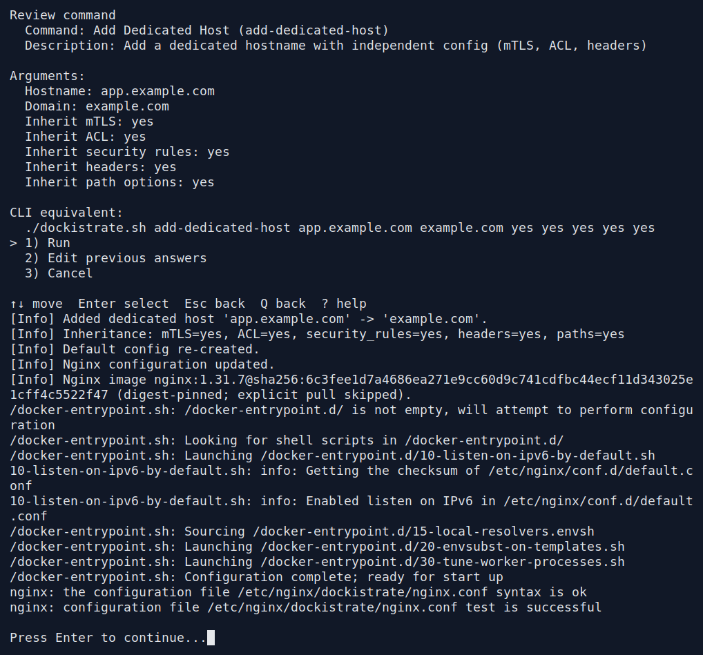

   [Read the captured terminal text](../assets/interactive/core-hosts-hosts-dedicated/11-add-dedicated-host-result.txt)

</details>

<details>
<summary>list-dedicated-hosts — inputs and result</summary>

1. Choose **example.com**.

   

   [Read the captured terminal text](../assets/interactive/core-hosts-list-dedicated-hosts/03-example-com.txt)

2. list-dedicated-hosts result.

   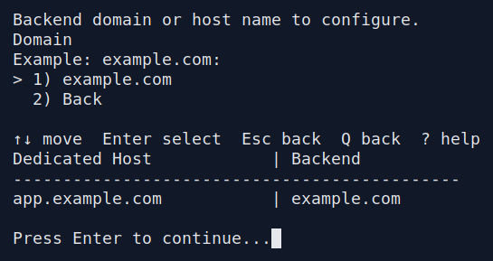

   [Read the captured terminal text](../assets/interactive/core-hosts-list-dedicated-hosts/04-list-dedicated-hosts-result.txt)

</details>

<details>
<summary>show-dedicated-host-inherit — inputs and result</summary>

1. Choose **app.example.com**.

   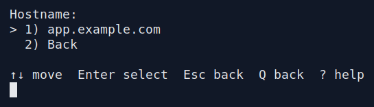

   [Read the captured terminal text](../assets/interactive/core-hosts-show-dedicated-host-inherit/03-app-example-com.txt)

2. show-dedicated-host-inherit result.

   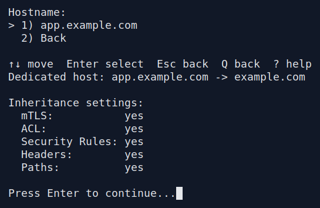

   [Read the captured terminal text](../assets/interactive/core-hosts-show-dedicated-host-inherit/04-show-dedicated-host-inherit-result.txt)

</details>

<details>
<summary>Verify the application response</summary>

1. Verify the application response.

   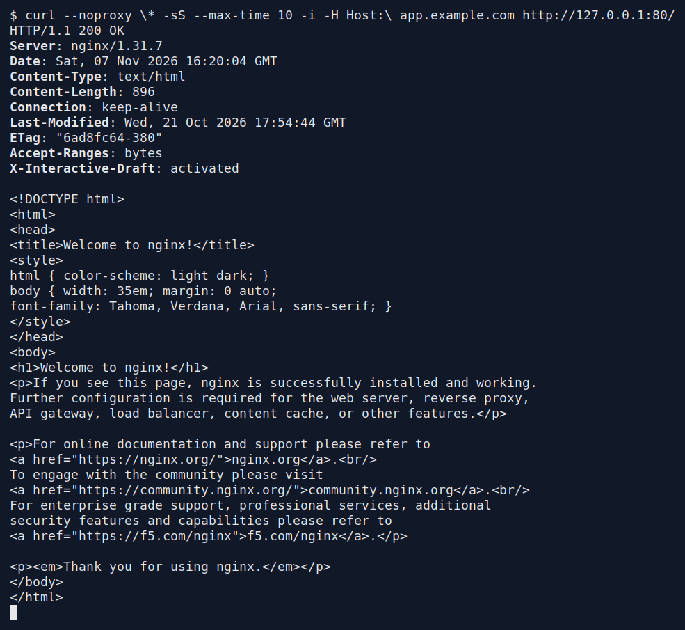

   [Read the captured terminal text](../assets/interactive/core-hosts-dedicated-host-request/01-verify-the-application-response.txt)

</details>

<details>
<summary>set-dedicated-host-inherit — inputs and result</summary>

1. Choose **app.example.com**.

   

   [Read the captured terminal text](../assets/interactive/core-hosts-hosts-inheritance/03-app-example-com.txt)

2. Choose **headers (current: yes)**.

   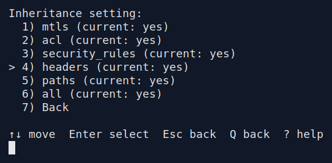

   [Read the captured terminal text](../assets/interactive/core-hosts-hosts-inheritance/04-headers-current-yes.txt)

3. Choose **no**.

   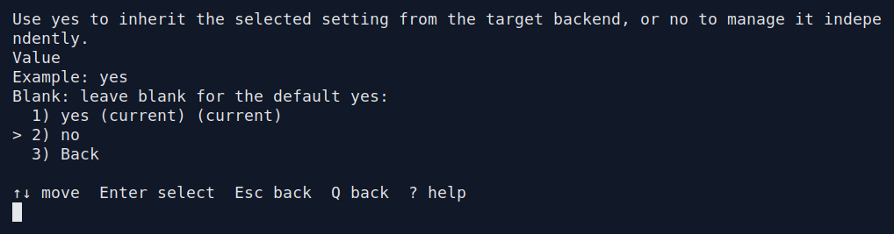

   [Read the captured terminal text](../assets/interactive/core-hosts-hosts-inheritance/05-no.txt)

4. Review the collected inputs, then choose **Run**.

   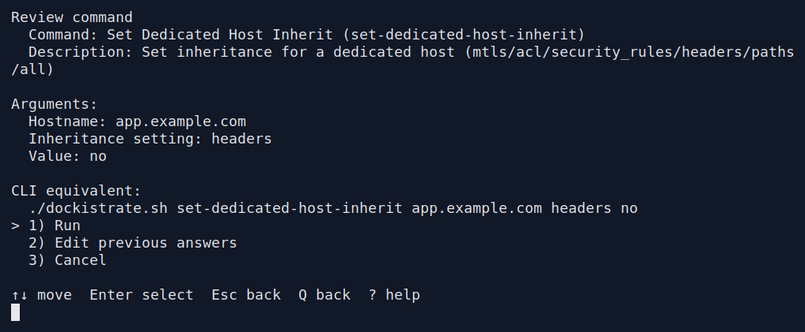

   [Read the captured terminal text](../assets/interactive/core-hosts-hosts-inheritance/06-review-and-run-set-dedicated-host-inherit.txt)

5. set-dedicated-host-inherit result.

   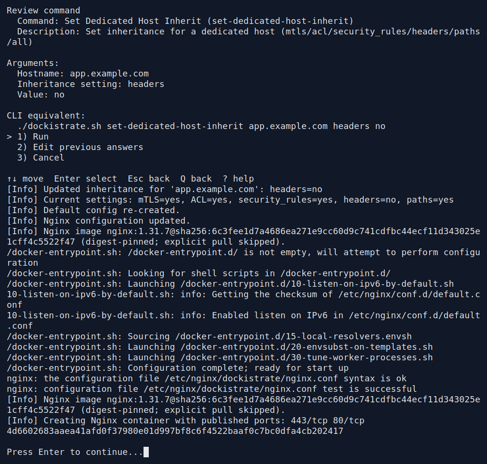

   [Read the captured terminal text](../assets/interactive/core-hosts-hosts-inheritance/07-set-dedicated-host-inherit-result.txt)

</details>

<details>
<summary>remove-dedicated-host — inputs and result</summary>

1. Choose **app.example.com**.

   

   [Read the captured terminal text](../assets/interactive/core-hosts-remove-dedicated-host/03-app-example-com.txt)

2. Review the collected inputs, then choose **Run**.

   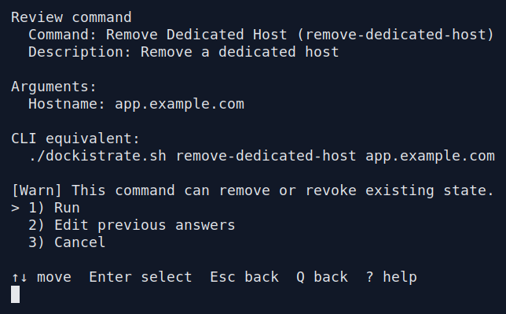

   [Read the captured terminal text](../assets/interactive/core-hosts-remove-dedicated-host/04-review-and-run-remove-dedicated-host.txt)

3. Enter `YES`.

   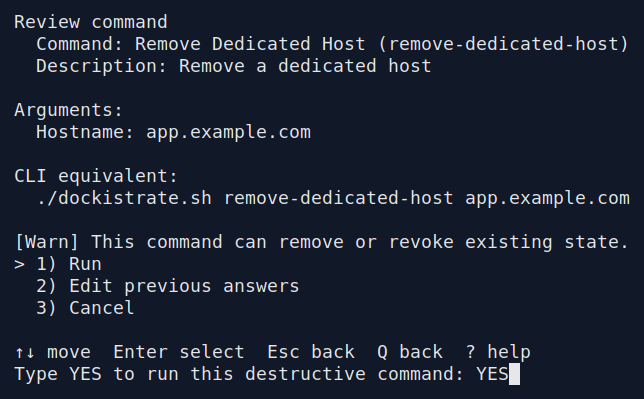

   [Read the captured terminal text](../assets/interactive/core-hosts-remove-dedicated-host/05-confirm-removal.txt)

4. remove-dedicated-host result.

   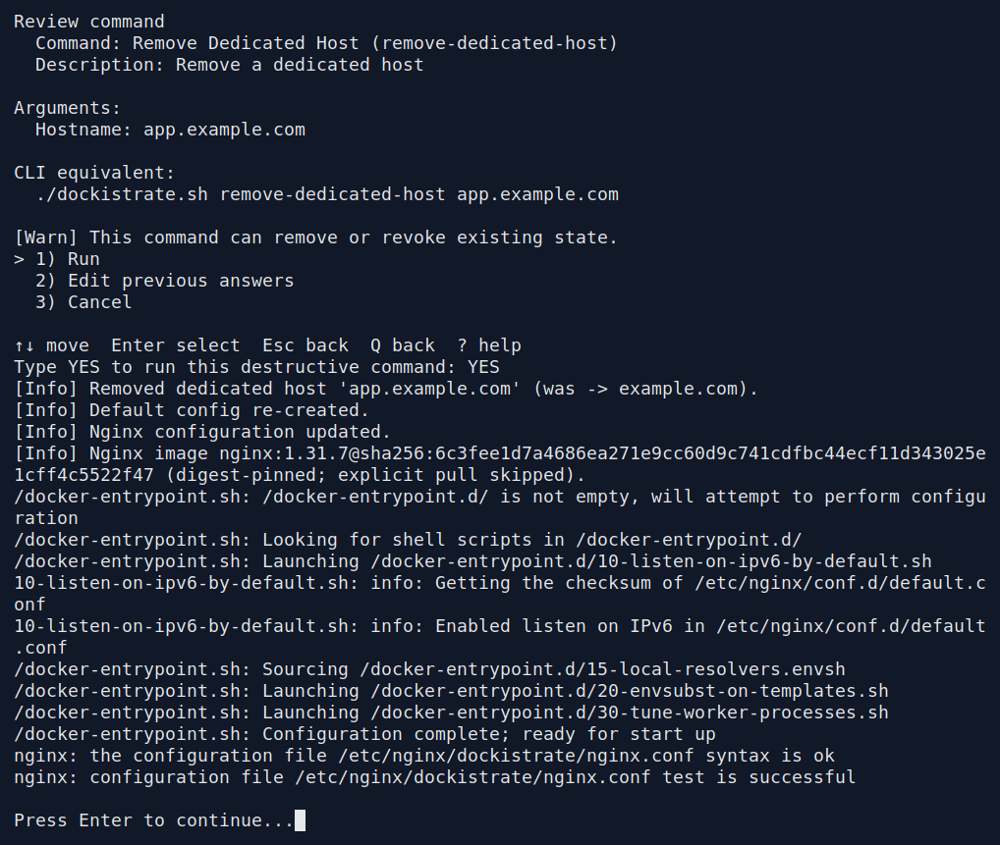

   [Read the captured terminal text](../assets/interactive/core-hosts-remove-dedicated-host/06-remove-dedicated-host-result.txt)

</details>

<!-- /walkthrough: hosts-dedicated -->

```bash
./dockistrate.sh add-dedicated-host app.example.com example.com
./dockistrate.sh show-dedicated-host-inherit app.example.com
curl --noproxy '*' -i http://127.0.0.1 -H 'Host: app.example.com'
```

<a id="cmd-set-dedicated-host-inherit"></a>
### Change one inheritance switch

Choose **Set Dedicated Host Inherit** → `app.example.com` → `headers` → `no`,
then review → **Run**. **Show Dedicated Host Inherit** should now show headers
inheritance disabled. Add the hostname's own header overrides in
[Headers & HSTS/CSP](headers-real-ip-hsts-csp.md). Repeat with `headers` → `yes` to undo.

**CLI:** `./dockistrate.sh set-dedicated-host-inherit app.example.com headers no`

The setting picker offers `mtls`, `acl`, `security_rules`, `headers`, `paths`,
and `all`; its labels show the current value. `all` changes all five switches.
A dedicated host can have its own HTTP version and client/proxy IP header
settings as well. See [request-rule inheritance](access-control-security-rules.md#request-rule-hostnames-and-inheritance)
for effective rules and status overrides.

| Operation | Selection and result to check | CLI equivalent |
| --- | --- | --- |
| <a id="cmd-show-dedicated-host-inherit"></a>Show Dedicated Host Inherit | Select the hostname; inspect its five current inheritance settings. | `show-dedicated-host-inherit app.example.com` |
| <a id="cmd-list-dedicated-hosts"></a>List Dedicated Hosts | Select a backend; inspect hostname → backend mappings. | `list-dedicated-hosts example.com` (omit domain for all) |
| <a id="cmd-remove-dedicated-host"></a>Remove Dedicated Host | Select the hostname → review → Run. Check it is absent from the list. Save its own settings before removal if you intend to recreate it. | `remove-dedicated-host app.example.com` |

## When changes take effect

Changing `acl`, `security_rules`, `headers`, or `all` inheritance replaces the
managed proxy and interrupts active sessions in both modes. Inherited headers
can change the client identity used by access control. This differs from
1.0.1's graceful reload behavior; syntax and saved formats are unchanged.
An `mtls` inheritance change also replaces the proxy when its selected
certificate snapshot changes; unchanged verification material follows the normal
update path. `paths`-only inheritance changes keep their existing update behavior.
See [certificate isolation](tls-certificates-http3.md#proxy-certificate-isolation)
and [policy update behavior](access-control-security-rules.md#when-policy-changes-take-effect).

Aliases and dedicated hosts have their own editable domain folders.
[Pending CSV edits](domain-configuration.md#pending-edits-and-existing-commands)
must be resolved explicitly before an affected command can change them.
