# Interactive Workflows

Run `./dockistrate.sh -i` to choose a task, answer its prompts, and review the
command before running it. The [README examples](../../README.md#1-serve-http)
introduce HTTP, local HTTPS, and a request rule. This page explains the controls
shared by every guide; the [documentation index](../README.md) lists all tasks.

On a narrow screen, open a screenshot at full size or follow its text transcript.
The numbered steps retain the inputs, so you can complete a task without images.

## Navigate and Review

### Start from Home

Choose a task such as **Add a new backend**, **Expose or update a port**, or
**Diagnostics / troubleshoot**. **Advanced command browser** groups the full
command set into categories. These are alternate routes to the same operations.
Select by label: installed images, networks, domains, and certificates change
which entries are available and where they appear.

If a command needs setup that does not exist, **Missing setup** offers the next
action, such as **Add backend now** or **Add port now**. Complete that suggested
task, then return to the original task when ready. You can also return without
changing the application. Certificate, header, mTLS, ACL, and security-rule
guidance follows the same pattern. An empty Recent or Favorites list offers
**Return to previous menu** and **Quit**.

<!-- walkthrough: navigation -->

list-port-mappings — inputs and result

1. Choose **Search all commands**.

   

   [Read the captured terminal text](../assets/interactive/core-services-navigation-search/01-choose-a-task.txt)

2. Choose **Routing & Ports :: List Port Mappings — List configured port mappings with**.

   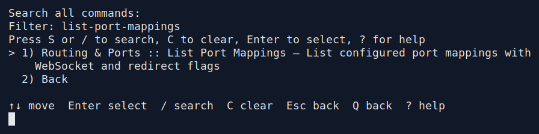

   [Read the captured terminal text](../assets/interactive/core-services-navigation-search/02-find-list-port-mappings.txt)

3. list-port-mappings result.

   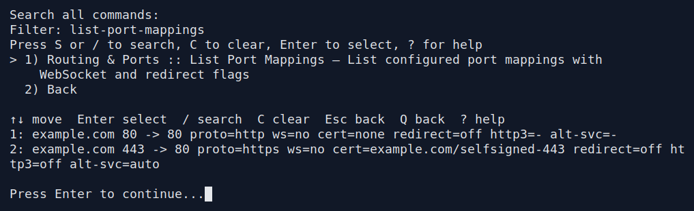

   [Read the captured terminal text](../assets/interactive/core-services-navigation-search/03-list-port-mappings-result.txt)

4. Choose **Quit**.

   

   [Read the captured terminal text](../assets/interactive/core-services-navigation-search/04-return-to-home.txt)

Return to Home

1. Choose **Home**.

   

   [Read the captured terminal text](../assets/interactive/core-services-navigation-help/01-home.txt)

2. Contextual help.

   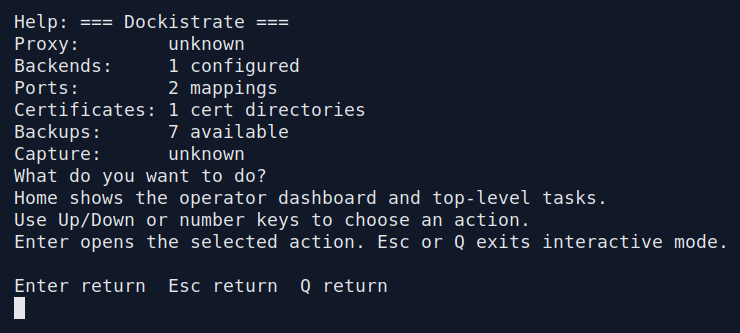

   [Read the captured terminal text](../assets/interactive/core-services-navigation-help/02-contextual-help.txt)

3. Choose **Advanced command browser**.

   

   [Read the captured terminal text](../assets/interactive/core-services-navigation-help/03-choose-a-task.txt)

4. Choose **Back to home**.

   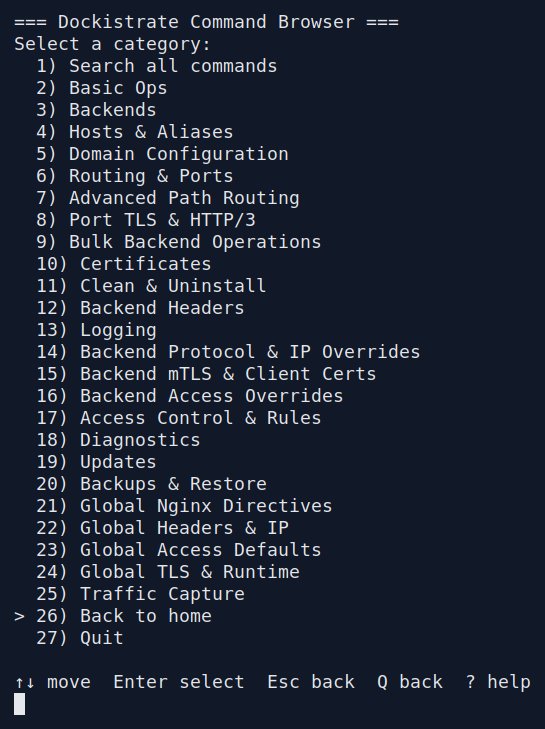

   [Read the captured terminal text](../assets/interactive/core-services-navigation-help/04-return-from-command-categories.txt)

5. Choose **Quit**.

   

   [Read the captured terminal text](../assets/interactive/core-services-navigation-help/05-return-to-home.txt)

list-port-mappings — inputs and result

1. Choose **Recent commands**.

   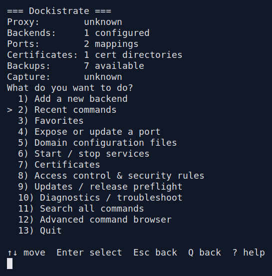

   [Read the captured terminal text](../assets/interactive/core-services-navigation-favorites/01-choose-a-task.txt)

2. Choose **2026-11-09T11:34:38+0000 :: List Port Mappings (list-port-mappings) - ./dockistrate.sh list-port-mappings**.

   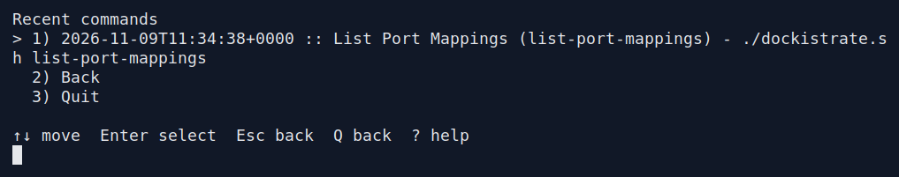

   [Read the captured terminal text](../assets/interactive/core-services-navigation-favorites/02-2026-11-09t11-34-38-0000-list-port-mappings-list-port-mappings-dockistrate-sh-li.txt)

3. Choose **Add to favorites**.

   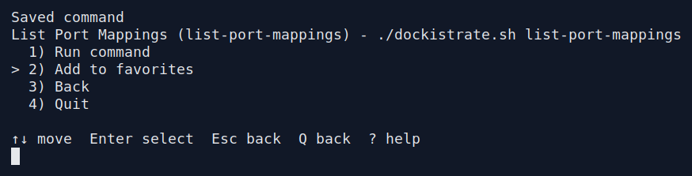

   [Read the captured terminal text](../assets/interactive/core-services-navigation-favorites/03-add-to-favorites.txt)

4. Choose **Back**.

   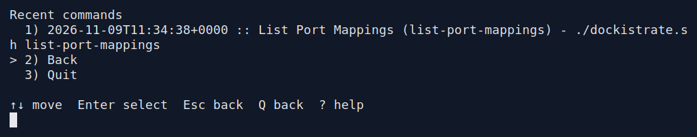

   [Read the captured terminal text](../assets/interactive/core-services-navigation-favorites/04-back.txt)

5. Choose **Favorites**.

   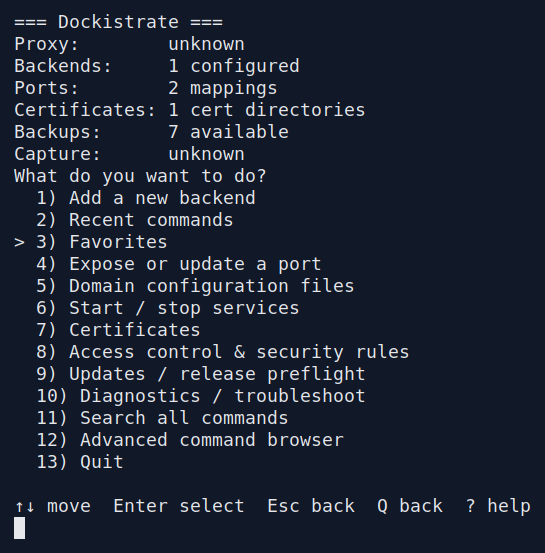

   [Read the captured terminal text](../assets/interactive/core-services-navigation-favorites/05-choose-a-task.txt)

6. Choose **List Port Mappings (list-port-mappings) - ./dockistrate.sh list-port-mappings**.

   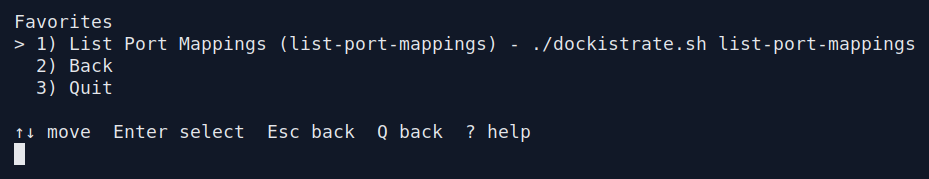

   [Read the captured terminal text](../assets/interactive/core-services-navigation-favorites/06-list-port-mappings-list-port-mappings-dockistrate-sh-list-port-mappings.txt)

7. Choose **Run command**.

   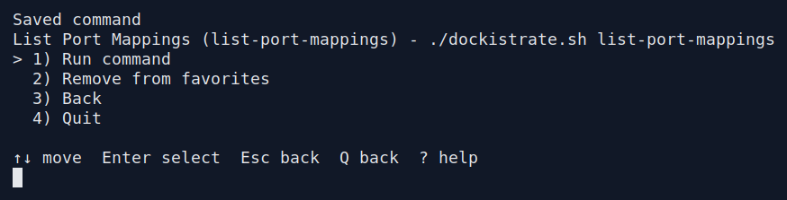

   [Read the captured terminal text](../assets/interactive/core-services-navigation-favorites/07-run-command.txt)

8. Favorite command result.

   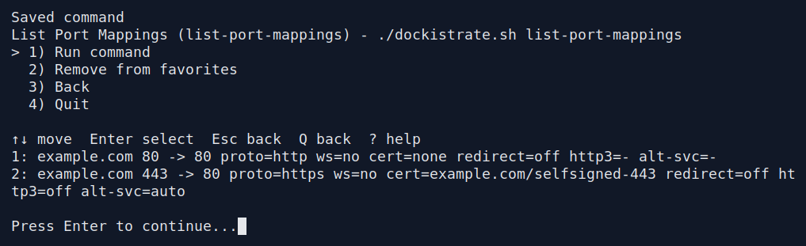

   [Read the captured terminal text](../assets/interactive/core-services-navigation-favorites/08-favorite-command-result.txt)

9. Choose **Quit**.

   

   [Read the captured terminal text](../assets/interactive/core-services-navigation-favorites/09-return-to-home.txt)

Return to Home

1. Choose **Favorites**.

   

   [Read the captured terminal text](../assets/interactive/core-services-navigation-remove-favorite/01-choose-a-task.txt)

2. Choose **List Port Mappings (list-port-mappings) - ./dockistrate.sh list-port-mappings**.

   

   [Read the captured terminal text](../assets/interactive/core-services-navigation-remove-favorite/02-list-port-mappings-list-port-mappings-dockistrate-sh-list-port-mappings.txt)

3. Choose **Remove from favorites**.

   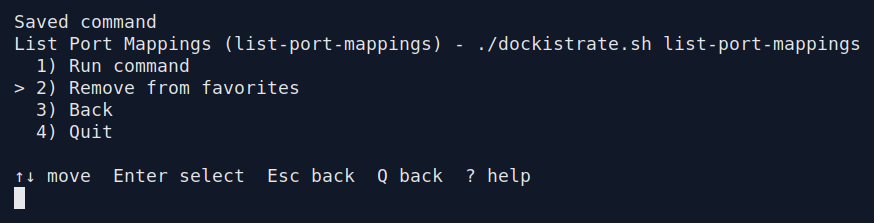

   [Read the captured terminal text](../assets/interactive/core-services-navigation-remove-favorite/03-remove-from-favorites.txt)

4. Choose **Quit**.

   

   [Read the captured terminal text](../assets/interactive/core-services-navigation-remove-favorite/04-return-to-home.txt)

replace-backend-network — inputs and result

1. Choose **Search all commands**.

   

   [Read the captured terminal text](../assets/interactive/core-services-navigation-back-review-cancel/01-choose-a-task.txt)

2. Choose **Backends :: Replace Backend Network — Move a backend container to a different**.

   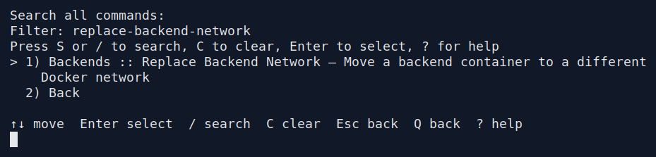

   [Read the captured terminal text](../assets/interactive/core-services-navigation-back-review-cancel/02-find-replace-backend-network.txt)

3. Choose **example.com**.

   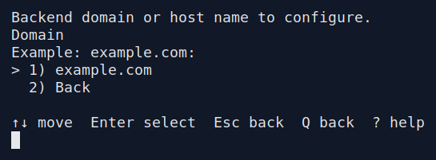

   [Read the captured terminal text](../assets/interactive/core-services-navigation-back-review-cancel/03-example-com.txt)

4. Choose **Back**.

   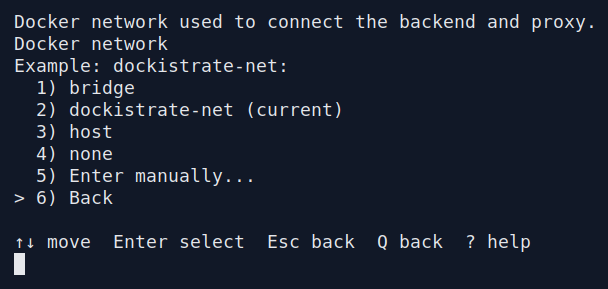

   [Read the captured terminal text](../assets/interactive/core-services-navigation-back-review-cancel/04-back-to-backend-selection.txt)

5. Choose **example.com**.

   

   [Read the captured terminal text](../assets/interactive/core-services-navigation-back-review-cancel/05-example-com.txt)

6. Choose **dockistrate-net (current)**.

   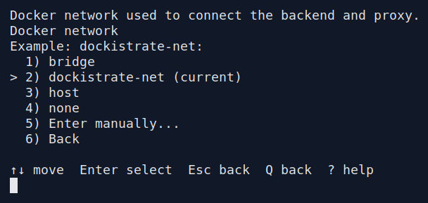

   [Read the captured terminal text](../assets/interactive/core-services-navigation-back-review-cancel/06-dockistrate-net-current.txt)

7. Choose **Edit previous answers**.

   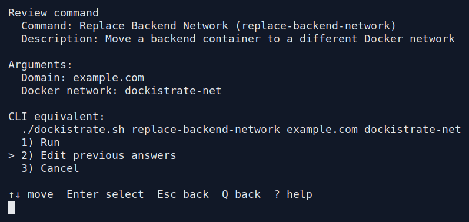

   [Read the captured terminal text](../assets/interactive/core-services-navigation-back-review-cancel/07-edit-previous-answers.txt)

8. Choose **example.com**.

   

   [Read the captured terminal text](../assets/interactive/core-services-navigation-back-review-cancel/08-example-com.txt)

9. Choose **dockistrate-net (current)**.

   

   [Read the captured terminal text](../assets/interactive/core-services-navigation-back-review-cancel/09-dockistrate-net-current.txt)

10. Choose **Cancel**.

    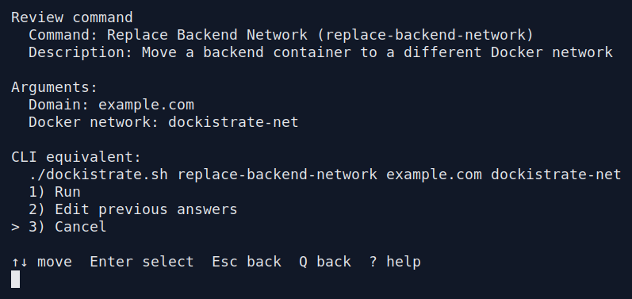

    [Read the captured terminal text](../assets/interactive/core-services-navigation-back-review-cancel/10-cancel-before-running.txt)

11. Choose **Back**.

    

    [Read the captured terminal text](../assets/interactive/core-services-navigation-back-review-cancel/11-return-from-search.txt)

12. Choose **Quit**.

    

    [Read the captured terminal text](../assets/interactive/core-services-navigation-back-review-cancel/12-return-to-home.txt)

replace-backend-network — inputs and result

1. Choose **Search all commands**.

   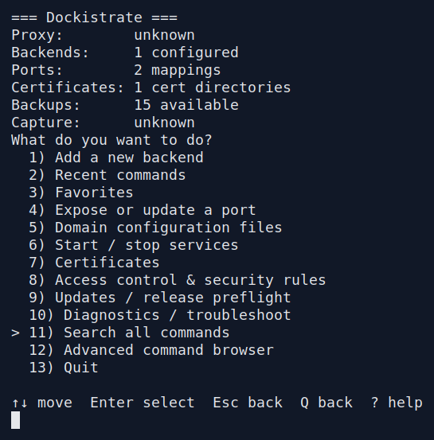

   [Read the captured terminal text](../assets/interactive/core-services-backend-network/01-choose-a-task.txt)

2. Choose **Backends :: Replace Backend Network — Move a backend container to a different**.

   

   [Read the captured terminal text](../assets/interactive/core-services-backend-network/02-find-replace-backend-network.txt)

3. Choose **example.com**.

   

   [Read the captured terminal text](../assets/interactive/core-services-backend-network/03-example-com.txt)

4. Choose **Enter manually...**.

   

   [Read the captured terminal text](../assets/interactive/core-services-backend-network/04-enter-manually.txt)

5. Enter `docs-secondary`.

   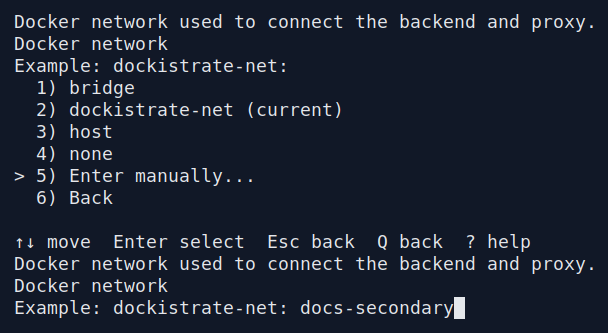

   [Read the captured terminal text](../assets/interactive/core-services-backend-network/05-enter-value.txt)

6. Review the collected inputs, then choose **Run**.

   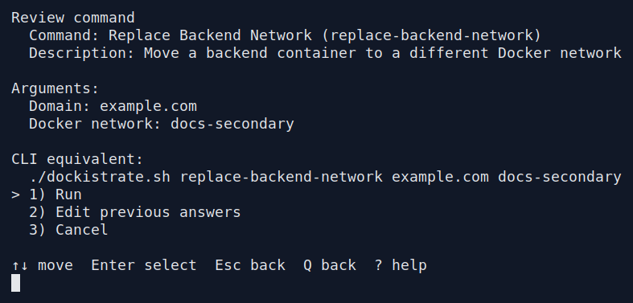

   [Read the captured terminal text](../assets/interactive/core-services-backend-network/06-review-and-run-replace-backend-network.txt)

7. replace-backend-network result.

   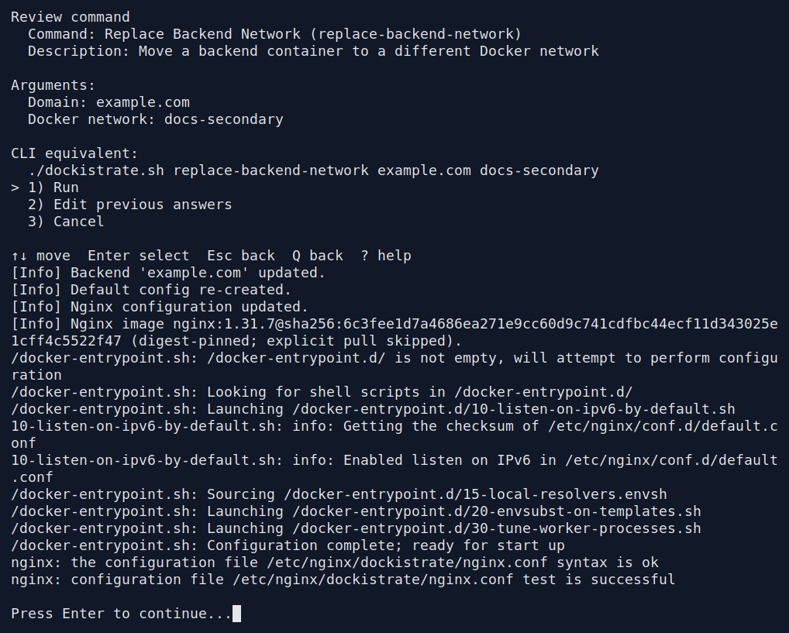

   [Read the captured terminal text](../assets/interactive/core-services-backend-network/07-replace-backend-network-result.txt)

8. Choose **Quit**.

   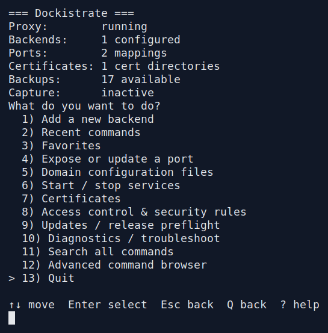

   [Read the captured terminal text](../assets/interactive/core-services-backend-network/08-return-to-home.txt)

stop-backend — inputs and result

1. Choose **Search all commands**.

   

   [Read the captured terminal text](../assets/interactive/core-branches-navigation-missing-backend/01-choose-a-task.txt)

2. Choose **Backends :: Stop Backend — Stop a backend container — unavailable: no backends**.

   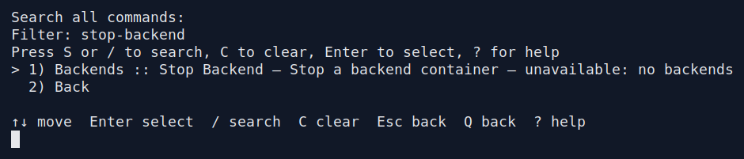

   [Read the captured terminal text](../assets/interactive/core-branches-navigation-missing-backend/02-find-stop-backend.txt)

3. Choose **Add backend now**.

   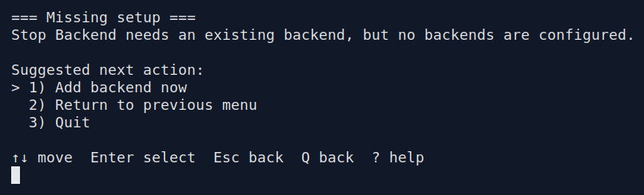

   [Read the captured terminal text](../assets/interactive/core-branches-navigation-missing-backend/03-create-the-missing-backend.txt)

4. Choose **Enter domain**.

   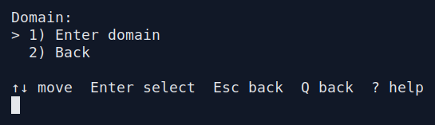

   [Read the captured terminal text](../assets/interactive/core-branches-navigation-missing-backend/04-enter-domain.txt)

5. Enter `example.com`.

   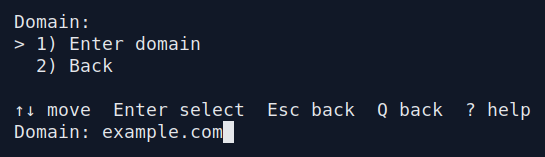

   [Read the captured terminal text](../assets/interactive/core-branches-navigation-missing-backend/05-enter-value.txt)

6. Choose **HTTP**.

   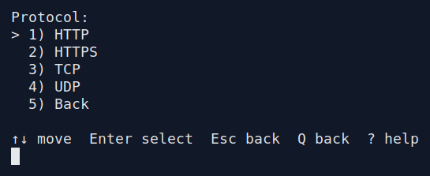

   [Read the captured terminal text](../assets/interactive/core-branches-navigation-missing-backend/06-http.txt)

7. Choose **dockistrate-net**.

   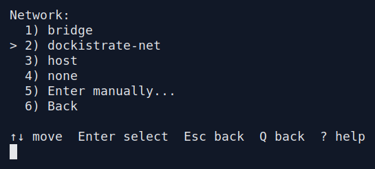

   [Read the captured terminal text](../assets/interactive/core-branches-navigation-missing-backend/07-dockistrate-net.txt)

8. Choose **Enter manually...**.

   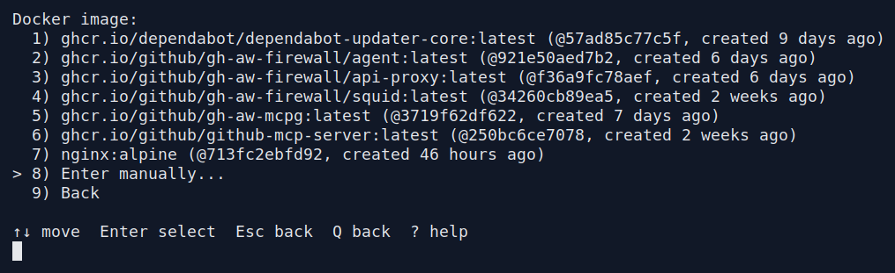

   [Read the captured terminal text](../assets/interactive/core-branches-navigation-missing-backend/08-enter-manually.txt)

9. Enter `nginx:alpine`.

   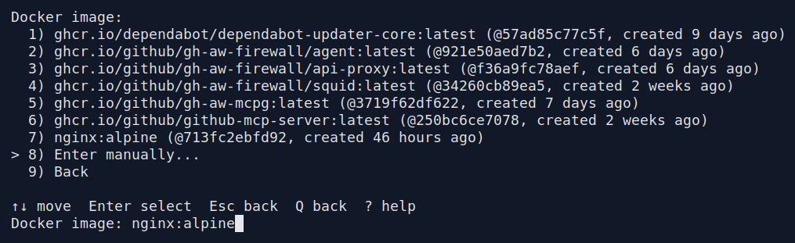

   [Read the captured terminal text](../assets/interactive/core-branches-navigation-missing-backend/09-enter-value.txt)

10. Choose **80**.

    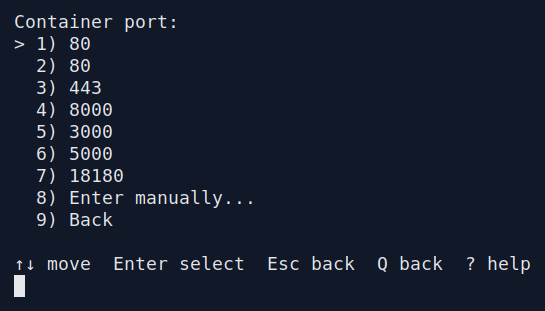

    [Read the captured terminal text](../assets/interactive/core-branches-navigation-missing-backend/10-80.txt)

11. Choose **Use default: 80**.

    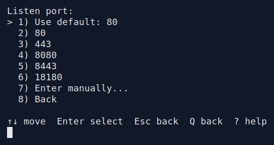

    [Read the captured terminal text](../assets/interactive/core-branches-navigation-missing-backend/11-use-default-80.txt)

12. Choose **Disabled**.

    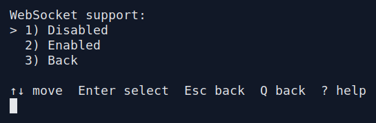

    [Read the captured terminal text](../assets/interactive/core-branches-navigation-missing-backend/12-disabled.txt)

13. Choose **Do not expose**.

    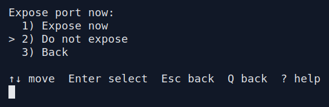

    [Read the captured terminal text](../assets/interactive/core-branches-navigation-missing-backend/13-create-the-backend-before-exposing-a-port.txt)

14. Press Enter to accept the displayed default or leave the optional value blank.

    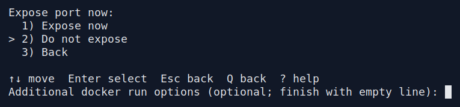

    [Read the captured terminal text](../assets/interactive/core-branches-navigation-missing-backend/14-enter-value.txt)

15. Review the collected inputs, then choose **Run**.

    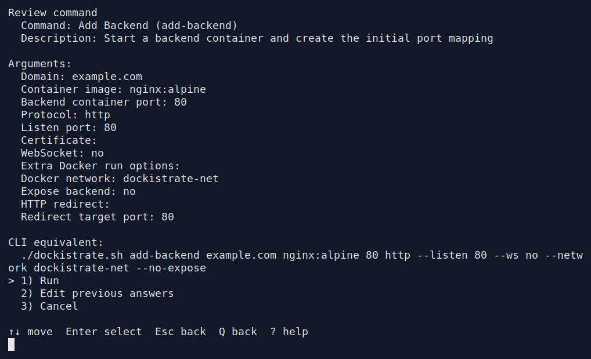

    [Read the captured terminal text](../assets/interactive/core-branches-navigation-missing-backend/15-run.txt)

16. The suggested backend creation completes.

    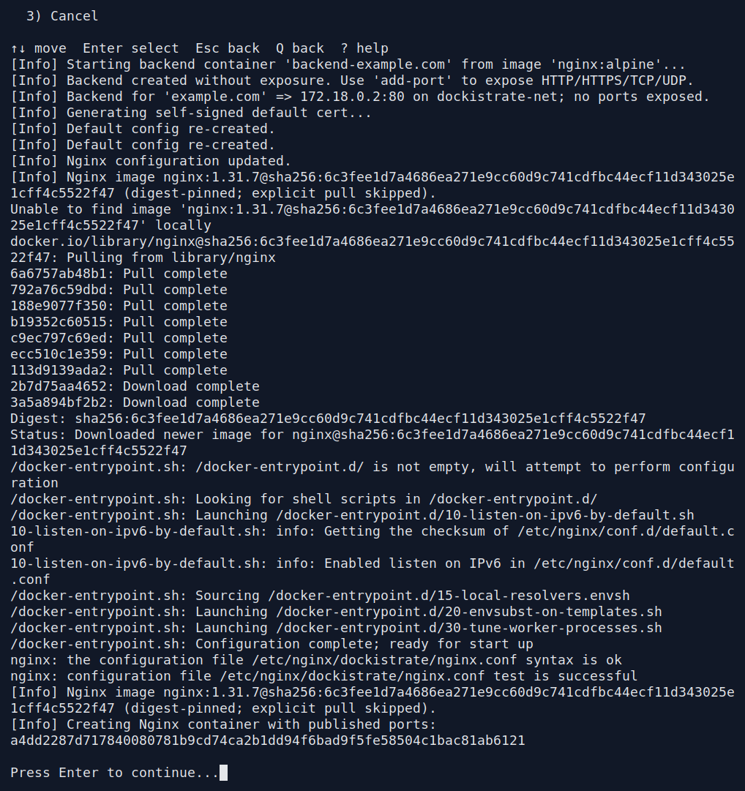

    [Read the captured terminal text](../assets/interactive/core-branches-navigation-missing-backend/16-the-suggested-backend-creation-completes.txt)

17. Choose **Quit**.

    

    [Read the captured terminal text](../assets/interactive/core-branches-navigation-missing-backend/17-return-to-home.txt)

remove-port — inputs and result

1. Choose **Search all commands**.

   

   [Read the captured terminal text](../assets/interactive/core-branches-navigation-missing-port/01-choose-a-task.txt)

2. Choose **Routing & Ports :: Remove Port — Remove a port mapping for a backend — unavailable:**.

   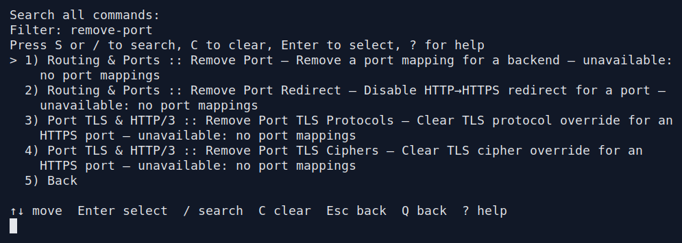

   [Read the captured terminal text](../assets/interactive/core-branches-navigation-missing-port/02-find-remove-port.txt)

3. Choose **Add port now**.

   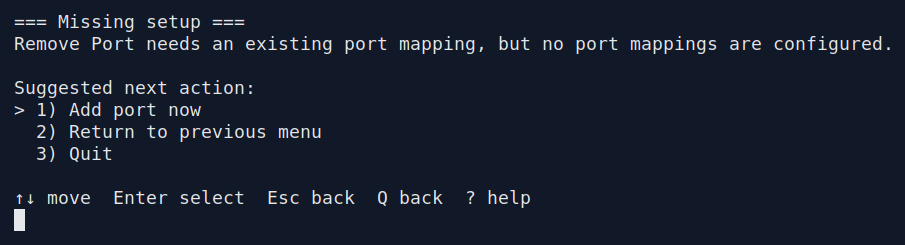

   [Read the captured terminal text](../assets/interactive/core-branches-navigation-missing-port/03-create-the-missing-port-mapping.txt)

4. Choose **example.com**.

   

   [Read the captured terminal text](../assets/interactive/core-branches-navigation-missing-port/04-example-com.txt)

5. Choose **80**.

   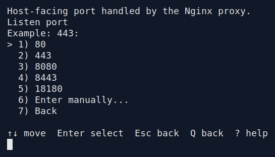

   [Read the captured terminal text](../assets/interactive/core-branches-navigation-missing-port/05-80.txt)

6. Choose **80**.

   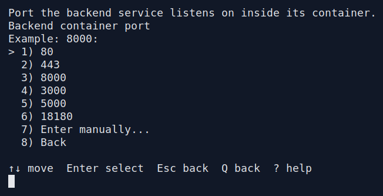

   [Read the captured terminal text](../assets/interactive/core-branches-navigation-missing-port/06-80.txt)

7. Choose **HTTP (current)**.

   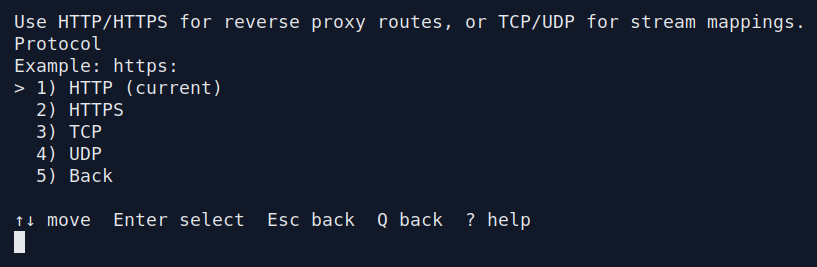

   [Read the captured terminal text](../assets/interactive/core-branches-navigation-missing-port/07-http-current.txt)

8. Choose **no (current)**.

   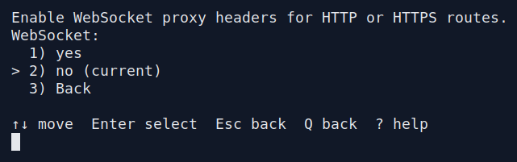

   [Read the captured terminal text](../assets/interactive/core-branches-navigation-missing-port/08-no-current.txt)

9. Review the collected inputs, then choose **Run**.

   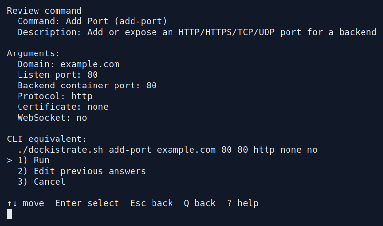

   [Read the captured terminal text](../assets/interactive/core-branches-navigation-missing-port/09-run.txt)

10. The suggested HTTP port creation completes.

    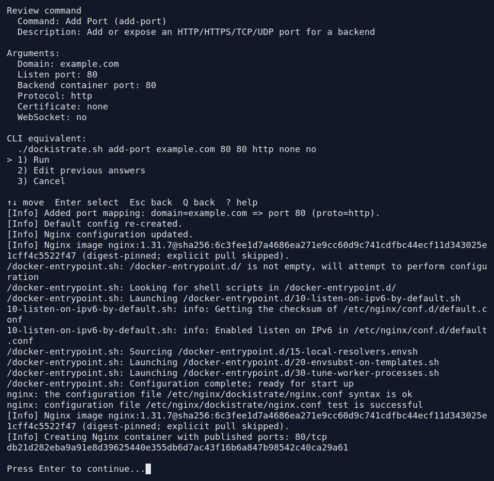

    [Read the captured terminal text](../assets/interactive/core-branches-navigation-missing-port/10-the-suggested-http-port-creation-completes.txt)

11. Choose **Quit**.

    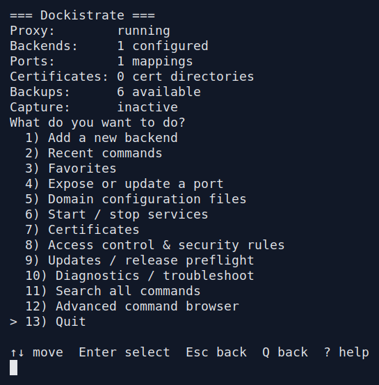

    [Read the captured terminal text](../assets/interactive/core-branches-navigation-missing-port/11-return-to-home.txt)

remove-cert — inputs and result

1. Choose **Search all commands**.

   

   [Read the captured terminal text](../assets/interactive/core-branches-navigation-missing-certificates/01-choose-a-task.txt)

2. Choose **Certificates :: Remove Cert — Delete a certificate directory for a domain or port**.

   

   [Read the captured terminal text](../assets/interactive/core-branches-navigation-missing-certificates/02-find-remove-cert.txt)

3. Choose **Return to previous menu**.

   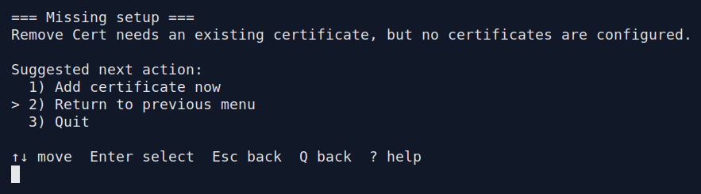

   [Read the captured terminal text](../assets/interactive/core-branches-navigation-missing-certificates/03-return-from-missing-certificates-guidance.txt)

4. Choose **Back**.

   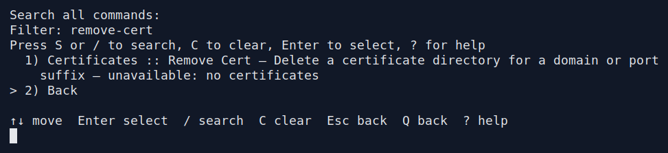

   [Read the captured terminal text](../assets/interactive/core-branches-navigation-missing-certificates/04-return-from-command-search.txt)

5. Choose **Quit**.

   

   [Read the captured terminal text](../assets/interactive/core-branches-navigation-missing-certificates/05-return-to-home.txt)

update-backend-header — inputs and result

1. Choose **Search all commands**.

   

   [Read the captured terminal text](../assets/interactive/core-branches-navigation-missing-headers/01-choose-a-task.txt)

2. Choose **Backend Headers :: Update Backend Header — Update a backend header override —**.

   

   [Read the captured terminal text](../assets/interactive/core-branches-navigation-missing-headers/02-find-update-backend-header.txt)

3. Choose **Return to previous menu**.

   

   [Read the captured terminal text](../assets/interactive/core-branches-navigation-missing-headers/03-return-from-missing-headers-guidance.txt)

4. Choose **Back**.

   

   [Read the captured terminal text](../assets/interactive/core-branches-navigation-missing-headers/04-return-from-command-search.txt)

5. Choose **Quit**.

   

   [Read the captured terminal text](../assets/interactive/core-branches-navigation-missing-headers/05-return-to-home.txt)

disable-backend-mtls — inputs and result

1. Choose **Search all commands**.

   

   [Read the captured terminal text](../assets/interactive/core-branches-navigation-missing-mtls/01-choose-a-task.txt)

2. Choose **Backend mTLS & Client Certs :: Disable Backend mTLS — Disable backend mTLS for a**.

   

   [Read the captured terminal text](../assets/interactive/core-branches-navigation-missing-mtls/02-find-disable-backend-mtls.txt)

3. Choose **Return to previous menu**.

   

   [Read the captured terminal text](../assets/interactive/core-branches-navigation-missing-mtls/03-return-from-missing-mtls-guidance.txt)

4. Choose **Back**.

   

   [Read the captured terminal text](../assets/interactive/core-branches-navigation-missing-mtls/04-return-from-command-search.txt)

5. Choose **Quit**.

   

   [Read the captured terminal text](../assets/interactive/core-branches-navigation-missing-mtls/05-return-to-home.txt)

disable-acl — inputs and result

1. Choose **Search all commands**.

   

   [Read the captured terminal text](../assets/interactive/core-branches-navigation-missing-acl/01-choose-a-task.txt)

2. Choose **Access Control & Rules :: Disable ACL — Disable an ACL rule — unavailable: no ACL**.

   

   [Read the captured terminal text](../assets/interactive/core-branches-navigation-missing-acl/02-find-disable-acl.txt)

3. Choose **Return to previous menu**.

   

   [Read the captured terminal text](../assets/interactive/core-branches-navigation-missing-acl/03-return-from-missing-acl-guidance.txt)

4. Choose **Back**.

   

   [Read the captured terminal text](../assets/interactive/core-branches-navigation-missing-acl/04-return-from-command-search.txt)

5. Choose **Quit**.

   

   [Read the captured terminal text](../assets/interactive/core-branches-navigation-missing-acl/05-return-to-home.txt)

disable-security-rule — inputs and result

1. Choose **Search all commands**.

   

   [Read the captured terminal text](../assets/interactive/core-branches-navigation-missing-security-rule/01-choose-a-task.txt)

2. Choose **Access Control & Rules :: Disable Security Rule — Disable a security rule —**.

   

   [Read the captured terminal text](../assets/interactive/core-branches-navigation-missing-security-rule/02-find-disable-security-rule.txt)

3. Choose **Return to previous menu**.

   

   [Read the captured terminal text](../assets/interactive/core-branches-navigation-missing-security-rule/03-return-from-missing-security-rule-guidance.txt)

4. Choose **Back**.

   

   [Read the captured terminal text](../assets/interactive/core-branches-navigation-missing-security-rule/04-return-from-command-search.txt)

5. Choose **Quit**.

   

   [Read the captured terminal text](../assets/interactive/core-branches-navigation-missing-security-rule/05-return-to-home.txt)

<!-- /walkthrough: navigation -->

| Home task | Next guide |
| --- | --- |
| Add a new backend; Expose or update a port; Start / stop services | [Backends and ports](backends-and-ports.md) |
| Domain configuration files | [Edit, preview, and apply CSVs](domain-configuration.md) |
| Certificates | [TLS and certificates](tls-certificates-http3.md) |
| Access control & security rules | [Access and request rules](access-control-security-rules.md) |
| Updates / release preflight | [Updates](updates.md) |
| Diagnostics / troubleshoot | [Diagnostics and capture](diagnostics-capture.md) |
| Advanced command browser | [All guides](../README.md) |

### Find a command

1. Choose **Search all commands**.
2. Press `/` or `S`, type a command such as `list-port-mappings`, and confirm
   the filter. Matching considers command names and descriptions.
3. Select **List Port Mappings**. This read-only command runs directly;
   check the output lists the configured listeners.

Press `C` in a command list to clear its filter. Search also works inside a
category's command list. The equivalent CLI command is
`./dockistrate.sh list-port-mappings`; browsing and filtering alone change no
configuration.

### Repeat a recent operation

After running an eligible command, return to Home → **Recent commands**. Select
its saved entry, choose **Run command**, inspect the saved arguments on review,
then **Run** for a change; read-only commands run directly. Use **Edit previous
answers** on a change if the target or values should change.
The default recent list keeps ten entries. Commands classified as sensitive
are not saved, so an operation may be absent even after it ran.

### Keep a frequently used command

In **Recent commands**, select a saved entry → **Add to favorites**. Return to
Home → **Favorites** and check the entry appears. Select it → **Run command**
to review and rerun it. Select **Remove from favorites** to remove the shortcut;
this does not undo the command. Saved entries include arguments, so inspect
those values before every run. Recent commands and favorites are local to this
state directory; the CLI equivalent is the command shown in the entry.

### Enter a value that is not listed

Choose **Enter manually...** where offered and type the value, such as a Docker
image tag or listen port. Manual entry supplies an argument; it does not by
itself create a network, certificate, or other resource. Current/default values
are marked. Blank input follows the behavior printed at that prompt; it does
not universally mean “keep current.”

### Correct an earlier answer

Use **Back**, Esc, or Q in a picker to return to the previous logical step or
containing menu. Type `back` in a text prompt where supported. At Home, Esc or Q
exits. Up/down and Enter select entries; number keys also select entries.

### Read the review before Run

Configuration changes show their operation, target, values, and CLI equivalent.
Read-only commands and dry-run domain previews run without this review. **Run** executes the
command; **Edit previous answers** returns to its inputs. For example, confirm
that adding a port says `example.com`, listen `8080`, upstream `80`, and HTTP
before running it. After completion, inspect the output and use the guide's
verification step; use another terminal for application requests.

Review rows name the selected settings, including options added after the main
inputs. Path updates distinguish the current path from its replacement; rule
updates group each condition's source, name, test, and value. Commands with no
arguments show `(none)` and their CLI equivalent has no empty placeholder.
An intentional empty value still matters: clearing saved Nginx Docker options
shows **Extra Docker run options: (clear)** and `--docker-opts ''`.

**Add Security Rule** has its own summary and **Confirm** choice. Some destructive
commands also ask for an explicit confirmation such as `YES`. Those confirmations
still apply when rerunning a saved command.

### Cancel without running

Choose **Cancel** on review, or **Back** out of the collection steps. No command
is run by the review's Cancel choice. EOF while selecting or collecting arguments
cancels collection and clears the selection; Enter accepts the displayed default.
After a command has run, use that guide's undo/removal procedure instead.

### Read help at the current step

Press `?` in Home or a selection menu to read contextual help, then follow its
return prompt. Prompts also show examples and blank-input behavior when relevant.
If a command requires something that does not exist, follow the displayed setup
choice or return to Home; manually typing a nonexistent object does not create it.

## HTTP Setup and Custom Ports

Follow [Run a web application](backends-and-ports.md#cmd-add-backend), then
[Expose another HTTP port](backends-and-ports.md#cmd-add-port). Fresh configurations
deny traffic at both ACL address layers. For a private service, allow the intended
L7 clients and original L3 peers; L3 and `both` use exact IPv4 addresses. Docker
can present a bridge gateway rather than loopback. A security-rule Allow does
not override an ACL denial. See [address-layer examples](access-control-security-rules.md#address-layers-and-private-services)
and [trusted proxy handling](headers-real-ip-hsts-csp.md#client-ip-and-proxy-ip).

## HTTPS, Redirects, and Certificate Choices

[Add local HTTPS](../../README.md#2-add-local-https), then use the
[TLS and certificate guide](tls-certificates-http3.md) for certificate selection,
listener overrides, and HTTP/3. Adding a self-signed HTTPS port through Add Port
leaves HTTP serving normally unless you separately enable its redirect.

### Add an HTTP Redirect

Follow [Redirect HTTP requests to HTTPS](backends-and-ports.md#cmd-set-port-redirect).
When creating a new HTTPS backend, the separate **HTTP->HTTPS redirect** choice
and **Use HTTPS listen port** choice control its initial redirect.

### Use Let's Encrypt

Follow [TLS and certificates](tls-certificates-http3.md). Use a real hostname
with public DNS and reachable inbound port 80. Add Cert can offer a missing
HTTPS listener and HTTP redirect; an existing listener must explicitly select
the new certificate through Update Port. Renew Certs renews eligible certificates.

### Import or Replace a Certificate

Follow [TLS and certificates](tls-certificates-http3.md). Upload choices ask for
absolute fullchain and private-key paths. Add Cert can offer a listener/redirect;
Replace Cert keeps existing listeners and redirects while replacing the selected
certificate suffix. Imported material is copied into its owner's managed directory.

## Inspect and Change Request Rules

Use [Access control and request rules](access-control-security-rules.md).
List Security Rules filters by direct owner and keeps global rule IDs; inherited
rules are not added to a domain filter. Update Security Rule lets you keep or
replace its conditions. Require rules must all pass before the first matching
Block/Allow is evaluated. The interactive add flow defaults to Block; the CLI's
omitted action defaults to Require. Policy changes replace the proxy.

## Edit an Address Rule or Host Override

Use [Access control](access-control-security-rules.md) for ACL ID, address, scope,
policy, and status changes. In Update ACL, blank keeps the saved status; `-`
clears it. Allow rules retain rejection metadata without prompting for it.
[Hostname inheritance](hosts-and-aliases.md) distinguishes ordinary aliases from
dedicated hosts; [headers and client IP](headers-real-ip-hsts-csp.md) explains the
available targets for each override.

## Edit a CSV, Preview It, and Apply It

Follow the complete [edit → validate → preview → apply walkthrough](domain-configuration.md#edit-preview-and-apply-a-change).
Manual edits remain inactive until explicitly applied; Update Nginx Config and
Check Config continue to use applied state.

### Resolve Pending or Invalid Drafts

The picker offers **Review file changes**, **Apply file changes**, or **Cancel
command** when a change would touch pending edits. Repair invalid files first.
After a successful apply, it collects the original command's arguments again.
To discard an edit, deliberately restore only its affected values from
`runtime/applied/`; preserve other pending work. See [pending edits](domain-configuration.md#pending-edits-and-existing-commands).

## Diagnose a Failed Check

Start with **Diagnostics / troubleshoot** → **Status** and **Check Config**.
Then inspect mappings, certificates, and proxy logs as appropriate in the
[diagnostics guide](diagnostics-capture.md). Configuration validity and a successful
application request are separate checks; use both after changing a route.
