# Mutual TLS and Client Certificates

Use mutual TLS (mTLS) when an HTTPS client must present a certificate issued by
your backend's certificate authority (CA). Start with `./dockistrate.sh -i` and
open **Advanced command browser → Backend mTLS & Client Certs**. The screenshots
come from a live run on a disposable server on 7 November 2026. The
[recording details](../assets/interactive/security-mtls-provenance.json) identify
the source revision and passed client-authentication and lifecycle checks.

**Before starting:** have an HTTPS backend such as `example.com`, working server
certificate trust, Docker and OpenSSL, and a test client already permitted by
ACLs/security rules. The examples use HTTPS port `443` and its self-signed
server certificate from the [TLS walkthrough](tls-certificates-http3.md#https-example).
Record the current state and make a complete backup before authority changes.
Resolve pending manual domain edits before immediate commands.

Ordinary aliases inherit their primary backend's mTLS settings. Dedicated
hosts can use their own settings or inherit them; inspect their inheritance
before changing credentials. Work on the authority-owning backend when changing
a shared authority. Certificate-snapshot changes can replace the proxy and
interrupt all active sessions.

List/show commands run directly without a mutation review. For **Remove…** or
**Revoke…**, choosing **Run** is followed by **Type YES to run this
destructive command:**; enter `YES` only when the displayed scope is intended.

## Walkthrough: enable mTLS and issue the first client

<a id="cmd-enable-backend-mtls"></a>

1. Choose **Enable Backend mTLS**, select `example.com`, and enter `guide-client`
   at **Client name**. Leaving it empty enables mTLS without issuing a client.
   Use letters, digits, hyphens, underscores or dots in a client name.
2. Review the domain and client, then **Run**. First-time enable can create a new
   CA only when no prior mapping/material exists. Re-enable reuses retained
   authority state; it must not silently replace missing or inconsistent history.

<!-- walkthrough: mtls-clients -->

<details>
<summary>enable-backend-mtls — inputs and result</summary>

1. Choose **example.com**.

   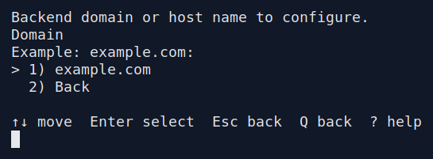

   [Read the captured terminal text](../assets/interactive/security-mtls-mtls-clients/03-example-com.txt)

2. Enter `guide-client`.

   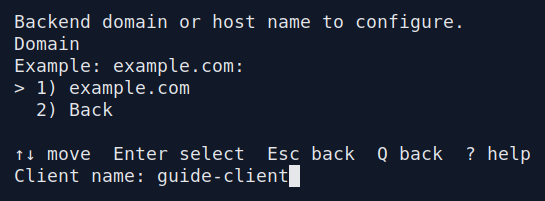

   [Read the captured terminal text](../assets/interactive/security-mtls-mtls-clients/04-enter-value.txt)

3. Review the collected inputs, then choose **Run**.

   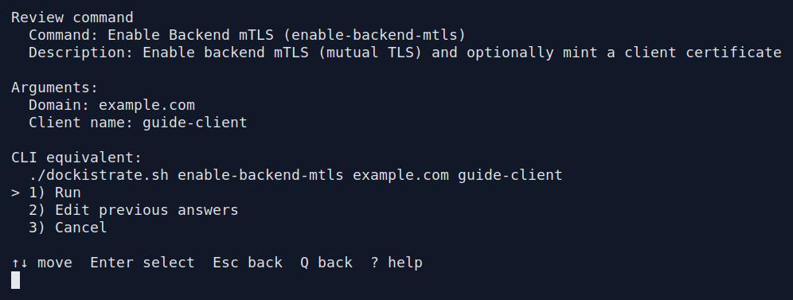

   [Read the captured terminal text](../assets/interactive/security-mtls-mtls-clients/05-run.txt)

4. Command result.

   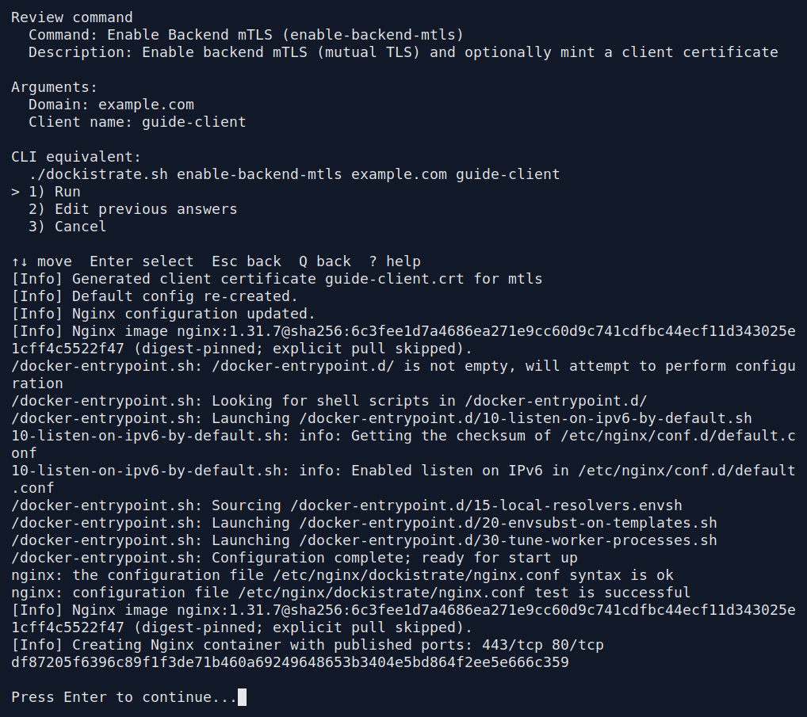

   [Read the captured terminal text](../assets/interactive/security-mtls-mtls-clients/06-command-result.txt)

</details>

<details>
<summary>list-backend-client-certs — inputs and result</summary>

1. Choose **example.com**.

   

   [Read the captured terminal text](../assets/interactive/security-mtls-list-backend-client-certs/03-example-com.txt)

2. Command result.

   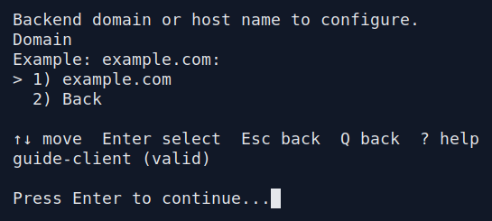

   [Read the captured terminal text](../assets/interactive/security-mtls-list-backend-client-certs/04-command-result.txt)

</details>

<details>
<summary>Authenticate with the issued client certificate</summary>

1. Authenticate with the issued client certificate.

   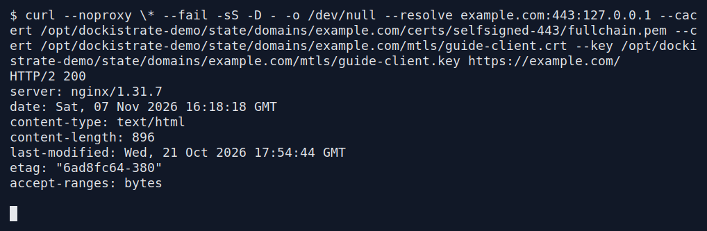

   [Read the captured terminal text](../assets/interactive/security-mtls-mtls-verified/01-authenticate-with-the-issued-client-certificate.txt)

</details>

<details>
<summary>add-backend-client-cert — inputs and result</summary>

1. Choose **example.com**.

   

   [Read the captured terminal text](../assets/interactive/security-mtls-add-backend-client-cert/03-example-com.txt)

2. Enter `second-client`.

   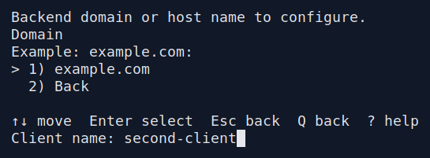

   [Read the captured terminal text](../assets/interactive/security-mtls-add-backend-client-cert/04-enter-value.txt)

3. Review the collected inputs, then choose **Run**.

   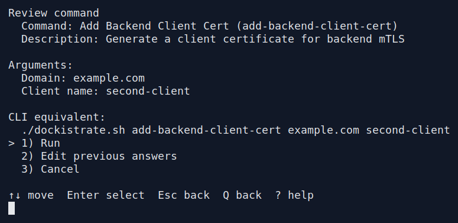

   [Read the captured terminal text](../assets/interactive/security-mtls-add-backend-client-cert/05-run.txt)

4. Command result.

   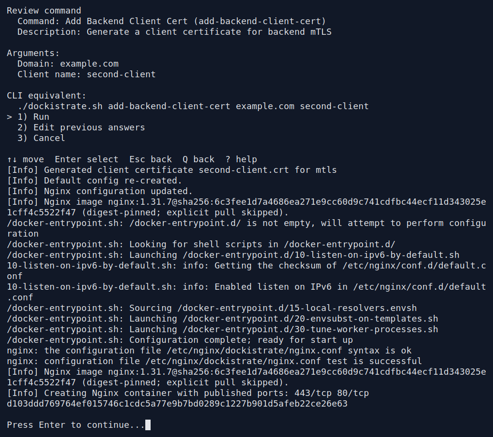

   [Read the captured terminal text](../assets/interactive/security-mtls-add-backend-client-cert/06-command-result.txt)

</details>

<details>
<summary>disable-backend-mtls — inputs and result</summary>

1. Choose **example.com**.

   

   [Read the captured terminal text](../assets/interactive/security-mtls-disable-backend-mtls/03-example-com.txt)

2. Review the collected inputs, then choose **Run**.

   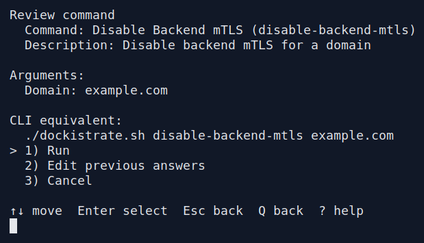

   [Read the captured terminal text](../assets/interactive/security-mtls-disable-backend-mtls/04-run.txt)

3. Command result.

   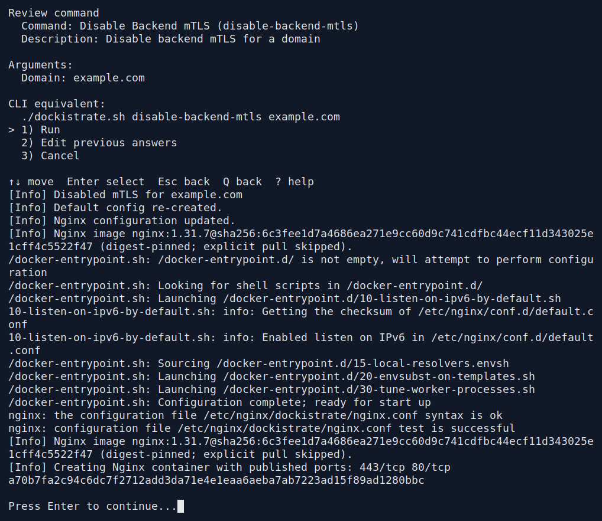

   [Read the captured terminal text](../assets/interactive/security-mtls-disable-backend-mtls/05-command-result.txt)

</details>

<details>
<summary>enable-backend-mtls — inputs and result</summary>

1. Choose **example.com**.

   

   [Read the captured terminal text](../assets/interactive/security-mtls-mtls-reenable/03-example-com.txt)

2. Press Enter to accept the displayed default or leave the optional value blank.

   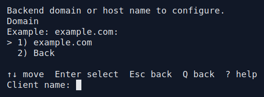

   [Read the captured terminal text](../assets/interactive/security-mtls-mtls-reenable/04-enter-value.txt)

3. Review the collected inputs, then choose **Run**.

   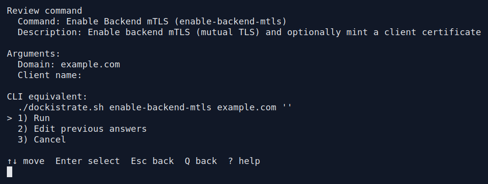

   [Read the captured terminal text](../assets/interactive/security-mtls-mtls-reenable/05-run.txt)

4. Command result.

   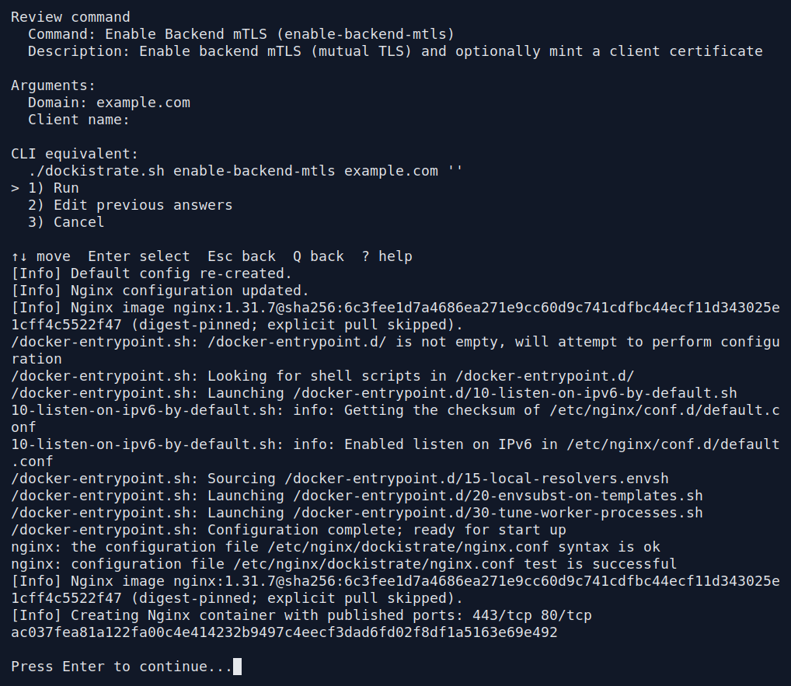

   [Read the captured terminal text](../assets/interactive/security-mtls-mtls-reenable/06-command-result.txt)

</details>

<details>
<summary>check-config — inputs and result</summary>

1. Configuration test passed.

   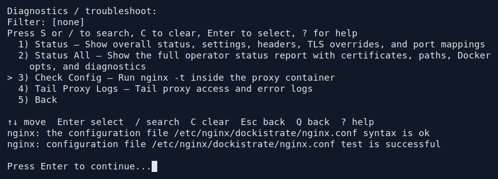

   [Read the captured terminal text](../assets/interactive/security-mtls-mtls-config/03-configuration-test-passed.txt)

</details>

<!-- /walkthrough: mtls-clients -->

3. Choose **List Backend Client Certs → example.com** and **List Backend CAs**.
   For a fresh issue, look for `guide-client` and inspect the generated certificate
   identity/serial. Run **Check Config**. The host-side files are
   `state/domains/example.com/mtls/guide-client.crt` and `guide-client.key`.
4. Send the two HTTPS requests below. A client without a certificate should be
   rejected; the issued client should reach the application if the other access
   controls permit it. The rejection may be a TLS/client-certificate error or
   an HTTP error; do not treat one particular status as universal.
5. To undo enforcement while preserving credentials, use **Disable Backend mTLS
   → example.com → Run**. This removes the mTLS requirement, not the host-side
   keys or the other access controls.

```bash
./dockistrate.sh enable-backend-mtls example.com guide-client
./dockistrate.sh list-backend-client-certs example.com
./dockistrate.sh list-backend-cas
./dockistrate.sh check-config

# No client certificate: must not receive the protected application response.
curl --noproxy '*' -i --resolve example.com:443:127.0.0.1 \
  --cacert state/domains/example.com/certs/selfsigned-443/fullchain.pem \
  https://example.com:443/

# Issued client: should reach an otherwise permitted application.
curl --noproxy '*' -i --resolve example.com:443:127.0.0.1 \
  --cacert state/domains/example.com/certs/selfsigned-443/fullchain.pem \
  --cert state/domains/example.com/mtls/guide-client.crt \
  --key state/domains/example.com/mtls/guide-client.key \
  https://example.com:443/
```

The `--cacert` path trusts the **server** certificate. The mTLS CA signs the
**client** certificate; these serve different roles. With a publicly trusted
server certificate, use normal client trust instead of the demo CA path.

## Walkthrough: export a client for another device

<a id="cmd-export-backend-client-p12"></a>

1. Choose **Export Backend Client P12**, select `example.com`, then
   `guide-client`, review and **Run**.
2. At **Enter export password:** and **Confirm export password:**, enter the same
   nonempty password. These hidden prompts occur after the command review.

<!-- walkthrough: mtls-export -->

<details>
<summary>export-backend-client-p12 — inputs and result</summary>

1. Choose **example.com**.

   

   [Read the captured terminal text](../assets/interactive/security-mtls-mtls-export/03-example-com.txt)

2. Choose **guide-client**.

   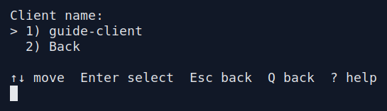

   [Read the captured terminal text](../assets/interactive/security-mtls-mtls-export/04-guide-client.txt)

3. Review the collected inputs, then choose **Run**.

   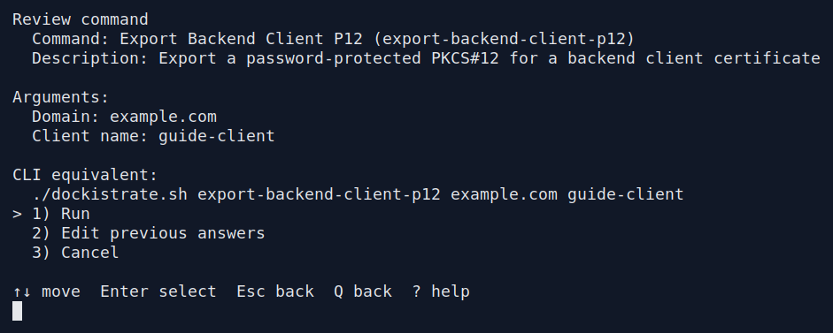

   [Read the captured terminal text](../assets/interactive/security-mtls-mtls-export/05-run.txt)

4. Enter the demonstration password; the terminal hides its value.

   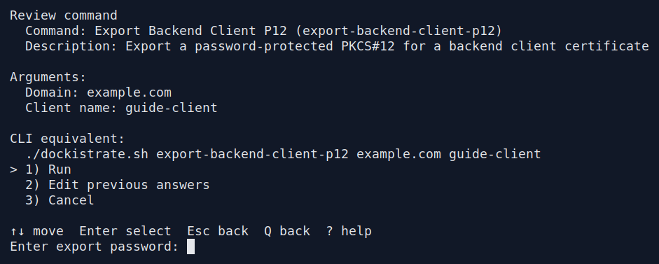

   [Read the captured terminal text](../assets/interactive/security-mtls-mtls-export/06-enter-value.txt)

5. Enter the demonstration password; the terminal hides its value.

   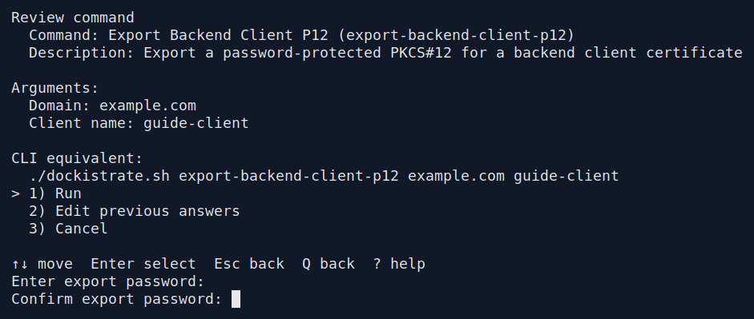

   [Read the captured terminal text](../assets/interactive/security-mtls-mtls-export/07-enter-value.txt)

6. Command result.

   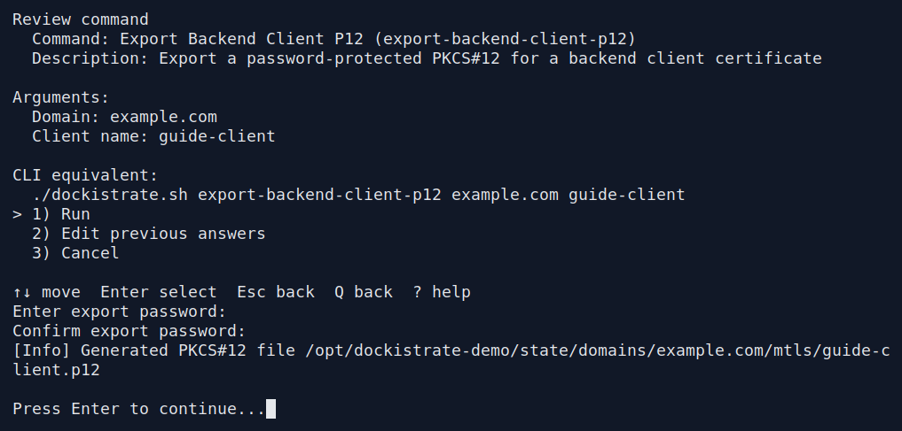

   [Read the captured terminal text](../assets/interactive/security-mtls-mtls-export/08-command-result.txt)

</details>

<details>
<summary>Inspect the protected bundle without displaying keys</summary>

1. Inspect the protected bundle without displaying keys.

   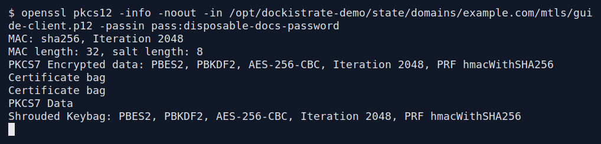

   [Read the captured terminal text](../assets/interactive/security-mtls-pkcs12-inspection/01-inspect-the-protected-bundle-without-displaying-keys.txt)

</details>

<!-- /walkthrough: mtls-export -->

3. Check the reported `.p12` path:
   `state/domains/example.com/mtls/guide-client.p12`. Import the bundle into the
   intended client's certificate store using its password, then repeat the
   authenticated request from that client. Export alone does not prove the
   other device can authenticate.
4. Remove an unwanted exported copy using your host/client file-management tools.
   Dockistrate has no dedicated export-deletion command. Deleting a bundle does
   not revoke copies already distributed; revoke the certificate to deny them.

The interactive form is also available directly:

```bash
./dockistrate.sh export-backend-client-p12 example.com guide-client
```

For automation, supply **one** password source:

```bash
./dockistrate.sh export-backend-client-p12 example.com guide-client \
  --password-file /protected/path/export-password
# Alternatively: --password-env MTLS_EXPORT_PASSWORD or --password-stdin
```

The file/stdin must contain one nonempty line; a final LF/CRLF is accepted.
The environment variable must already be set. Do not put a real password or
private key into screenshots, command examples or the repository.

## Walkthrough: rotate or revoke a client

1. List clients and identify the exact name. To rotate while keeping the same
   name, choose **Replace Backend Client Cert → example.com → guide-client**,
   review and **Run**. The old certificate is revoked and the local certificate
   and key are replaced; distribute/export the replacement again.
2. Compare its serial/fingerprint with the prior client copy. Verify that a
   fresh connection using the new credential succeeds and the previous
   credential is rejected. Existing distributed bundles are not rewritten.

<!-- walkthrough: mtls-rotation -->

<details>
<summary>replace-backend-client-cert — inputs and result</summary>

1. Choose **example.com**.

   

   [Read the captured terminal text](../assets/interactive/security-mtls-mtls-rotation/03-example-com.txt)

2. Choose **guide-client**.

   

   [Read the captured terminal text](../assets/interactive/security-mtls-mtls-rotation/04-guide-client.txt)

3. Review the collected inputs, then choose **Run**.

   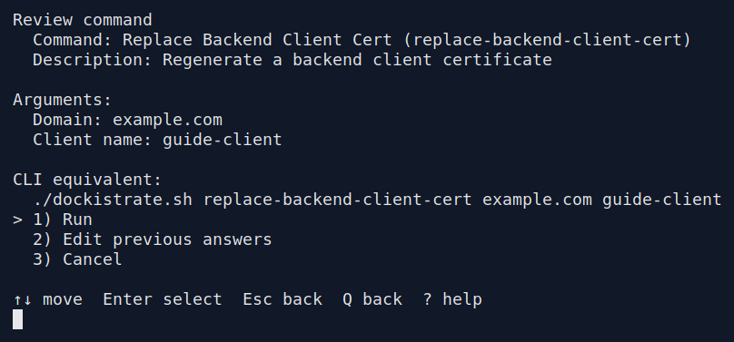

   [Read the captured terminal text](../assets/interactive/security-mtls-mtls-rotation/05-run.txt)

4. Command result.

   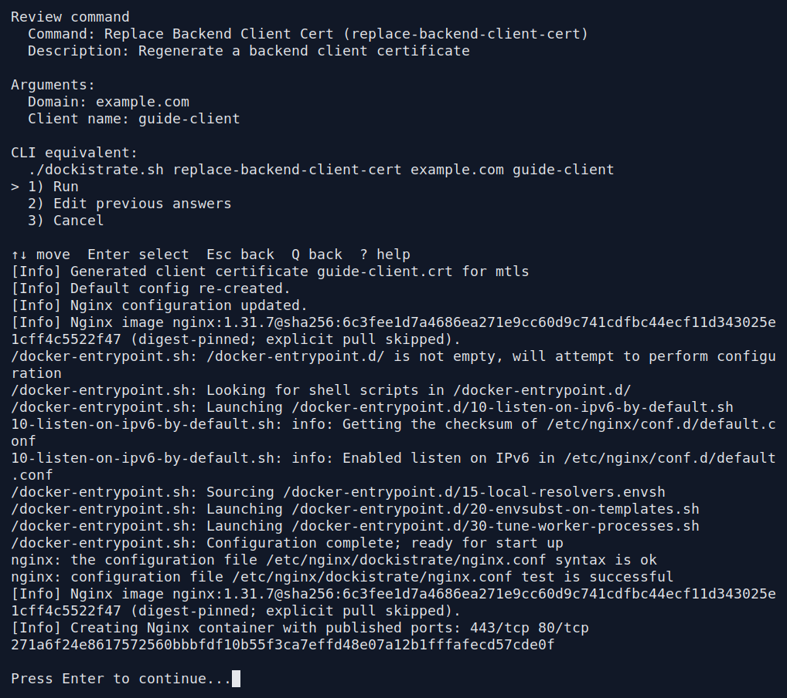

   [Read the captured terminal text](../assets/interactive/security-mtls-mtls-rotation/06-command-result.txt)

</details>

<details>
<summary>revoke-backend-client-cert — inputs and result</summary>

1. Choose **example.com**.

   

   [Read the captured terminal text](../assets/interactive/security-mtls-revoke-backend-client-cert/03-example-com.txt)

2. Enter `second-client`.

   

   [Read the captured terminal text](../assets/interactive/security-mtls-revoke-backend-client-cert/04-enter-value.txt)

3. Review the collected inputs, then choose **Run**.

   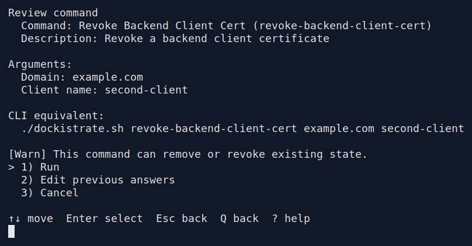

   [Read the captured terminal text](../assets/interactive/security-mtls-revoke-backend-client-cert/05-run.txt)

4. Enter `YES`.

   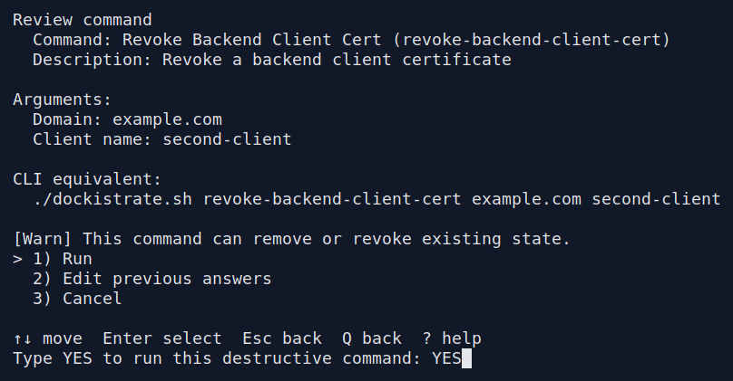

   [Read the captured terminal text](../assets/interactive/security-mtls-revoke-backend-client-cert/06-enter-value.txt)

5. Command result.

   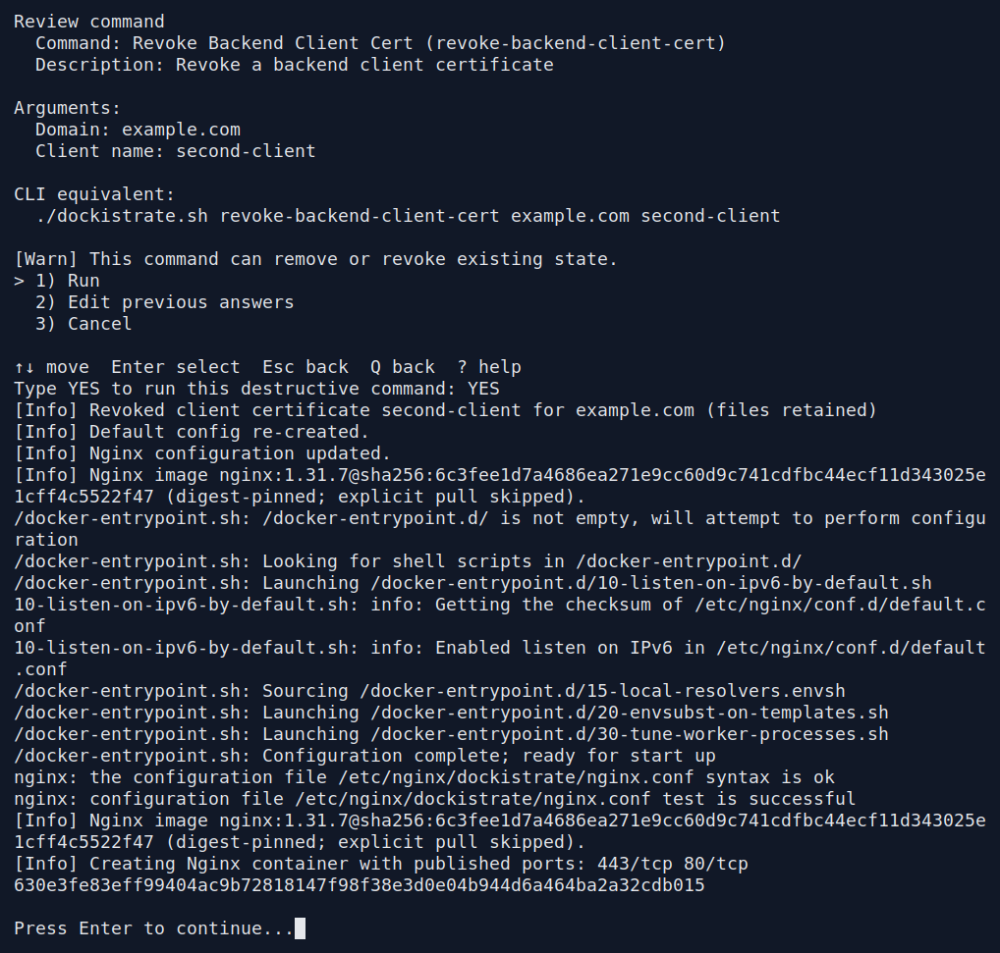

   [Read the captured terminal text](../assets/interactive/security-mtls-revoke-backend-client-cert/07-command-result.txt)

</details>

<details>
<summary>remove-backend-client-cert — inputs and result</summary>

1. Choose **example.com**.

   

   [Read the captured terminal text](../assets/interactive/security-mtls-remove-backend-client-cert/03-example-com.txt)

2. Choose **second-client**.

   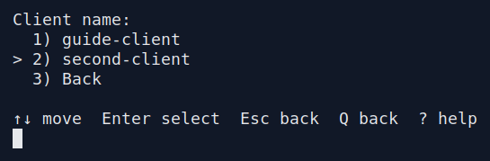

   [Read the captured terminal text](../assets/interactive/security-mtls-remove-backend-client-cert/04-second-client.txt)

3. Review the collected inputs, then choose **Run**.

   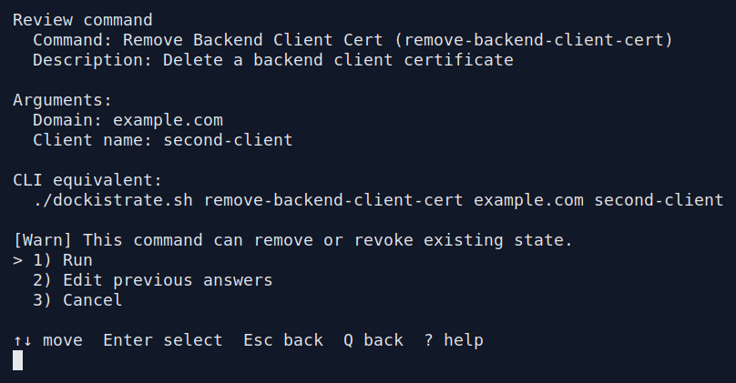

   [Read the captured terminal text](../assets/interactive/security-mtls-remove-backend-client-cert/05-run.txt)

4. Enter `YES`.

   

   [Read the captured terminal text](../assets/interactive/security-mtls-remove-backend-client-cert/06-enter-value.txt)

5. Command result.

   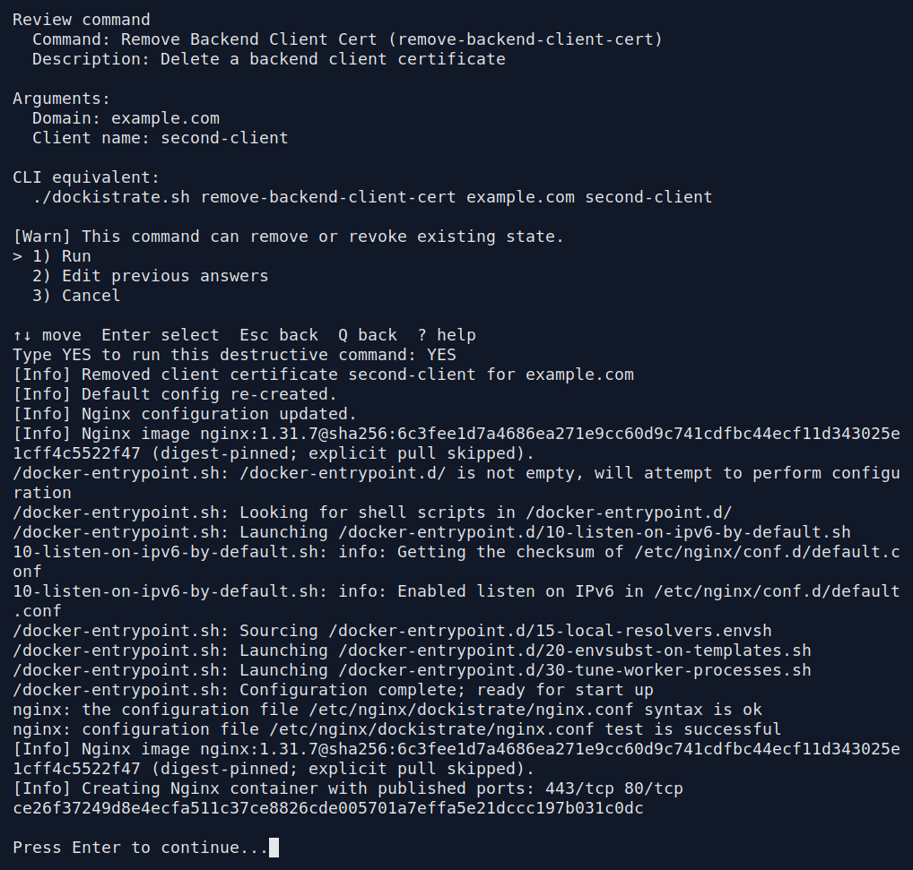

   [Read the captured terminal text](../assets/interactive/security-mtls-remove-backend-client-cert/07-command-result.txt)

</details>

<!-- /walkthrough: mtls-rotation -->

3. To revoke access without deleting local files, choose **Revoke Backend Client
   Cert**, select the domain and enter `guide-client`, review and **Run**.
   Repeat the request using that certificate: it should now be rejected.
4. For local cleanup, **Remove Backend Client Cert** revokes it and deletes its
   `.crt`/`.key` files. It does not remove a previously exported `.p12` file.
   Neither revocation nor removal has an un-revoke command; issue replacement
   credentials when access is needed again.

| Menu action and inputs | CLI equivalent after `./dockistrate.sh` | Expected result / recovery |
| --- | --- | --- |
| <a id="cmd-add-backend-client-cert"></a>**Add Backend Client Cert** → domain → new client name | `add-backend-client-cert example.com second-client` | Issue another client under the enabled authority; verify its fresh connection, revoke/remove it to undo. |
| <a id="cmd-list-backend-client-certs"></a>**List Backend Client Certs** → domain | `list-backend-client-certs example.com` | Read saved client status without initializing missing authority files; use serial/handshake checks for rotated credentials. |
| <a id="cmd-replace-backend-client-cert"></a>**Replace Backend Client Cert** → domain → client | `replace-backend-client-cert example.com guide-client` | Revoke the old credential and issue a new one with that name. Re-export and redistribute it. |
| <a id="cmd-revoke-backend-client-cert"></a>**Revoke Backend Client Cert** → domain → client name | `revoke-backend-client-cert example.com guide-client` | Publish revocation while retaining local files; test rejection of the old serial. |
| <a id="cmd-remove-backend-client-cert"></a>**Remove Backend Client Cert** → domain → client | `remove-backend-client-cert example.com guide-client` | Revoke and remove `.crt`/`.key`; separately manage exported copies. |
| <a id="cmd-disable-backend-mtls"></a>**Disable Backend mTLS** → domain | `disable-backend-mtls example.com` | Stop requiring client certificates, retain authority/client material; re-enable without a client name to reuse it. |

For every mutation in the table, inspect the review before **Run**; **Cancel**
cancels. Run **Check Config** and test both permitted and revoked/missing
credentials after an enforcement change. Do not infer authentication from the
presence of files or a successful Nginx syntax test.

## Walkthrough: replace or remove an authority

**Before starting:** mTLS must be enabled for the selected mapping. Save a
complete backup and plan client redistribution. A CA rotation is broader than
a single-client rotation: old clients stop authenticating under the new CA.

1. Choose **List Backend CAs** and identify the owning domain. Open **Replace
   Backend CA → example.com** and inspect the review. For a documentation or
   rehearsal run, choose **Cancel** here; nothing has been rotated.
2. When deliberately rotating, choose **Run**. Dockistrate creates a new CA,
   resets its issuance history and removes old local client `.crt`/`.key` files.
   It can also recover a missing authority directory for an enabled mapping.

<!-- walkthrough: mtls-authority -->

<details>
<summary>list-backend-cas — inputs and result</summary>

1. Command result.

   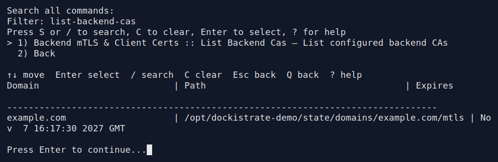

   [Read the captured terminal text](../assets/interactive/security-mtls-list-backend-cas/03-command-result.txt)

</details>

<details>
<summary>replace-backend-ca — inputs and result</summary>

1. Choose **example.com**.

   

   [Read the captured terminal text](../assets/interactive/security-mtls-mtls-authority-review/03-example-com.txt)

2. Choose **Cancel**.

   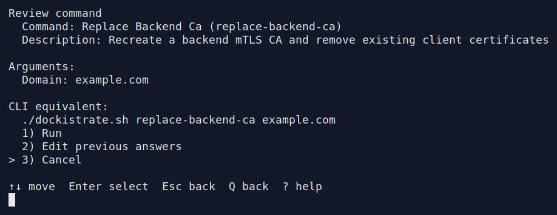

   [Read the captured terminal text](../assets/interactive/security-mtls-mtls-authority-review/04-cancel.txt)

3. Choose **Back**.

   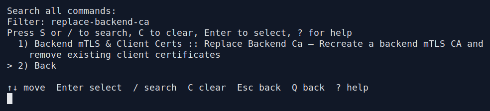

   [Read the captured terminal text](../assets/interactive/security-mtls-mtls-authority-review/05-return-without-running.txt)

</details>

<details>
<summary>replace-backend-ca — inputs and result</summary>

1. Choose **example.com**.

   

   [Read the captured terminal text](../assets/interactive/security-mtls-mtls-authority/03-example-com.txt)

2. Review the collected inputs, then choose **Run**.

   

   [Read the captured terminal text](../assets/interactive/security-mtls-mtls-authority/04-run.txt)

3. Command result.

   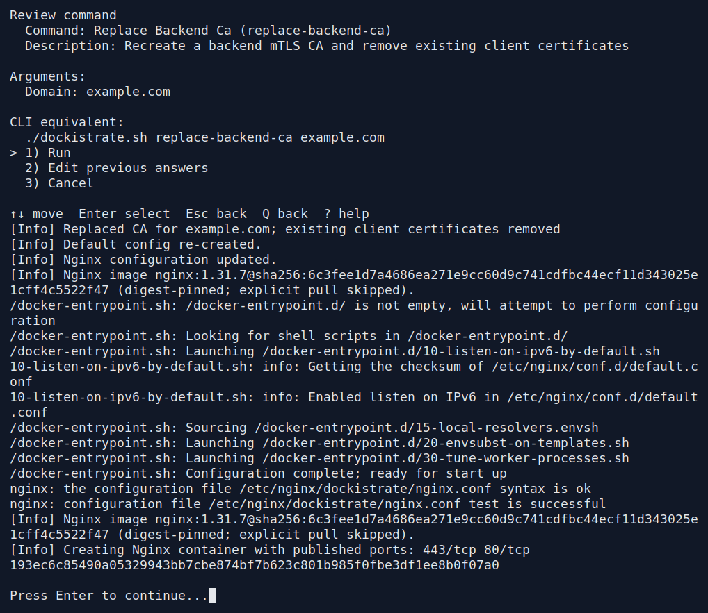

   [Read the captured terminal text](../assets/interactive/security-mtls-mtls-authority/05-command-result.txt)

</details>

<details>
<summary>add-backend-client-cert — inputs and result</summary>

1. Choose **example.com**.

   

   [Read the captured terminal text](../assets/interactive/security-mtls-mtls-new-authority-client/03-example-com.txt)

2. Enter `replacement-client`.

   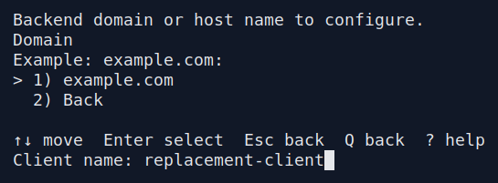

   [Read the captured terminal text](../assets/interactive/security-mtls-mtls-new-authority-client/04-enter-value.txt)

3. Review the collected inputs, then choose **Run**.

   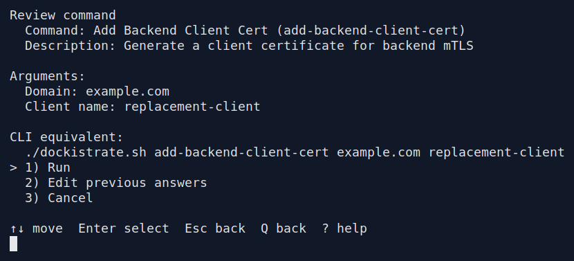

   [Read the captured terminal text](../assets/interactive/security-mtls-mtls-new-authority-client/05-run.txt)

4. Command result.

   

   [Read the captured terminal text](../assets/interactive/security-mtls-mtls-new-authority-client/06-command-result.txt)

</details>

<details>
<summary>remove-backend-ca — inputs and result</summary>

1. Choose **example.com**.

   

   [Read the captured terminal text](../assets/interactive/security-mtls-remove-backend-ca/03-example-com.txt)

2. Review the collected inputs, then choose **Run**.

   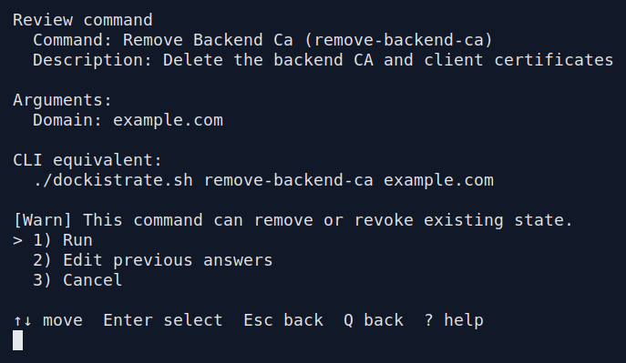

   [Read the captured terminal text](../assets/interactive/security-mtls-remove-backend-ca/04-run.txt)

3. Enter `YES`.

   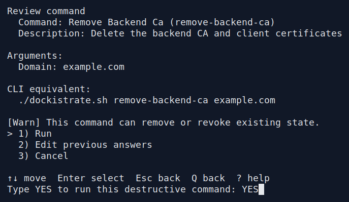

   [Read the captured terminal text](../assets/interactive/security-mtls-remove-backend-ca/05-enter-value.txt)

4. Command result.

   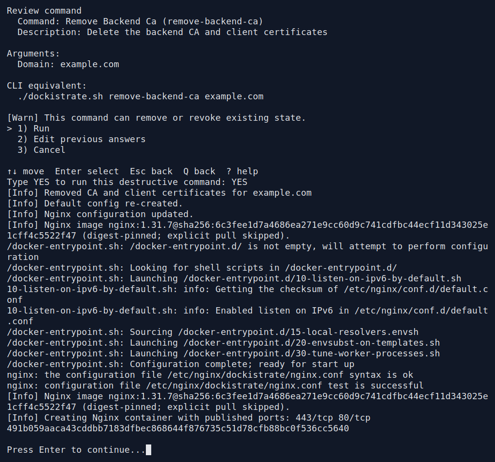

   [Read the captured terminal text](../assets/interactive/security-mtls-remove-backend-ca/06-command-result.txt)

</details>

<!-- /walkthrough: mtls-authority -->

3. Issue new clients with **Add Backend Client Cert**, distribute them and verify
   a new connection. Verify that a saved old client is rejected. Old `.p12`
   exports and copies on other devices still exist; they are not fresh credentials.
4. If intentionally retiring mTLS and its local authority, choose **Remove
   Backend CA** while the mapping is enabled, review and **Run**. It disables
   mTLS and removes the owned authority directory, including client material
   and exports there. This does not delete copies on other devices or backups.
   To stop enforcement while preserving recovery material, use **Disable
   Backend mTLS** instead.

| Menu action and inputs | CLI equivalent | Result / recovery |
| --- | --- | --- |
| <a id="cmd-list-backend-cas"></a>**List Backend CAs** | `list-backend-cas` | Inspect authorities associated with enabled mappings. |
| <a id="cmd-replace-backend-ca"></a>**Replace Backend CA** → domain | `replace-backend-ca example.com` | Replace the enabled authority; recovery requires a complete backup or newly issued clients. |
| <a id="cmd-remove-backend-ca"></a>**Remove Backend CA** → domain | `remove-backend-ca example.com` | Disable enforcement and delete the owned directory; there is no undelete command. |

Do not run authority deletion after disabling and assume retained material is
selected: these authority commands resolve an enabled mapping. A disabled
domain with damaged retained material needs complete recovery before re-enable.

## Authority integrity and storage

First-time creation differs from reuse. Re-enable, apply, restore, issue,
revoke and export require matching `ca.crt`/`ca.key`, intact `index.txt`, and valid
`serial`/`crlnumber`. Existing CRLs must be signed by the CA and include exactly
the database's revoked serials. Missing identity/history files are not silently
recreated; a missing CRL can be generated only from validated authority state.
Restore the complete authority from a backup, rather than mixing individual
files from different dates. See [mTLS backup integrity and recovery](backups-restore-cleanup.md#mtls-integrity-and-recovery).

Host-side material belongs to `state/domains/<domain>/mtls/`. CA signing keys,
client keys, exports and issuance history stay outside the default proxy mount;
only the public CA/CRL and selected server certificate material are projected
for Nginx. See [proxy certificate isolation](tls-certificates-http3.md#proxy-certificate-isolation)
for upgrade behavior, transactional recovery and connection interruption.

For manual CSV changes, use the [domain configuration workflow](domain-configuration.md).
Validation and preview do not activate a draft; only explicit apply does.
