# Path Routing

Editable path declarations live in `state/domains/<domain>/config/paths.csv`;
their additional options live in `path_options.csv` and refer to `path_id`.
Manual edits require explicit apply. See
[Domain configuration files](domain-configuration.md) for the format and workflow.

Path options let one backend route different URL prefixes with independent
WebSocket, redirect, header, target, match, priority, and rewrite behavior.

## Example

<a id="cmd-add-path-option"></a>
### Route a URL prefix to another upstream

**Before you start:** use the `example.com` HTTP backend from the README. Its
`nginx:alpine` application serves container port 80. This example strips `/api`
and forwards to that same application; use `8080` instead only if your own
application actually serves a separate API on that port.

1. Open `./dockistrate.sh -i` → **Advanced command browser** →
   **Advanced Path Routing** → **Add Path Option**.
2. Select `example.com`, listener `80`, and enter path prefix `/api`.
3. Set WebSocket `inherit`, type redirect `inherit` and header set `none`, then
   choose match **Prefix** and priority `10`. For **Upstream target**, choose
   **Enter manually...** → `80`; for **Path rewrite**, choose **Strip prefix**.
4. Choose **Reason** → **Enter manually...** → `API demo`; keep **Source
   location** at `auto`. Review the full
   path and target, then **Run**.
5. Choose **List Path Options** for `example.com` / `80`, then **Check Config**.
   Request `/api/`; the upstream should receive `/` and return its expected page.

The review names options such as **Path priority**, **Upstream target**, and
**Path rewrite**. Updates show **Current path prefix** and **New path prefix**
separately, so check both before running a replacement.

<!-- walkthrough: path-routing -->

<details>
<summary>add-path-option — inputs and result</summary>

1. Choose **example.com**.

   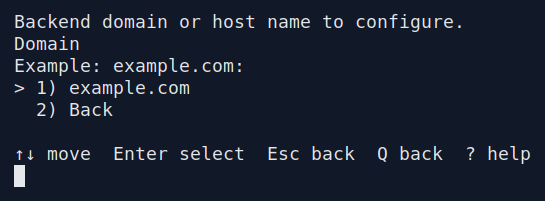

   [Read the captured terminal text](../assets/interactive/core-routing-path-routing/03-example-com.txt)

2. Choose **80 -> 80 proto=http ws=no cert=none**.

   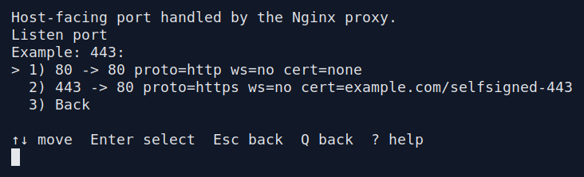

   [Read the captured terminal text](../assets/interactive/core-routing-path-routing/04-80-80-proto-http-ws-no-cert-none.txt)

3. Enter `/api`.

   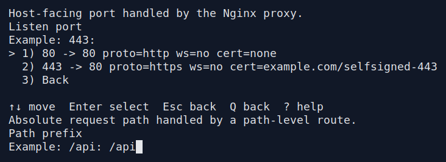

   [Read the captured terminal text](../assets/interactive/core-routing-path-routing/05-enter-value.txt)

4. Choose **inherit (current)**.

   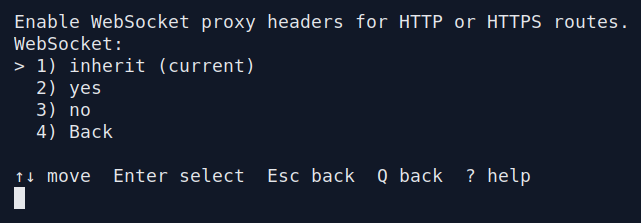

   [Read the captured terminal text](../assets/interactive/core-routing-path-routing/06-inherit-current.txt)

5. Enter `inherit`.

   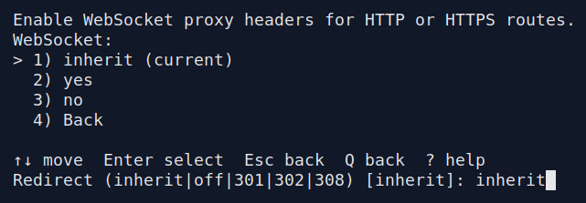

   [Read the captured terminal text](../assets/interactive/core-routing-path-routing/07-enter-value.txt)

6. Enter `none`.

   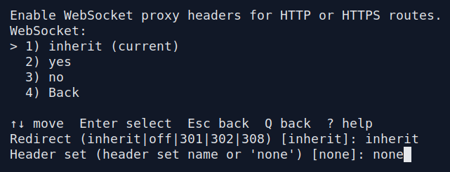

   [Read the captured terminal text](../assets/interactive/core-routing-path-routing/08-enter-value.txt)

7. Choose **Prefix (current)**.

   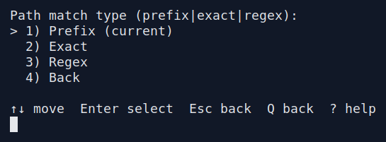

   [Read the captured terminal text](../assets/interactive/core-routing-path-routing/09-prefix-current.txt)

8. Choose **10**.

   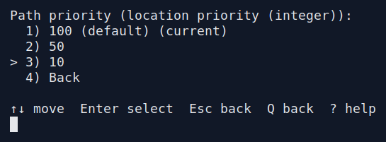

   [Read the captured terminal text](../assets/interactive/core-routing-path-routing/10-10.txt)

9. Choose **Enter manually...**.

   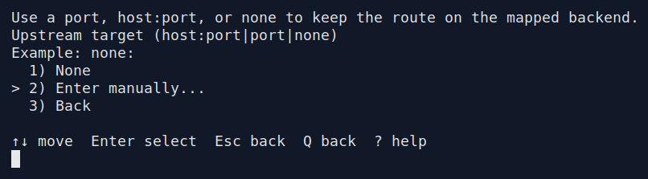

   [Read the captured terminal text](../assets/interactive/core-routing-path-routing/11-enter-manually.txt)

10. Enter `80`.

    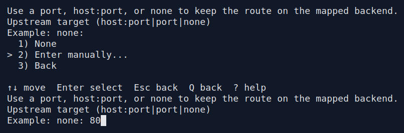

    [Read the captured terminal text](../assets/interactive/core-routing-path-routing/12-enter-value.txt)

11. Choose **Strip prefix**.

    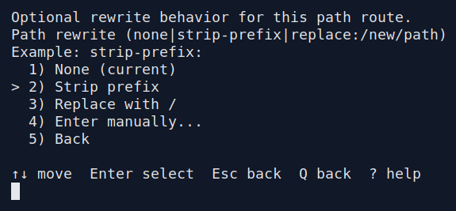

    [Read the captured terminal text](../assets/interactive/core-routing-path-routing/13-strip-prefix.txt)

12. Choose **Enter manually...**.

    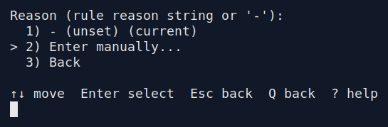

    [Read the captured terminal text](../assets/interactive/core-routing-path-routing/14-enter-manually.txt)

13. Enter `API demo`.

    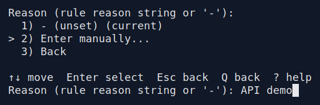

    [Read the captured terminal text](../assets/interactive/core-routing-path-routing/15-enter-value.txt)

14. Choose **auto (current)**.

    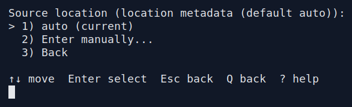

    [Read the captured terminal text](../assets/interactive/core-routing-path-routing/16-auto-current.txt)

15. Review the collected inputs, then choose **Run**.

    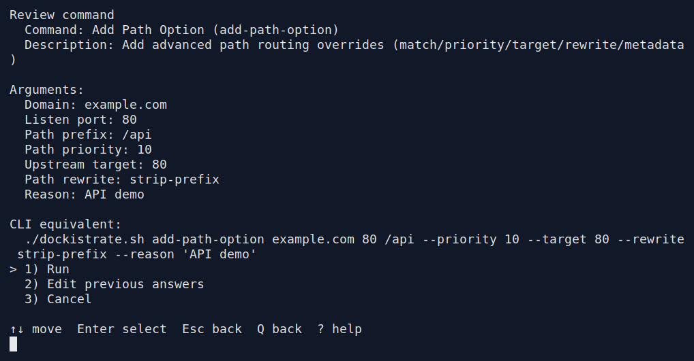

    [Read the captured terminal text](../assets/interactive/core-routing-path-routing/17-review-and-run-add-path-option.txt)

16. add-path-option result.

    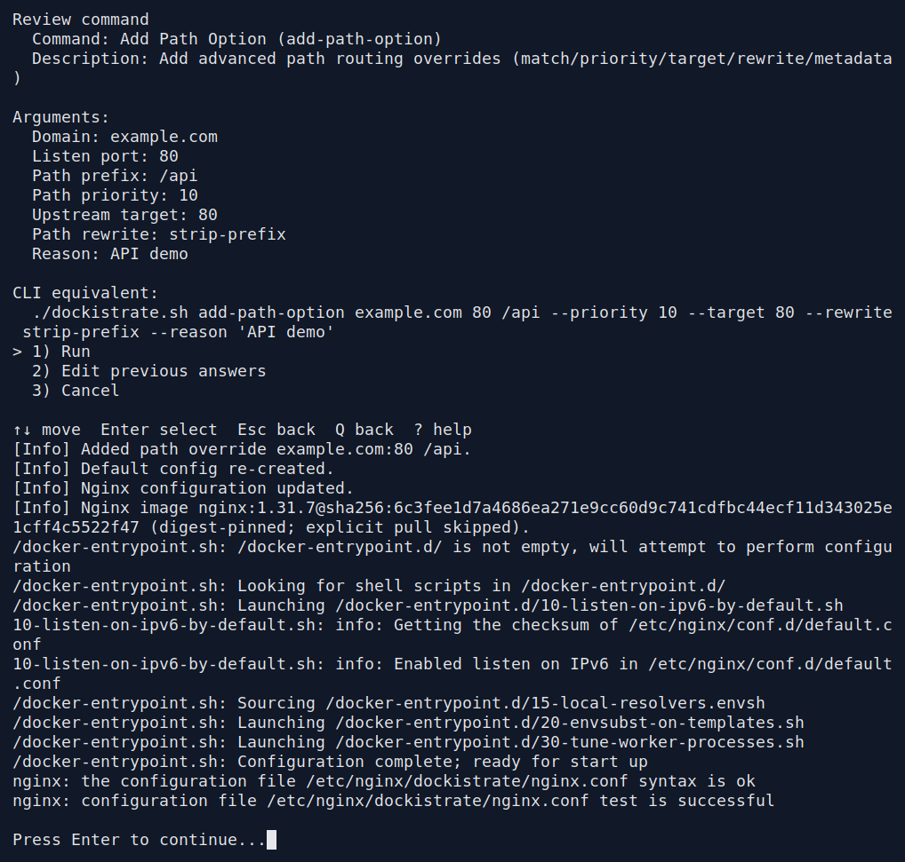

    [Read the captured terminal text](../assets/interactive/core-routing-path-routing/18-add-path-option-result.txt)

</details>

<details>
<summary>list-path-options — inputs and result</summary>

1. Choose **example.com**.

   

   [Read the captured terminal text](../assets/interactive/core-routing-list-path-options/03-example-com.txt)

2. Enter `80`.

   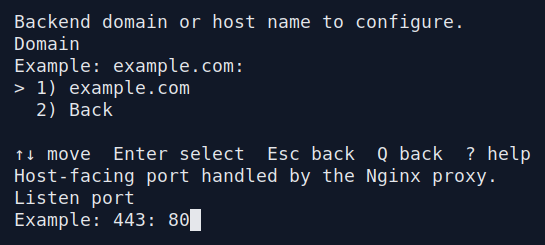

   [Read the captured terminal text](../assets/interactive/core-routing-list-path-options/04-enter-value.txt)

3. list-path-options result.

   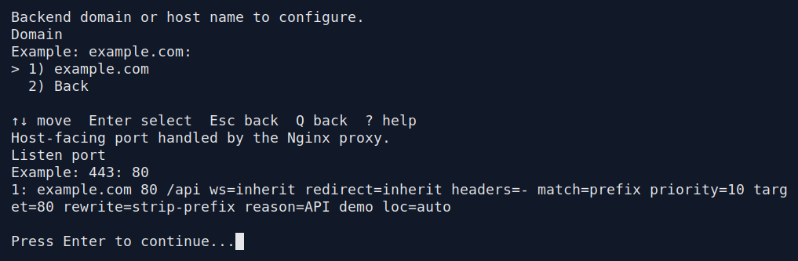

   [Read the captured terminal text](../assets/interactive/core-routing-list-path-options/05-list-path-options-result.txt)

</details>

<details>
<summary>Verify the application response</summary>

1. Verify the application response.

   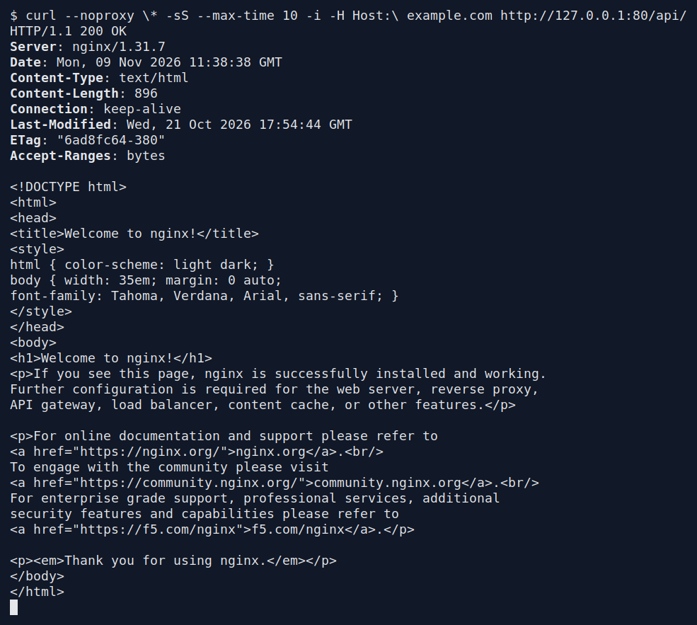

   [Read the captured terminal text](../assets/interactive/core-routing-path-prefix-rewrite/01-verify-the-application-response.txt)

</details>

<details>
<summary>update-path-option — inputs and result</summary>

1. Choose **example.com**.

   

   [Read the captured terminal text](../assets/interactive/core-routing-path-update/03-example-com.txt)

2. Choose **80 -> 80 proto=http ws=no cert=none**.

   

   [Read the captured terminal text](../assets/interactive/core-routing-path-update/04-80-80-proto-http-ws-no-cert-none.txt)

3. Choose **/api**.

   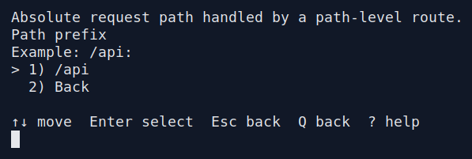

   [Read the captured terminal text](../assets/interactive/core-routing-path-update/05-api.txt)

4. Enter `/service`.

   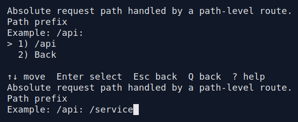

   [Read the captured terminal text](../assets/interactive/core-routing-path-update/06-enter-value.txt)

5. Press Enter to accept the displayed default or leave the optional value blank.

   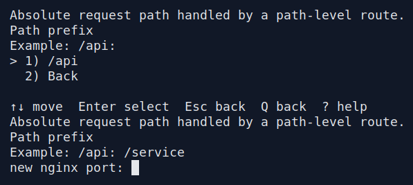

   [Read the captured terminal text](../assets/interactive/core-routing-path-update/07-enter-value.txt)

6. Choose **inherit**.

   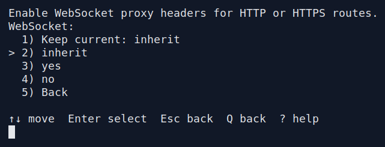

   [Read the captured terminal text](../assets/interactive/core-routing-path-update/08-inherit.txt)

7. Enter `inherit`.

   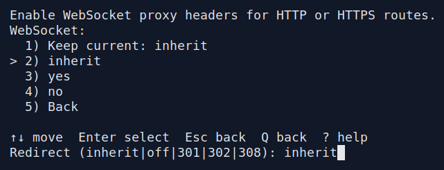

   [Read the captured terminal text](../assets/interactive/core-routing-path-update/09-enter-value.txt)

8. Enter `none`.

   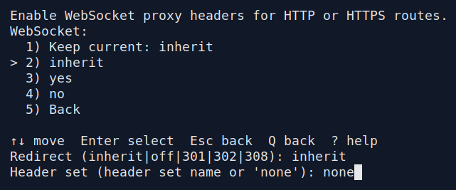

   [Read the captured terminal text](../assets/interactive/core-routing-path-update/10-enter-value.txt)

9. Choose **Prefix**.

   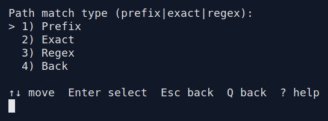

   [Read the captured terminal text](../assets/interactive/core-routing-path-update/11-prefix.txt)

10. Choose **50**.

    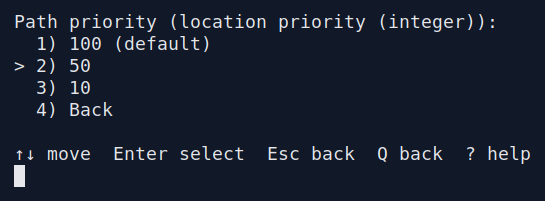

    [Read the captured terminal text](../assets/interactive/core-routing-path-update/12-50.txt)

11. Choose **Enter manually...**.

    

    [Read the captured terminal text](../assets/interactive/core-routing-path-update/13-enter-manually.txt)

12. Enter `80`.

    

    [Read the captured terminal text](../assets/interactive/core-routing-path-update/14-enter-value.txt)

13. Choose **Strip prefix**.

    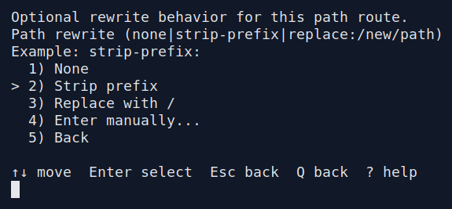

    [Read the captured terminal text](../assets/interactive/core-routing-path-update/15-strip-prefix.txt)

14. Choose **Enter manually...**.

    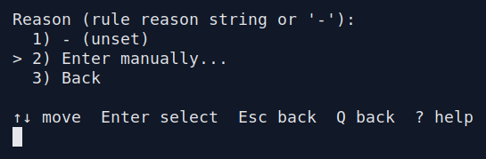

    [Read the captured terminal text](../assets/interactive/core-routing-path-update/16-enter-manually.txt)

15. Enter `Service demo`.

    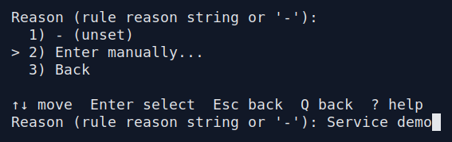

    [Read the captured terminal text](../assets/interactive/core-routing-path-update/17-enter-value.txt)

16. Choose **auto**.

    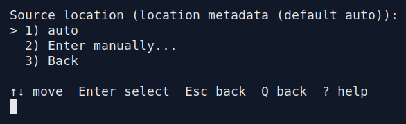

    [Read the captured terminal text](../assets/interactive/core-routing-path-update/18-auto.txt)

17. Review the collected inputs, then choose **Run**.

    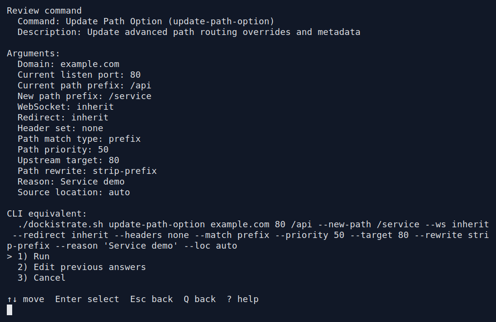

    [Read the captured terminal text](../assets/interactive/core-routing-path-update/19-review-and-run-update-path-option.txt)

18. update-path-option result.

    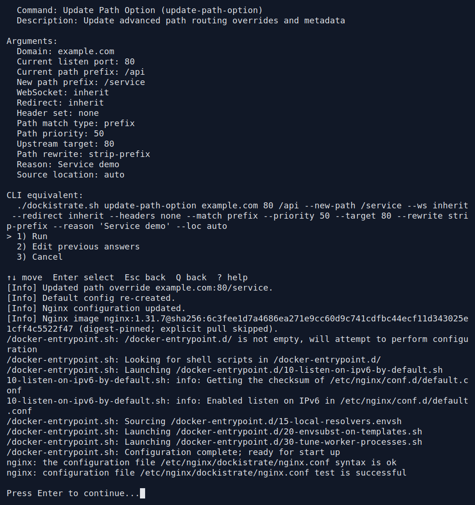

    [Read the captured terminal text](../assets/interactive/core-routing-path-update/20-update-path-option-result.txt)

</details>

<details>
<summary>Verify the application response</summary>

1. Verify the application response.

   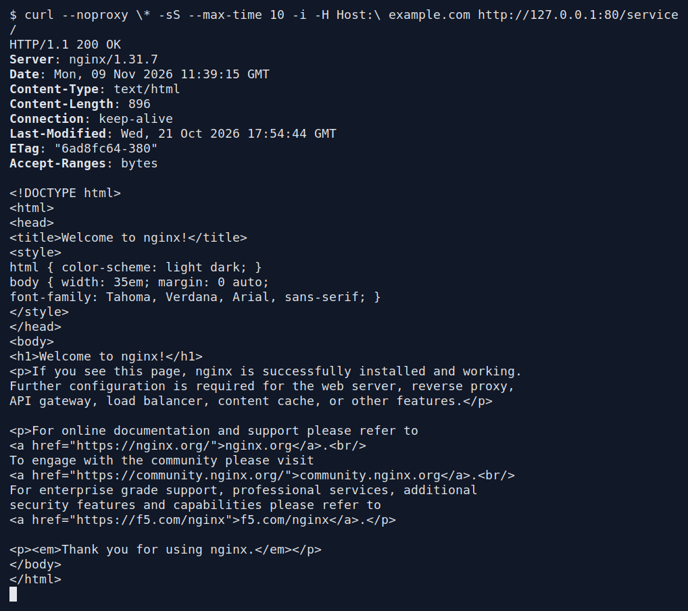

   [Read the captured terminal text](../assets/interactive/core-routing-updated-prefix-rewrite/01-verify-the-application-response.txt)

</details>

<details>
<summary>remove-path-option — inputs and result</summary>

1. Choose **example.com**.

   

   [Read the captured terminal text](../assets/interactive/core-routing-path-remove/03-example-com.txt)

2. Choose **80 -> 80 proto=http ws=no cert=none**.

   

   [Read the captured terminal text](../assets/interactive/core-routing-path-remove/04-80-80-proto-http-ws-no-cert-none.txt)

3. Choose **/service**.

   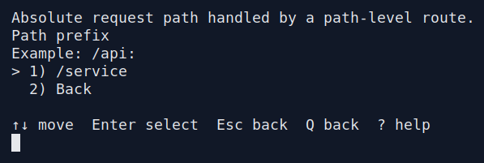

   [Read the captured terminal text](../assets/interactive/core-routing-path-remove/05-service.txt)

4. Review the collected inputs, then choose **Run**.

   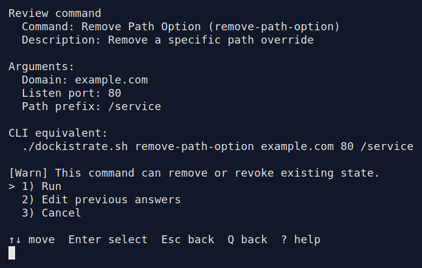

   [Read the captured terminal text](../assets/interactive/core-routing-path-remove/06-review-and-run-remove-path-option.txt)

5. Enter `YES`.

   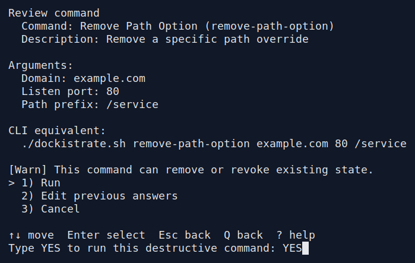

   [Read the captured terminal text](../assets/interactive/core-routing-path-remove/07-confirm-removal.txt)

6. remove-path-option result.

   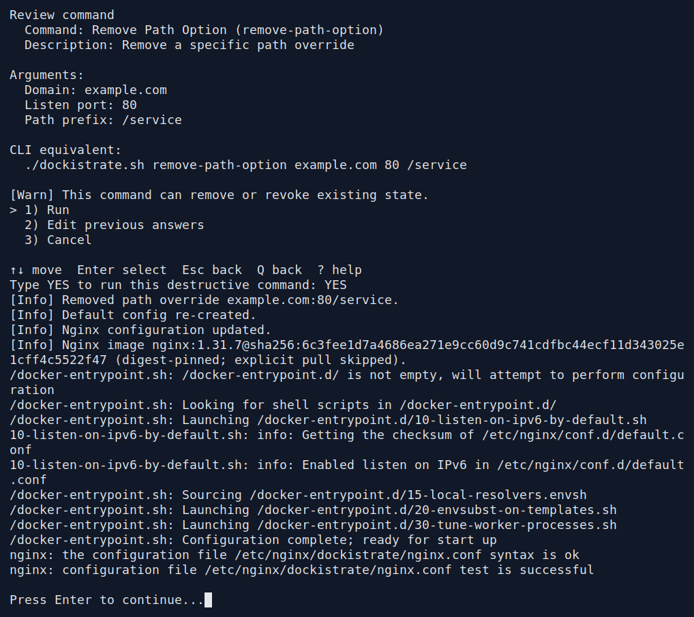

   [Read the captured terminal text](../assets/interactive/core-routing-path-remove/08-remove-path-option-result.txt)

</details>

<details>
<summary>remove-all-path-options — inputs and result</summary>

1. Choose **example.com**.

   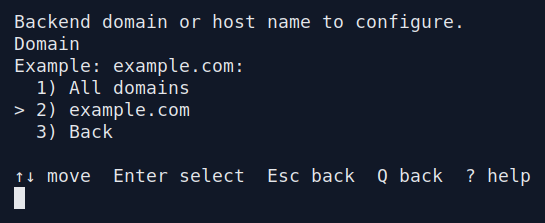

   [Read the captured terminal text](../assets/interactive/core-routing-path-remove-all/03-example-com.txt)

2. Review the collected inputs, then choose **Run**.

   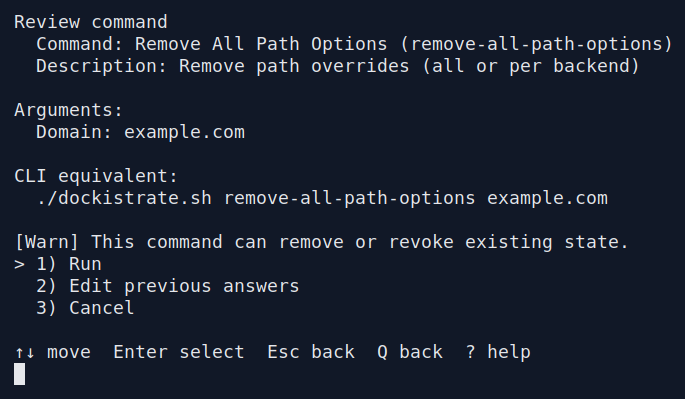

   [Read the captured terminal text](../assets/interactive/core-routing-path-remove-all/04-review-and-run-remove-all-path-options.txt)

3. Enter `YES`.

   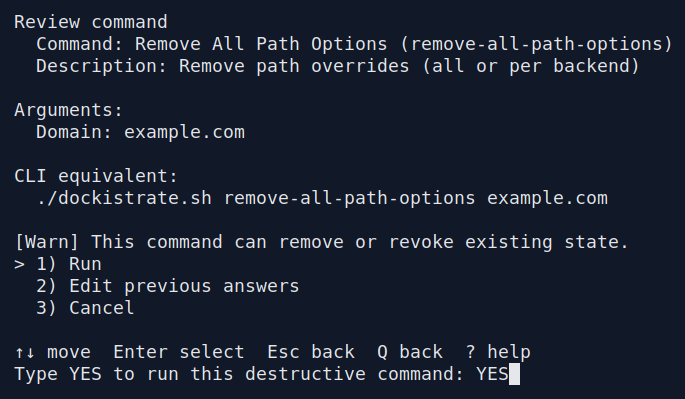

   [Read the captured terminal text](../assets/interactive/core-routing-path-remove-all/05-confirm-removal.txt)

4. remove-all-path-options result.

   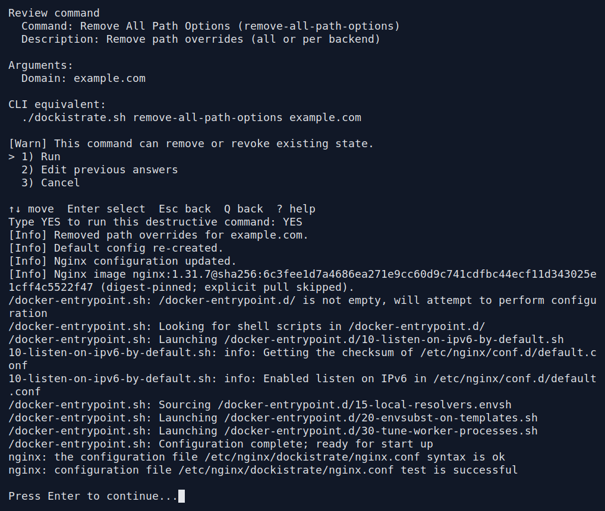

   [Read the captured terminal text](../assets/interactive/core-routing-path-remove-all/06-remove-all-path-options-result.txt)

</details>

<!-- /walkthrough: path-routing -->

```bash
./dockistrate.sh add-path-option example.com 80 /api \
  --target 80 --match prefix --priority 10 \
  --rewrite strip-prefix --reason "API demo"
./dockistrate.sh list-path-options example.com 80
```

The other match choices are `exact` and `regex`. Target can be another backend
port or `host:port`; rewrite can retain the URL (`none`) or replace its prefix
(`replace:/new/path`). A header-set name must refer to the intended prepared
[header include](#header-sets); `none` does not add one.

### Edit, list, and remove paths

All operations below are in **Advanced Path Routing**. Changes use review →
**Run**; removals also require `YES`. Listing runs directly after its filters.
Choose a stored path by its full literal value, including any `|` or regex
characters. CLI arguments containing shell metacharacters must be quoted.

| Operation | Interactive inputs and check | CLI equivalent |
| --- | --- | --- |
| <a id="cmd-update-path-option"></a>Update Path Option | Domain → listener → existing path. Enter a new path/listener or keep them, then keep/change WebSocket, redirect, headers, match, priority, target, rewrite, reason, and location metadata. Blank or **Keep current**, as displayed, retains the saved value. Review → Run; list and request the resulting URL. Restore the previous values to undo. | `update-path-option example.com 80 /api --priority 20` |
| <a id="cmd-list-path-options"></a>List Path Options | Choose the domain and enter a listener (blank leaves the listener filter unset). Inspect effective rows and overrides. | `list-path-options example.com 80` (omit filters for all) |
| <a id="cmd-remove-path-option"></a>Remove Path Option | Domain → listener → complete path → review → Run. Check the row is absent; the listener's remaining routes handle subsequent requests. Re-add the declaration and its associated directives to restore it. | `remove-path-option example.com 80 /api` |
| <a id="cmd-remove-all-path-options"></a>Remove All Path Options | Select one backend or **All domains** → review → Run. Check the selected scope has no path rows. Save path declarations/directives first if restoration is needed. | `remove-all-path-options example.com` (omit domain for all) |

## Common Commands

```text
add-path-option <domain> <nginx_port> <path_prefix> [--ws yes|no|inherit] [--redirect inherit|off|301|302|308] [--headers name|none] [--match prefix|exact|regex] [--priority int] [--target port|host:port] [--rewrite none|strip-prefix|replace:/path] [--reason text] [--loc text]
update-path-option <domain> <nginx_port> <path_prefix> [options]
remove-path-option <domain> <nginx_port> <path_prefix>
remove-all-path-options [domain]
list-path-options [domain] [nginx_port]
```

## Match and Priority

Path prefixes must start with `/` and cannot contain Nginx structure characters
such as `#`, `;`, `{`, or `}`. During config generation, path locations are
inserted before the catch-all `/` route. Lower numeric `--priority` values are
emitted first; when priorities tie, longer path prefixes are emitted first.
Nginx still evaluates each location according to its match mode.
Priorities are decimal: `010` means 10 and sorts after 9; `08` means 8.
The same interpretation applies to CLI, interactive, and CSV changes.

Use `inherit` when a path should keep port-level WebSocket or redirect behavior:

```bash
./dockistrate.sh add-path-option example.com 80 /socket --ws inherit
```

## Header Sets

If a path references a header set, Dockistrate includes the corresponding file
under `state/config/nginx_conf/conf.d/path_headers/` inside that location. This
keeps path-specific headers separate from global or backend headers.

Persisted header-set names are validated again during cleanup before an include
can be removed; invalid state fails closed with its source line identified.
Include deletion uses the managed-root safe-delete guard. Shared consumers are
calculated while holding the same lock as the mutation, preventing stale
pre-lock data from deleting an include that is still in use.

```bash
./dockistrate.sh add-path-option example.com 80 /admin --headers admin-only
```

## Verification

The `/api` example uses the application on the backend's port 80.
For an isolated **public demo**, the policy below opens both ACL address layers
for the demo domain. Private services should retain `deny` and configure both
[client and original-peer allowances](access-control-security-rules.md#address-layers-and-private-services).
The curl request uses IPv4; the public policy does not restrict access to IPv4.

```bash
./dockistrate.sh list-path-options example.com 80
./dockistrate.sh check-config
./dockistrate.sh set-backend-acl-policy example.com allow
curl --noproxy '*' -i http://127.0.0.1/api -H 'Host: example.com'
```

For menu setup and diagnosis, see [interactive workflows](interactive-workflows.md).

## Cleanup

```bash
./dockistrate.sh remove-path-option example.com 80 /api
./dockistrate.sh remove-all-path-options example.com
```

Removing a port also removes its associated path options.

Both removal commands work through the CLI and interactive menus. Single-path
removal matches the domain, listener, and complete literal path; quote paths
such as `'/api|assets'` when using the CLI. Removal also deletes all managed and
raw Nginx directives attached to that target, including dedicated-host overrides
that refer to the backend path. This includes saved overrides on hosts whose
path inheritance is currently disabled.

`remove-all-path-options example.com` removes that backend's paths across its
listeners and the corresponding path directives on its dedicated hosts. Omit
the domain to remove all path overrides and path-scoped directives. Paths with
`--headers none` are included. Other domains remain unchanged during
domain-specific removal, and global, backend, and listener directives are kept.

Path and directive cleanup is one transaction: a cleanup or activation failure
restores the previous active configuration. Pending manual edits on affected
domains are protected; apply or discard them explicitly before retrying.
