# TLS, Certificates, and HTTP/3

Start with `./dockistrate.sh -i` to choose certificate material, configure a
listener and check what clients receive. The screenshots come from live runs
on disposable servers. Recording details identify the source
revisions and passed [local certificate checks](../assets/interactive/security-certificates-provenance.json)
and [TLS/HTTP/3 checks](../assets/interactive/security-tls-provenance.json).
Public Let's Encrypt issuance remains **not live verified**; see its prerequisites below.

List/show commands run directly without a mutation review. For **Remove…** or
**Revoke…**, choosing **Run** is followed by **Type YES to run this
destructive command:**; enter `YES` only when the displayed scope is intended.

## Walkthrough: add a local HTTPS certificate

**Before starting:** have a backend such as `example.com` serving HTTP internally,
Docker and OpenSSL available, and an unused host port such as `8443`. Record
existing listeners and redirects. Allow the test client through both ACL layers
or deliberately use a public demo policy; see the
[access guide](access-control-security-rules.md#address-layers-and-private-services).
Immediate commands must not overwrite pending manual domain edits.

1. Open **Certificates → Add Cert**, choose `example.com`, then **Enter
   manually...** for **Certificate port suffix**. Enter `8443` and choose
   **Generate self-signed certificate**.
2. Review the domain, suffix and certificate type, then **Run**. For an existing
   backend, addition can create a missing HTTPS listener and HTTP mapping.
   Answer **yes** to **Redirect HTTP port … to HTTPS?** and confirm `8443` at
   **Redirect target port** for this example. Choose **no** if you want to
   retain HTTP access; the upload example below demonstrates that choice.

<!-- walkthrough: certificates -->

<details>
<summary>add-cert — inputs and result</summary>

1. Choose **example.com**.

   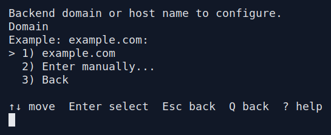

   [Read the captured terminal text](../assets/interactive/security-certificates-certificates/03-example-com.txt)

2. Choose **Enter manually...**.

   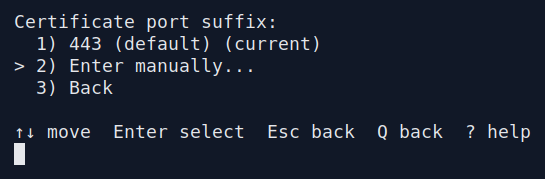

   [Read the captured terminal text](../assets/interactive/security-certificates-certificates/04-enter-manually.txt)

3. Enter `8443`.

   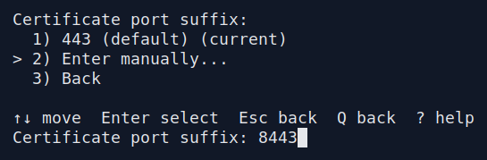

   [Read the captured terminal text](../assets/interactive/security-certificates-certificates/05-enter-value.txt)

4. Choose **Generate self-signed certificate (current)**.

   

   [Read the captured terminal text](../assets/interactive/security-certificates-certificates/06-generate-self-signed-certificate-current.txt)

5. Review the collected inputs, then choose **Run**.

   

   [Read the captured terminal text](../assets/interactive/security-certificates-certificates/07-run.txt)

6. Enter `yes`.

   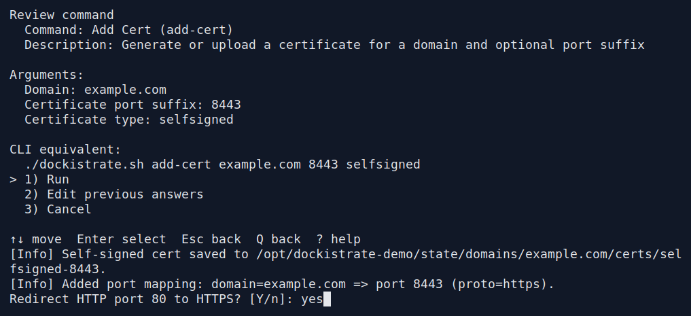

   [Read the captured terminal text](../assets/interactive/security-certificates-certificates/08-enter-value.txt)

7. Enter `8443`.

   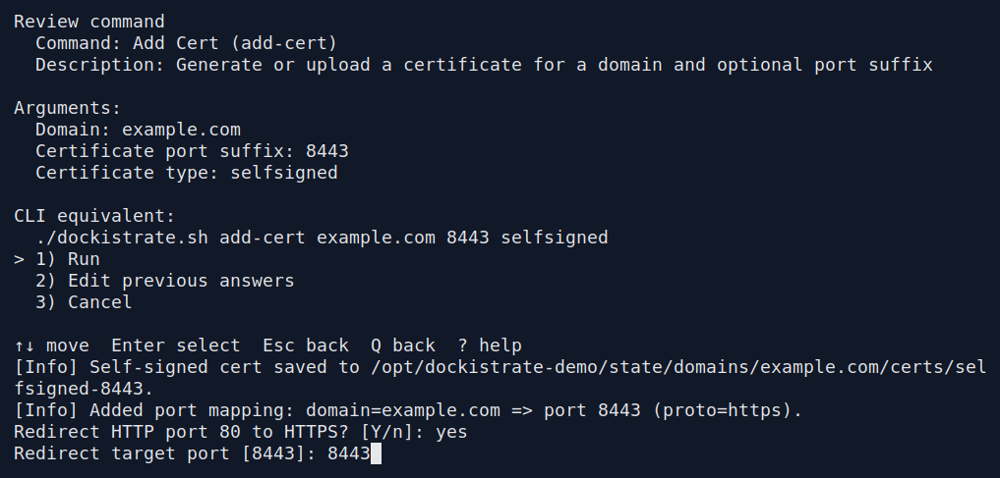

   [Read the captured terminal text](../assets/interactive/security-certificates-certificates/09-enter-value.txt)

8. Command result.

   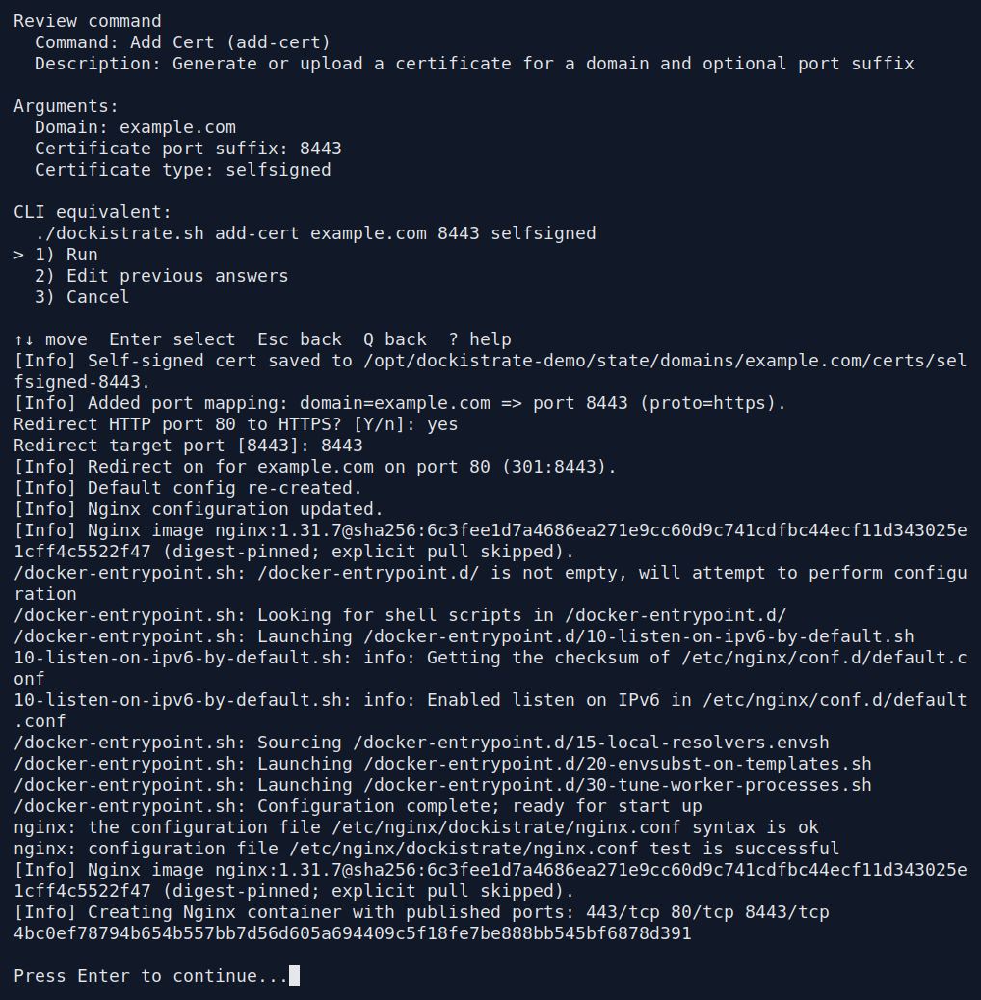

   [Read the captured terminal text](../assets/interactive/security-certificates-certificates/10-command-result.txt)

</details>

<details>
<summary>list-certs — inputs and result</summary>

1. Command result.

   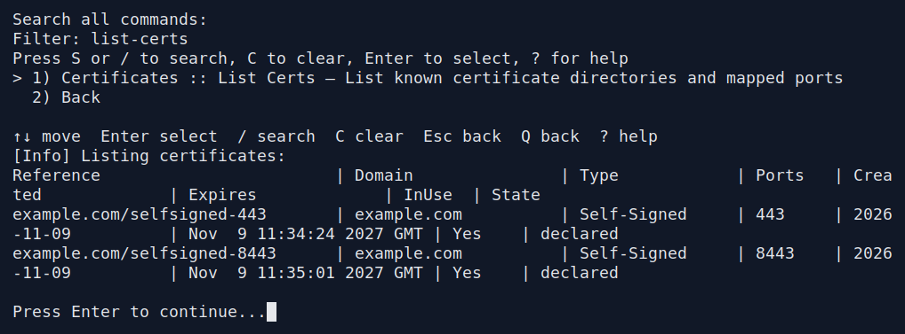

   [Read the captured terminal text](../assets/interactive/security-certificates-list-certs/03-command-result.txt)

</details>

<details>
<summary>replace-cert — inputs and result</summary>

1. Choose **example.com**.

   

   [Read the captured terminal text](../assets/interactive/security-certificates-replace-cert/03-example-com.txt)

2. Choose **8443**.

   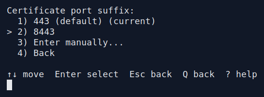

   [Read the captured terminal text](../assets/interactive/security-certificates-replace-cert/04-8443.txt)

3. Choose **Generate self-signed certificate (current)**.

   

   [Read the captured terminal text](../assets/interactive/security-certificates-replace-cert/05-generate-self-signed-certificate-current.txt)

4. Review the collected inputs, then choose **Run**.

   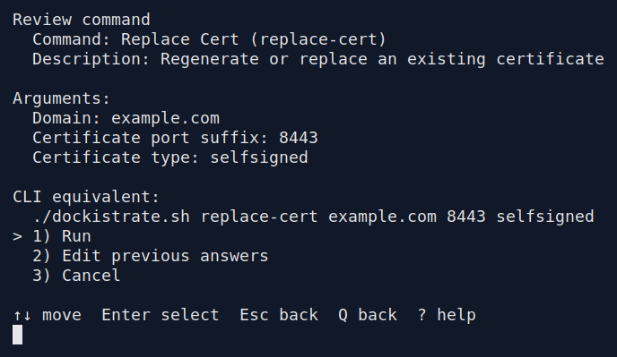

   [Read the captured terminal text](../assets/interactive/security-certificates-replace-cert/06-run.txt)

5. Command result.

   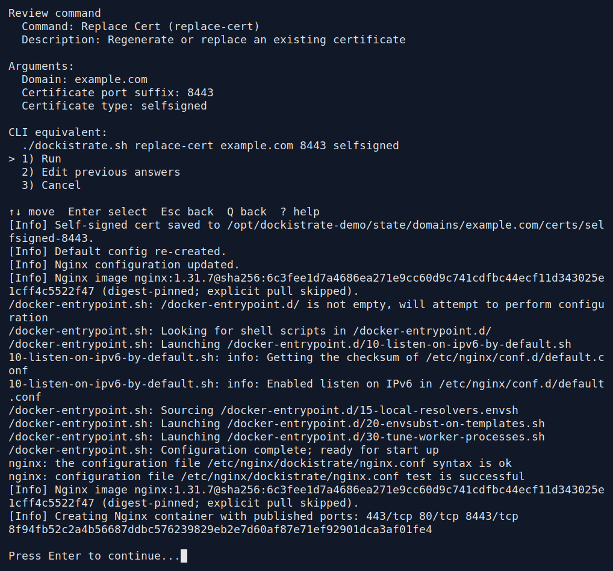

   [Read the captured terminal text](../assets/interactive/security-certificates-replace-cert/07-command-result.txt)

</details>

<details>
<summary>Trust the owned certificate and request HTTPS</summary>

1. Trust the owned certificate and request HTTPS.

   

   [Read the captured terminal text](../assets/interactive/security-certificates-certificate-local-trust/01-trust-the-owned-certificate-and-request-https.txt)

</details>

<details>
<summary>add-cert — inputs and result</summary>

1. Choose **example.com**.

   

   [Read the captured terminal text](../assets/interactive/security-certificates-certificate-acme-prerequisites/03-example-com.txt)

2. Choose **Enter manually...**.

   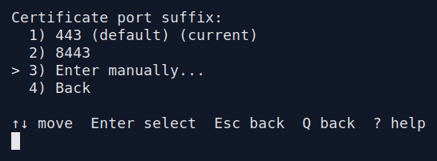

   [Read the captured terminal text](../assets/interactive/security-certificates-certificate-acme-prerequisites/04-enter-manually.txt)

3. Enter `9443`.

   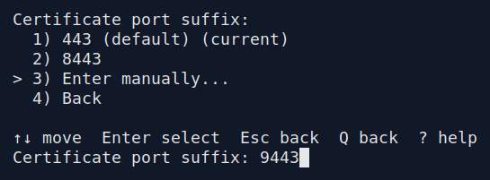

   [Read the captured terminal text](../assets/interactive/security-certificates-certificate-acme-prerequisites/05-enter-value.txt)

4. Choose **Generate Let's Encrypt certificate**.

   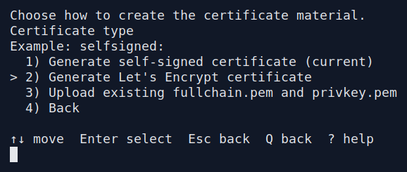

   [Read the captured terminal text](../assets/interactive/security-certificates-certificate-acme-prerequisites/06-generate-let-s-encrypt-certificate.txt)

5. Choose **Cancel**.

   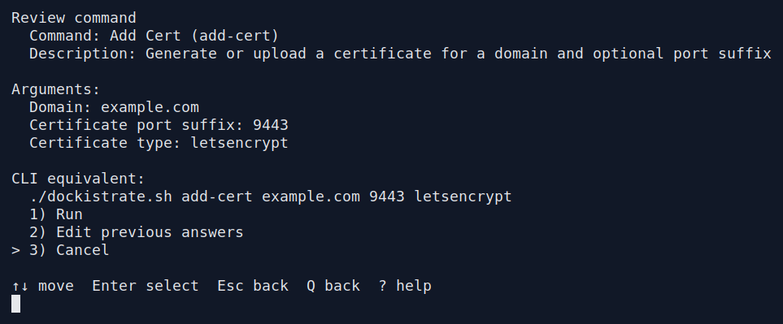

   [Read the captured terminal text](../assets/interactive/security-certificates-certificate-acme-prerequisites/07-cancel.txt)

6. Choose **Back**.

   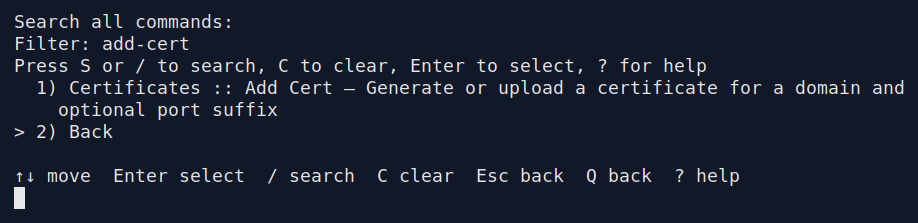

   [Read the captured terminal text](../assets/interactive/security-certificates-certificate-acme-prerequisites/08-return-without-running.txt)

</details>

<details>
<summary>renew-certs — inputs and result</summary>

1. Choose **Cancel**.

   

   [Read the captured terminal text](../assets/interactive/security-certificates-certificate-renewal-review/03-cancel.txt)

2. Choose **Back**.

   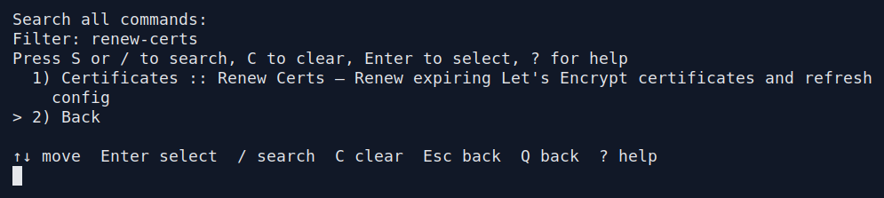

   [Read the captured terminal text](../assets/interactive/security-certificates-certificate-renewal-review/04-return-without-running.txt)

</details>

<details>
<summary>renew-certs — inputs and result</summary>

1. Review the collected inputs, then choose **Run**.

   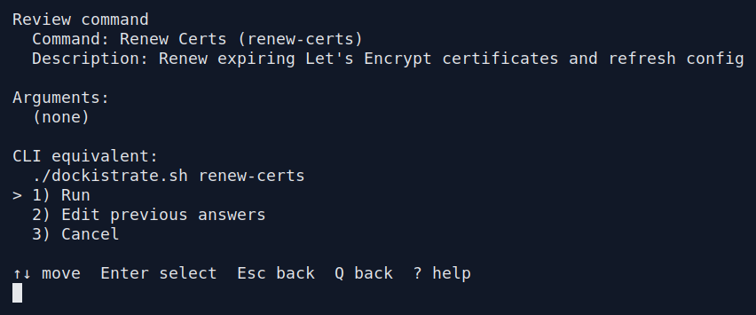

   [Read the captured terminal text](../assets/interactive/security-certificates-certificate-renewal-scan/03-run.txt)

2. Command result.

   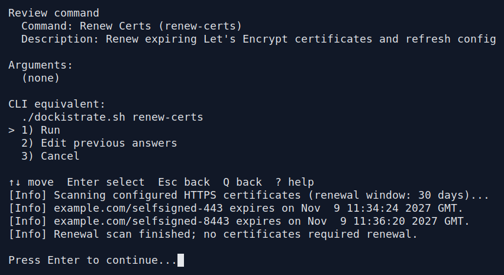

   [Read the captured terminal text](../assets/interactive/security-certificates-certificate-renewal-scan/04-command-result.txt)

</details>

<details>
<summary>add-cert — inputs and result</summary>

1. Choose **example.com**.

   

   [Read the captured terminal text](../assets/interactive/security-certificates-certificate-upload/03-example-com.txt)

2. Choose **Enter manually...**.

   

   [Read the captured terminal text](../assets/interactive/security-certificates-certificate-upload/04-enter-manually.txt)

3. Enter `9443`.

   

   [Read the captured terminal text](../assets/interactive/security-certificates-certificate-upload/05-enter-value.txt)

4. Choose **Upload existing fullchain.pem and privkey.pem**.

   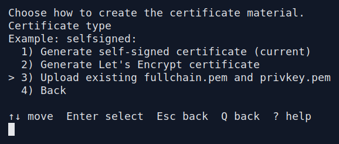

   [Read the captured terminal text](../assets/interactive/security-certificates-certificate-upload/06-upload-existing-fullchain-pem-and-privkey-pem.txt)

5. Enter `/opt/dockistrate-demo/state/domains/example.com/certs/selfsigned-443/fullchain.pem`.

   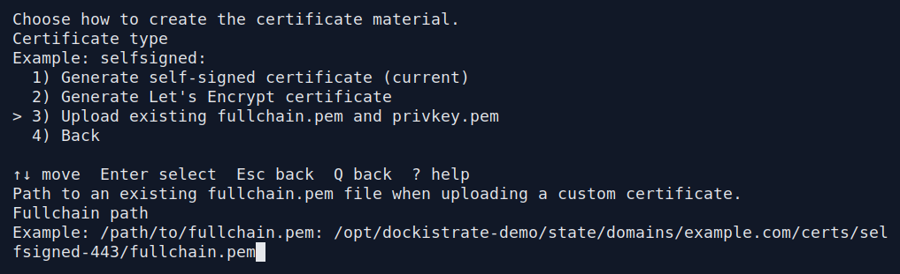

   [Read the captured terminal text](../assets/interactive/security-certificates-certificate-upload/07-enter-value.txt)

6. Enter `/opt/dockistrate-demo/state/domains/example.com/certs/selfsigned-443/privkey.pem`.

   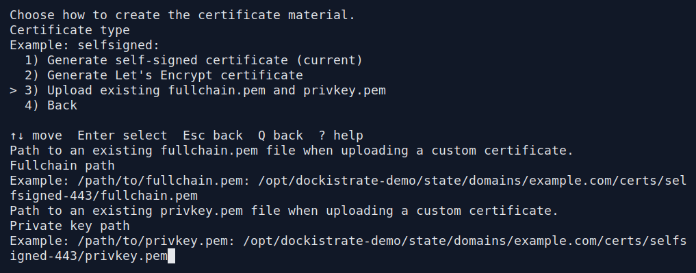

   [Read the captured terminal text](../assets/interactive/security-certificates-certificate-upload/08-enter-value.txt)

7. Review the collected inputs, then choose **Run**.

   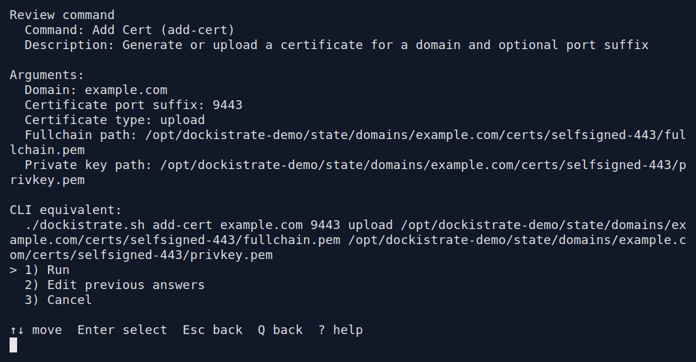

   [Read the captured terminal text](../assets/interactive/security-certificates-certificate-upload/09-run.txt)

8. Enter `no`.

   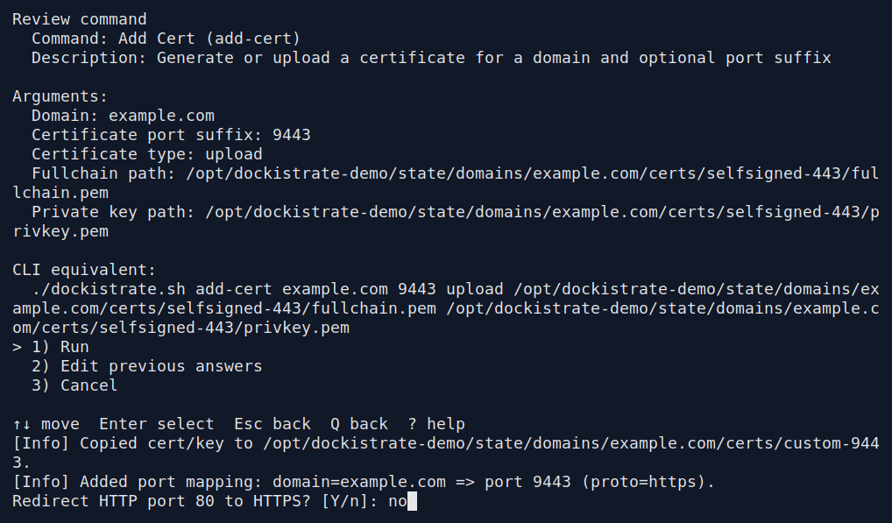

   [Read the captured terminal text](../assets/interactive/security-certificates-certificate-upload/10-enter-value.txt)

9. Command result.

   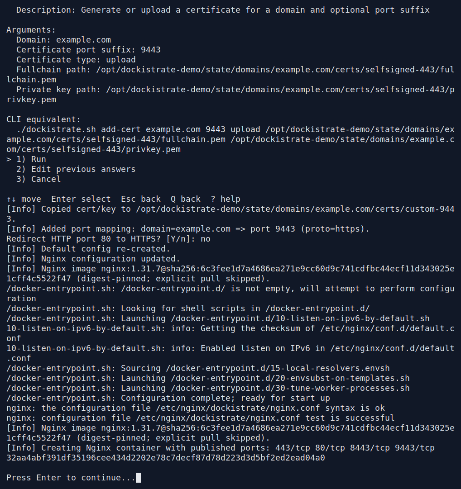

   [Read the captured terminal text](../assets/interactive/security-certificates-certificate-upload/11-command-result.txt)

</details>

<details>
<summary>Verify the uploaded certificate serves HTTPS</summary>

1. Verify the uploaded certificate serves HTTPS.

   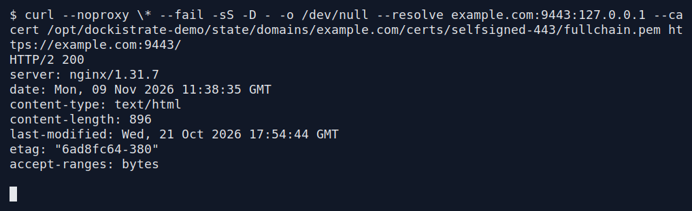

   [Read the captured terminal text](../assets/interactive/security-certificates-uploaded-certificate-local-trust/01-verify-the-uploaded-certificate-serves-https.txt)

</details>

<details>
<summary>remove-cert — inputs and result</summary>

1. Choose **example.com**.

   

   [Read the captured terminal text](../assets/interactive/security-certificates-remove-uploaded-certificate/03-example-com.txt)

2. Choose **9443**.

   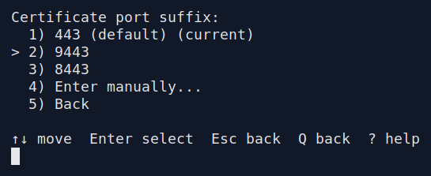

   [Read the captured terminal text](../assets/interactive/security-certificates-remove-uploaded-certificate/04-9443.txt)

3. Review the collected inputs, then choose **Run**.

   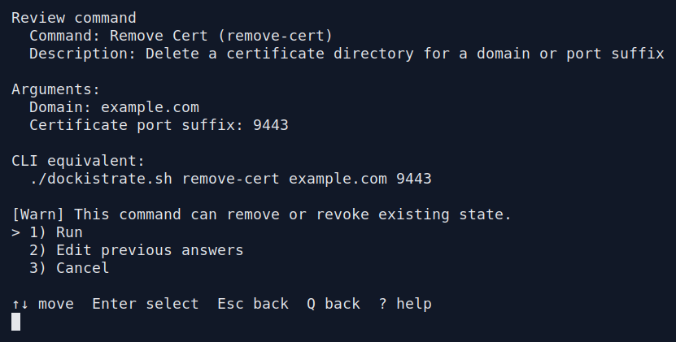

   [Read the captured terminal text](../assets/interactive/security-certificates-remove-uploaded-certificate/05-run.txt)

4. Enter `YES`.

   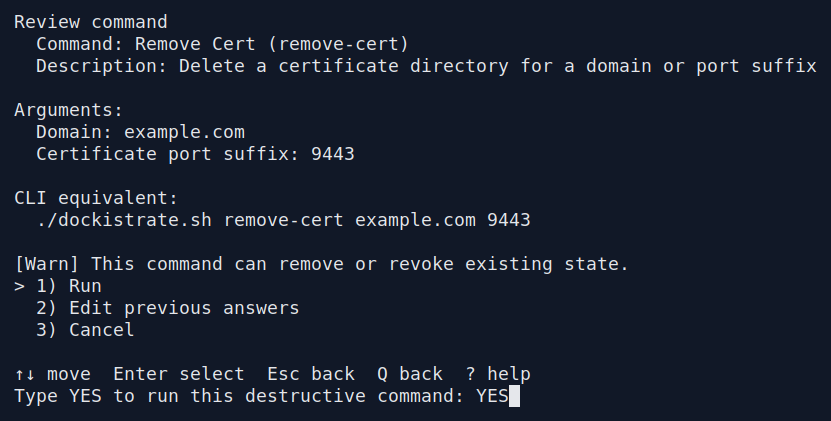

   [Read the captured terminal text](../assets/interactive/security-certificates-remove-uploaded-certificate/06-enter-value.txt)

5. Command result.

   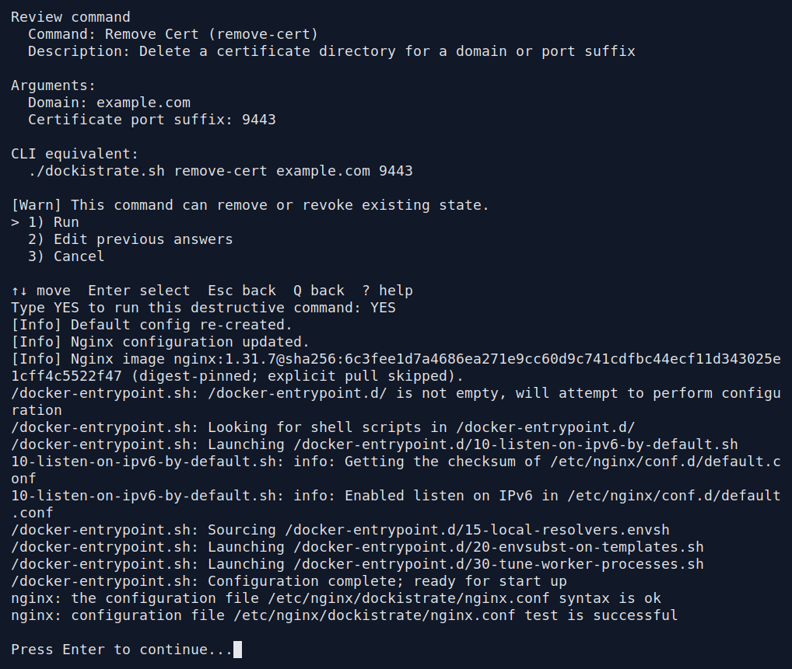

   [Read the captured terminal text](../assets/interactive/security-certificates-remove-uploaded-certificate/07-command-result.txt)

</details>

<details>
<summary>remove-cert — inputs and result</summary>

1. Choose **example.com**.

   

   [Read the captured terminal text](../assets/interactive/security-certificates-remove-cert/03-example-com.txt)

2. Choose **8443**.

   

   [Read the captured terminal text](../assets/interactive/security-certificates-remove-cert/04-8443.txt)

3. Review the collected inputs, then choose **Run**.

   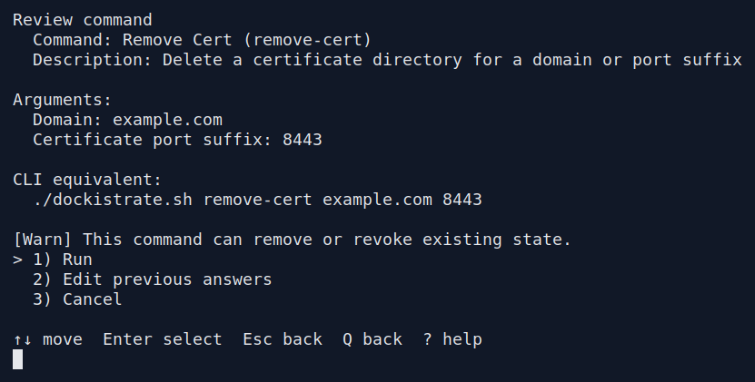

   [Read the captured terminal text](../assets/interactive/security-certificates-remove-cert/05-run.txt)

4. Enter `YES`.

   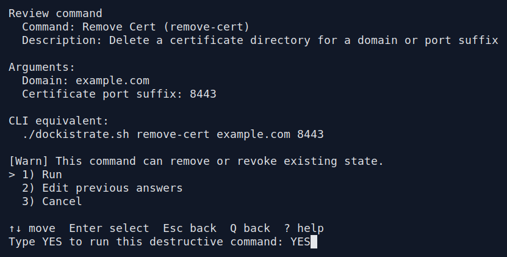

   [Read the captured terminal text](../assets/interactive/security-certificates-remove-cert/06-enter-value.txt)

5. Command result.

   

   [Read the captured terminal text](../assets/interactive/security-certificates-remove-cert/07-command-result.txt)

</details>

<details>
<summary>check-config — inputs and result</summary>

1. Configuration test passed.

   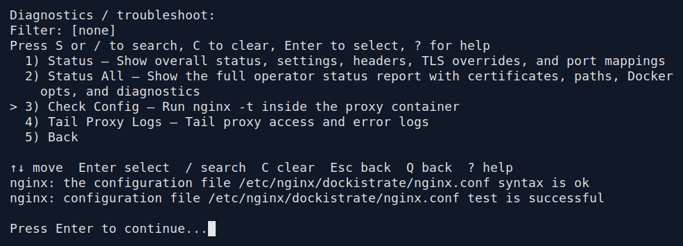

   [Read the captured terminal text](../assets/interactive/security-certificates-certificate-cleanup-config/03-configuration-test-passed.txt)

</details>

<details>
<summary>remove-cert — inputs and result</summary>

1. Choose **Return to previous menu**.

   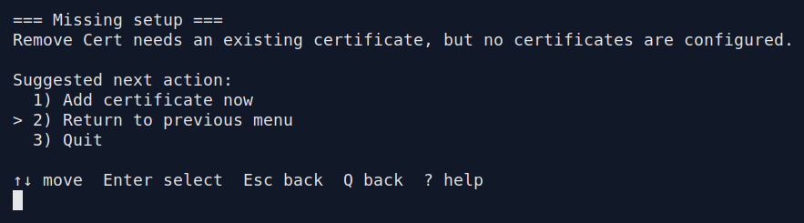

   [Read the captured terminal text](../assets/interactive/core-branches-navigation-missing-certificates/03-return-from-missing-certificates-guidance.txt)

2. Choose **Back**.

   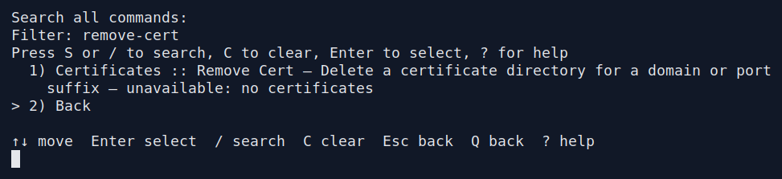

   [Read the captured terminal text](../assets/interactive/core-branches-navigation-missing-certificates/04-return-from-command-search.txt)

</details>

<!-- /walkthrough: certificates -->

3. Choose **List Certs**, then **Expose or update a port → List Port Mappings**.
   Confirm the certificate owner/ID and HTTPS listener. If HTTPS already existed,
   **Update Port** must select the new certificate explicitly; adding a certificate
   does not switch an existing mapping.
4. Run **Check Config** and request the HTTPS endpoint below. Check the certificate
   identity and application response, not just whether Nginx configuration passes.
5. To undo, restore the previous mapping/redirect or remove the demo mapping,
   then **Remove Cert → example.com → 8443 → Run**. Removal refuses certificates
   still referenced by a listener, including references from another domain.

```bash
# CLI add-cert also offers mapping convenience and enables its default redirect.
./dockistrate.sh add-cert example.com 8443 selfsigned
./dockistrate.sh list-certs
./dockistrate.sh list-port-mappings
./dockistrate.sh check-config
curl --noproxy '*' -i --resolve example.com:8443:127.0.0.1 \
  --cacert state/domains/example.com/certs/selfsigned-8443/fullchain.pem \
  https://example.com:8443/
```

The CLI addition's redirect behavior differs from the interactive **no** choice;
use the [redirect controls](backends-and-ports.md) to restore the intended HTTP
behavior. The local CA file above is the self-signed server certificate. A
publicly trusted certificate uses normal client trust instead.

## Choose a provider and maintain certificates

Open **Certificates**, select the action below, enter its arguments, inspect
the review and choose **Run**. **Cancel** cancels before execution. CLI examples
follow `./dockistrate.sh`; replace file paths and public hostnames with yours.
**Renew Certs** takes no arguments: review `(none)`, then run the scan or cancel.
That review alone does not establish that a certificate was renewed.

| Menu action and inputs | CLI equivalent | Result and recovery |
| --- | --- | --- |
| <a id="cmd-add-cert"></a>**Add Cert** → domain → suffix → self-signed, Let's Encrypt, or upload; upload asks for fullchain/key paths | `add-cert example.com 8443 upload /path/fullchain.pem /path/privkey.pem` | Register managed material; inspect List Certs and mapping. Undo only after removing dependent references. |
| <a id="cmd-list-certs"></a>**List Certs** | `list-certs` | Inspect declared certificates and retained material before selecting or removing it. |
| <a id="cmd-replace-cert"></a>**Replace Cert** → domain → existing suffix → provider/files | `replace-cert example.com 8443 selfsigned` | Replace material while retaining mappings/redirects. Verify the new fingerprint and a fresh HTTPS connection. To recover intentionally, replace with saved prior material or restore a backup. |
| <a id="cmd-renew-certs"></a>**Renew Certs** → review | `renew-certs` | Scan configured HTTPS certificates and renew eligible Let's Encrypt material. Inspect the reported outcome and served expiry; expiring self-signed/uploaded material must be replaced manually. |
| <a id="cmd-remove-cert"></a>**Remove Cert** → domain → suffix | `remove-cert example.com 8443` | Remove owned matching certificate material after dependencies are cleared. Retained legacy copies are also cleaned up after commit; recovery needs saved material. |

For **Let's Encrypt**, use a real hostname you control with public DNS pointing
to this server, public TCP port 80 reachable, and registry/ACME connectivity.
The `.test` or `example.com` demo cannot demonstrate public issuance. The
[provider details](#lets-encrypt) explain webroot versus standalone validation.
The recorded Let's Encrypt path stops at **Cancel** in the review: public
issuance is **not live verified**. There are no later email or terms prompts:
Dockistrate runs Certbot non-interactively, agrees to its terms and registers
without an email address. The shared HTTP redirect prompts appear only after
successful issuance; the local self-signed path demonstrates those controls.
For **upload**, have the matching PEM private key and complete certificate chain
on the host; do not paste key contents into the picker or documentation.

## Walkthrough: override TLS on one listener

**Before starting:** have an HTTPS listener on `443`, and record its current
global/per-port TLS settings. Per-port settings apply to every domain sharing
that listener port. Check client compatibility before activation.

1. Open **Advanced command browser → Port TLS & HTTP/3 → Set Port TLS Protocols**,
   select `443`, and enter `TLSv1.3`.
2. Review the port and protocols and choose **Run**. Use **Set Port TLS Ciphers**
   for the same port and enter `HIGH:!aNULL:!MD5` if that is your intended profile.

<!-- walkthrough: tls-settings -->

<details>
<summary>set-tls-protocols — inputs and result</summary>

1. Enter `TLSv1.2 TLSv1.3`.

   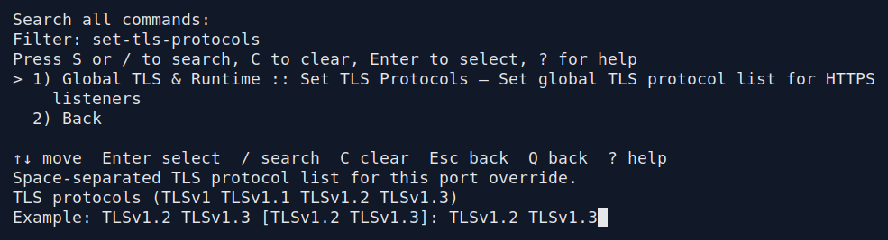

   [Read the captured terminal text](../assets/interactive/security-tls-set-tls-protocols/03-enter-value.txt)

2. Review the collected inputs, then choose **Run**.

   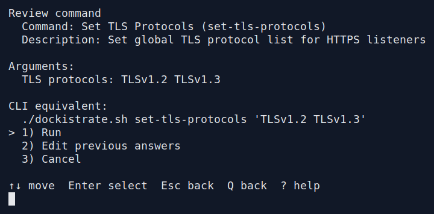

   [Read the captured terminal text](../assets/interactive/security-tls-set-tls-protocols/04-run.txt)

3. Command result.

   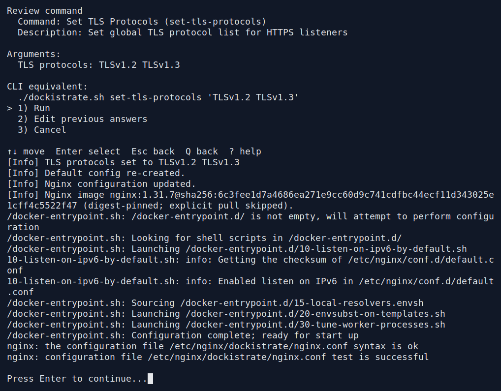

   [Read the captured terminal text](../assets/interactive/security-tls-set-tls-protocols/05-command-result.txt)

</details>

<details>
<summary>set-tls-ciphers — inputs and result</summary>

1. Enter `HIGH:!aNULL:!MD5`.

   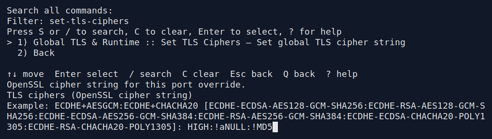

   [Read the captured terminal text](../assets/interactive/security-tls-set-tls-ciphers/03-enter-value.txt)

2. Review the collected inputs, then choose **Run**.

   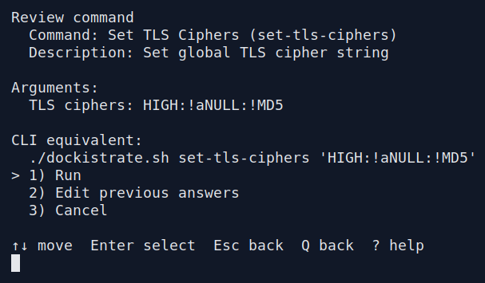

   [Read the captured terminal text](../assets/interactive/security-tls-set-tls-ciphers/04-run.txt)

3. Command result.

   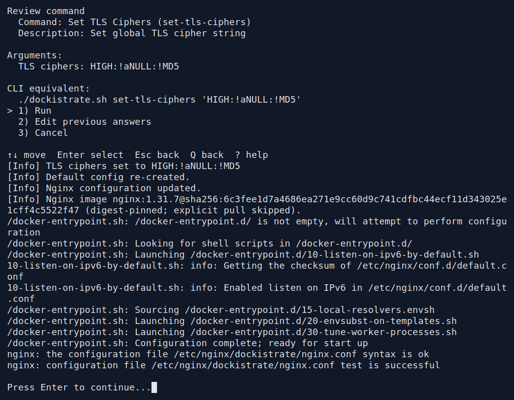

   [Read the captured terminal text](../assets/interactive/security-tls-set-tls-ciphers/05-command-result.txt)

</details>

<details>
<summary>set-port-tls-protocols — inputs and result</summary>

1. Choose **443**.

   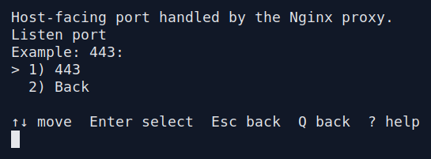

   [Read the captured terminal text](../assets/interactive/security-tls-tls-settings/03-443.txt)

2. Enter `TLSv1.3`.

   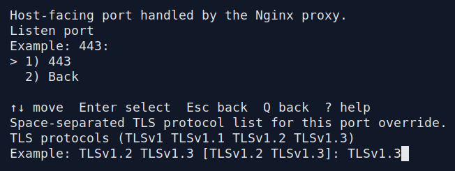

   [Read the captured terminal text](../assets/interactive/security-tls-tls-settings/04-enter-value.txt)

3. Review the collected inputs, then choose **Run**.

   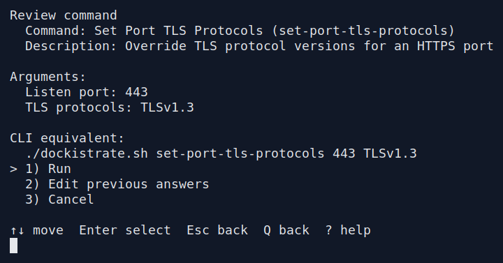

   [Read the captured terminal text](../assets/interactive/security-tls-tls-settings/05-run.txt)

4. Command result.

   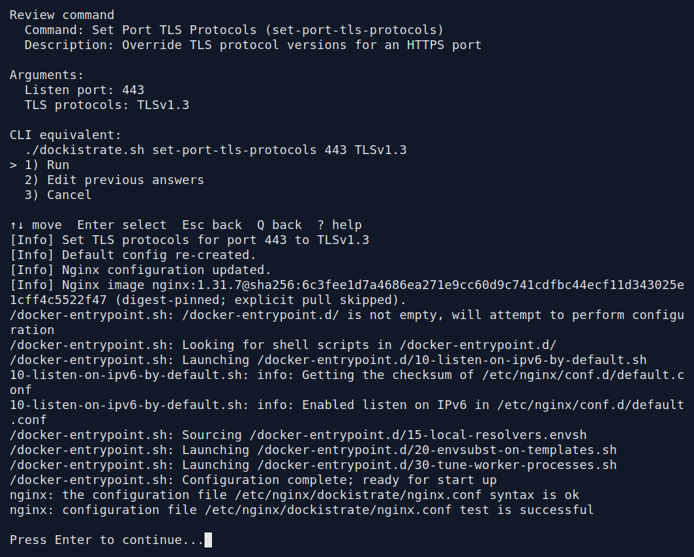

   [Read the captured terminal text](../assets/interactive/security-tls-tls-settings/06-command-result.txt)

</details>

<details>
<summary>set-port-tls-ciphers — inputs and result</summary>

1. Choose **443**.

   

   [Read the captured terminal text](../assets/interactive/security-tls-set-port-tls-ciphers/03-443.txt)

2. Enter `HIGH:!aNULL:!MD5`.

   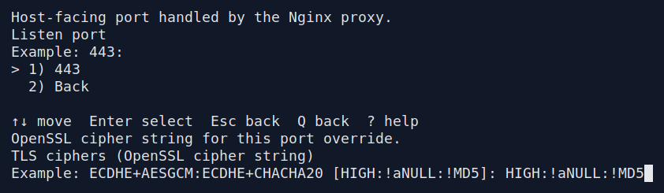

   [Read the captured terminal text](../assets/interactive/security-tls-set-port-tls-ciphers/04-enter-value.txt)

3. Review the collected inputs, then choose **Run**.

   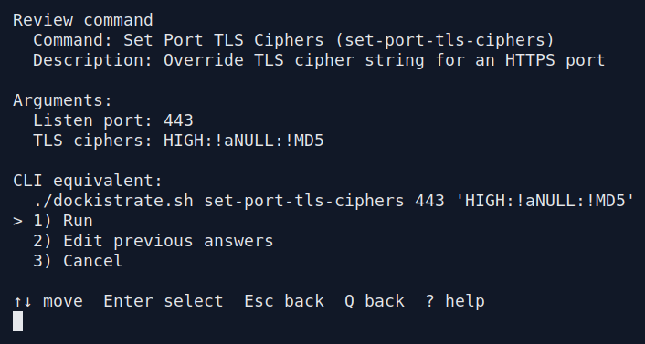

   [Read the captured terminal text](../assets/interactive/security-tls-set-port-tls-ciphers/05-run.txt)

4. Command result.

   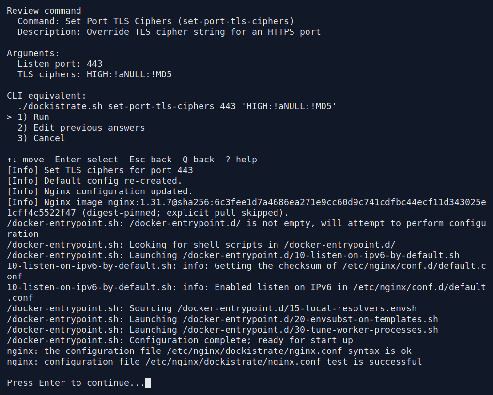

   [Read the captured terminal text](../assets/interactive/security-tls-set-port-tls-ciphers/06-command-result.txt)

</details>

<details>
<summary>TLS 1.2 is rejected while the listener requires TLS 1.3</summary>

1. TLS 1.2 is rejected while the listener requires TLS 1.3.

   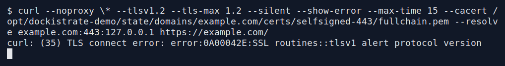

   [Read the captured terminal text](../assets/interactive/security-tls-tls12-excluded/01-tls-1-2-is-rejected-while-the-listener-requires-tls-1-3.txt)

</details>

<details>
<summary>remove-port-tls-protocols — inputs and result</summary>

1. Choose **443**.

   

   [Read the captured terminal text](../assets/interactive/security-tls-remove-port-tls-protocols/03-443.txt)

2. Review the collected inputs, then choose **Run**.

   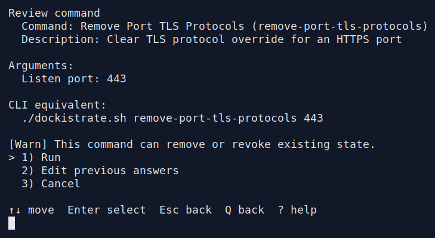

   [Read the captured terminal text](../assets/interactive/security-tls-remove-port-tls-protocols/04-run.txt)

3. Enter `YES`.

   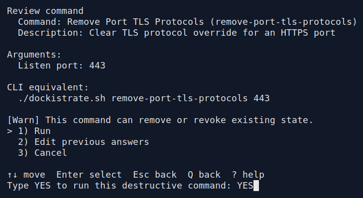

   [Read the captured terminal text](../assets/interactive/security-tls-remove-port-tls-protocols/05-enter-value.txt)

4. Command result.

   

   [Read the captured terminal text](../assets/interactive/security-tls-remove-port-tls-protocols/06-command-result.txt)

</details>

<details>
<summary>remove-port-tls-ciphers — inputs and result</summary>

1. Choose **443**.

   

   [Read the captured terminal text](../assets/interactive/security-tls-remove-port-tls-ciphers/03-443.txt)

2. Review the collected inputs, then choose **Run**.

   

   [Read the captured terminal text](../assets/interactive/security-tls-remove-port-tls-ciphers/04-run.txt)

3. Enter `YES`.

   

   [Read the captured terminal text](../assets/interactive/security-tls-remove-port-tls-ciphers/05-enter-value.txt)

4. Command result.

   

   [Read the captured terminal text](../assets/interactive/security-tls-remove-port-tls-ciphers/06-command-result.txt)

</details>

<details>
<summary>check-config — inputs and result</summary>

1. Configuration test passed.

   

   [Read the captured terminal text](../assets/interactive/security-tls-tls-settings-config/03-configuration-test-passed.txt)

</details>

<!-- /walkthrough: tls-settings -->

3. Run **Check Config**, then test a real TLS handshake and HTTPS request. Verify
   that intended protocols work and excluded protocols fail, with clients capable
   of exercising each version.
4. Choose **Remove Port TLS Protocols** and **Remove Port TLS Ciphers** for `443`
   to restore inheritance; if there were older overrides, restore those values
   instead. Global setters are undone by restoring their saved prior values.

| Menu action and inputs | CLI equivalent | Scope / check |
| --- | --- | --- |
| <a id="cmd-set-tls-protocols"></a>**Global TLS & Runtime → Set TLS Protocols** → protocol string | `set-tls-protocols 'TLSv1.2 TLSv1.3'` | Global fallback; existing port overrides remain. |
| <a id="cmd-set-tls-ciphers"></a>**Global TLS & Runtime → Set TLS Ciphers** → cipher string | `set-tls-ciphers 'HIGH:!aNULL:!MD5'` | Global OpenSSL cipher-list setting; inspect generated configuration. |
| <a id="cmd-set-port-tls-protocols"></a>**Set Port TLS Protocols** → `443` → protocol string | `set-port-tls-protocols 443 TLSv1.3` | Listener override; verify negotiated protocols. |
| <a id="cmd-remove-port-tls-protocols"></a>**Remove Port TLS Protocols** → `443` | `remove-port-tls-protocols 443` | Inherit global protocols again. |
| <a id="cmd-set-port-tls-ciphers"></a>**Set Port TLS Ciphers** → `443` → cipher string | `set-port-tls-ciphers 443 'HIGH:!aNULL:!MD5'` | Listener override; verify supported negotiated ciphers. |
| <a id="cmd-remove-port-tls-ciphers"></a>**Remove Port TLS Ciphers** → `443` | `remove-port-tls-ciphers 443` | Inherit global ciphers again. |

TLS values are intentional operator choices; broad or legacy profiles are not
blocked solely as policy. Parsing and injection-prevention checks still apply.
`ssl_ciphers` does not choose TLS 1.3 cipher suites.

## Walkthrough: enable and disable HTTP/3

**Before starting:** use an HTTPS listener, a compatible Nginx build, reachable
UDP on the same listener port, and an HTTP/3-capable client. Check `curl -V` for
HTTP3 support before using the example probe. Without those prerequisites,
configuration can be reviewed but end-to-end HTTP/3 remains unverified.

1. Open **Advanced command browser → Port TLS & HTTP/3 → Set Port HTTP3**.
   Select `443`, **On**, and **Auto** for Alt-Svc; review and **Run**.
2. Choose **List Port HTTP3** and the port to inspect its setting. An advertised
   Alt-Svc header alone is not evidence of a working QUIC connection.

<!-- walkthrough: http3 -->

<details>
<summary>set-port-http3 — inputs and result</summary>

1. Choose **443**.

   

   [Read the captured terminal text](../assets/interactive/security-tls-http3/03-443.txt)

2. Choose **On**.

   

   [Read the captured terminal text](../assets/interactive/security-tls-http3/04-on.txt)

3. Choose **Auto (current)**.

   

   [Read the captured terminal text](../assets/interactive/security-tls-http3/05-auto-current.txt)

4. Review the collected inputs, then choose **Run**.

   

   [Read the captured terminal text](../assets/interactive/security-tls-http3/06-run.txt)

5. Command result.

   

   [Read the captured terminal text](../assets/interactive/security-tls-http3/07-command-result.txt)

</details>

<details>
<summary>list-port-http3 — inputs and result</summary>

1. Choose **443**.

   

   [Read the captured terminal text](../assets/interactive/security-tls-list-port-http3/03-443.txt)

2. Command result.

   

   [Read the captured terminal text](../assets/interactive/security-tls-list-port-http3/04-command-result.txt)

</details>

<details>
<summary>HTTP/3 request succeeds without fallback</summary>

1. HTTP/3 request succeeds without fallback.

   

   [Read the captured terminal text](../assets/interactive/security-tls-http3-verified/01-http-3-request-succeeds-without-fallback.txt)

</details>

<details>
<summary>set-port-http3 — inputs and result</summary>

1. Choose **443**.

   

   [Read the captured terminal text](../assets/interactive/security-tls-http3-disable/03-443.txt)

2. Choose **Off**.

   

   [Read the captured terminal text](../assets/interactive/security-tls-http3-disable/04-off.txt)

3. Choose **Auto (current)**.

   

   [Read the captured terminal text](../assets/interactive/security-tls-http3-disable/05-auto-current.txt)

4. Review the collected inputs, then choose **Run**.

   

   [Read the captured terminal text](../assets/interactive/security-tls-http3-disable/06-run.txt)

5. Command result.

   

   [Read the captured terminal text](../assets/interactive/security-tls-http3-disable/07-command-result.txt)

</details>

<details>
<summary>set-port-http3 — Type a custom Alt-Svc value</summary>

1. Choose **Custom (manual value)**.

   

   [Read the captured terminal text](../assets/interactive/security-branches-http3-custom-advertisement/05-custom-manual-value.txt)

2. Enter `h3=":443"; ma=60`.

   

   [Read the captured terminal text](../assets/interactive/security-branches-http3-custom-advertisement/06-enter-value.txt)

3. Review the collected inputs, then choose **Run**.

   

   [Read the captured terminal text](../assets/interactive/security-branches-http3-custom-advertisement/07-run.txt)

4. Command result.

   

   [Read the captured terminal text](../assets/interactive/security-branches-http3-custom-advertisement/08-command-result.txt)

</details>

<details>
<summary>set-port-http3 — Keep HTTP/3 enabled and suppress its advertisement</summary>

1. Choose **443**.

   

   [Read the captured terminal text](../assets/interactive/security-branches-http3-suppress-advertisement/03-443.txt)

2. Choose **On (current)**.

   

   [Read the captured terminal text](../assets/interactive/security-branches-http3-suppress-advertisement/04-on-current.txt)

3. Choose **Off**.

   

   [Read the captured terminal text](../assets/interactive/security-branches-http3-suppress-advertisement/05-off.txt)

4. Review the collected inputs, then choose **Run**.

   

   [Read the captured terminal text](../assets/interactive/security-branches-http3-suppress-advertisement/06-run.txt)

5. Command result.

   

   [Read the captured terminal text](../assets/interactive/security-branches-http3-suppress-advertisement/07-command-result.txt)

</details>

<!-- /walkthrough: http3 -->

3. Run **Check Config** and send a request with `curl --http3-only`, using the
   correct server CA. Confirm that the request actually uses HTTP/3.
4. Select **Set Port HTTP3 → 443 → Off**, review and **Run** to undo. Restore
   the previous Alt-Svc choice if it was customized.

| Menu action and inputs | CLI equivalent | Result |
| --- | --- | --- |
| <a id="cmd-set-port-http3"></a>**Set Port HTTP3** → port → On/Off → Auto/Off/Custom Alt-Svc | `set-port-http3 443 on auto` | Configure HTTP/3 and its advertisement; `set-port-http3 443 off` disables it. |
| <a id="cmd-list-port-http3"></a>**List Port HTTP3** → port (or empty for all) | `list-port-http3 443` | Inspect saved listener settings without proving connectivity. |

```bash
curl --noproxy '*' --http3-only -i --resolve example.com:443:127.0.0.1 \
  --cacert state/domains/example.com/certs/selfsigned-443/fullchain.pem \
  https://example.com:443/
```

For a custom advertisement, choose **Set Port HTTP3 → 443 → On → Custom
(manual value)**, enter `h3=":443"; ma=60`, review and **Run**. Check the actual
`Alt-Svc` response header. **On → Off** keeps HTTP/3 enabled while suppressing
that advertisement; verify the header is absent. **Off → Auto** disables
HTTP/3 and restores the example's advertisement preference.

```bash
./dockistrate.sh set-port-http3 443 on 'h3=":443"; ma=60'
./dockistrate.sh set-port-http3 443 on off
./dockistrate.sh set-port-http3 443 off auto
```

For client certificate authentication, use the dedicated
[mutual TLS walkthrough](mutual-tls.md), including first enable, export,
revocation, replacement and authority recovery.

## Certificate storage and detailed behavior

Dockistrate can generate self-signed certificates, use Let's Encrypt through
Certbot, upload certificate material, and tune TLS behavior globally or per
listener port.
For menu-by-menu steps, see [interactive HTTPS and certificate workflows](interactive-workflows.md#https-redirects-and-certificate-choices).

Domain-owned certificate declarations live in
`state/domains/<domain>/config/certificates.csv`; HTTPS listeners reference an
explicit `certificate_owner` and `certificate_id`. The CLI and interactive
certificate picker accept the corresponding `owner/id` reference. See
[Domain configuration files](domain-configuration.md) for editing and apply.

Removing a declaration retains its files for recovery. `list-certs` identifies
these retained copies; they remain available to explicit removal and replacement,
while new HTTPS mapping choices offer declared certificates.
An explicit `remove-cert` also removes its matching retained legacy serving
copy after the operation commits. Migration keeps those original copies until
explicit cleanup is safe.

`replace-cert` stages the new certificate and refreshes the proxy certificate
projection before completing. If activation fails, its transaction restores the
previous managed certificate. This applies to both CLI and interactive replacement.
Replacement preserves existing listeners and redirect settings; the automatic
HTTPS mapping and redirect prompts belong to `add-cert` only.

## Common Commands

```text
add-cert <domain> [port_suffix] [selfsigned|letsencrypt|upload] [fullchain] [privkey]
replace-cert <domain> [port_suffix] [selfsigned|letsencrypt|upload] [fullchain] [privkey]
remove-cert <domain> [port_suffix]
list-certs
renew-certs

set-tls-protocols <protocols>
set-tls-ciphers <cipher_string>
set-port-tls-protocols <port> <protocols>
set-port-tls-ciphers <port> <cipher_string>
set-port-http3 <port> <on|off> [auto|off|value]
list-port-http3 [port]
```

## HTTPS Example

Create an HTTPS listener for a stock Nginx backend that serves on container
port 80, with an automatically generated self-signed certificate:

```bash
./dockistrate.sh add-backend example.com nginx:alpine 80 https
./dockistrate.sh check-config
```

Exposing the backend starts the proxy. Fresh configurations deny client traffic
at both ACL address layers. For this **public demo**, open both layers only for
the demo domain and verify the local self-signed endpoint over IPv4:

```bash
./dockistrate.sh set-backend-acl-policy example.com allow
curl --noproxy '*' -ki --resolve example.com:443:127.0.0.1 https://example.com/
```

Expect 200. `-k` skips trust verification for the self-signed demo only. Private
services should retain `deny` and configure both
[client and original-peer allowances](access-control-security-rules.md#address-layers-and-private-services).

New self-signed certificates include a DNS subject alternative name (SAN), or
an IP SAN when the configured host is an IPv4 address. For a local trust check,
use `--cacert state/domains/example.com/certs/selfsigned-443/fullchain.pem`
instead of `-k`. Certificates remain self-signed and are not publicly trusted.

For an existing backend, add HTTPS exposure explicitly:

```bash
./dockistrate.sh add-port example.com 443 80 https none
```

Adding a port leaves existing HTTP behavior unchanged; configure redirects
separately with `set-port-redirect`. With `add-port ... https none`, or an
`add-backend` self-signed selection, Dockistrate writes the self-signed
certificate under `state/domains/<domain>/certs/selfsigned-<port>/` after
migration to domain configuration. Legacy schema-1 state uses
`state/certs/selfsigned/live/<domain>_<port>` until `migrate-state` converts it.

## Let's Encrypt

Request a Let's Encrypt certificate or renew existing certificates:

```bash
./dockistrate.sh add-cert example.com 443 letsencrypt
./dockistrate.sh renew-certs
```

Replace `example.com` with a real hostname you control and point its public DNS
to this server. `add-cert` creates certificate material; use `replace-cert` to
replace an existing certificate. When adding for an existing backend, it can
create a missing HTTPS mapping and configure an HTTP redirect (interactive mode
asks about the redirect). It does not switch an existing HTTPS mapping to a
different certificate; select the new owner/ID with `update-port` or **Update
Port**. See the [guided sequence](interactive-workflows.md#use-lets-encrypt).

When the managed proxy is running and publishes HTTP port 80, Dockistrate uses
the Certbot webroot flow and serves challenges from `/var/www/certbot` inside
the proxy container. Otherwise it uses standalone validation. Port 80 must be
reachable for validation.

## Uploaded Certificates

Upload existing certificate files:

```bash
./dockistrate.sh add-cert example.com 443 upload /path/fullchain.pem /path/privkey.pem
```

Certificate references used by port mappings resolve to managed, domain-owned
certificate directories. For example, `example.com/selfsigned-443` identifies
`state/domains/example.com/certs/selfsigned-443/`. Managed legacy references are
normalized during migration. Outside-root and traversal paths are blocked.
Another domain can reference an existing owner's certificate without making a
second editable copy of it.

## Mutual TLS and PKCS#12

CLI and interactive commands distinguish first-time authority creation from
reuse. First-time enable with no retained authority material can create its CA
and database. Re-enable, apply, restore, issuance, revocation, and PKCS#12 export
reuse the existing authority: they require matching `ca.crt` and `ca.key`,
an intact `index.txt`, and valid `serial` and `crlnumber` counters.
A missing authority directory for previously enabled
mTLS is an error, not a request to create new credentials. Disabling mTLS keeps
its material for validated reuse. For an enabled mTLS mapping,
`replace-backend-ca` explicitly rotates the authority and removes its old client
certificate and key files. It also works when the authority directory is missing.

When those operations reuse an existing CRL, it must be a regular, non-symlink
file signed by the authority with exactly the database's revoked serials.
An older signed CRL that omits a recorded revocation is rejected.
A missing CRL may be generated only from validated authority/database state.
Missing identity or history files are never silently reconstructed. OpenSSL
configuration and a missing certificate-output directory may be recreated
without resetting the database. Failed validation or CRL generation stops
the operation; transactional activation preserves the previous configuration.
Nginx validates the resulting configuration before
activation. Existing expiry, protocol, cipher, and key-strength choices retain
their existing handling.

`list-backend-client-certs` reads certificate status without creating or
initializing mTLS files. Restore incomplete or inconsistent material from a
complete backup. For an enabled mTLS mapping, deliberate CA replacement and
new client credentials provide another recovery option. Disabled domains retain
their existing material and need a complete recovery before re-enable. See
[mTLS backup integrity and recovery](backups-restore-cleanup.md#mtls-integrity-and-recovery)
for restore behavior, including disabled material and pending drafts.

### Proxy certificate isolation

The managed proxy mount contains configured server `fullchain.pem` and
`privkey.pem` files, plus public mTLS `ca.crt` and `ca.crl` files. It excludes CA
signing keys, client private keys, PKCS#12 exports, CSRs and CA working files.
Each snapshot also contains integrity metadata with file paths, ownership,
permissions and hashes; it contains no private key bytes.
Read-only mounting alone does not protect those secrets from a compromised
proxy root process; they remain outside every default proxy mount.

Host-side mTLS issuance and export material is stored in
`state/domains/<domain>/mtls/` after migration. Legacy state uses
`state/certs/mtls/<domain>`. Shared ACME account and renewal state resides under
`state/shared/acme/`. Dockistrate builds a complete certificate snapshot under
`state/config/proxy_certs`, outside the Nginx configuration mount, and mounts
only the selected snapshot read-only at `/etc/letsencrypt`. Existing generated
certificate paths and the separate Certbot issuance workflow are preserved.
Snapshot creation uses Bash 3-compatible helpers, OpenSSL and the standard
filesystem tools. It verifies open file handles and private staging copies,
and stops if it cannot read or publish the selected files safely. No host Python
installation is required.

Changes to selected certificate or verification material replace the managed
proxy so atomic certificate renewal and CRL replacement cannot leave it using
an old bind-mounted inode. This interrupts active sessions, including during
mTLS enable/disable, CA replacement or revocation when the snapshot changes.
Unchanged material can reuse the current snapshot and the normal update path.
CLI and interactive commands use the same behavior. Intentional extra mounts
supplied through operator Docker options remain the operator's responsibility.

Rollback can also replace the proxy to restore the previous certificate snapshot
and its permissions, even when the forward update only reloaded it. A failed
configuration change can therefore interrupt sessions while recovery restores
the previous runtime.

#### Upgrading an existing proxy

After installing this version, run:

```bash
./dockistrate.sh start-nginx
./dockistrate.sh check-config
```

The configuration update recognizes the older managed proxy, replaces its broad
certificate mount, and preserves saved settings and host-side credentials. A
running old container retains its old mount until this update succeeds. Plan
for interrupted sessions. No certificate reissuance or saved-state conversion
is required solely for the upgrade. If private material was already disclosed,
removing the mount does not revoke stolen credentials; rotate the affected CA
and client credentials separately.

Noninteractive PKCS#12 export accepts a password from the supported environment,
file, or stdin source. A `--password-stdin` value may end with one LF or CRLF
terminator; that terminator is removed. Empty values, embedded newlines, bare
carriage returns, and surplus lines remain rejected.

## TLS Overrides

Set global protocol and cipher preferences:

```bash
./dockistrate.sh set-tls-protocols "TLSv1.2 TLSv1.3"
./dockistrate.sh set-tls-ciphers "HIGH:!aNULL:!MD5"
```

Override a specific HTTPS listener:

```bash
./dockistrate.sh set-port-tls-protocols 443 "TLSv1.3"
./dockistrate.sh set-port-tls-ciphers 443 "ECDHE+AESGCM"
```

Dockistrate validates TLS values with the local OpenSSL build but does not block
intentional operator-selected profiles solely because they are broad or legacy.
Cipher strings must still parse as cipher-list data rather than OpenSSL command
options; valid leading-minus rules such as `-AES:HIGH` remain supported, while
option-only values such as `-v`, control characters, and Nginx directive
delimiters are rejected.

## HTTP/3

Enable HTTP/3 for an HTTPS listener:

```bash
./dockistrate.sh set-port-http3 443 on auto
./dockistrate.sh list-port-http3 443
```

HTTP/3 needs UDP published for the same HTTPS listener port. For example, an
HTTPS listener on `443` needs UDP `443`; a listener on `8443` needs UDP `8443`.

The [Nginx security advisories](https://nginx.org/en/security_advisories.html)
include HTTP/3 issues affecting older releases, including CVE-2026-42530,
CVE-2026-90439 and CVE-2026-95101 under their documented conditions. The reviewed
mainline release `1.31.7` includes their fixes. Fresh state uses the digest-pinned
reference below; existing installations retain their saved selection and must
upgrade explicitly:

```bash
./dockistrate.sh set-nginx-image nginx:1.31.7@sha256:6c3fee1d7a4686ea271e9cc60d9c741cdfbc44ecf11d343025e1cff4c5522f47 if-missing
```

In `./dockistrate.sh -i`, select `set-nginx-image`, choose manual entry and paste
the full reference, then select the pull mode and review the command. Until an
affected proxy is recreated on a reviewed fixed release, disable each HTTP/3
listener with `./dockistrate.sh set-port-http3 <port> off`. Disabling HTTP/3 does
not mitigate unrelated Nginx vulnerabilities. The
[image maintenance review](../security/image-maintenance.md) records the version
selection, digest and remaining evidence limits.

## Verification

```bash
./dockistrate.sh list-certs
./dockistrate.sh list-port-http3
./dockistrate.sh status
./dockistrate.sh check-config
openssl s_client -connect localhost:443 -servername example.com
```

Also request the served URL: the handshake and `nginx -t` checks alone do not
prove the backend response or access policy. Use the demo request above for a
self-signed setup, or an HTTPS request without `-k` for a publicly trusted
certificate. Existing mTLS or request rules still need their required inputs.
