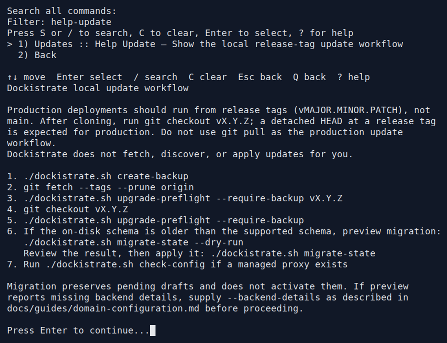
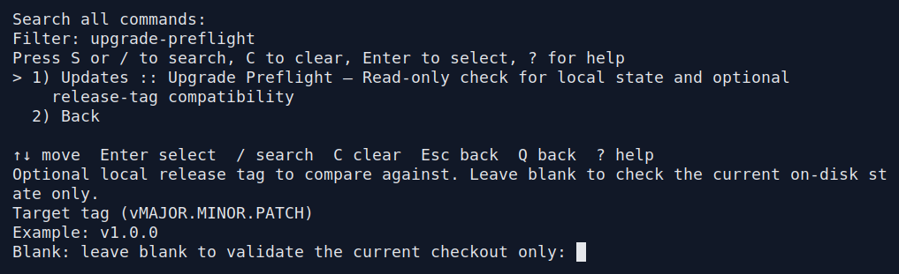
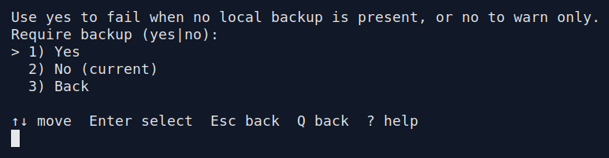
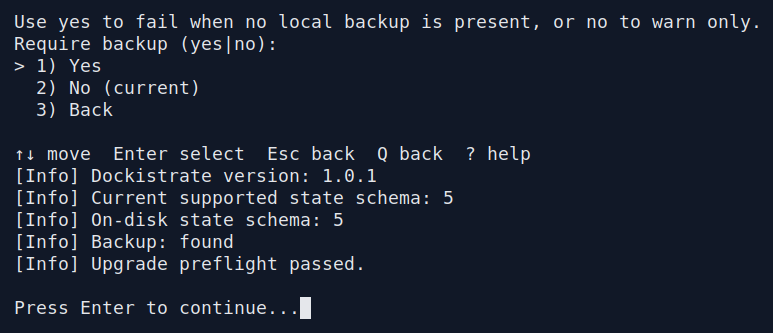

# Updating Dockistrate

Back up, check a release, select its code, and verify the running application.
Use release tags for production; a detached HEAD at a selected tag is expected.
For an existing public 1.0.1 installation, follow the
[2.0.0 upgrade sequence](#upgrading-from-101-to-200). A successful preflight
does not migrate storage or establish ownership of existing backend containers.

## Interactive update walkthrough

<a id="cmd-help-update"></a>
<a id="cmd-upgrade-preflight"></a>

1. Choose **Advanced command browser → Backups & Restore → Create Backup**
   and enter `before-update`. Back up application data separately.
2. Exit the picker and fetch tags in your terminal with
   `git fetch --tags --prune origin`. Reopen `./dockistrate.sh -i`.
3. Open **Updates / release preflight → Help Update** to read the update steps.
   Choose **Upgrade Preflight**, select the target local release tag, and require
   a backup. Read the checks and resolve any failure before continuing.
4. Exit the picker before `git checkout vX.Y.Z`, replacing `vX.Y.Z` with your
   selected release. Reopen the interactive interface so it loads the new code.
5. Run **Upgrade Preflight** again. If storage migration is required, follow the
   [domain migration walkthrough](domain-configuration.md#upgrade-existing-state).
6. Open **Diagnostics / troubleshoot → Check Config**, inspect **Status**, and
   request each affected application. Preflight alone does not prove connectivity.

<!-- walkthrough: updates -->

<details>
<summary>help-update — inputs and result</summary>

1. Command result.

   

   [Read the captured terminal text](../assets/interactive/operations-backup-help-update/03-command-result.txt)

</details>

<details>
<summary>upgrade-preflight — inputs and result</summary>

1. Press Enter to accept the displayed default or leave the optional value blank.

   

   [Read the captured terminal text](../assets/interactive/operations-backup-upgrade-preflight/03-enter-value.txt)

2. Choose **Yes**.

   

   [Read the captured terminal text](../assets/interactive/operations-backup-upgrade-preflight/04-yes.txt)

3. Command result.

   

   [Read the captured terminal text](../assets/interactive/operations-backup-upgrade-preflight/05-command-result.txt)

   This preserved capture is from a private development revision whose version
   label still read `1.0.1`; its schema 5 output is not the public 1.0.1 release.
   A 2.0.0 checkout reports `2.0.0`; the original screenshot and recording remain unchanged.

</details>

<!-- /walkthrough: updates -->

**Expected result:** the selected release and supported state schema agree,
configuration validation succeeds, and application requests behave as intended.
Dockistrate does not fetch or check out releases for you. A release checkout is
an explicit terminal step, not an interactive menu feature.

**Recovery:** retain the original release and backups. An older release may not
understand newer state; follow the checks and recovery notes below instead of
forcing a downgrade. Saved image selections change separately from source code.

```bash
./dockistrate.sh help update
./dockistrate.sh upgrade-preflight --require-backup vX.Y.Z
```

## Upgrading from 1.0.1 to 2.0.0

Version 2.0.0 introduces schema 5, editable domain files and verified backend
ownership. Use the existing public checkout and physical state directory for
this sequence. Moving installations is a separate recovery task: copied state
does not authorize taking over containers owned by another directory.

1. Record current routes, access decisions, backend images, full container IDs,
   mounts and running/stopped states. Schedule the backend replacement and
   proxy activation interruptions. Back up application data separately,
   including any data in container writable layers that must survive replacement.
2. With the old code, create a configuration backup and fetch the public tag:

   ```bash
   ./dockistrate.sh create-backup before-2.0.0
   git fetch --tags --prune origin
   ./dockistrate.sh upgrade-preflight --require-backup v2.0.0
   ```

   **The 1.0.1 backup contains configuration only, not certificate material.**
   Before changing code, also take a consistent offline backup of the complete
   pre-upgrade `state/` directory, preserving ownership and permissions. Include
   `state/certs/`, legacy mTLS and ACME material, and any separately mounted
   certificate stores. Keep this copy and application backups outside the
   working installation. Read any preflight warning. A pass allows a newer
   schema; it does not claim that the older state is already converted.
3. Exit the interactive session, resolve any local source changes, and select
   the new code:

   ```bash
   git checkout v2.0.0
   ./dockistrate.sh --version
   ./dockistrate.sh upgrade-preflight --require-backup
   ```

   The version should be `2.0.0`, with supported schema `5`. On-disk schema `1`
   at this point is expected. Do not start ordinary service commands yet.
4. Prepare the legacy backend declarations from your inspection using the
   [migration CSV format](domain-configuration.md#upgrade-existing-state).
   Replace the example path with that file, review the preview, then convert:

   ```bash
   ./dockistrate.sh migrate-state --dry-run --backend-details /absolute/path/backend-details.csv
   ./dockistrate.sh migrate-state --backend-details /absolute/path/backend-details.csv
   ```

   If the preview reports all metadata is already available, the details flag
   can be omitted. Migration must preserve the currently serving configuration
   and leave containers unchanged. Resolve validation errors before continuing.
5. For each legacy backend without saved ownership, follow the
   [identity upgrade](backends-and-ports.md#backend-identity-and-upgrades): use
   `update-backend` with the inspected full container ID in
   `--replace-unmanaged-container` and an explicit `--image`. Prefer the
   inspected immutable image reference when keeping the same image.
   Complete every required replacement before ordinary runtime management.
   This step replaces containers and interrupts connections; writable-layer
   data is not transferred automatically. Interactive **Update Backend** offers
   the same explicit replacement choice.
6. Preview the migrated configuration, inspect every proposed change, then apply:

   ```bash
   ./dockistrate.sh apply-domain-config --all --dry-run
   ./dockistrate.sh apply-domain-config --all
   ./dockistrate.sh upgrade-preflight --require-backup
   ./dockistrate.sh check-config
   ./dockistrate.sh status
   ```

   The first apply after schema-1 migration refreshes generated proxy layout.
   `--all` also includes any pending drafts; use a named domain instead when
   only that domain's reviewed changes should become active.
7. Check each application and listener, including rejected access and mTLS
   requests as applicable. Confirm the intended running/stopped states and
   application data. Update saved images separately when needed; source checkout
   alone does not replace an existing Nginx or Certbot image selection.

For rollback, do not run 1.0.1 against schema-5 state. Retain the original code,
complete pre-upgrade state copy, configuration backup, application backups and
container inspection records. Restore the matching legacy state and runtime
before resuming service. The old `restore-backup` restores configuration only;
it does not recover the separately saved certificates, mTLS or ACME material.
Follow [backup recovery](backups-restore-cleanup.md#restore-and-recovery-behavior)
for the current format, but do not assume that coverage applies to a 1.0.1
archive. A configuration-only restore is not an application-data rollback.

## Detailed reference

## Before checkout

Create a configuration backup, fetch release tags, and check the target tag:

```bash
./dockistrate.sh create-backup before-update
git fetch --tags --prune origin
./dockistrate.sh upgrade-preflight --require-backup vX.Y.Z
```

Replace `vX.Y.Z` with the target release. Preflight is read-only: it checks the
state schema, backup presence, and the selected local tag's version/schema
metadata. It does not validate application traffic or scan images for
vulnerabilities. The tag must already exist locally and match its `VERSION`
file. A target whose supported schema is older than the on-disk schema is
rejected; do not bypass that check by simply checking out older code.

Back up application files, bind mounts, and volumes separately. In 2.0.0,
Dockistrate's configuration backup includes editable and applied domain settings
and managed certificate material, but does not contain application data.
The public 1.0.1 backup contains configuration only; preserve its certificate
material separately as described in the [upgrade sequence](#upgrading-from-101-to-200). See
[backup coverage and recovery](backups-restore-cleanup.md).

## Select the release and migrate when needed

```bash
git checkout vX.Y.Z
./dockistrate.sh upgrade-preflight --require-backup
```

Use release tags rather than `git pull` on a production branch. If Git reports
local source changes, resolve them before continuing; do not discard operator
work to force the checkout.

If the reported on-disk schema is older than the supported schema, preview its
conversion with the newly selected code:

```bash
./dockistrate.sh migrate-state --dry-run
```

Review the result, resolve any reported missing information, then migrate:

```bash
./dockistrate.sh migrate-state
./dockistrate.sh upgrade-preflight --require-backup
```

Current state uses schema 5. Migration from schemas 1–4 preserves existing
security rules as `require`; the new Block/Allow actions are explicit choices.
Domain CSVs use named columns, with listener options in `ports.csv` and
certificate import settings in `certificates.csv`.

Migration converts storage without starting or replacing backends, issuing
certificates, reloading the proxy, or activating pending drafts. Editable and
applied snapshots stay separate. Schema-1 migration preserves the older serving
layout until an explicit apply refreshes generated output. Preview that apply
before proceeding. See [migration details](domain-configuration.md#upgrade-existing-state).

For legacy backends missing image/run-state metadata, provide a CSV with header
`domain,image,state` through `--backend-details` during preview and migration.
This supplies configuration metadata; it does not adopt running containers or
bypass an invalid ownership record. Legacy runtime replacement still requires
an operator-verified full container ID. Follow the
[backend identity workflow](backends-and-ports.md#backend-identity-and-upgrades).

If migration fails, follow the reported recovery instructions and retain its
recovery files. Do not apply drafts to work around incomplete recovery.

## Verify the result

When a managed proxy exists, validate its configuration and inspect status:

```bash
./dockistrate.sh check-config
./dockistrate.sh status
```

Also send requests to your configured domains and listeners. `check-config`
checks Nginx syntax; it does not prove backend availability or every access
policy. See [HTTP and port checks](backends-and-ports.md#verification),
[TLS checks](tls-certificates-http3.md#verification), and
[access-policy checks](access-control-security-rules.md#verification).

Apply manual changes separately, after reviewing their preview. Security rules,
ACLs, client-IP interpretation, and related inheritance changes recreate the
proxy and interrupt active sessions. Certificate projection or runtime-option
changes can also require recreation. Review the applicable guide before
changing a serving installation.

## The same workflow in interactive mode

Run `./dockistrate.sh -i`. Use **Advanced command browser** → **Backups & Restore**
for `create-backup`, then **Updates / release preflight** for `upgrade-preflight`.
Fetch the target tag in your terminal before selecting it in preflight.
Exit the picker before Git checkout; Dockistrate does not perform the checkout.
After checkout, start a fresh `./dockistrate.sh -i` session so it loads the newly
selected code. Run `upgrade-preflight` again through **Updates / release
preflight**, then open **Domain configuration files** → `migrate-state` to
preview and convert older storage if needed. Use **Diagnostics / troubleshoot**
for `status` and `check-config`.

## Images are updated separately

Checking out a new release preserves saved Nginx and Certbot image selections.
Fresh defaults use reviewed digests, but existing selections change only through
`set-nginx-image` or `set-certbot-image`. Use the exact references and pull-mode
guidance in [image maintenance](../security/image-maintenance.md#updating-an-existing-installation)
and [image settings](advanced-nginx-docker-options.md#images).

The Nginx image command recreates the proxy. The Certbot image command chooses
the image for later certificate operations. Both are available through CLI and
**Search all commands** in interactive mode. A digest pins content; it does not
authenticate its publisher or establish that the image has no vulnerabilities.
